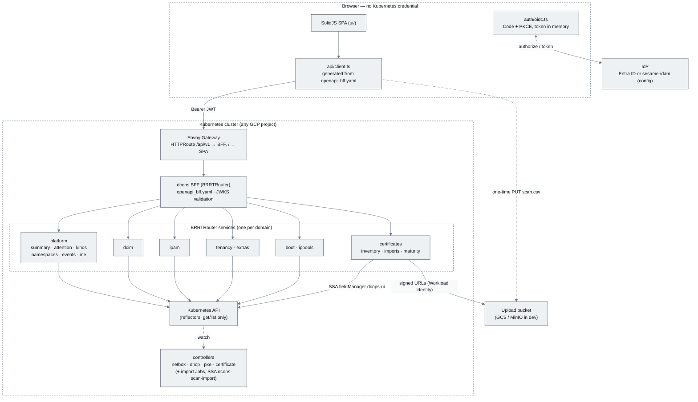
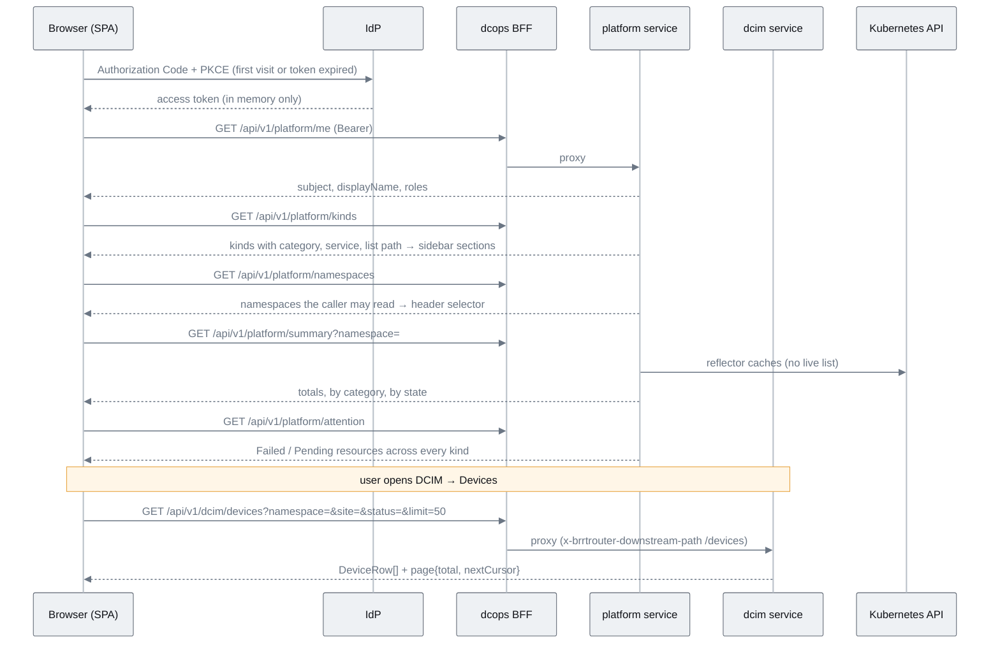
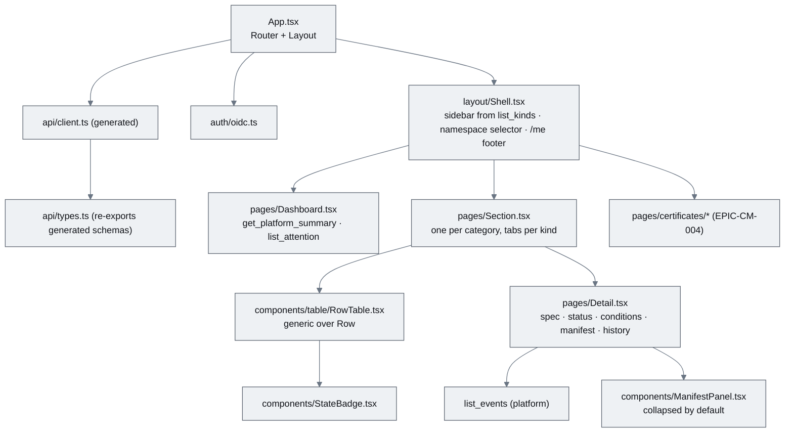
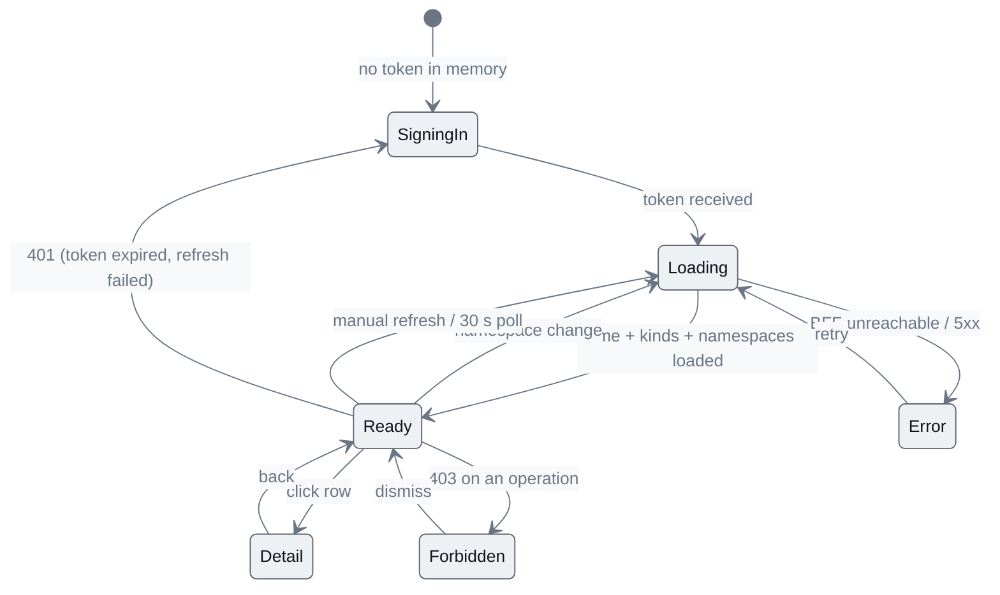

# DCops Dashboard — Platform View UI

> **Type:** Architecture Design Document  
> **Status:** Draft v2 — browser talks only to the BFF (supersedes v1's direct-Kubernetes design)  
> **Priority:** P1  
> **Effort:** 10–14 days (UI shell) + the `platform` service and BFF scaffold from `CM-002.2`  
> **Parent:** DCops platform operational visibility gap  
> **Contracts:** `openapi/dcops/` (`openapi_bff.yaml` and one spec per service) — see `openapi/dcops/README.md` for the screen → operation traceability table  
> **Mockups:** `docs/03_ui_design/` (22 signed-off artboards)

---

## 0. What changed in v2

v1 of this document had the SPA call the Kubernetes API directly: `kubectl proxy` in Tilt, a mounted
ServiceAccount token in production, browser-side CRD discovery through `GET /apis`, and a
`dcops-ui-reader` ClusterRole. That design is withdrawn. Once the certificate-management work
(EPIC-CM-002/003/004) added an authenticated write path, keeping a second, credentialed read path
in the browser meant two auth models, two RBAC surfaces and Kubernetes JSON shaped by CRD internals
leaking into screens built for non-technical Operations managers.

The rule now (README delta 16 in `docs/02_certificate_management/README.md`): **the browser talks
only to the BFF.** No Kubernetes credential of any kind reaches the browser, no CRD discovery
happens there, and every screen is fed by an operation in a consumer-driven OpenAPI contract
derived from the mockups. Section headings below are kept so diffs against v1 read cleanly.

## 1. Problem Statement

Operators and developers have **no visual overview** of the DCops platform. To see what CRs are deployed they must run scattered `kubectl get` commands across the 25 NetBox/boot CRD types in `config/crd/` (plus the three certificate CRDs EPIC-CM-001 adds). There is no single pane of glass to answer:

- How many resources are deployed, and by type?
- Which resources are in Failed state?
- What is the reconciliation health of each namespace?
- Which certificates need an owner, are expiring, or have drifted? (EPIC-CM-004)

This makes troubleshooting slow and onboarding difficult, and it keeps the estate in the hands of people who can run `kubectl`.

## 2. Goals

- [ ] **Phase 1 (Read-only platform view):** display every `dcops.microscaler.io` resource with state, namespace and error visibility, served through the BFF
- [ ] **Certificates (EPIC-CM-004):** inventory, ownership, scan import and maturity screens on the same shell, with writes through the BFF
- [ ] **Phase 2 (Future):** edit NetBox/boot resources through the UI → GitOps apply flow (still through the BFF; the services would open pull requests, not patch the cluster)
- [ ] **Integration:** extend the single `ui/` SPA (SolidJS/Vite/nginx) — do not replace it
- [ ] **Zero hand-written API types:** the client is generated from `openapi_bff.yaml`; CRD schemas flow into the service specs by generator, never by copying

## 3. Non-Goals (for Phase 1)

- No write operations on NetBox, boot or IP-pool resources (declared in Git, reconciled by controllers — ADR-001); only the `certificates` service exposes writes
- **No direct Kubernetes access from the browser** — no `kubectl proxy`, no ServiceAccount token, no `/apis/` or `/api/v1/namespaces` calls, no SPA RBAC
- No anonymous access: every BFF operation except `/healthz` requires an OIDC bearer token
- No real-time streaming for the platform views — polling (30 s) is enough; the only SSE stream is certificate-import progress

## 4. Architecture

### 4.1 High-level data flow



Three layers, each with one job:

| Layer | Owns | Never does |
|---|---|---|
| **SPA** | rendering, filters in memory, OIDC flow, the generated client | build Kubernetes URLs, hold a cluster credential, decode CRD JSON |
| **BFF** | one origin for the browser, JWT validation, proxying by `x-service`, CORS | business logic (all operations are `x-brrtrouter-impl: false` today) |
| **Services** | read CRDs through kube-rs reflectors and shape them into rows/details; `certificates` also writes with SSA and mints signed URLs | expose raw Kubernetes objects; hold bucket key files |

### 4.2 Request flow (dashboard load)



### 4.3 Tilt dev flow

There is no `kubectl proxy` any more. Tilt runs the BFF and the services as ordinary resources next
to the controllers, MinIO stands in for the bucket, and the IdP is whichever issuer `OIDC_ISSUER`
points at (sesame-idam from `shared-k8s` by default; an Entra tenant works unchanged). `build-ui`
serves the SPA on port 8800 with `VITE_DCOPS_API_BASE` pointing at the gateway. A developer without
an IdP can run the BRRTRouter TestApp fixtures (`--features testing`) and the SPA against `msw`
handlers generated from the same spec examples.

### 4.4 Production flow

Same topology as 4.1 in any GCP project the client's IaC provisions: GKE, Workload Identity for the
`certificates` service's signing identity, the bucket name and prefix as environment variables, and
the IdP issuer/audience/JWKS URL as configuration (README delta 15). The SPA is static files behind
the gateway; its Deployment mounts no ServiceAccount token (`automountServiceAccountToken: false`)
and has no RBAC bindings. The services run with a namespaced Role limited to `get`/`list`/`watch`
on the kinds they serve; only `certificates` has `patch` on `certificatescanimports` and `certificateinventories`.

### 4.5 Component architecture



## 5. API Design

The API is the `dcops` OpenAPI suite in `openapi/dcops/`. It is consumer-driven: every operation
exists because a signed-off mockup needs it, and the traceability table in `openapi/dcops/README.md`
maps all 22 artboards to their operations.

### 5.1 Services and operations

| Service | Base path | Operations | Backed by |
|---|---|---|---|
| platform | `/api/v1/platform` | `summary`, `attention`, `kinds`, `namespaces`, `events`, `me`, `healthz` | reflectors over every kind; core Events and Namespaces |
| dcim | `/api/v1/dcim` | 11 kinds × list/get, `summary`, `devices/{ns}/{name}/interfaces` | NetBox DCIM CRDs |
| ipam | `/api/v1/ipam` | 9 kinds × list/get, `summary` | NetBox IPAM CRDs |
| tenancy | `/api/v1/tenancy` | 2 kinds × list/get, `summary` | NetBox tenancy CRDs |
| extras | `/api/v1/extras` | tags list/get, `summary` | NetBoxTag |
| boot | `/api/v1/boot` | 2 kinds × list/get, `summary` (+ lifecycle counts) | BootProfile, BootIntent |
| ippools | `/api/v1/ippools` | 2 kinds × list/get, `summary` | IPPool, IPClaim (**CRDs not yet in repo — placeholder schemas**) |
| certificates | `/api/v1/certificates` | inventory, ownership, maturity, imports (18 ops) | EPIC-CM-002/003 |

Each CRD-backed kind exposes two read operations, generated from the CRD's `openAPIV3Schema`:

| Operation | Path | Returns |
|---|---|---|
| list | `GET /<segment>?namespace=&state=&search=&limit=&cursor=&sort=` (+ per-kind filters) | `<Kind>List { items: <Kind>Row[], page }` — scalar spec columns, state, error, lastReconciled, netboxId/Url |
| get | `GET /<segment>/{namespace}/{name}` | `<Kind>Detail` — full spec, status, conditions, `manifestYaml`, `gitUrl` |

### 5.2 TypeScript types

Generated, not written. `just ui-gen-client` runs `openapi-typescript` over `openapi_bff.yaml`
into `ui/src/api/client.ts`; `ui/src/api/types.ts` re-exports the schemas screens use under short
names. Representative shapes (from the spec, shown for orientation only):

```typescript
// components['schemas']['DcimDeviceRow']
interface DeviceRow {
  metadata: ResourceMeta;            // name, namespace, uid, creationTimestamp, labels?
  state: 'Pending' | 'Created' | 'Updated' | 'Failed';
  error: string | null;
  lastReconciled: string | null;
  netboxId: number | null;
  netboxUrl: string | null;
  spec: { name: string; site: string | null; deviceType: string | null; deviceRole: string | null; status?: string; serial?: string; /* scalar spec fields */ };
}

// components['schemas']['PlatformKindDescriptor'] — replaces browser-side CRD discovery
interface KindDescriptor { kind: string; plural: string; category: string; service: string; segment: string; listPath: string; description: string; }

// components['schemas']['ErrorEnvelope'] — every non-2xx
interface ErrorEnvelope { code: string; message: string; fields?: { name: string; reason: string }[]; requestId: string; }
```

### 5.3 API client interface

```typescript
// ui/src/api/http.ts — the only hand-written network code besides the upload helper
export function bff<T>(op: OperationId, params: Params, init?: RequestInit): Promise<T>;
//   - prefixes VITE_DCOPS_API_BASE (default /api/v1)
//   - attaches Authorization: Bearer <token from auth/oidc.ts>
//   - maps ErrorEnvelope → ApiError { kind: 'unauthorised'|'forbidden'|'notFound'|'conflict'|'validation'|'gone'|'unavailable', message, requestId }
//   - retries idempotent GET once on network/5xx; never retries writes
export function uploadToSignedUrl(upload: UploadInstruction, file: File, onProgress: (pct: number) => void): Promise<void>;
//   - PUT to the bucket with the headers the API returned; no Authorization header
```

## 6. UI Layout

Unchanged from the signed-off mockups (`docs/03_ui_design/`): header with namespace selector and
`/me` footer, sidebar sections built from `list_kinds`, main content with summary tiles, a filter
row, a virtualised row table and a detail page with tabs. See `Main.dc.html`, `DcimOverview.dc.html`,
`DcimDeviceDetail.dc.html` for the platform views.

### 6.1 Page states



## 7. CRD Categories

Categories come from `GET /api/v1/platform/kinds` at runtime; the SPA has no hard-coded list. The
table below is what the generator currently emits from `config/crd/all-crds.yaml`:

| Category | Service | Kinds | Count |
|---|---|---|---|
| **IPAM** | ipam | prefixes, ip-addresses, ip-ranges, aggregates, vlans, rirs, vrfs, route-targets, roles | 9 |
| **DCIM** | dcim | sites, locations, regions, site-groups, devices, device-types, device-roles, manufacturers, platforms, interfaces, mac-addresses | 11 |
| **Tenancy** | tenancy | tenants, tenant-groups | 2 |
| **Extras** | extras | tags | 1 |
| **Boot** | boot | boot-profiles, boot-intents | 2 |
| **IP Pool** | ippools | pools, claims — *placeholder until the CRDs exist* | 2 |
| **Certificates** | certificates | inventory, imports (surfaces CertificateInventory and CertificateScanImport; CertificateBinding has no screen yet) | 2 |

## 8. File Structure

```
openapi/dcops/                       # contracts (generated by scripts/build_specs.py)
├── bff-suite-config.yaml
├── openapi_bff.yaml
├── platform/ dcim/ ipam/ tenancy/ extras/ boot/ ippools/ certificates/  (openapi.yaml each)
└── README.md                        # screen → operation traceability

services/                            # BRRTRouter services (CM-002.2 scaffold)
├── dcops-bff/{gen,impl}
├── platform/{gen,impl}
├── dcim/ ipam/ tenancy/ extras/ boot/ ippools/   ({gen,impl} each; thin — reflectors + row mapping)
└── certificates-api/{gen,impl}      # EPIC-CM-002

ui/src/
├── api/
│   ├── client.ts            # GENERATED from openapi_bff.yaml (just ui-gen-client)
│   ├── http.ts              # bearer, ErrorEnvelope → ApiError, retry policy
│   ├── upload.ts            # uploadToSignedUrl
│   └── types.ts             # re-exports of generated schemas
├── auth/oidc.ts             # Authorization Code + PKCE, token in memory
├── layout/Shell.tsx         # sidebar from list_kinds, namespace selector, /me footer
├── pages/                   # Dashboard, Section, Detail, certificates/*
├── components/              # RowTable, StateBadge, ManifestPanel, filters, …
├── stores/                  # namespace, kinds, me, certificates
└── i18n/en.ts
```

Removed relative to v1: `api/k8s-client.ts`, `api/crd-discovery.ts`, `config/dcops-ui/role.yaml`.

## 9. Tilt Integration

```python
# BFF and services are ordinary k8s resources built from the workspace
k8s_resource('dcops-bff',            port_forwards='8080:8080', labels=['api'], resource_deps=['platform-svc', 'certificates-api'])
k8s_resource('platform-svc',         labels=['api'])
k8s_resource('certificates-api',     labels=['api'], resource_deps=['minio', 'certificate-controller'])
# … one resource per domain service

# SPA: unchanged local_resource, now pointed at the gateway
local_resource('build-ui', cmd='cd ui && npm run build', deps=['ui/src'], labels=['ui'])
k8s_resource('dcops-ui', port_forwards='8800:80', labels=['ui'], resource_deps=['dcops-bff'])

# Contract drift guard
local_resource('openapi-check',
    cmd='python3 openapi/dcops/scripts/build_specs.py --crds config/crd/all-crds.yaml --out /tmp/openapi-check && diff -r /tmp/openapi-check openapi/dcops --exclude README.md --exclude scripts',
    deps=['config/crd', 'openapi/dcops/scripts'], labels=['api'])
```

The `kubectl-proxy` resource from v1 is deleted.

## 10. Production Deployment

- SPA: static files served by nginx behind the gateway; `automountServiceAccountToken: false`; no RBAC.
- BFF: validates every JWT against the configured JWKS (`OIDC_ISSUER`, `OIDC_AUDIENCE`, `OIDC_JWKS_URL`), forwards to services by `x-service`; CORS is `inherit` from the gateway (same origin in production).
- Services: namespaced `Role` per service with `get`/`list`/`watch` on the kinds it serves; `certificates-api` additionally `patch` on `certificatescanimports` and — through SSA with field manager `dcops-ui`, limited to ownership/acknowledgement/bucket — on `certificateinventories`, plus a Workload Identity binding for `signBlob`; the reconciler, not the API, creates the preview/apply Jobs (`CM-002.4`). No ServiceAccount key files anywhere (`scripts/check_no_sa_keys.py`).
- Project-agnostic: bucket, prefix, signer email, issuer and audience are environment variables supplied by the client's IaC; nothing in the repo names a GCP project.

## 11. Open Questions

| # | Question | Default resolution |
|---|---|---|
| **Q1** | Separate "Admin" section or integrated navigation? | Resolved by the mockups — one shell, categories in the sidebar from `list_kinds`. |
| **Q2** | Thousands of CR instances? | Server-side cursor paging (`limit` ≤ 200) from reflector caches; the SPA filters the current page in memory. Certificates (5,368 rows) is the sizing case and is virtualised. |
| **Q3** | ~~Proxy vs in-cluster client modes?~~ | Withdrawn — one client, one origin, `VITE_DCOPS_API_BASE` for local Vite only. |
| **Q4** | Polling interval? | 30 s default for platform views, manual refresh always available; certificate imports use SSE. |
| **Q5** | Multiple API versions? | Handled in the services: a new CRD version changes the generator input, the BFF contract stays `/api/v1` until a breaking row/detail change. |
| **Q6** | IPPool / IPClaim CRDs are not in `config/crd/` | Generator carries placeholders so the IpPools screen has a contract; replace when the CRDs land (tracked in `openapi/dcops/README.md`). |
| **Q7** | Do we deploy sesame-idam alongside, or use the client's Entra tenant only? | Both work unchanged (issuer/audience/claim→role mapping are config); decision with the client. |
