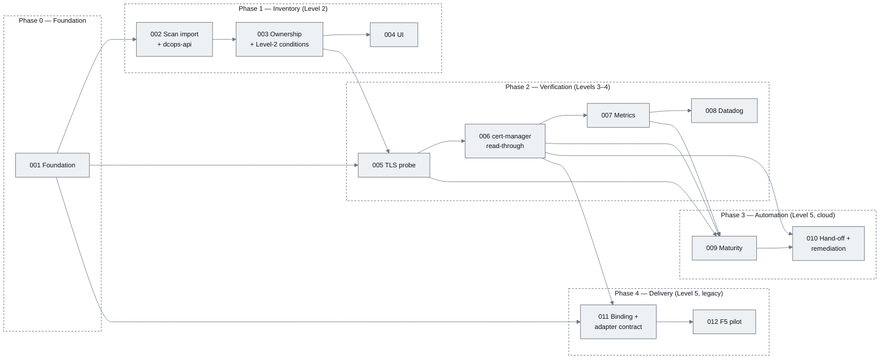

# Certificate Management — Delivery Epics

> **Parent:** [Certificate Management Design](../CERTIFICATE_MANAGEMENT_DESIGN.md)
> **Status:** Draft backlog — 12 epics, 55 stories
> **Authoring rules:** [STORY_TEMPLATE.md](STORY_TEMPLATE.md)

This directory breaks the design into deliverable epics. Every story carries the same eight sections (description, diagrams, functional requirements, non-functional requirements, acceptance criteria, unit test criteria, integration test criteria, QA process) and every functional requirement is traced to an acceptance criterion and a test. IDs are stable: `CM-0NN.S` for stories, `FR/NFR/AC/UT/IT-0NN.S-kk` for requirements and tests.

## Epics by phase

| Phase | Epic | Title | Stories | CMMI level | Depends on |
|-------|------|-------|---------|------------|------------|
| 0 — Foundation | [EPIC-CM-001](stories/EPIC-CM-001-foundation.md) | Scope, CRDs and controller skeleton | 5 | — | — |
| 1 — Inventory | [EPIC-CM-002](stories/EPIC-CM-002-scan-import-api.md) | Scan import & `dcops-api` (BRRTRouter service, GCS bucket uploads, Job-based processing) | 7 | 2 | 001 |
| 1 — Inventory | [EPIC-CM-003](stories/EPIC-CM-003-ownership-conditions.md) | Ownership, classification & Level-2 conditions | 5 | 2 | 001, 002 |
| 1 — Inventory | [EPIC-CM-004](stories/EPIC-CM-004-ui-certificates.md) | UI — Certificates section | 5 | 2 | 002, 003 |
| 2 — Verification | [EPIC-CM-005](stories/EPIC-CM-005-tls-probe-conditions.md) | Live TLS probe & conditions | 4 | 3 | 001, 003 |
| 2 — Verification | [EPIC-CM-006](stories/EPIC-CM-006-cert-manager-readthrough-drift.md) | cert-manager read-through & drift | 4 | 3–4 | 005 |
| 2 — Verification | [EPIC-CM-007](stories/EPIC-CM-007-metrics-exposition.md) | Metrics exposition | 3 | 4 | 005, 006 |
| 2 — Verification | [EPIC-CM-008](stories/EPIC-CM-008-datadog-integration.md) | Datadog integration (`dcops`) | 5 | 4 | 007 |
| 3 — Automation | [EPIC-CM-009](stories/EPIC-CM-009-maturity-computation.md) | Maturity level computation & rollup | 3 | 4 | 005, 006, 007 |
| 3 — Automation | [EPIC-CM-010](stories/EPIC-CM-010-cert-manager-handoff-remediation.md) | cert-manager hand-off & opt-in remediation | 4 | 5 (cloud) | 006, 009 |
| 4 — Delivery | [EPIC-CM-011](stories/EPIC-CM-011-binding-adapter-contract.md) | `CertificateBinding` & adapter contract | 5 | 5 (legacy) | 001, 006 |
| 4 — Delivery | [EPIC-CM-012](stories/EPIC-CM-012-f5-adapter-pilot.md) | F5 BIG-IP adapter pilot | 5 | 5 (legacy) | 011 |

The certificates API (EPIC-CM-002) is spec-first: `openapi/dcops/certificates/openapi.yaml` is the source of truth and `brrtrouter-gen` produces the `services/certificates-api/gen` crate, following the PriceWhisperer/Hauliage/Sesame convention. Uploaded scans and import artifacts are persisted to a GCS bucket through one-time signed URLs; production is GKE with Workload Identity and IAM `signBlob` (no service-account key files anywhere), development uses MinIO — DCops keeps no database. Heavy import work runs in Kubernetes Jobs created by the `CertificateScanImport` reconciler, not in request handlers.

The Datadog integration (EPIC-CM-008) lives in this repository under `integrations/datadog/dcops/`, laid out exactly as an `integrations-core` check so it can be copied into a fork of `integrations-core` or `integrations-extras` for release.

## Dependency graph

Critical path to a Level-2 estate (the first milestone on the proposal deck's closing slide): 001 → 002 → 003 → 004. Critical path to the Datadog dashboard being live: 001 → 003 → 005 → 006 → 007 → 008. EPIC-CM-011 can start as soon as 001 and 006 land, in parallel with 007–010.

## Suggested sequencing

| Sprint | Epics in flight | Milestone |
|--------|-----------------|-----------|
| 1–2 | 001 | Controller running on `shared-k8s`; CRDs applied; ADR-002 proposed |
| 3–5 | 002, 003 | Scan uploaded to the bucket through the BRRTRouter API and processed by Jobs; owners assignable; `OwnerAssigned` reported |
| 6–7 | 004, 005 | Operations managers import and assign owners in the UI; live probing on |
| 8–9 | 006, 007 | Drift detection; `/metrics` complete |
| 10–11 | 008, 009 | Datadog dashboard and monitors live; maturity level reported |
| 12–13 | 010, 011 | Fast-track hand-off to cert-manager; binding state machine with mock adapter |
| 14–16 | 012 | F5 pilot with verified rollback (production gate) |

## Design deltas recorded while writing the stories

Breaking the design into stories surfaced decisions the design document leaves open or does not cover. They are recorded here so the design can be amended in one pass rather than discovered during implementation. Each is also listed under the owning epic's *Open questions*.

| # | Delta | Owning story | Default taken |
|---|-------|--------------|---------------|
| 1 | The reconciler needs three sanctioned spec writes: `issuance.certManagerRef` after auto-link acceptance, `issuance.mode`/`certManagerRef` after Certificate generation, and nothing else. Design §5.3 says "never mutates spec". | CM-006.4, CM-010.1 | Allowed via SSA with the controller's own field manager and `force=false`; to be recorded as an ADR-002 addendum |
| 2 | Additive status fields beyond §5.2: `status.scan.{firstSeen, expiry, observedCount, businessUnits, issuers, automated, severity}`, `status.expiry{…}` (pre-probe reminders), `status.escalation{episodeStartedAt, emitted[]}`, `status.certManager.{notAfter, reason, message, secretFingerprintChangedAt}`, `status.history.{probedSince, lastSloBreach, lastDrift, lastRemediation, remediationAttempts}` | CM-002.3, CM-003.4, CM-005.3, CM-006.1, CM-009.1, CM-010.2 | Add to §5.2 |
| 3 | `CertificateBinding` phase enum widened to `Pending, Validating, Staging, Activating, Verifying, RollingBack, Verified, RolledBack, Failed, Unsupported`; `targetRef` sub-fields fixed; binding-specific conditions `Supported`, `Validated`, `Ready`, `Linked` | CM-011.1, CM-011.3 | Add to §5 / §9 |
| 4 | Two new metrics: `dcops_certificate_remediations_total` and `dcops_binding_last_failure_info{step,safe_state}` (plus `dcops_binding_phase`, `dcops_binding_transitions_total` already implied) | CM-010.2, CM-012.5 | Add to §8.1 and `metadata.csv` |
| 5 | Datadog: the `host` label is renamed `certificate_host` (reserved tag); `scan_import_last_timestamp_seconds` is exposed through a `time_elapsed` transformer as `dcops.scan_import.age`; "succeeded only when Verified" is implemented as a two-query monitor formula | CM-008.1, CM-008.2, CM-008.4 | Amend §8.2–8.3 |
| 6 | ~~The SPA needs read access to core `events` for the record detail page (`config/dcops-ui/role.yaml`)~~ Superseded by delta 16: Events come from `GET /api/v1/platform/events`; the SPA has no RBAC | CM-004.4 | — |
| 7 | Estate maturity weighting made concrete: contribution = `min(5, level + offset)` with Critical/High 0, Medium 1, Routine 2; stale records excluded from the minimum | CM-009.2 | Amend §7 |
| 8 | Bulk ownership endpoint fixed as `POST /api/v1/certificates/bulk/ownership` (≤ 2,000 targets, dry-run); filtered list served from the controller's reflector store rather than K8s selectors | CM-003.3, CM-003.5 | Add to §6.1 |
| 9 | Custom probe trust bundle is controller-wide (`PROBE_TRUST_BUNDLE_SECRET`), not per record; Secret RBAC uses generated per-namespace Roles with `resourceNames` | CM-005.1, CM-006.2 | Amend §5.3 / §10 |
| 10 | `ScanFormat`, the parser, diff and apply live in a dependency-light `crates/certificate-scan` crate (apply behind a `kube` feature) shared by the import worker, the API's intake sniff and the CLI | CM-002.1, CM-002.5 | Amend §10 |
| 11 | `dcops-api` is **not** an axum router inside the controller (design §6.1). It is a separate BRRTRouter service (`dcops-certificates-api`, `may` runtime) generated from `openapi/dcops/certificates/openapi.yaml`, with JWKS bearer auth declared in the spec. Consequence for EPIC-CM-004: the SPA obtains an OIDC access token (Authorization Code + PKCE) and sends `Authorization: Bearer` to the API; there is no gateway cookie/`X-Forwarded-User` identity. | CM-002.2, CM-004.1 | Amend §6.1, §6.2, §10; ADR-002 addendum |
| 12 | Import processing is out of band: the API validates metadata, mints a signed upload URL and creates the `CertificateScanImport`; after the client confirms the upload, the reconciler runs a **preview Job** and, after `POST …/confirm` with the preview's hash, an **apply Job**, both the controller image's `import-worker` subcommand. Phases: `AwaitingUpload → Pending → Previewing → AwaitingConfirmation → Applying → Completed`, plus `Failed`/`Cancelled`/`Expired`. The API ServiceAccount cannot touch `CertificateInventory`; only the apply Job's SA can. | CM-002.3, CM-002.4 | Amend §6.2, §6.3; add Jobs to §10 |
| 13 | `CertificateScanImport` spec/status widened: `spec.source{kind, bucket, object, contentSha256, sizeBytes, filename, contentType, formatHint, uploadExpiresAt}`, `spec.requestedBy`, `spec.mode (previewThenApply | applyDirect)`, `spec.confirmation{confirmedBy, confirmedAt, previewSha256}`, `spec.cancelled`; `status.phase`, `status.artifacts{scan, preview, result}{uri, sizeBytes, sha256, etag, generation}`, `status.preview{summary, sha256, expiresAt, sample}`, `status.result{summary, completedAt, errors[]}`, `status.lastError` | CM-001.2 (amend), CM-002.3, CM-002.4 | Amend §5 |
| 14 | No database in DCops. Scan originals and import artifacts are stored in a GCS bucket (`imports/<ns>/<id>/{scan.csv, preview.jsonl.gz, result.jsonl.gz}`) behind an `UploadStore` trait. Production is GKE only: the API and worker use Workload Identity, the API signs V4 URLs through IAM `signBlob` as its own GSA, and **no service-account JSON key exists anywhere — not in Secrets, CI or tooling** (a repository lint enforces this). Signed `PUT` URLs are one-time (`x-goog-if-generation-match: 0`, ≤ 15 min); `GET` ≤ 5 min. Objects are immutable (`ifGenerationMatch=0`, versioning) and only a lifecycle rule deletes them (scan 400 d, artifacts 30 d). Dev/CI use MinIO through `S3Store` (SigV4 presign, `If-None-Match: *`), rejected at startup in production. Consequence for EPIC-CM-004: the wizard `PUT`s the file to the signed URL itself and computes sha256 + an 8 KiB sample client-side. | CM-002.7, CM-002.3, CM-004.3 | New §6.5 "Upload storage"; add bucket, Workload Identity and IAM to §10 |
| 15 | DCops must run in **any** GCP project: projects, buckets, GSAs and Workload Identity bindings come from the client's IaC; DCops consumes configuration only, and ships a reference Terraform module plus a requirements doc for what that IaC must produce. IdP is configuration (`iss`/`aud`/`jwks_url` + a claim→role mapping); Microsoft Entra ID expected, Sesame-IDAM optional. | CM-002.7, CM-002.2, CM-004.1 | Add "Deployment configuration" section to §10; `docs/deploy/upload-store-requirements.md` |
| 16 | **The browser talks only to the BFF.** The SPA holds no Kubernetes credential, does no CRD discovery and never calls `/apis/` or `/api/v1/namespaces`; `ui/src/api/k8s-client.ts`, `crd-discovery.ts` and `config/dcops-ui/role.yaml` are deleted. All reads and writes go through the `dcops` BFF (`openapi/dcops/openapi_bff.yaml`, `/api/v1/<service>/…`) which proxies to one BRRTRouter service per domain (`platform`, `dcim`, `ipam`, `tenancy`, `extras`, `boot`, `ippools`, `certificates`). The suite is consumer-driven — every operation traces to a signed-off mockup (`openapi/dcops/README.md`) — and generated from `config/crd/all-crds.yaml` by `openapi/dcops/scripts/build_specs.py`; the UI client is generated from the BFF spec. IPPool/IPClaim CRDs do not exist yet and are carried as placeholders. | CM-002.2, CM-004.1, CM-004.3, CM-004.4 | Rewrite §6.1 (architecture), §10 (no SPA RBAC); `docs/01_dashboard_design.md` v2 done |

## Working the backlog

1. Create one tracker issue per epic and one per story, titled with the ID (`CM-002.3 — Apply path with SSA idempotency`); paste the story section as the issue body.
2. A story is *ready* when its Open-questions defaults are either accepted or resolved in the design document.
3. A story is *done* when every AC is demonstrated in the PR using the QA process steps, the named unit and integration tests exist and pass under `just verify`, and the PR carries the artefacts the QA process lists.
4. When implementation diverges from a story, update the story in the same PR — this directory is the specification of record until the code is merged, after which the code and its tests are.
