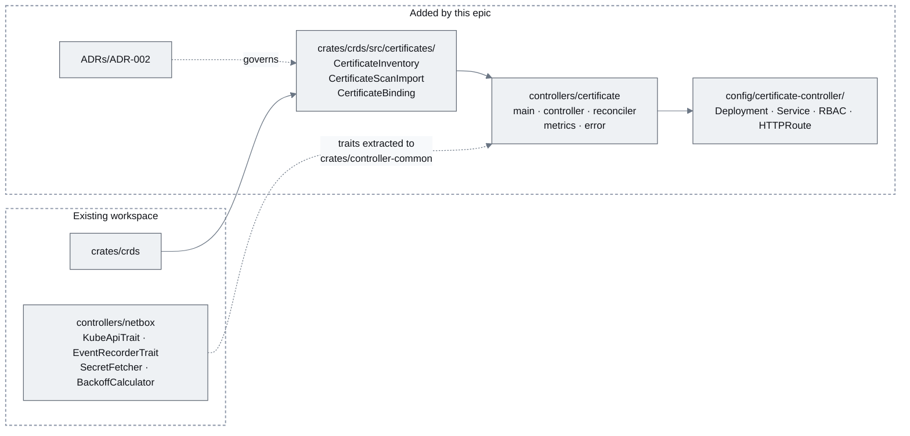
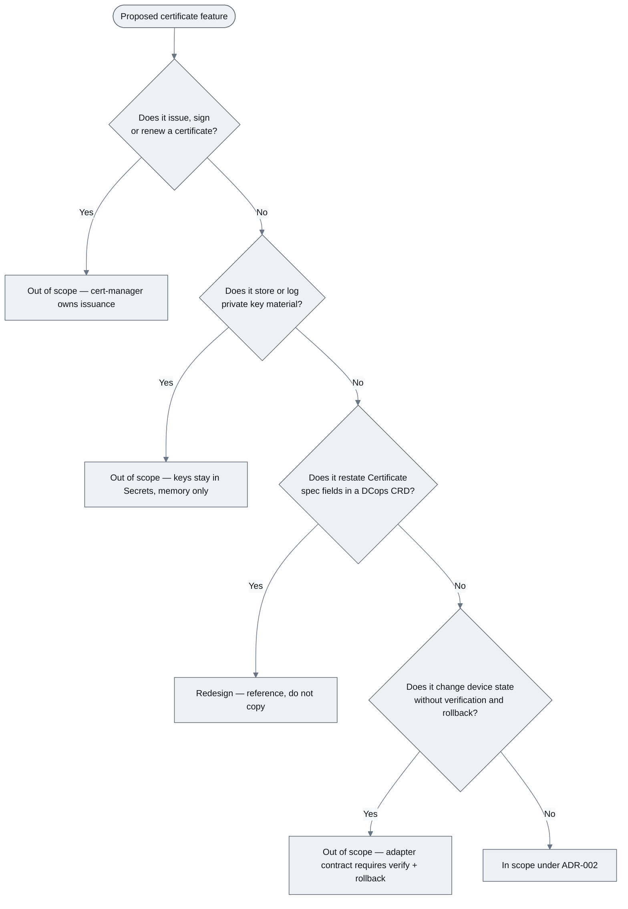
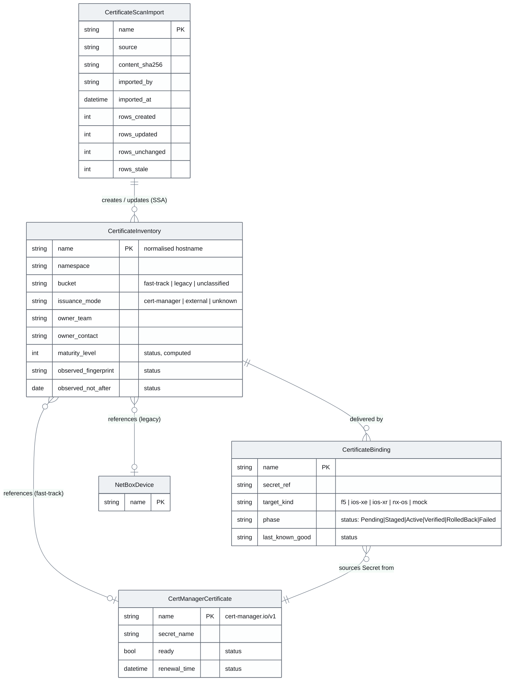
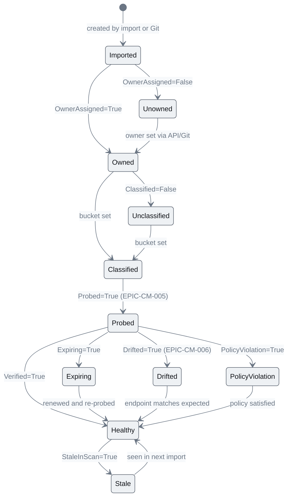
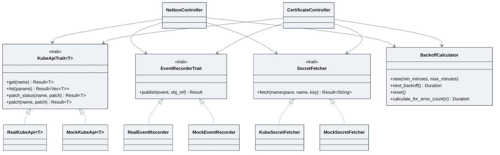
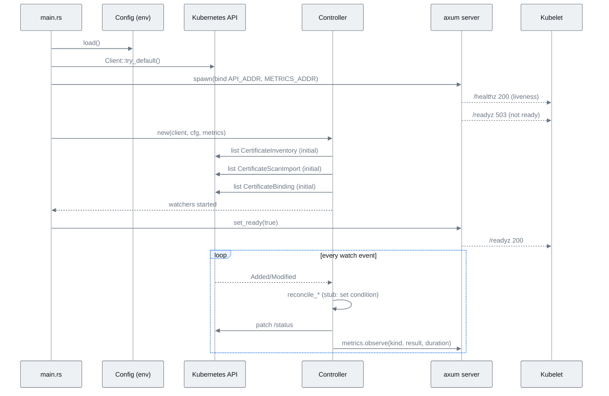
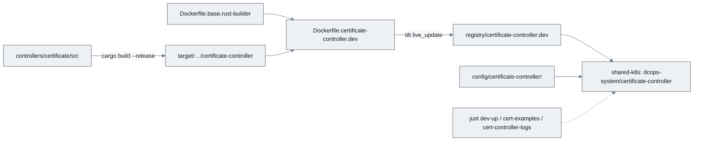

# EPIC-CM-001: Foundation — scope, CRDs and controller skeleton

> **Parent:** [Certificate Management Design](../../CERTIFICATE_MANAGEMENT_DESIGN.md) §5, §9, §10
> **Phase:** 0 — Foundation
> **CMMI level advanced:** — (enables Levels 2–5)
> **Status:** Draft — awaiting implementation
> **Priority:** P0
> **Estimated effort:** 6–8 days
> **Depends on:** None

---

## Overview

Every later epic assumes three things exist: an ADR that puts certificate management inside DCops's locked scope, typed CRDs for the certificate domain, and a `controllers/certificate` workspace member that already follows the netbox controller's testable patterns (trait-abstracted Kubernetes API, event recorder, secret fetcher, bounded backoff) and already exposes `/metrics` and probes. This epic delivers exactly that and nothing behavioural: the reconciler in this epic records that it saw a resource and sets `Probed=False` with reason `NotImplemented`. Real behaviour arrives in EPIC-CM-002 onwards.

The epic also establishes the delivery plumbing — Dockerfiles, kustomize under `config/certificate-controller/`, Tilt wiring and `just` recipes — so that from the first merge the controller runs on the shared dev cluster and QA can exercise every subsequent story without further infrastructure work.

Out of scope: probing, scan parsing, the `dcops-api` HTTP surface (EPIC-CM-002), UI (EPIC-CM-004), any adapter code (EPIC-CM-011/012).

## Epic-level diagram

Where the new crate and controller sit relative to what already exists (flowchart, because the point is dependency direction).

## Stories

| ID | Story | Persona | Effort |
|----|-------|---------|--------|
| **CM-001.1** | As the DCops maintainer, I want ADR-002 to amend the locked scope so that certificate work is legitimate under the project's own governance | Maintainer | 0.5 d |
| **CM-001.2** | As a controller developer, I want the certificate CRDs defined in `crates/crds` so that every controller and the UI share one typed model | Developer | 2 d |
| **CM-001.3** | As a controller developer, I want the netbox controller's reusable traits extracted into a shared crate so that the certificate controller is testable from day one without copy-paste | Developer | 1.5 d |
| **CM-001.4** | As a platform operator, I want a `certificate-controller` binary with health probes, `/metrics` and structured logging deployed by kustomize so that it runs on the shared cluster like every other DCops controller | Operator | 2 d |
| **CM-001.5** | As a developer, I want Tilt, Dockerfiles and `just` recipes for the new controller so that `just dev-up` builds and hot-reloads it | Developer | 1 d |

## Definition of Done (epic)

- [ ] Every story's ACs pass
- [ ] `just verify` (fmt, clippy with workspace lints, nextest) is green
- [ ] `config/crd/all-crds.yaml` regenerated and applied cleanly to the shared cluster
- [ ] `README.md` capability list gains a "Certificate management (foundation)" line and the roadmap callout is updated
- [ ] `docs/implementationChecklists/CertificateInventory.md` created from `TEMPLATE.md`
- [ ] Controller pod is `Running` on `shared-k8s` with `/healthz`, `/readyz` and `/metrics` answering

## Open questions

| ID | Question | Default if unresolved |
|----|----------|----------------------|
| **Q1** | Extract shared traits into `crates/controller-common` now, or let the certificate controller depend on `controllers/netbox` as a library? | Extract. A binary crate is a poor dependency and the dhcp controller will want the same traits. |
| **Q2** | Single `certificates` namespace or per-business-unit namespaces (design §12.4)? | Namespaced CRDs, no opinion baked into the controller; `WATCH_NAMESPACE` optional as in netbox. |

---

## CM-001.1 — ADR-002: certificate management scope

**As the** DCops maintainer, **I want** an accepted ADR that amends ADR-001's locked scope **so that** certificate inventory, verification and delivery are legitimate work under the project's governance and the cert-manager boundary is a recorded decision.

### Description

`ADRs/ADR-001-Scope_and_Non-Goals.md` locks DCops to PXE intent and IP allocation and lists everything else as out of scope until proven necessary. This story adds `ADRs/ADR-002-Certificate_Management_Scope.md` in the same format (Status, Date, Context, Decision, In Scope, Non-Goals, Consequences). The Decision section restates design §3 as binding rules: DCops never issues certificates or holds keys outside in-memory verification; cert-manager remains the issuer; a `CertificateInventory` references a `Certificate` and never restates it; auto-remediation is opt-in per record. The In Scope section lists the three CRDs and the phased delivery from design §11. The Non-Goals section names what stays out: acting as a CA, replacing NetBox for device inventory, SSH-based device fallback.

The ADR also records the decision on design §12.1 (ownership as cluster-resident operational data for Phase 1, Git export as a Phase 3 option) so that EPIC-CM-002 can build on it.

### Diagrams

Decision flow for how a future feature request is judged against ADR-001 and ADR-002 (flowchart, because this is what reviewers will actually apply).

### Functional requirements

| ID | Requirement |
|----|-------------|
| **FR-001.1-01** | MUST add `ADRs/ADR-002-Certificate_Management_Scope.md` following the section structure of ADR-001 |
| **FR-001.1-02** | MUST state the cert-manager boundary rules from design §3 as numbered, testable decisions |
| **FR-001.1-03** | MUST list `CertificateInventory`, `CertificateScanImport` and `CertificateBinding` as in-scope resources with one-line purposes |
| **FR-001.1-04** | MUST record the Phase 1 decision on ownership data residency (design §12.1) |
| **FR-001.1-05** | MUST update ADR-001's "Explicit Non-Goals" with a pointer to ADR-002 where certificate work was previously excluded |
| **FR-001.1-06** | SHOULD link the ADR from `README.md` "Documentation" and from the design document header |

### Non-functional requirements

| ID | Category | Requirement |
|----|----------|-------------|
| **NFR-001.1-01** | Governance | ADR status is `Proposed` on merge and moves to `Accepted` only by a second PR with maintainer approval |
| **NFR-001.1-02** | Compatibility | No change to code or CRDs in this story — documentation only |

### Acceptance criteria

| ID | Given / When / Then |
|----|---------------------|
| **AC-001.1-01** | **Given** the ADR is merged **When** a reader opens `ADRs/` **Then** ADR-002 exists with Status, Date, Context, Decision, In Scope, Non-Goals and Consequences sections |
| **AC-001.1-02** | **Given** ADR-002 **When** a reviewer checks the Decision section **Then** each of the four boundary rules in the diagram above appears as a numbered decision |
| **AC-001.1-03** | **Given** ADR-001 **When** a reader reaches its non-goals **Then** the certificate exclusion is annotated "superseded by ADR-002" |
| **AC-001.1-04** | **Given** the README **When** a reader opens "Documentation" **Then** ADR-002 is linked |

### Unit test criteria

| ID | Test | Covers |
|----|------|--------|
| **UT-001.1-01** | `scripts/check_docs.py::test_adr_sections` — asserts every `ADRs/ADR-*.md` contains the mandatory headings (add the script if absent; run in CI docs job) | FR-001.1-01, AC-001.1-01 |

### Integration test criteria

| ID | Test | Environment | Covers |
|----|------|-------------|--------|
| **IT-001.1-01** | None. | — | — |

### QA process

1. Open the PR diff; confirm only files under `ADRs/`, `README.md` and `docs/` changed.
2. Read ADR-002 against design §3 and §12.1; tick each boundary rule and the ownership decision.
3. Confirm ADR-001 links forward and README links to ADR-002.
4. Negative path: attempt to find any statement in ADR-002 that contradicts ADR-001's foundational assumptions (Git is source of truth, NetBox is a backend). Raise as a review comment if found.
5. Attach to the PR: checklist of rules verified, link to the design section each maps to.

---

## CM-001.2 — Certificate CRDs in `crates/crds`

**As a** controller developer, **I want** `CertificateInventory`, `CertificateScanImport` and `CertificateBinding` defined as typed Rust CRDs **so that** the controller, importer and UI share one schema and `config/crd/all-crds.yaml` is generated, not hand-written.

### Description

Adds `crates/crds/src/certificates/{mod.rs, certificate_inventory.rs, certificate_scan_import.rs, certificate_binding.rs}` using `kube::CustomResource` + `schemars::JsonSchema` exactly as `boot_intent.rs` does, re-exported from `lib.rs`. Field names, enums and condition types follow design §5.1–5.2 verbatim. `CertificateBinding` is defined with its spec (secret reference, target reference, adapter kind, policy) and a status carrying the stage/activate/verify/retain state machine, but no reconciler consumes it until EPIC-CM-011 — defining it now stops the inventory schema from later needing a breaking change to reference it.

Conditions use the standard `metav1.Condition` shape (`type`, `status`, `reason`, `message`, `lastTransitionTime`, `observedGeneration`) so `kubectl wait --for=condition=OwnerAssigned` works. Status is a subresource. Printer columns expose `Owner`, `Bucket`, `Days`, `Verified` for `kubectl get certificateinventories`.

The CRD generator bin in `crates/crds/src/bin/` is extended to emit the three new CRDs into `config/crd/all-crds.yaml`.

### Diagrams

Data model and relationships (erDiagram, because the relationships between the three kinds and cert-manager's objects are the point).

Condition lifecycle for a single `CertificateInventory` (stateDiagram, because later epics set these transitions and this is the contract they inherit).

### Functional requirements

| ID | Requirement |
|----|-------------|
| **FR-001.2-01** | MUST define `CertificateInventorySpec` with `endpoints[]`, `ownership`, `bucket`, `issuance`, `policy`, `acknowledgement`, `references` exactly as design §5.1 |
| **FR-001.2-02** | MUST define `CertificateInventoryStatus` with `observed`, `certManager`, `maturityLevel`, `scan`, `conditions[]` exactly as design §5.2 |
| **FR-001.2-03** | MUST define the ten condition types as a Rust enum with `Display` producing the exact strings in §5.2 |
| **FR-001.2-04** | MUST define `CertificateScanImportSpec` (`source`, `contentSha256`, `importedBy`, optional `formatHint`) and status (`importedAt`, row counters, `errors[]`, `phase`) |
| **FR-001.2-05** | MUST define `CertificateBindingSpec` (`secretRef`, `targetRef`, `adapter`, `policy{verifyTimeout, retainPrevious, autoRollback}`) and status (`phase`, `stagedObjects[]`, `activeFingerprint`, `lastKnownGood`, `conditions[]`) |
| **FR-001.2-06** | MUST mark `status` as a subresource on all three kinds |
| **FR-001.2-07** | MUST add printer columns: Inventory → Owner, Bucket, Days, Verified; ScanImport → Source, Created, Updated, Stale; Binding → Target, Phase, Verified |
| **FR-001.2-08** | MUST add OpenAPI validation: `bucket` and `issuance.mode` enums; `endpoints[].port` 1–65535; `policy.probeInterval` and reminder values as duration strings matching `^[0-9]+(h|d)$` |
| **FR-001.2-09** | MUST regenerate `config/crd/all-crds.yaml` via the existing generator bin and commit the result |
| **FR-001.2-10** | SHOULD provide `Default` impls so that `CertificateInventorySpec { endpoints, ..Default::default() }` is valid with `bucket=unclassified`, `issuance.mode=unknown`, reminders `[90d,60d,30d,14d,7d]`, `sloMinimumRemaining=30d`, `probeInterval=6h`, `autoRemediate=false` |

### Non-functional requirements

| ID | Category | Requirement |
|----|----------|-------------|
| **NFR-001.2-01** | Compatibility | Types derive `Clone, Debug, PartialEq, Serialize, Deserialize, JsonSchema` and compile under the workspace lints (`missing_docs = warn` means every public field has a doc comment) |
| **NFR-001.2-02** | Compatibility | Generated CRD YAML applies without warnings on Kubernetes 1.30 (`k8s-openapi` `v1_30` feature) |
| **NFR-001.2-03** | Security | No spec or status field is typed to hold PEM private key material; `secretRef` is a name/namespace reference only |
| **NFR-001.2-04** | Maintainability | Round-trip serialisation of every example in `config/examples/certificates/` is covered by a test so schema drift is caught in CI |

### Acceptance criteria

| ID | Given / When / Then |
|----|---------------------|
| **AC-001.2-01** | **Given** the regenerated `all-crds.yaml` **When** `kubectl apply -f config/crd/all-crds.yaml` runs on the dev cluster **Then** three new CRDs are `Established` and `kubectl api-resources --api-group dcops.microscaler.io` lists `certificateinventories`, `certificatescanimports`, `certificatebindings` |
| **AC-001.2-02** | **Given** `config/examples/certificates/inventory-legacy.yaml` (the §5.1 example) **When** applied **Then** it is accepted and `kubectl get certificateinventories` shows the printer columns with `Owner=platform`, `Bucket=legacy` |
| **AC-001.2-03** | **Given** an inventory with `bucket: something-else` **When** applied **Then** the API server rejects it with an enum validation error |
| **AC-001.2-04** | **Given** an inventory with `policy.probeInterval: "6 hours"` **When** applied **Then** it is rejected by the pattern validation |
| **AC-001.2-05** | **Given** the Rust types **When** `CertificateInventorySpec::default()` is serialised **Then** the defaults in FR-001.2-10 appear |
| **AC-001.2-06** | **Given** the status subresource **When** a client PATCHes `/status` **Then** spec is unchanged and vice versa |

### Unit test criteria

| ID | Test | Covers |
|----|------|--------|
| **UT-001.2-01** | `certificates::inventory_test::roundtrip_design_example` — deserialise the §5.1 YAML, serialise, compare as `serde_json::Value` | FR-001.2-01/02, NFR-001.2-04 |
| **UT-001.2-02** | `certificates::inventory_test::defaults_match_design` — assert every FR-001.2-10 default | FR-001.2-10, AC-001.2-05 |
| **UT-001.2-03** | `certificates::inventory_test::condition_type_strings` — each enum variant's `Display` equals the §5.2 string | FR-001.2-03 |
| **UT-001.2-04** | `certificates::schema_test::crd_yaml_has_status_subresource_and_columns` — generate the CRD in-process and inspect `subresources.status` and `additionalPrinterColumns` | FR-001.2-06/07 |
| **UT-001.2-05** | `certificates::schema_test::validation_patterns` — assert the JSON schema contains the enum and pattern constraints | FR-001.2-08 |
| **UT-001.2-06** | `certificates::binding_test::roundtrip_binding_example` | FR-001.2-05 |
| **UT-001.2-07** | `certificates::scan_import_test::roundtrip_import_example` | FR-001.2-04 |

### Integration test criteria

| ID | Test | Environment | Covers |
|----|------|-------------|--------|
| **IT-001.2-01** | `tests/crd_apply.rs` (feature `integration`) — applies `all-crds.yaml` and the three examples against the Tilt k3s cluster, asserts `Established`, then applies the invalid examples and asserts rejection | kind/k3s via Tilt | AC-001.2-01..04 |

### QA process

1. `just dev-up`; wait for the cluster to be ready. Run `just apply-crds` (or `kubectl apply -f config/crd/all-crds.yaml`).
2. `kubectl get crd | grep certificate` — expect three, all `Established`.
3. Apply `config/examples/certificates/inventory-legacy.yaml`, `inventory-fast-track.yaml`, `scan-import-example.yaml`, `binding-mock.yaml`. Run `kubectl get certificateinventories -A` and screenshot the printer columns.
4. Negative path: apply `config/examples/certificates/invalid-bucket.yaml` and `invalid-interval.yaml`; capture the rejection messages.
5. `kubectl patch certificateinventory www-dev.metro-vto.es --subresource=status --type=merge -p '{"status":{"maturityLevel":2}}'` — confirm spec untouched via `kubectl get -o yaml`.
6. Exit criteria: all six ACs observed; attach `kubectl` outputs and the nextest report for `crates/crds` to the PR.

---

## CM-001.3 — Extract shared controller traits into `crates/controller-common`

**As a** controller developer, **I want** `KubeApiTrait`, `EventRecorderTrait`, `SecretFetcher` and `BackoffCalculator` in a shared library crate **so that** the certificate controller (and later the dhcp controller) can be unit-tested with the same mocks the netbox controller already has.

### Description

`controllers/netbox/src/{kube_api_trait.rs, events.rs, secret_fetcher.rs, backoff.rs}` and their test doubles in `test_utils.rs` are moved to `crates/controller-common/src/` with public re-exports; the netbox controller is updated to depend on the crate. Behaviour is unchanged — this is a pure move with the existing tests moving alongside. The `MockKubeApi`, `MockEventRecorder` and `MockSecretFetcher` implementations are exposed behind a `test-support` feature so downstream crates can use them in their own tests.

Not moved: anything NetBox-specific (`token_resolver`, `reconcile_helpers`).

### Diagrams

Trait surface after extraction (classDiagram, since the deliverable is a set of Rust traits and their implementors).

### Functional requirements

| ID | Requirement |
|----|-------------|
| **FR-001.3-01** | MUST create `crates/controller-common` as a workspace member with the four modules moved verbatim (history preserved with `git mv`) |
| **FR-001.3-02** | MUST expose mocks behind a `test-support` cargo feature |
| **FR-001.3-03** | MUST update `controllers/netbox` to import from the new crate with no behavioural change |
| **FR-001.3-04** | MUST move the corresponding `*_test.rs` files and keep them passing |
| **FR-001.3-05** | SHOULD add a crate-level README documenting each trait and how to use the mocks |

### Non-functional requirements

| ID | Category | Requirement |
|----|----------|-------------|
| **NFR-001.3-01** | Reliability | netbox controller test count before and after the move is identical; no test is skipped or `#[ignore]`d |
| **NFR-001.3-02** | Maintainability | No `pub use` of NetBox-specific types leaks into `controller-common` |
| **NFR-001.3-03** | Performance | Workspace clean build time increases by no more than 5% (measured in CI) |

### Acceptance criteria

| ID | Given / When / Then |
|----|---------------------|
| **AC-001.3-01** | **Given** the refactor **When** `cargo nextest run -p netbox-controller` runs **Then** the same tests pass as on `main` before the change |
| **AC-001.3-02** | **Given** a new crate depending on `controller-common` with `features=["test-support"]` **When** it constructs `MockKubeApi::<CertificateInventory>::new()` **Then** it compiles and can record calls |
| **AC-001.3-03** | **Given** `cargo tree -p controller-common` **Then** `netbox-client` is not in its dependency graph |
| **AC-001.3-04** | **Given** the netbox controller image **When** deployed to the dev cluster **Then** it reconciles the existing examples identically (no new Events, same statuses) |

### Unit test criteria

| ID | Test | Covers |
|----|------|--------|
| **UT-001.3-01** | Existing `backoff` tests moved and passing (`controller_common::backoff_test::*`) | FR-001.3-04 |
| **UT-001.3-02** | Existing `events_test`, `secret_fetcher_test`, `kube_api_trait` tests moved and passing | FR-001.3-04 |
| **UT-001.3-03** | `controller_common::mocks_test::mock_kube_api_records_patch_status` — new smoke test proving the `test-support` surface | FR-001.3-02, AC-001.3-02 |

### Integration test criteria

| ID | Test | Environment | Covers |
|----|------|-------------|--------|
| **IT-001.3-01** | Existing netbox controller integration suite run unchanged against Tilt | kind/k3s via Tilt | AC-001.3-04 |

### QA process

1. On `main`: `cargo nextest run -p netbox-controller 2>&1 | tail -3` — record test count.
2. On the branch: repeat; counts must match. Run `cargo tree -p controller-common | grep -c netbox-client` — expect `0`.
3. `just dev-up`; apply `config/examples/platform/`; `kubectl get netboxsites,netboxprefixes -A` — statuses identical to a pre-change run (compare `state` and `netboxId`).
4. Negative path: temporarily break a mock (e.g. return `Err`) in a scratch test to prove the mocks are actually wired, then revert.
5. Attach: both nextest summaries, `cargo tree` output, diff of `kubectl get -o yaml` before/after.

---

## CM-001.4 — `certificate-controller` binary with probes, metrics and RBAC

**As a** platform operator, **I want** a `certificate-controller` Deployment that starts, watches the three CRDs, serves `/healthz`, `/readyz` and `/metrics`, and has least-privilege RBAC **so that** it is operable like every other DCops controller before any business logic lands.

### Description

Creates `controllers/certificate/` with `main.rs` (config from env: `WATCH_NAMESPACE`, `METRICS_ADDR` default `0.0.0.0:9090`, `API_ADDR` default `0.0.0.0:8080`, `PROBE_CONCURRENCY` default `16`, `LOG_FORMAT` json|text), `controller.rs` (three `kube_runtime::Controller` watchers with finalizer-free reconcile), `reconciler/{inventory,scan_import,binding}.rs` (each a stub that sets one condition), `metrics.rs` (registry with `dcops_controller_reconcile_total{kind,result}` and `dcops_controller_reconcile_duration_seconds{kind}` — the two shared metrics from design §8.1), `error.rs` (a `ControllerError` mirroring netbox's). The axum server in `main.rs` mounts `/healthz`, `/readyz` (ready once all three watchers have completed their initial list) and `/metrics`; the `/api` router is mounted empty here and populated in EPIC-CM-002.

Kustomize under `config/certificate-controller/`: Deployment (non-root, read-only root FS, resource requests/limits), Service (ports `metrics` 9090, `api` 8080), ServiceAccount, ClusterRole (read/write `certificateinventories`, `certificatescanimports`, `certificatebindings` and their `/status`; create `events`; **read-only** `certificates.cert-manager.io` and `secrets` — the Secret read is scoped by a later story to named Secrets via RBAC `resourceNames` where feasible), ClusterRoleBinding, HTTPRoute for `/api` on the dev gateway.

### Diagrams

Startup and readiness sequence (sequenceDiagram, because readiness ordering is the subtle part).

### Functional requirements

| ID | Requirement |
|----|-------------|
| **FR-001.4-01** | MUST add `controllers/certificate` to the workspace with the module layout above and the binary name `certificate-controller` |
| **FR-001.4-02** | MUST watch all three CRDs (namespace-scoped when `WATCH_NAMESPACE` set, cluster-wide otherwise) using `kube_runtime::Controller` with `Config::default().concurrency(PROBE_CONCURRENCY)` |
| **FR-001.4-03** | MUST implement stub reconcilers that set `Probed=False/NotImplemented` on Inventory, `phase=Pending` on ScanImport and `phase=Pending` on Binding, then requeue at 1h |
| **FR-001.4-04** | MUST serve `/healthz` (always 200 while the process runs) and `/readyz` (200 only after initial lists complete) |
| **FR-001.4-05** | MUST serve `/metrics` in Prometheus text format with the two `dcops_controller_*` metrics and `process_*` defaults |
| **FR-001.4-06** | MUST emit structured logs (tracing) with `kind`, `namespace`, `name` fields on every reconcile, JSON when `LOG_FORMAT=json` |
| **FR-001.4-07** | MUST ship kustomize manifests with least-privilege RBAC as described, `runAsNonRoot`, `readOnlyRootFilesystem`, requests `50m/64Mi`, limits `500m/256Mi` |
| **FR-001.4-08** | MUST print build metadata (`BUILD_GIT_HASH`, `BUILD_TIMESTAMP`) at startup as the netbox controller does |
| **FR-001.4-09** | SHOULD handle SIGTERM by stopping watchers and finishing in-flight reconciles within 10s |

### Non-functional requirements

| ID | Category | Requirement |
|----|----------|-------------|
| **NFR-001.4-01** | Security | RBAC grants no `delete` on any resource and no access to Secrets outside `get` |
| **NFR-001.4-02** | Security | Key material never appears in logs, status, Events or metrics (enforced by NFR on every later story; this story adds the tracing redaction layer that rejects fields named `*key*`/`*pem*`) |
| **NFR-001.4-03** | Reliability | Reconcile errors are retried with `BackoffCalculator` (min 1 min, max 30 min); a panic in one reconcile does not stop the controller |
| **NFR-001.4-04** | Performance | Idle controller uses < 30 MiB RSS and < 5m CPU on the dev cluster |
| **NFR-001.4-05** | Observability | `/metrics` responds in < 100 ms with 5,000 inventory objects present |

### Acceptance criteria

| ID | Given / When / Then |
|----|---------------------|
| **AC-001.4-01** | **Given** the manifests applied **When** the pod starts **Then** `/healthz` returns 200 within 5 s and `/readyz` returns 200 within 15 s |
| **AC-001.4-02** | **Given** an applied `CertificateInventory` **When** the controller reconciles it **Then** `status.conditions` contains `Probed=False` reason `NotImplemented` and a `Normal` Event `Reconciled` exists |
| **AC-001.4-03** | **Given** `/metrics` **When** scraped **Then** `dcops_controller_reconcile_total{kind="CertificateInventory",result="success"}` ≥ 1 |
| **AC-001.4-04** | **Given** the ServiceAccount **When** `kubectl auth can-i delete certificateinventories --as=system:serviceaccount:dcops-system:certificate-controller` runs **Then** the answer is `no` |
| **AC-001.4-05** | **Given** `kubectl auth can-i get secrets --as=…` **Then** `yes`; `kubectl auth can-i list secrets --as=…` **Then** `no` |
| **AC-001.4-06** | **Given** the API server is unreachable at startup **When** the pod starts **Then** it retries with backoff and `/readyz` stays 503, and the pod is not `CrashLoopBackOff` within the first 2 minutes |
| **AC-001.4-07** | **Given** a running pod **When** `kubectl delete pod` is issued **Then** logs show "shutdown complete" before exit |

### Unit test criteria

| ID | Test | Covers |
|----|------|--------|
| **UT-001.4-01** | `config_test::defaults_and_overrides` — env parsing incl. invalid `PROBE_CONCURRENCY=0` rejected | FR-001.4-01/02 |
| **UT-001.4-02** | `reconciler::inventory_test::stub_sets_probed_false` using `MockKubeApi` and `MockEventRecorder` — asserts the status patch body and the Event | FR-001.4-03, AC-001.4-02 |
| **UT-001.4-03** | `reconciler::scan_import_test::stub_sets_pending`, `reconciler::binding_test::stub_sets_pending` | FR-001.4-03 |
| **UT-001.4-04** | `metrics_test::reconcile_counter_and_histogram_registered` — scrape the in-process registry | FR-001.4-05, AC-001.4-03 |
| **UT-001.4-05** | `http_test::readyz_transitions` — axum `oneshot` requests before/after `set_ready` | FR-001.4-04, AC-001.4-01 |
| **UT-001.4-06** | `logging_test::redaction_layer_drops_key_fields` — a span field named `private_key` is not emitted | NFR-001.4-02 |
| **UT-001.4-07** | `error_test::backoff_on_transient_error` — `ControllerError::Transient` maps to requeue with `BackoffCalculator` duration | NFR-001.4-03 |

### Integration test criteria

| ID | Test | Environment | Covers |
|----|------|-------------|--------|
| **IT-001.4-01** | `tests/controller_boot.rs` (feature `integration`) — deploys via kustomize to the Tilt cluster, polls probes, applies an inventory, asserts condition and Event, scrapes metrics | kind/k3s via Tilt | AC-001.4-01..03 |
| **IT-001.4-02** | `tests/rbac.rs` — runs the `kubectl auth can-i` matrix via SubjectAccessReview | kind/k3s via Tilt | AC-001.4-04/05 |

### QA process

1. `just dev-up` — Tilt shows `certificate-controller` green. `kubectl -n dcops-system get pods` shows `Running`, `READY 1/1`.
2. Port-forward 9090 and 8080; `curl /healthz`, `/readyz`, `/metrics`; save outputs.
3. Apply `config/examples/certificates/inventory-legacy.yaml`; `kubectl describe certificateinventory www-dev.metro-vto.es` — confirm condition and Event; `kubectl logs` shows a JSON line with `kind`, `namespace`, `name`.
4. Run the `auth can-i` matrix from AC-001.4-04/05; record answers.
5. Negative path: scale the API server proxy down in Tilt (or `iptables` block in the pod's netns), restart the pod, observe `/readyz` 503 and no CrashLoop for 2 min; restore.
6. `kubectl top pod` after 10 min idle — record RSS/CPU against NFR-001.4-04.
7. Attach: curl outputs, describe output, `auth can-i` matrix, `kubectl top` snapshot, nextest report.

---

## CM-001.5 — Dockerfiles, Tilt and `just` recipes

**As a** developer, **I want** `Dockerfile.certificate-controller{,.dev}`, a Tilt resource with live-update, and `just` recipes **so that** `just dev-up` builds and hot-reloads the new controller alongside the existing ones.

### Description

Copies the pattern of `dockerfiles/Dockerfile.netbox-controller{,.dev}` (multi-stage on `Dockerfile.base.rust-builder` / `Dockerfile.base.controller`), adds a `certificate-controller` resource to `Tiltfile` with `live_update` syncing the binary, adds `just cert-controller-build`, `just cert-controller-logs`, `just cert-examples` (applies `config/examples/certificates/`) and extends `just verify` and the GitHub workflow matrix to include the new crate. Build args inject `BUILD_GIT_HASH`/`BUILD_TIMESTAMP`.

### Diagrams

Build and deploy path in dev (flowchart).

### Functional requirements

| ID | Requirement |
|----|-------------|
| **FR-001.5-01** | MUST add `dockerfiles/Dockerfile.certificate-controller` (prod, distroless-style, non-root) and `.dev` (fast rebuild) |
| **FR-001.5-02** | MUST add the Tilt resource with `live_update` and label it in the existing DCops group |
| **FR-001.5-03** | MUST add `just` recipes: `cert-controller-build`, `cert-controller-logs`, `cert-examples`, and include the crate in `verify` |
| **FR-001.5-04** | MUST add the crate to CI (fmt, clippy, nextest, `cargo audit`) |
| **FR-001.5-05** | SHOULD add `.devcontainer` notes if any new tool is required (none expected) |

### Non-functional requirements

| ID | Category | Requirement |
|----|----------|-------------|
| **NFR-001.5-01** | Performance | Incremental Tilt rebuild after a one-line change < 60 s on the reference dev machine |
| **NFR-001.5-02** | Security | Prod image runs as UID 65532, contains only the binary and CA certificates |
| **NFR-001.5-03** | Compatibility | Image builds on `linux/amd64` and `linux/arm64` (Raspberry Pi management nodes per ADR-001) |

### Acceptance criteria

| ID | Given / When / Then |
|----|---------------------|
| **AC-001.5-01** | **Given** a clean checkout **When** `just dev-up` runs **Then** Tilt shows `certificate-controller` healthy without manual steps |
| **AC-001.5-02** | **Given** a running Tilt session **When** a log line in `main.rs` is edited **Then** the new text appears in pod logs within 60 s |
| **AC-001.5-03** | **Given** CI **When** a PR touches `controllers/certificate` **Then** fmt, clippy, nextest and audit jobs run for it |
| **AC-001.5-04** | **Given** the prod image **When** `docker run --rm  id` is executed **Then** UID is 65532 |

### Unit test criteria

| ID | Test | Covers |
|----|------|--------|
| **UT-001.5-01** | None (build tooling). Verified by CI jobs in AC-001.5-03. | — |

### Integration test criteria

| ID | Test | Environment | Covers |
|----|------|-------------|--------|
| **IT-001.5-01** | CI job `image-build` builds both Dockerfiles for both architectures and runs `id` in the prod image | GitHub Actions (buildx) | AC-001.5-03/04 |

### QA process

1. Fresh clone in the Dev Container; `just verify-shared-k8s && just dev-up`; screenshot Tilt UI with the new resource green.
2. Edit a log string; time until it appears in `just cert-controller-logs`.
3. `just cert-examples`; confirm the example inventories exist.
4. Negative path: introduce a clippy warning under `unwrap_used`; confirm `just verify` fails and CI blocks.
5. Attach: Tilt screenshot, timing note, CI run link, `docker run … id` output.
