# EPIC-CM-002: Scan import & `dcops-api` (BRRTRouter, out-of-band processing)

> **Parent:** [Certificate Management Design](../../CERTIFICATE_MANAGEMENT_DESIGN.md) §6
> **Phase:** 1 — Inventory
> **CMMI level advanced:** Level 2 · Managed
> **Status:** Draft — awaiting implementation
> **Priority:** P0
> **Estimated effort:** 17–20 days (suite scaffold added by delta 16)
> **Depends on:** EPIC-CM-001 (CRDs incl. `CertificateScanImport`, `controller-common` traits and mocks, controller binary with `/metrics`, kustomize and Tilt wiring)

---

## Overview

This epic turns the security team's scan export into `CertificateInventory` records, repeatably and auditably, through an API that non-technical Operations managers drive from the DCops UI (EPIC-CM-004). It is the first thing that moves the estate off Level 1: after it lands, the cluster holds one record per scanned hostname, every import is a `CertificateScanImport` object saying who loaded what and what changed, and re-importing the same file is a no-op by construction.

Two architectural decisions shape every story here and supersede the sketch in design §6.1.

**The API is a BRRTRouter service, not an axum router inside the controller.** DCops HTTP surfaces follow the Microscaler convention already used by PriceWhisperer, Hauliage and Sesame-IDAM: an OpenAPI 3.1 document is the source of truth, `brrtrouter-gen` produces the routing, validation, security and typed handler crate, and product code lives in a user-owned `impl` crate. The spec sits at `openapi/dcops/certificates/openapi.yaml` with a `bff-suite-config.yaml` giving it the `/api/v1/certificates` base path at the edge (HTTPRoute), and the generated + impl crates live under `services/certificates-api/`. Because BRRTRouter runs on `may` coroutines and the controller on tokio, the API is its own binary and Deployment (`dcops-certificates-api`), sharing only the `crds` and `certificate-scan` library crates with the controller. Identity is a bearer JWT validated by BRRTRouter's `JwksBearerProvider` against the platform IdP (Sesame-IDAM or the customer's OIDC provider), declared as a `securityScheme` in the spec — no forwarded-user headers.

**Uploads and import artifacts live in an object-storage bucket, not in the cluster and not in a database.** The API never receives the file: it mints a short-lived GCS V4 signed `PUT` URL bound to one object key, the declared content type and the declared length, and the browser or CLI uploads directly to `gs://<bucket>/imports/<namespace>/<importId>/scan.csv`. The worker reads it back with its own Workload Identity; the preview diff and the apply result are written beside it as `preview.jsonl.gz` and `result.jsonl.gz`. The `CertificateScanImport` object is the record (who, when, which object, which hashes, what happened); the bucket holds the immutable originals under versioning and a lifecycle rule (400-day retention by default), which is the Level 2 audit trail the maturity scale asks for. Production is GKE: the API and the worker authenticate with Workload Identity only, and the API signs URLs through IAM `signBlob` as its own Google service account — no service-account JSON key exists anywhere, not even in a Secret, because the primary client's policy forbids it. The signed `PUT` carries `x-goog-if-generation-match: 0`, so it is a genuine one-time write. There is no Postgres; an `UploadStore` trait keeps GCS the production backend and MinIO (S3 presigning) the development one.

**Parsing, diffing and applying happen out of band, in Kubernetes Jobs.** A 5,000-row CSV diffed against 5,000 inventory objects is seconds of work and megabytes of memory; neither belongs in a request handler that must answer in milliseconds, and neither should die with an API pod. The API's job is intake metadata: validate, sign, create the `CertificateScanImport`, confirm the object landed, and answer. The reconciler in `controllers/certificate` then runs a **preview Job** that reads the object and writes the diff, waits for the manager's confirmation (`POST …/confirm`), and runs an **apply Job** that performs the Server-Side Apply writes. The Jobs run the same controller image with an `import-worker` subcommand, so parser, diff and apply logic exist once, in `crates/certificate-scan`, and are unit-tested without HTTP or Kubernetes.

Out of scope: ownership and acknowledgement writes (EPIC-CM-003), the UI (EPIC-CM-004), probing (EPIC-CM-005), and any change to the read-only `dcops-ui` ClusterRole.

## Epic-level diagram

Where the pieces run and what talks to what (flowchart; the point is the process boundary between the coroutine API, the tokio controller and the Jobs).

```mermaid
%%{init: {'theme':'base','themeVariables': {'fontFamily': 'Inter, Segoe UI, Helvetica, Arial, sans-serif', 'fontSize': '14px', 'primaryColor': '#EEF1F4', 'primaryTextColor': '#111318', 'primaryBorderColor': '#5E6672', 'secondaryColor': '#EAF3FF', 'secondaryTextColor': '#111318', 'secondaryBorderColor': '#2F80ED', 'tertiaryColor': '#EAF8F0', 'tertiaryTextColor': '#111318', 'tertiaryBorderColor': '#2FA36B', 'lineColor': '#6B7684', 'textColor': '#6B7684', 'nodeBorder': '#5E6672', 'nodeTextColor': '#111318', 'mainBkg': '#EEF1F4', 'clusterBkg': '#F7F9FB', 'clusterBorder': '#BAC1C9', 'titleColor': '#111318', 'edgeLabelBackground': '#F7F9FB', 'actorBkg': '#EEF1F4', 'actorBorder': '#5E6672', 'actorTextColor': '#111318', 'actorLineColor': '#BAC1C9', 'signalColor': '#6B7684', 'signalTextColor': '#6B7684', 'labelBoxBkgColor': '#EAF3FF', 'labelBoxBorderColor': '#2F80ED', 'labelTextColor': '#111318', 'loopTextColor': '#111318', 'noteBkgColor': '#FFF6E7', 'noteBorderColor': '#E6A23C', 'noteTextColor': '#111318', 'activationBkgColor': '#DCE6F7', 'activationBorderColor': '#2F80ED', 'sequenceNumberColor': '#FFFFFF', 'labelColor': '#111318', 'altBackground': '#F7F9FB', 'attributeBackgroundColorOdd': '#FFFFFF', 'attributeBackgroundColorEven': '#F7F9FB', 'classText': '#111318'}}}%%
flowchart LR
    subgraph edge["Envoy Gateway"]
        route["HTTPRoute /api/v1/certificates<br/>→ dcops-certificates-api"]
    end
    subgraph api["dcops-certificates-api (BRRTRouter, may)"]
        spec["openapi/dcops/certificates/openapi.yaml<br/>CM-002.2"]
        gen["services/certificates-api/gen<br/>routing · validation · JWKS auth"]
        impl["services/certificates-api/impl<br/>controllers · KubeGateway<br/>CM-002.2 · CM-002.3"]
    end
    subgraph bucket["GCS bucket (UploadStore, CM-002.7)"]
        obj["imports/&lt;ns&gt;/&lt;id&gt;/scan.csv<br/>preview.jsonl.gz · result.jsonl.gz"]
    end
    subgraph k8s["Kubernetes API"]
        cr["CertificateScanImport<br/>spec.source · status.phase · status.artifacts"]
        inv["CertificateInventory ×5k"]
    end
    subgraph ctl["certificate-controller (tokio)"]
        rec["scan_import reconciler<br/>CM-002.4"]
        job1["Job: import-worker preview"]
        job2["Job: import-worker apply<br/>CM-002.5"]
    end
    lib["crates/certificate-scan<br/>ScanFormat · diff · apply<br/>CM-002.1"]
    cli["dcops-certctl / just cert-import<br/>CM-002.6"]

    route --> gen --> impl
    spec -. brrtrouter-gen .-> gen
    impl -->|"signed PUT / GET URLs, HEAD"| obj
    impl -->|"create / get / patch (SA token)"| cr
    cli -->|"PUT scan.csv (signed URL)"| obj
    cr -->|watch| rec
    rec -->|creates, ownerRef| job1
    rec -->|creates after confirm| job2
    job1 -->|"GET scan.csv · PUT preview"| obj
    job2 -->|"PUT result"| obj
    job1 -->|lists| inv
    job1 -->|"status.preview"| cr
    job2 -->|"SSA, manager dcops-scan-import"| inv
    job2 -->|"status.result"| cr
    lib -.-> job1
    lib -.-> job2
    lib -.-> cli
    cli --> route
    style edge fill:transparent,stroke:#8A94A6,stroke-width:1.5px,stroke-dasharray:4 3
    style api fill:transparent,stroke:#8A94A6,stroke-width:1.5px,stroke-dasharray:4 3
    style bucket fill:transparent,stroke:#8A94A6,stroke-width:1.5px,stroke-dasharray:4 3
    style k8s fill:transparent,stroke:#8A94A6,stroke-width:1.5px,stroke-dasharray:4 3
    style ctl fill:transparent,stroke:#8A94A6,stroke-width:1.5px,stroke-dasharray:4 3
```

## Stories

| ID | Story | Persona | Effort |
|----|-------|---------|--------|
| **CM-002.1** | As a controller developer, I want a `certificate-scan` library with a `ScanFormat` trait, the headerless-scanner parser, normalisation and row hashing so that the import worker, the API and the CLI share one implementation with no HTTP or Kubernetes dependency | Developer | 2 d |
| **CM-002.2** | As a platform engineer, I want the `dcops` OpenAPI suite generated from the CRDs and mockups, and the certificates service, BFF and platform service scaffolded from it with JWKS bearer auth so that the UI has one contract-first, validated, secured origin that follows the Microscaler convention | Developer | 5 d |
| **CM-002.7** | As a platform engineer, I want uploads and artifacts persisted in a GCS bucket behind an `UploadStore` trait — Workload Identity + IAM `signBlob`, one-time signed URLs, MinIO in dev, no key files anywhere — so that originals are kept for audit, nothing large flows through the API, and DCops needs no database (build before CM-002.3) | Developer | 3 d |
| **CM-002.3** | As an Operations manager, I want to upload the scan file straight to the bucket and get back an import I can watch, preview and confirm so that loading a scan is three clicks and never blocks on processing | Operations manager | 2.5 d |
| **CM-002.4** | As a platform operator, I want each import processed by short-lived Kubernetes Jobs orchestrated by the `CertificateScanImport` reconciler so that heavy work is isolated, retryable and visible as ordinary Kubernetes objects | Operator | 3 d |
| **CM-002.5** | As the DCops maintainer, I want the apply step to use Server-Side Apply with its own field manager, touch only scan-derived fields, flag absent rows and never delete so that re-imports converge and human-owned fields are safe by construction | Maintainer | 2 d |
| **CM-002.6** | As an engineer, I want `dcops-certctl import` and `just cert-import` driving the same API, plus import metrics, so that bootstrap and automation do not need the UI and Operations can see import health in Datadog | Developer | 1 d |

## Definition of Done (epic)

- [ ] Every story's ACs pass
- [ ] `just verify` (fmt, clippy with workspace lints, nextest) is green for `crates/certificate-scan`, `controllers/certificate`, `services/certificates-api/impl`
- [ ] `just api-gen` regenerates `services/certificates-api/gen` from the spec with no diff on a clean tree (CI check)
- [ ] `dcops-certificates-api`, MinIO and the import Jobs run on `shared-k8s`; the real `certificates.csv` (5,368 rows) imports end-to-end in under 60 s and a second import of the same file produces zero inventory writes
- [ ] Bucket and Workload Identity provisioning applied to the GKE dev project; `signBlob` signing and one-time `PUT` verified there (IT-002.7-02); `check_no_sa_keys` green in CI
- [ ] Docs updated: README capability list gains "Scan import via `dcops-certificates-api`"; `docs/api/certificates-api.md` generated from the spec (Swagger UI served at `/docs`); `docs/implementationChecklists/CertificateScanImport.md` created from `TEMPLATE.md`
- [ ] ADR-002 addendum recording the three decisions in the Overview (BRRTRouter service; bucket + signed URLs, no database; Job-based processing)

## Open questions

| ID | Question | Default if unresolved |
|----|----------|----------------------|
| **Q1** | *Resolved:* uploads and artifacts live in a GCS bucket via one-time signed URLs (`CM-002.7`); production is GKE with Workload Identity and IAM `signBlob`; no key files; MinIO in dev; no database. Projects, buckets, GSAs and Workload Identity bindings are provisioned by the client's own IaC — DCops must run in **any** project given only configuration (`UPLOAD_BUCKET`, `UPLOAD_PREFIX`, `GCS_SIGNER_EMAIL`, the KSA annotation). The Terraform under `config/upload-store/` is therefore a reference module and a dev-project convenience, not something the client applies. | Ship the reference module; document the exact IAM roles and bucket settings the client's IaC must produce (`docs/deploy/upload-store-requirements.md`); CMEK is the client's choice and must be transparent to DCops. |
| **Q2** | How does a `may`-coroutine API talk to the Kubernetes API and to Google's metadata/IAM/GCS endpoints? kube-rs and the Google SDKs are tokio-only. | A small `KubeGateway` trait in the impl crate with an implementation over BRRTRouter's native rustls HTTP client (`brrtrouter::http::fetch`), using the pod ServiceAccount token and CA. Only a handful of verbs are needed (create/get/list/patch `CertificateScanImport` and its `/status`). The same native client serves `upload-store` (metadata server, IAM `signBlob`, GCS JSON API). A tokio bridge thread is the fallback if the native client proves awkward. |
| **Q3** | *Resolved:* the full preview diff and the apply result are bucket artifacts (`preview.jsonl.gz`, `result.jsonl.gz`); `status.preview`/`status.result` carry summaries and ≤ 200 sample rows. Remaining question: should the UI page the diff through the API or download the artifact via the signed `GET` and page client-side? | API paging (`GET …/preview`) for the wizard; signed `GET` for "download full diff". |
| **Q4** | Layout of the API crates in a repo that is not a microservices monorepo. | `openapi/dcops/certificates/openapi.yaml` + `openapi/dcops/bff-suite-config.yaml` (suite `dcops`, `package_prefix: dcops`) and `services/certificates-api/{gen,impl}` as workspace members; mirrors `PriceWhisperer/microservices/openapi/<suite>/<service>/openapi.yaml`. |
| **Q5** | BRRTRouter browser posture is Bearer/JWKS only (no server sessions). The client's IdP is expected to be Microsoft Entra ID; whether Sesame-IDAM is also deployed (as a broker/federation layer in front of Entra) is undecided. | The SPA obtains an OIDC token (Authorization Code + PKCE) and sends `Authorization: Bearer`. `JwksBearerProvider` is configured by `iss`/`aud`/`jwks_url` only, so Entra ID (`https://login.microsoftonline.com/<tenant>/v2.0`) and Sesame-IDAM are interchangeable at config time. Role mapping is a config table (`identity.roles`) from claim values to DCops roles — Entra *app roles* (`roles` claim) or group object IDs (`groups` claim) → `dcops:certificates:import` / `admin`; no code change to switch IdP. `CM-002.2` and `CM-004.1` are written to that contract. |

---

## CM-002.1 — `certificate-scan` library: `ScanFormat`, parser, normalisation, hashing

**As a** controller developer, **I want** the scan parsing, hostname normalisation and row hashing in a dependency-light library crate **so that** the import worker, the API's intake checks and the CLI cannot diverge and are unit-tested without HTTP or Kubernetes.

### Description

Creates `crates/certificate-scan` (workspace member, no `kube`, no `may`, no `axum`; dependencies: `csv`, `serde`, `sha2`, `idna`, `chrono`, `flate2`, `thiserror`). Public surface:

- `trait ScanFormat { fn id(&self) -> &'static str; fn detect(&self, sample: &[csv::StringRecord]) -> Detection; fn parse(&self, row: &csv::StringRecord, line: usize) -> Result<ScanRow, RowError>; fn column_mapping(&self) -> &[ColumnMeaning]; }` with `Detection::{Confident(score), Possible(score), No}`.
- `FormatRegistry::detect_and_parse(reader) -> Parsed { format_id, mapping, rows: Vec<ScanRow>, warnings: Vec<Warning>, errors: Vec<RowError> }` — tries every registered format, picks the highest confident score, strips a UTF-8 BOM, tolerates CRLF, and never aborts on a bad row (it is recorded with its line number).
- `HeaderlessScannerFormat` for the current export (design plan: ten columns — host, observed count, first seen `M/D/YYYY`, expiry `M/D/YYYY`, classification, business units, issuers, automation flag `Yes|No`, severity, recommended action). Detection requires ten columns, a plausible hostname in column 1, two parseable dates and a known classification string in at least 90 % of the sampled rows.
- `ScanRow { host: Hostname, observed_count: u32, first_seen: NaiveDate, expiry: NaiveDate, classification: Classification, business_units: Vec<String>, issuers: Vec<String>, automated: bool, severity: Severity, recommended_action: String, line: usize }`.
- `Hostname::normalise(&str) -> Result<Hostname, HostnameError>`: trim, lowercase, IDNA-encode to A-labels (UTS-46 non-transitional), strip one trailing dot, reject anything that is not a valid DNS name of ≤ 253 characters or that contains a scheme, port or path. The normalised string is the `CertificateInventory` name (design §6.3).
- `ScanRow::canonical_bytes()` and `row_hash() -> Sha256Hex`: canonical form is the normalised host and the scan-derived fields in a fixed order, dates as ISO, lists sorted and de-duplicated, so that reordering business units or issuers in a later export does not produce a spurious "updated".
- `dedupe(rows) -> (Vec<ScanRow>, Vec<Warning>)`: when the same host appears more than once the row with the latest expiry wins and a `DuplicateHost` warning names the dropped lines.
- `gzip::{compress, decompress}` helpers with an explicit size ceiling, used by the API (Q1) and the worker.

Deliberately not here: any diffing against the cluster (that needs the inventory list; it lives in `CM-002.5`'s apply module of the same crate, gated behind a `kube` feature), any I/O beyond `Read`.

### Diagrams

Types and the trait the worker, API and CLI consume (classDiagram).

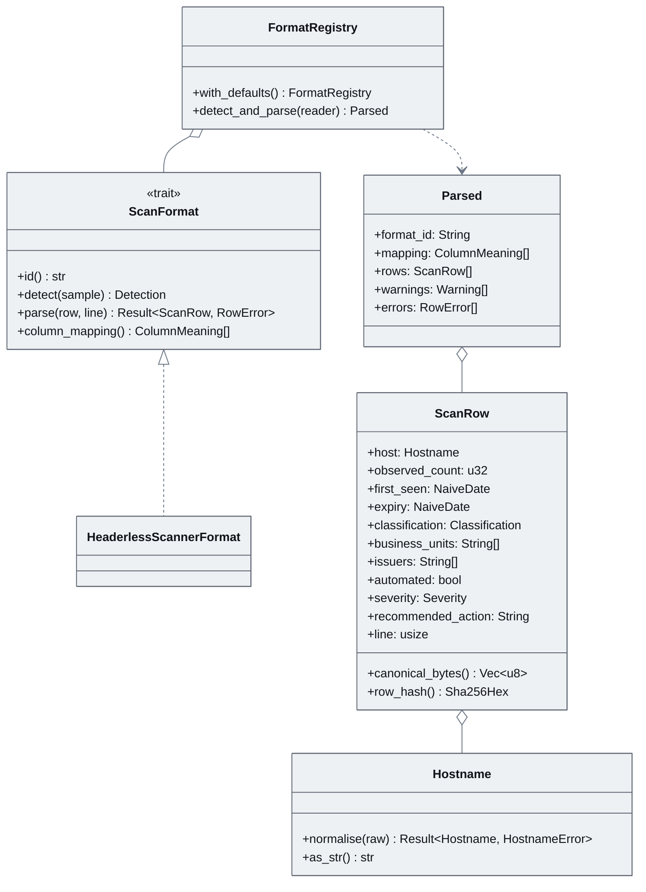

Parse pipeline for one upload (flowchart).

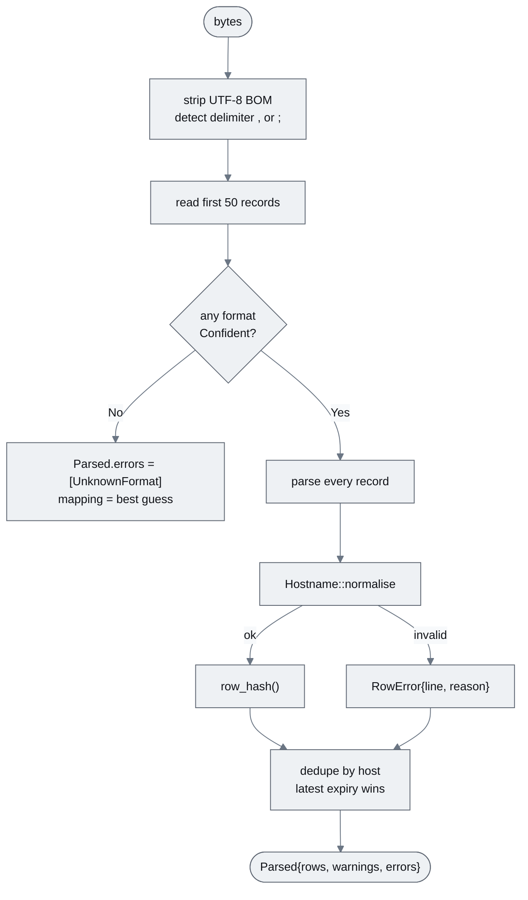

### Functional requirements

| ID | Requirement |
|----|-------------|
| **FR-002.1-01** | MUST provide the `ScanFormat` trait, `FormatRegistry` and `HeaderlessScannerFormat` with the detection rule described |
| **FR-002.1-02** | MUST strip a leading UTF-8 BOM and accept `,` or `;` delimiters and CRLF line endings |
| **FR-002.1-03** | MUST normalise hostnames as described and reject invalid ones with a line-numbered `RowError` rather than aborting the parse |
| **FR-002.1-04** | MUST parse `M/D/YYYY` and `MM/DD/YYYY` dates; an unparseable date is a `RowError` |
| **FR-002.1-05** | MUST map classification strings to `Classification::{LikelyAutomated, CentralManagementRequired, AutomationCandidateVerify}` (matching the en-dash and hyphen variants) and severity to `Severity::{Critical, High, Medium, Routine}`; unknown values are `RowError`s |
| **FR-002.1-06** | MUST compute `row_hash()` over the canonical form so that list reordering and whitespace differences do not change the hash |
| **FR-002.1-07** | MUST de-duplicate by normalised host, latest expiry winning, emitting `Warning::DuplicateHost` |
| **FR-002.1-08** | MUST expose `column_mapping()` so callers can show the manager which column meant what |
| **FR-002.1-09** | MUST provide `gzip::compress(bytes, max_out) -> Result<Vec<u8>, TooLarge>` and `decompress(bytes, max_out)` |
| **FR-002.1-10** | SHOULD expose `Parsed::summary()` (rows, errors, warnings, date range, classification counts) for the API's intake response |

### Non-functional requirements

| ID | Category | Requirement |
|----|----------|-------------|
| **NFR-002.1-01** | Performance | Parsing the 5,368-row export completes in < 250 ms and allocates < 40 MB peak (measured by a criterion bench in CI) |
| **NFR-002.1-02** | Reliability | No `unwrap`/`expect`/`panic` reachable from untrusted input (`clippy::unwrap_used = deny`, fuzz target for the parser under `cargo fuzz`) |
| **NFR-002.1-03** | Compatibility | The crate compiles without `kube`, `may`, `tokio` in its default feature set so the BRRTRouter impl crate can depend on it |
| **NFR-002.1-04** | Security | Input size is bounded by the caller (`max_bytes`); the parser never reads beyond it |

### Acceptance criteria

| ID | Given / When / Then |
|----|---------------------|
| **AC-002.1-01** | **Given** the real export **When** `detect_and_parse` runs **Then** `format_id="headerless-scanner-v1"`, 5,368 rows parse, `errors` is empty and `warnings` lists only duplicate hosts if any |
| **AC-002.1-02** | **Given** a row whose host is `WWW.Metro-VTO.es.` **When** parsed **Then** the normalised host is `www.metro-vto.es` |
| **AC-002.1-03** | **Given** two exports differing only in business-unit order and trailing whitespace **When** hashed **Then** every `row_hash()` is identical |
| **AC-002.1-04** | **Given** a row with `13/45/2026` as expiry **When** parsed **Then** it appears in `errors` with its line number and the other rows still parse |
| **AC-002.1-05** | **Given** an export with a header row from a different scanner **When** parsed **Then** `errors` contains `UnknownFormat` and `mapping` contains the best-guess column meanings |
| **AC-002.1-06** | **Given** a 1.1 MB export **When** `gzip::compress(_, 900 KiB)` runs **Then** output is under 200 KB; **Given** a 20 MB export **Then** `TooLarge` |

### Unit test criteria

| ID | Test | Covers |
|----|------|--------|
| **UT-002.1-01** | `format_test::detects_real_export_fixture` (fixture: first 200 rows of the export, anonymised) | FR-002.1-01, AC-002.1-01 |
| **UT-002.1-02** | `format_test::bom_and_delimiters` — BOM, `;`, CRLF variants | FR-002.1-02 |
| **UT-002.1-03** | `hostname_test::normalise_cases` — table: uppercase, trailing dot, IDNA (`bücher.example`), scheme, port, path, 254-char name | FR-002.1-03, AC-002.1-02 |
| **UT-002.1-04** | `format_test::dates_and_enums` — valid and invalid dates, both dash variants of the classification | FR-002.1-04/05, AC-002.1-04 |
| **UT-002.1-05** | `hash_test::canonical_form_is_order_insensitive` | FR-002.1-06, AC-002.1-03 |
| **UT-002.1-06** | `dedupe_test::latest_expiry_wins_and_warns` | FR-002.1-07 |
| **UT-002.1-07** | `format_test::unknown_format_best_guess_mapping` | FR-002.1-01/08, AC-002.1-05 |
| **UT-002.1-08** | `gzip_test::round_trip_and_ceiling` | FR-002.1-09, AC-002.1-06 |
| **UT-002.1-09** | `bench/parse.rs` criterion bench asserting NFR-002.1-01 thresholds in CI (`--bench parse -- --test`) | NFR-002.1-01 |
| **UT-002.1-10** | `fuzz/fuzz_targets/parse.rs` — 60 s smoke in CI nightly | NFR-002.1-02 |

### Integration test criteria

| ID | Test | Environment | Covers |
|----|------|-------------|--------|
| **IT-002.1-01** | None. (Pure library; exercised end-to-end by IT-002.4-01.) | — | — |

### QA process

1. `cargo nextest run -p certificate-scan` and `cargo bench -p certificate-scan --bench parse -- --test`; record timings.
2. Run the `dcops-certctl parse --dry-run certificates.csv` subcommand from `CM-002.6` (or the crate's example binary) against the real export; confirm 5,368 rows, zero errors, and inspect the printed column mapping.
3. Negative path: feed a spreadsheet with a header row and a file with a broken date; confirm both are reported without aborting.
4. Attach: nextest and bench output, the dry-run summary.

---

## CM-002.2 — OpenAPI contract and BRRTRouter service scaffold

**As a** platform engineer, **I want** `openapi/dcops/certificates/openapi.yaml` and a generated BRRTRouter service with JWKS bearer security, config, HTTPRoute, image and Tilt wiring **so that** every certificates endpoint is contract-first, validated and secured before a line of business logic is written.

### Description

Authoring follows the PriceWhisperer layout, but the documents are **generated, not hand-written** (README delta 16): `openapi/dcops/scripts/build_specs.py` reads `config/crd/all-crds.yaml` and the screen contracts from `docs/03_ui_design` and emits `openapi/dcops/bff-suite-config.yaml` (`suite: dcops`, `package_prefix: dcops`, eight services each with `base_path: /api/v1/<service>`, `gateway_path_style: prefixed`), one `openapi/dcops/<service>/openapi.yaml` per service and the composed `openapi/dcops/openapi_bff.yaml` (`x-service`, `x-service-base-path`, `x-brrtrouter-downstream-path`, schemas namespaced `<Service><Name>`, proxied operations `x-brrtrouter-impl: false`). All documents are `openapi: 3.1.0` with service-relative paths. Every operation carries an `operationId`, a `security` requirement (`BearerAuth` JWKS; `security: []` only on `/healthz`), `x-cors: inherit` and request/response `example`s (BRRTRouter's generator requires them). The certificates service (`openapi/dcops/certificates/openapi.yaml`, 17 operations) is the one this epic implements: `GET /summary`, `GET /inventory`, `GET /inventory/{namespace}/{name}`, `PATCH …/ownership`, `POST …/acknowledge`, `POST /inventory/bulk/ownership`, `GET /maturity` (bodies in EPIC-CM-003/009), `POST /imports`, `GET /imports`, `GET /imports/{importId}`, `POST /imports/{importId}/uploaded`, `GET /imports/{importId}/preview`, `GET /imports/{importId}/artifacts/{kind}`, `POST /imports/{importId}/confirm`, `POST /imports/{importId}/cancel`, `GET /imports/{importId}/events` (`x-sse: true`), `GET /healthz` (bodies in `CM-002.3`). There is no multipart upload operation: the file goes browser → bucket through the signed URL `POST /imports` returns (`CM-002.3`, `CM-002.7`), so `x-brrtrouter-body-size-bytes` stays at the default on every operation. Changing the contract means changing the generator (or the CRD) and regenerating; CI fails on drift. Screen → operation traceability lives in `openapi/dcops/README.md`.

**Suite scaffold (in scope here, +2 d).** Because the browser talks only to the BFF, this story also scaffolds `services/dcops-bff` from `openapi_bff.yaml` (pure proxy: JWKS validation once at the edge, forward by `x-service`, no business logic) and `services/platform` from `platform/openapi.yaml` (`/summary`, `/attention`, `/kinds`, `/namespaces`, `/events`, `/me`, `/healthz` over kube-rs reflectors for every kind in `config/crd/`). The read-only domain services (`dcim`, `ipam`, `tenancy`, `extras`, `boot`, `ippools`) are generated at the same time and get a shared row-mapping crate (`crates/dcops-rows`: `<Kind>Row`/`<Kind>Detail` from a reflector store, cursor paging, `search`/`sort`/`state` filters); their `impl` crates are thin and tracked in the UI-shell work that follows the mockups, not in this epic.

`just api-gen` first runs `build_specs.py`, then `brrtrouter-gen generate --spec openapi/dcops/<service>/openapi.yaml --output services/<service>` for every service in `bff-suite-config.yaml` and for the BFF; for certificates that produces `services/certificates-api/gen` (crate `dcops_certificates_gen`: handlers, types, `registry.rs`, embedded `doc/openapi.yaml`) and, once, `services/certificates-api/impl` (crate `dcops_certificates_api`: `controllers/`, `impl_registry.rs`, a `RunAppBuilder` main). `gen` is clobbered build output and CI fails if regeneration produces a diff; `impl` is user-owned and never regenerated with `--force`. `impl/config/config.yaml` configures `security.jwks.BearerAuth` (`jwks_url`, `iss`, `aud`, `leeway_secs`, `cache_ttl_secs`) from environment-specific values, `cors.allowed_origins` for the UI hostname, and `http` keep-alive. Identity for later audit fields (`importedBy`, `confirmedBy`) is taken from validated JWT claims (`sub`/`oid`, `preferred_username`, `email`/`upn`) exposed by BRRTRouter's `SecurityRequest` into the handler context via a small `Identity` extractor in `impl/src/identity.rs`. Roles are resolved through a configurable mapping (`identity.roles` in `config.yaml`: claim name → value → DCops role) so that Microsoft Entra ID app roles (`roles` claim) or group IDs (`groups` claim), or Sesame-IDAM scopes, all map to `dcops:certificates:import` / `dcops:certificates:admin` without a code change; the extractor enforces the required role and returns `403` with the standard error envelope when absent. The IdP is pure configuration (`iss`, `aud`, `jwks_url`); the dev overlay uses BRRTRouter's HMAC `BearerJwtProvider` with `just dev-token`.

`impl/src/kube_gateway.rs` defines `trait KubeGateway` (Q2) with `create_scan_import`, `get_scan_import`, `list_scan_imports`, `patch_scan_import_spec`, `patch_scan_import_status`; `KubeGatewayHttp` implements it over `brrtrouter::http::fetch`'s rustls client using the ServiceAccount token and CA from `/var/run/secrets/kubernetes.io/serviceaccount`, with typed `crds` structs on the wire; `MockKubeGateway` (feature `testing`) records calls. The service exposes `/metrics` through `MetricsMiddleware` (Prometheus, `brrtrouter_*` families plus the `dcops_api_*` families added in `CM-002.6`), `/docs` (Swagger UI from the embedded spec) and `/healthz`.

Delivery plumbing mirrors EPIC-CM-001: `dockerfiles/Dockerfile.certificates-api{,.dev}` (non-root), `config/certificates-api/` (Deployment, Service, ServiceAccount with a Role limited to `certificatescanimports` (and `/status`) create/get/list/patch in the `certificates` namespace, HTTPRoute with `gitops.microscaler.io/hostname`), a Tilt resource with live-update, `just api-gen`, `just api-run` (local `brrtrouter-gen serve --watch` for spec iteration) and `just api-logs`.

### Diagrams

Spec-to-service build flow and what is generated versus owned (flowchart).

```mermaid
%%{init: {'theme':'base','themeVariables': {'fontFamily': 'Inter, Segoe UI, Helvetica, Arial, sans-serif', 'fontSize': '14px', 'primaryColor': '#EEF1F4', 'primaryTextColor': '#111318', 'primaryBorderColor': '#5E6672', 'secondaryColor': '#EAF3FF', 'secondaryTextColor': '#111318', 'secondaryBorderColor': '#2F80ED', 'tertiaryColor': '#EAF8F0', 'tertiaryTextColor': '#111318', 'tertiaryBorderColor': '#2FA36B', 'lineColor': '#6B7684', 'textColor': '#6B7684', 'nodeBorder': '#5E6672', 'nodeTextColor': '#111318', 'mainBkg': '#EEF1F4', 'clusterBkg': '#F7F9FB', 'clusterBorder': '#BAC1C9', 'titleColor': '#111318', 'edgeLabelBackground': '#F7F9FB', 'actorBkg': '#EEF1F4', 'actorBorder': '#5E6672', 'actorTextColor': '#111318', 'actorLineColor': '#BAC1C9', 'signalColor': '#6B7684', 'signalTextColor': '#6B7684', 'labelBoxBkgColor': '#EAF3FF', 'labelBoxBorderColor': '#2F80ED', 'labelTextColor': '#111318', 'loopTextColor': '#111318', 'noteBkgColor': '#FFF6E7', 'noteBorderColor': '#E6A23C', 'noteTextColor': '#111318', 'activationBkgColor': '#DCE6F7', 'activationBorderColor': '#2F80ED', 'sequenceNumberColor': '#FFFFFF', 'labelColor': '#111318', 'altBackground': '#F7F9FB', 'attributeBackgroundColorOdd': '#FFFFFF', 'attributeBackgroundColorEven': '#F7F9FB', 'classText': '#111318'}}}%%
flowchart LR
    suite["openapi/dcops/bff-suite-config.yaml<br/>suite dcops · base_path /api/v1/certificates"]
    spec["openapi/dcops/certificates/openapi.yaml<br/>operations · schemas · examples<br/>securitySchemes.BearerAuth · x-sse · x-cors"]
    gencli["brrtrouter-gen generate<br/>(just api-gen)"]
    subgraph gen["services/certificates-api/gen — clobbered build output"]
        h["handlers/*.rs<br/>typed Request/Response"]
        t["types.rs · registry.rs"]
        d["doc/openapi.yaml (embedded)"]
    end
    subgraph impl["services/certificates-api/impl — user-owned"]
        c["controllers/*.rs<br/>#[handler] business logic"]
        r["impl_registry.rs"]
        m["main.rs (RunAppBuilder)"]
        kg["kube_gateway.rs · identity.rs"]
        cfg["config/config.yaml<br/>jwks · cors · http"]
    end
    suite --> gencli
    spec --> gencli
    gencli --> gen
    gencli -. "first run only" .-> impl
    gen --> m
    c --> r --> m
    kg --> c
    cfg --> m
    m --> bin["dcops-certificates-api binary<br/>/api/v1/certificates/* · /docs · /metrics · /healthz"]
    style gen fill:transparent,stroke:#8A94A6,stroke-width:1.5px,stroke-dasharray:4 3
    style impl fill:transparent,stroke:#8A94A6,stroke-width:1.5px,stroke-dasharray:4 3
```

Request pipeline for a secured operation, as BRRTRouter executes it (sequenceDiagram).

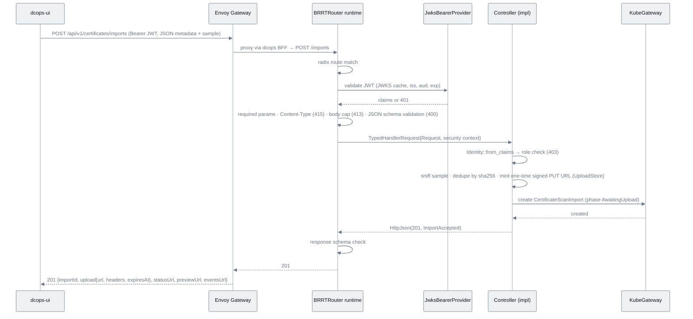

### Functional requirements

| ID | Requirement |
|----|-------------|
| **FR-002.2-01** | MUST add `openapi/dcops/bff-suite-config.yaml` and `openapi/dcops/certificates/openapi.yaml` (3.1.0) with the operations listed, each with `operationId`, `security`, `x-cors`, examples and `x-brrtrouter-impl: true` |
| **FR-002.2-02** | MUST declare `components.securitySchemes.BearerAuth` (`type: http, scheme: bearer, bearerFormat: JWT`) and apply it to every operation except `/healthz` |
| **FR-002.2-03** | MUST declare the shared `ErrorEnvelope` schema (`code`, `message`, `fields[]`, `requestId`) and reference it from every 4xx/5xx response |
| **FR-002.2-04** | MUST generate `services/certificates-api/gen` via `just api-gen` and fail CI when the committed `gen` differs from a fresh generation |
| **FR-002.2-05** | MUST provide `services/certificates-api/impl` with `RunAppBuilder` main, `impl_registry.rs`, and stub controllers returning the spec examples until `CM-002.3` replaces them |
| **FR-002.2-06** | MUST configure `JwksBearerProvider` from `config/config.yaml` (`jwks_url`, `iss`, `aud`) with values injected from a ConfigMap per environment |
| **FR-002.2-07** | MUST implement `Identity` extraction from validated claims with a configurable claim→role mapping (`identity.roles`; verified against Entra ID `roles`/`groups` claims and Sesame-IDAM scopes) and enforce the `dcops:certificates:import` role for write operations (403 otherwise) |
| **FR-002.2-08** | MUST implement `KubeGateway` and `KubeGatewayHttp` over the ServiceAccount credentials with the verbs listed; MUST provide `MockKubeGateway` behind feature `testing` |
| **FR-002.2-09** | MUST serve `/docs` (Swagger UI), `/metrics` (Prometheus) and `/healthz` |
| **FR-002.2-10** | MUST ship Dockerfiles, kustomize (`config/certificates-api/`), HTTPRoute at `/api/v1/certificates`, Tilt resource and `just` recipes |
| **FR-002.2-11** | MUST NOT accept file bytes on any operation: `create_import` takes JSON metadata plus a base64 sample (≤ 12,288 chars) and the body cap stays at BRRTRouter's default; the file itself goes browser → bucket via the signed URL (`CM-002.3`, `CM-002.7`) |
| **FR-002.2-12** | SHOULD add `docs/api/certificates-api.md` rendered from the spec (`brrtrouter-gen docs` or redoc-cli) in CI |

### Non-functional requirements

| ID | Category | Requirement |
|----|----------|-------------|
| **NFR-002.2-01** | Security | Fail-closed: an operation without an explicit `security` key is rejected by a spec lint in CI; JWT validation errors are 401 before any parameter error can leak |
| **NFR-002.2-02** | Security | The API ServiceAccount cannot read Secrets and cannot `create`/`delete` `CertificateInventory` (verified by `kubectl auth can-i`); it may `get`/`list`/`watch` inventories (reads for the UI) and `patch` them only through SSA with field manager `dcops-ui` for `spec.ownership`, `spec.acknowledgement` and `spec.classification.bucket` (EPIC-CM-003); scan-import inventory creation happens only in the apply Job |
| **NFR-002.2-03** | Performance | `GET /imports/{id}` p50 < 10 ms, p99 < 50 ms at 200 req/s on a 2-vCPU pod (Goose load test in CI nightly) |
| **NFR-002.2-04** | Compatibility | Spec stays on OpenAPI 3.1.0 per BRRTRouter's version policy; no 3.2 features |
| **NFR-002.2-05** | Observability | Every request logs `requestId`, `operationId`, `sub`, status and latency as JSON; OTEL traces exported when `OTEL_EXPORTER_OTLP_ENDPOINT` is set |
| **NFR-002.2-06** | Maintainability | `gen` never hand-edited (CI diff check); controllers never regenerated with `--force` |

### Acceptance criteria

| ID | Given / When / Then |
|----|---------------------|
| **AC-002.2-01** | **Given** a clean tree **When** `just api-gen` runs **Then** `git status` shows no change under `services/certificates-api/gen` |
| **AC-002.2-02** | **Given** the deployed service **When** `GET /api/v1/certificates/imports` is called without a token **Then** 401 with the `ErrorEnvelope` |
| **AC-002.2-03** | **Given** a valid JWT lacking `dcops:certificates:import` **When** `POST /imports` is called **Then** 403 |
| **AC-002.2-04** | **Given** a valid JWT with the role **When** `POST /imports` is sent as `multipart/form-data` **Then** 415; **When** the JSON body exceeds the default body cap (oversized `sample`) **Then** 413; **When** `sizeBytes` exceeds 12 MiB **Then** 422 `validation_failed` |
| **AC-002.2-05** | **Given** the service **When** `/docs` is opened **Then** Swagger UI shows every operation with examples; `/metrics` exposes `brrtrouter_*` families; `/healthz` is 200 without auth |
| **AC-002.2-06** | **Given** the API ServiceAccount **When** `kubectl auth can-i create certificateinventories --as=system:serviceaccount:dcops-system:dcops-certificates-api` **Then** `no`; `… patch certificateinventories -n certificates` **Then** `yes`; `… get secrets` **Then** `no`; `… create certificatescanimports -n certificates` **Then** `yes` |
| **AC-002.2-07** | **Given** a spec change adding an operation without `security` **When** CI runs **Then** the spec lint fails |

### Unit test criteria

| ID | Test | Covers |
|----|------|--------|
| **UT-002.2-01** | `impl/tests/contract.rs::every_operation_has_security_and_example` — parses the spec with `oas3` and asserts the lint rules | FR-002.2-01/02, NFR-002.2-01, AC-002.2-07 |
| **UT-002.2-02** | `impl/tests/testapp.rs::unauthenticated_is_401` — `brrtrouter::test_support::TestApp::from_spec_with_options` + `register_impl`, no token | FR-002.2-02, AC-002.2-02 |
| **UT-002.2-03** | `impl/tests/testapp.rs::missing_role_is_403` — dev HMAC `BearerJwtProvider` in test config, token without role | FR-002.2-07, AC-002.2-03 |
| **UT-002.2-04** | `impl/tests/testapp.rs::content_type_and_size_guards` — 415, 413 and 422 `sizeBytes` paths | FR-002.2-11, AC-002.2-04 |
| **UT-002.2-05** | `impl/src/identity_test.rs::claims_to_identity` — `sub`/`oid`, `preferred_username`/`upn`, `email` precedence; role mapping table applied to Entra-shaped tokens (`roles[]`, `groups[]`) and Sesame-shaped tokens (space-separated `scope`) | FR-002.2-07 |
| **UT-002.2-06** | `impl/src/kube_gateway_test.rs::http_gateway_builds_requests` — wiremock K8s API: asserts paths, `Authorization: Bearer <sa-token>`, content types, error mapping (404/409/422) | FR-002.2-08 |
| **UT-002.2-07** | `impl/tests/testapp.rs::error_envelope_shape` — every error response validates against `ErrorEnvelope` | FR-002.2-03 |

### Integration test criteria

| ID | Test | Environment | Covers |
|----|------|-------------|--------|
| **IT-002.2-01** | `tests/api_boot.rs` (feature `integration`) — deploys kustomize to the Tilt cluster, obtains a token from the dev IdP (Sesame-IDAM dev instance or a static-JWKS stub Deployment in `config/dev/`), hits `/healthz`, `/docs`, `/metrics`, an authenticated and an unauthenticated route | kind/k3s via Tilt | AC-002.2-02/05 |
| **IT-002.2-02** | `tests/rbac_api.rs` — SubjectAccessReview matrix for the API ServiceAccount | kind/k3s via Tilt | NFR-002.2-02, AC-002.2-06 |
| **IT-002.2-03** | CI job `api-gen-diff` — regenerates and diffs | GitHub Actions | FR-002.2-04, AC-002.2-01 |
| **IT-002.2-04** | CI nightly `goose-certificates-api` — Goose scenario from BRRTRouter's `examples/api_load_test.rs` adapted to `GET /imports/{id}` | GitHub Actions (2-core) | NFR-002.2-03 |

### QA process

1. `just dev-up`; confirm `dcops-certificates-api` green in Tilt. Open `https://dcops.dev.microscaler.local/api/v1/certificates/docs`; screenshot the operation list.
2. `curl -i …/api/v1/certificates/imports` → 401 envelope. Obtain a dev token (`just dev-token role=dcops:certificates:import`); repeat → 200 empty list. Obtain a token without the role → 403 on `POST /imports`.
3. `curl -i -F file=@x.csv -X POST …/imports` → 415. `POST …/imports` with `sizeBytes: 13631488` → 422 `validation_failed`; with a 1 MiB `sample` → 413.
4. Run the `kubectl auth can-i` matrix from AC-002.2-06.
5. Negative path: edit the spec to remove `security` from one operation and run `just api-lint` → fails; revert. Edit a file under `gen/` and run `just api-gen-check` → fails; revert.
6. Attach: Swagger screenshot, curl transcripts, `auth can-i` matrix, CI links for gen-diff and Goose.

---

## CM-002.3 — Upload intake via signed bucket URLs, import lifecycle endpoints and confirmation

**As an** Operations manager, **I want** to upload the scan file straight to the platform's bucket and immediately get an import I can watch, preview and confirm **so that** loading a scan is three clicks, the original file is kept as the audit record, and nothing waits on processing.

### Description

Implements the controllers behind the operations from `CM-002.2`, in `services/certificates-api/impl/src/controllers/`, on top of the `UploadStore` from `CM-002.7`. The file never passes through the API: the API mints a short-lived signed URL, the browser (or CLI) `PUT`s the bytes directly to the bucket, and the worker reads them from there. This keeps the coroutine API free of large bodies, gives the audit trail an immutable original, and needs no database.

`create_import` (`POST /imports`, JSON `{filename, sizeBytes, contentSha256, contentType, namespace?, formatHint?, note?, sample?, mode?}` — `mode` defaults to `previewThenApply`; `applyDirect` is accepted only from callers holding the additional role `dcops:certificates:admin`): validates size (≤ 12 MiB), type (`text/csv` or `application/octet-stream`) and filename; if `sample` (base64 of the first 8 KiB, computed client-side) is present, runs `certificate-scan`'s detector on it and returns `422 unknown_format` with the best-guess mapping — the same check the worker repeats authoritatively later. It then looks for an existing non-failed `CertificateScanImport` in the namespace with the same `contentSha256` younger than 24 h and, if found, returns `200` with that import (idempotent re-upload; no new object). Otherwise it allocates a ULID `importId`, derives the object key `imports/<namespace>/<importId>/scan.csv`, asks the store for a signed `PUT` URL bound to that exact key, the declared `Content-Type`, the declared `Content-Length`, the one-time precondition (`x-goog-if-generation-match: 0`) and a 15-minute expiry, creates the `CertificateScanImport` (`spec.source{kind: gcs, bucket, object, contentSha256, sizeBytes, filename, contentType, formatHint, uploadExpiresAt}`, `spec.requestedBy` from `Identity`, `spec.note`, `spec.mode: previewThenApply`, `status.phase: AwaitingUpload`) and returns `201 {importId, upload{url, method: PUT, headers, expiresAt}, statusUrl, previewUrl, eventsUrl}`. The client `PUT`s the file, then calls `mark_uploaded` (`POST /imports/{importId}/uploaded`), which `HEAD`s the object through the store, checks `Content-Length` equals `spec.source.sizeBytes`, records `status.artifacts.scan{uri, sizeBytes, etag, generation}` and moves the import to `Pending` for the reconciler (`CM-002.4`); a missing or mismatched object returns `409 upload_incomplete` and the client may retry the `PUT` until the URL expires. An import left in `AwaitingUpload` past the URL's expiry is moved to `Expired` by the reconciler.

`get_import` (`GET /imports/{importId}`) returns the `ImportStatus` DTO (phase, counters, `preview.summary`, `result.summary`, artifact URIs, timestamps, who, `errors[]` truncated to 50). `list_imports` (`GET /imports?namespace=&phase=&limit=&cursor=`) is newest first, paged by `continue` token. `get_preview` (`GET /imports/{importId}/preview?outcome=&limit=&cursor=`) reads `status.artifacts.preview` (a gzip JSON-lines object the preview Job wrote, `CM-002.4`), pages it with an in-memory LRU cache keyed by `importId` and decompressed once per API pod, and returns `409 preview_not_ready` before the artifact exists; `GET /imports/{importId}/artifacts/{scan|preview|result}` returns a `302` to a 5-minute signed `GET` URL so the UI and CLI can fetch the original file or the full diff without the API relaying bytes. `confirm_import` (`POST /imports/{importId}/confirm {previewSha256}`) is allowed only in `AwaitingConfirmation` and records `spec.confirmation{confirmedBy, confirmedAt, previewSha256}`; the reconciler refuses to apply if the preview's hash differs. `repreview_import` (`POST …/repreview`, body `{columnMapping[]}`, consumer-driven from the ImportReview mockup's editable mapping table) is accepted only in `AwaitingConfirmation`: it validates that `host` and `expiry` are each mapped exactly once (422 `invalid_mapping`), writes the mapping to `spec.source.columnMapping`, clears `status.preview` and moves the phase back to `Previewing` so the reconciler launches a fresh preview Job (the old `preview.jsonl.gz` is overwritten); the SSE stream then reports the new `AwaitingConfirmation` with a new preview `sha256`, which is why `confirm_import` binds to the sha256. `cancel_import` (`POST …/cancel`) sets `spec.cancelled`; the reconciler moves to `Cancelled` and the bucket lifecycle rule (not the API) eventually removes the objects. `import_events` (`GET …/events`, SSE) streams `{phase, counters, updatedAt}` by polling the CR every 2 s server-side and closes on a terminal phase.

The controllers never parse more than the 8 KiB sample and never touch `CertificateInventory`; that separation keeps the API fast and its ServiceAccount narrow. Bucket credentials never reach the browser — only the signed URL does.

### Diagrams

Intake through the bucket, then preview and confirmation (sequenceDiagram; the API handles metadata only).

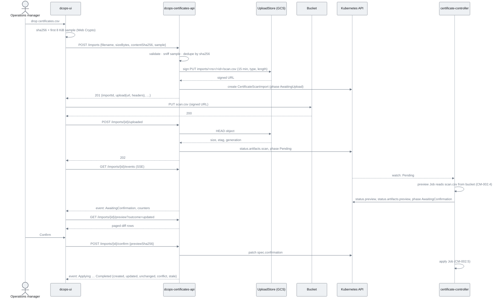

Decision logic inside `create_import` and `mark_uploaded` (flowchart).

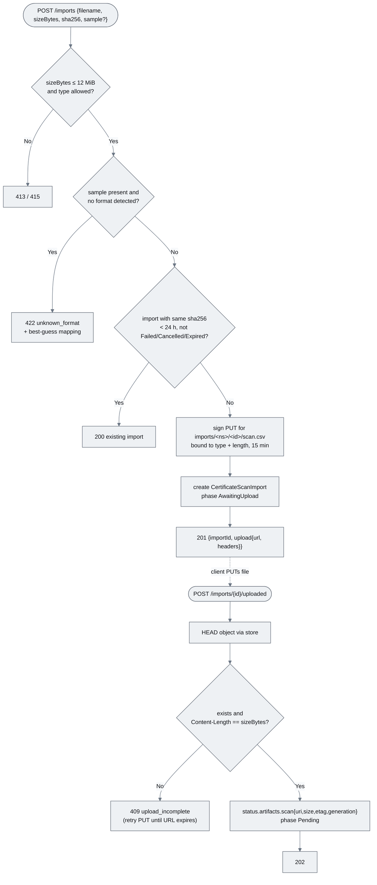

### Functional requirements

| ID | Requirement |
|----|-------------|
| **FR-002.3-01** | MUST implement `create_import` with the validation, optional sample sniff, sha256 dedupe, signed-URL minting and CR creation described, returning 200/201/413/415/422 as specified |
| **FR-002.3-02** | MUST generate `importId` as a ULID, name the CR `import-<ulid>` and derive the object key `imports/<namespace>/<importId>/scan.csv`; object keys are never client-supplied |
| **FR-002.3-03** | MUST record `spec.requestedBy{subject, username, email}` from `Identity`, never from a request body field |
| **FR-002.3-04** | MUST bind the signed `PUT` URL to the exact key, declared `Content-Type`, declared `Content-Length` and the one-time precondition header, with a 15-minute expiry, and MUST NOT return bucket credentials or any URL permitting overwrite, `GET`, `DELETE` or list |
| **FR-002.3-05** | MUST implement `mark_uploaded`: `HEAD` through the store, verify size, record `status.artifacts.scan`, move to `Pending`; 409 `upload_incomplete` otherwise; 409 `phase_mismatch` if not in `AwaitingUpload` |
| **FR-002.3-06** | MUST implement `get_import`, `list_imports` (newest first, paged) and map CR status to the `ImportStatus` DTO without exposing raw Kubernetes objects |
| **FR-002.3-07** | MUST implement `get_preview` over the preview artifact with `outcome` filter (`created|updated|unchanged|conflict|stale|error`) and paging, returning 409 before the artifact exists; MUST cache a decompressed preview per pod with a bounded LRU (≤ 10 previews, ≤ 64 MiB) |
| **FR-002.3-08** | MUST implement `GET /imports/{id}/artifacts/{kind}` as a 302 to a 5-minute signed `GET` URL for `scan`, `preview`, `result`; 404 when the artifact is absent |
| **FR-002.3-09** | MUST implement `confirm_import` accepting only phase `AwaitingConfirmation`, recording `spec.confirmation{confirmedBy, confirmedAt, previewSha256}`; 409 `phase_mismatch` otherwise |
| **FR-002.3-10** | MUST implement `cancel_import` for non-terminal phases (including `AwaitingUpload`) |
| **FR-002.3-11** | MUST implement `import_events` as SSE emitting `{phase, counters, updatedAt}` on change and closing on a terminal phase |
| **FR-002.3-12** | SHOULD accept `formatHint` and pass it through to `spec.source.formatHint` for the worker |

### Non-functional requirements

| ID | Category | Requirement |
|----|----------|-------------|
| **NFR-002.3-01** | Performance | `POST /imports` returns in < 150 ms p95 (validation, one signing call, one CR create); `mark_uploaded` < 300 ms p95 (one `HEAD`, one status patch) |
| **NFR-002.3-02** | Idempotency | Identical bytes within 24 h yield the same `importId`; two concurrent creates for the same sha256 yield at most one import (CR name derived from sha256 during the race window; `AlreadyExists` returns the winner) |
| **NFR-002.3-03** | Security | Signed URLs are single-object, single-method, one-time for `PUT`, ≤ 15 min (`PUT`) / ≤ 5 min (`GET`); the API's identity is Workload Identity only (no key file), with `objects.create`, `objects.get` and `objects.list` on the `imports/` prefix and no delete; signed URLs are logged only as a hash |
| **NFR-002.3-04** | Reliability | An `AwaitingUpload` import whose URL expired is moved to `Expired` by the reconciler; an object uploaded for an import that was cancelled is removed by the bucket lifecycle rule, not by the API |
| **NFR-002.3-05** | Observability | Each create logs `importId`, `sha256`, `sizeBytes`, `sniffedFormat`, `sub`; each `uploaded` logs `etag`, `generation` |
| **NFR-002.3-06** | Compatibility | The response shape is store-agnostic (`upload{url, method, headers}`) so an S3-compatible or ConfigMap backend (`CM-002.7`) needs no client change |

### Acceptance criteria

| ID | Given / When / Then |
|----|---------------------|
| **AC-002.3-01** | **Given** the real export's metadata and sample **When** `POST /imports` is called **Then** 201 with a signed `PUT` URL whose query shows the exact object key and a ≤ 15-minute expiry, and a CR in `AwaitingUpload` with `spec.requestedBy.subject` equal to the token's `sub` |
| **AC-002.3-02** | **Given** that URL **When** the file is `PUT` and `POST …/uploaded` is called **Then** 202, `status.artifacts.scan` has the object's size, etag and generation, and the phase is `Pending` |
| **AC-002.3-03** | **Given** the same sha256 within 24 h **When** `POST /imports` is called **Then** 200 with the same `importId` and no new signed URL |
| **AC-002.3-04** | **Given** a sample with a header row from another tool **When** `POST /imports` is called **Then** 422 `unknown_format` with `mapping[]` in the envelope |
| **AC-002.3-05** | **Given** a signed URL **When** a `PUT` with a different `Content-Length` or `Content-Type`, or to a different key, is attempted **Then** the bucket rejects it (403) and `POST …/uploaded` returns 409 `upload_incomplete`; **When** the same URL is replayed after a successful `PUT` **Then** the bucket rejects it (412) and the original object is unchanged |
| **AC-002.3-06** | **Given** phase `Previewing` **When** `GET …/preview` is called **Then** 409; **When** phase is `AwaitingConfirmation` **Then** 200 with paged rows and `outcome` filtering works; `GET …/artifacts/preview` 302s to a URL that downloads the gzip JSON-lines |
| **AC-002.3-07** | **Given** phase `AwaitingConfirmation` **When** confirming with the current `previewSha256` **Then** 202 and `spec.confirmation` is set; with a stale hash **Then** 409 `preview_changed`; **Given** phase `Completed` **Then** 409 `phase_mismatch` |
| **AC-002.3-08** | **Given** an SSE subscription **When** the phase changes **Then** an event arrives within 3 s and the stream closes after a terminal phase |
| **AC-002.3-09** | **Given** an import left in `AwaitingUpload` for 16 min **Then** its phase is `Expired` and `POST …/uploaded` returns 409 `phase_mismatch` |

### Unit test criteria

| ID | Test | Covers |
|----|------|--------|
| **UT-002.3-01** | `controllers/create_import_test.rs::happy_path_signs_then_creates_cr` — `MockUploadStore` records the signing request (key, type, length, expiry); `MockKubeGateway` records the CR | FR-002.3-01/02/04, AC-002.3-01 |
| **UT-002.3-02** | `controllers/create_import_test.rs::dedupes_by_sha256_within_24h` and `::race_on_already_exists_returns_winner` | NFR-002.3-02, AC-002.3-03 |
| **UT-002.3-03** | `controllers/create_import_test.rs::unknown_format_from_sample_422` and `::no_sample_skips_sniff` | FR-002.3-01, AC-002.3-04 |
| **UT-002.3-04** | `controllers/create_import_test.rs::identity_from_claims_not_body` | FR-002.3-03 |
| **UT-002.3-05** | `controllers/mark_uploaded_test.rs::head_size_match_moves_to_pending` and `::missing_or_short_object_409` and `::wrong_phase_409` | FR-002.3-05, AC-002.3-02/05/09 |
| **UT-002.3-06** | `controllers/get_preview_test.rs::paging_filter_409_and_lru_bounds` | FR-002.3-07, AC-002.3-06 |
| **UT-002.3-07** | `controllers/artifacts_test.rs::redirects_to_short_lived_get_url_and_404_when_absent` — asserts ≤ 5-minute expiry and `GET` method | FR-002.3-08, NFR-002.3-03, AC-002.3-06 |
| **UT-002.3-08** | `controllers/confirm_import_test.rs::phase_and_preview_hash_guards` | FR-002.3-09, AC-002.3-07 |
| **UT-002.3-09** | `controllers/import_events_test.rs::sse_emits_on_change_and_closes` | FR-002.3-11, AC-002.3-08 |
| **UT-002.3-10** | `controllers/redaction_test.rs::signed_urls_logged_as_hash` | NFR-002.3-03 |

### Integration test criteria

| ID | Test | Environment | Covers |
|----|------|-------------|--------|
| **IT-002.3-01** | `tests/import_intake.rs` (feature `integration`) — against the Tilt cluster with the dev bucket from `CM-002.7` (MinIO): create, `PUT` via the signed URL, replayed `PUT` rejected, `uploaded`, assert CR/artifacts; wrong-length `PUT` rejected; re-create 200; cancel path; artifact 302 downloads the original | kind/k3s via Tilt + MinIO | AC-002.3-01/02/03/05, FR-002.3-08/10 |

### QA process

1. `just dev-up`; `just dev-token role=dcops:certificates:import`; `dcops-certctl import certificates.csv --verbose` (`CM-002.6`) or the manual sequence: `curl -X POST …/imports -d '{"filename":…, "sizeBytes":…, "contentSha256":…, "sample":…}'` → note `importId` and the signed URL; `curl -X PUT -H 'Content-Type: text/csv' --data-binary @certificates.csv "<url>"`; `curl -X POST …/imports/<id>/uploaded`.
2. `kubectl get certificatescanimport import-<id> -o yaml` — confirm `spec.source`, `spec.requestedBy`, `status.artifacts.scan`, phase `Pending`. `mc ls dev/dcops-imports/imports/certificates/<id>/` (dev) or the GCS console (GKE) — confirm `scan.csv` exists with the expected size. Replay the `PUT` → rejected.
3. Repeat step 1 with the same file → 200 same id, no new object. Send a header-row sample → 422 with mapping.
4. `curl -N …/imports/<id>/events`; watch phases. When `AwaitingConfirmation`: `GET …/preview?outcome=created&limit=5`; `GET …/artifacts/preview` → follow the 302 and gunzip; confirm; then confirm again with a wrong hash → 409.
5. Negative paths: `PUT` with a truncated file → bucket 403, `uploaded` → 409; replayed `PUT` → 412; leave an import in `AwaitingUpload` 16 min → `Expired`; `POST …/confirm` on `Completed` → 409; cancel during `AwaitingUpload`.
6. Attach: curl transcripts, `kubectl get` outputs, bucket listing (`mc ls` / console), SSE log, nextest report.
---

## CM-002.4 — Out-of-band processing: `CertificateScanImport` reconciler and Jobs

**As a** platform operator, **I want** each import processed by short-lived Kubernetes Jobs that the `CertificateScanImport` reconciler creates, watches and records **so that** parsing and applying are isolated from the API, survive pod restarts, are retryable, and are visible as ordinary Kubernetes objects.

### Description

Replaces the stub from `CM-001.4` with `controllers/certificate/src/reconciler/scan_import.rs` and adds an `import-worker` subcommand to the `certificate-controller` binary (`controllers/certificate/src/worker/{mod,preview,apply}.rs`, a clap subcommand so the same image runs both). Phase machine on `status.phase`: `Pending → Previewing → AwaitingConfirmation → Applying → Completed`, with `Failed`, `Cancelled` and `Expired` as terminal exits.

Reconcile logic per phase. **Pending**: validate `spec.source` and `status.artifacts.scan` (object exists via `UploadStore::head`; the sha256 is recomputed by the worker from the object, never trusted from spec), then create Job `scan-import-<id>-preview` (image = controller image, args `import-worker preview --import <ns>/<name>`, `restartPolicy: Never`, `backoffLimit: 2`, `activeDeadlineSeconds: 600`, `ttlSecondsAfterFinished: 3600`, ServiceAccount `certificate-import-worker` (annotated `iam.gke.io/gcp-service-account` for the worker GSA via Workload Identity, `CM-002.7`; in dev it reads the MinIO dev Secret instead) with read on `certificateinventories` and write on the import's `/status`, resources `250m/512Mi` requests, ownerReference to the import) and move to **Previewing**. **Previewing**: watch the Job; on success the worker has already written `preview.jsonl.gz` to the bucket and `status.preview{summary, sha256, expiresAt=now+15m, sample}` plus `status.artifacts.preview` — move to **AwaitingConfirmation**; on Job failure (after backoff) move to **Failed** with the worker's last error from the Job's termination message. **AwaitingConfirmation**: if `spec.cancelled` → **Cancelled**; if `now > preview.expiresAt` → **Expired** (Event `PreviewExpired`; the manager re-uploads); if `spec.confirmation.previewSha256 == status.preview.sha256` → create Job `scan-import-<id>-apply` (args `import-worker apply …`, same SA plus `patch` on `certificateinventories` with field manager `dcops-scan-import`) and move to **Applying**; if the hashes differ → Event `ConfirmationRejected` and stay. **Applying**: on success the worker has written `status.result{summary, completedAt, errors[]}` → **Completed**, Event `ImportCompleted` with counters; on failure → **Failed**. Every phase transition is an Event and a metric; the reconciler also moves imports stuck in `AwaitingUpload` past their signed-URL expiry to **Expired** (NFR-002.3-04). Bucket objects are never deleted by DCops; the lifecycle rule from `CM-002.7` owns retention.

The worker is a tokio binary using kube-rs and `upload-store` (feature `tokio`) directly: **preview** streams `scan.csv` from the bucket, verifies its sha256 and size against `spec.source`, runs `certificate-scan` fully, lists all `CertificateInventory` in the namespace (paged, 500 per page), computes the diff with `certificate-scan::diff` (created / updated / unchanged / conflict / stale, using `scan-row-hash` annotations and `managedFields` to detect conflicts as `CM-002.5` defines), writes the full diff as `preview.jsonl.gz` to the bucket (`put` with `ifGenerationMatch=0`; a retried Job that finds the artifact already present with the expected sha256 treats it as done) and the summary + first 200 rows per outcome to `status.preview`. **apply** re-reads the scan and the preview artifact, refuses to run if the preview sha256 no longer matches `spec.confirmation.previewSha256`, executes `CM-002.5`, and writes `result.jsonl.gz`. Both are idempotent: re-running a preview reuses the existing artifact; re-running apply produces the same end state.

### Diagrams

Import phase machine (stateDiagram-v2).

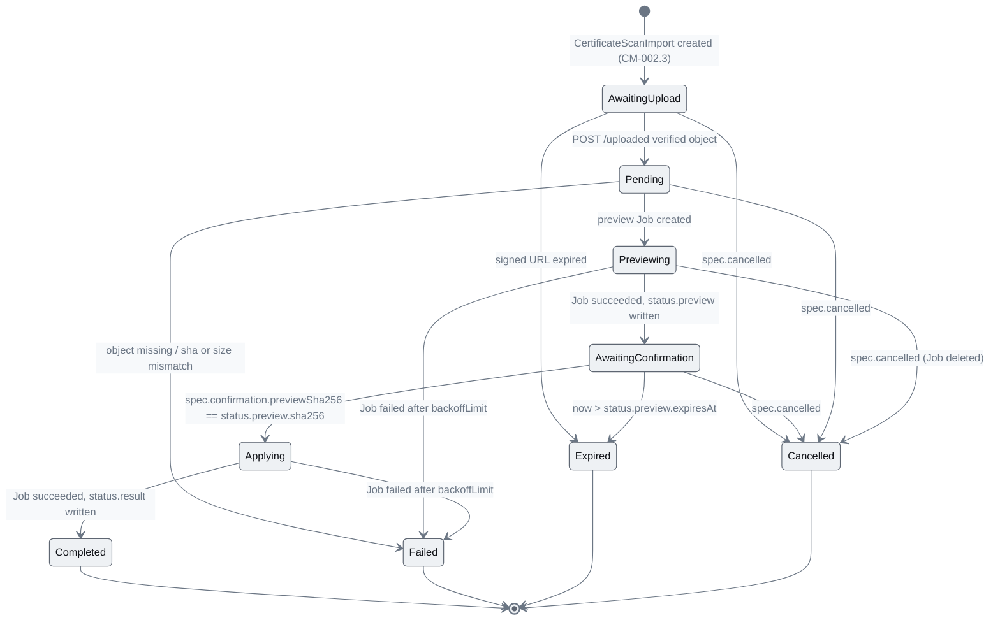

Reconciler and worker interaction for one import (sequenceDiagram).

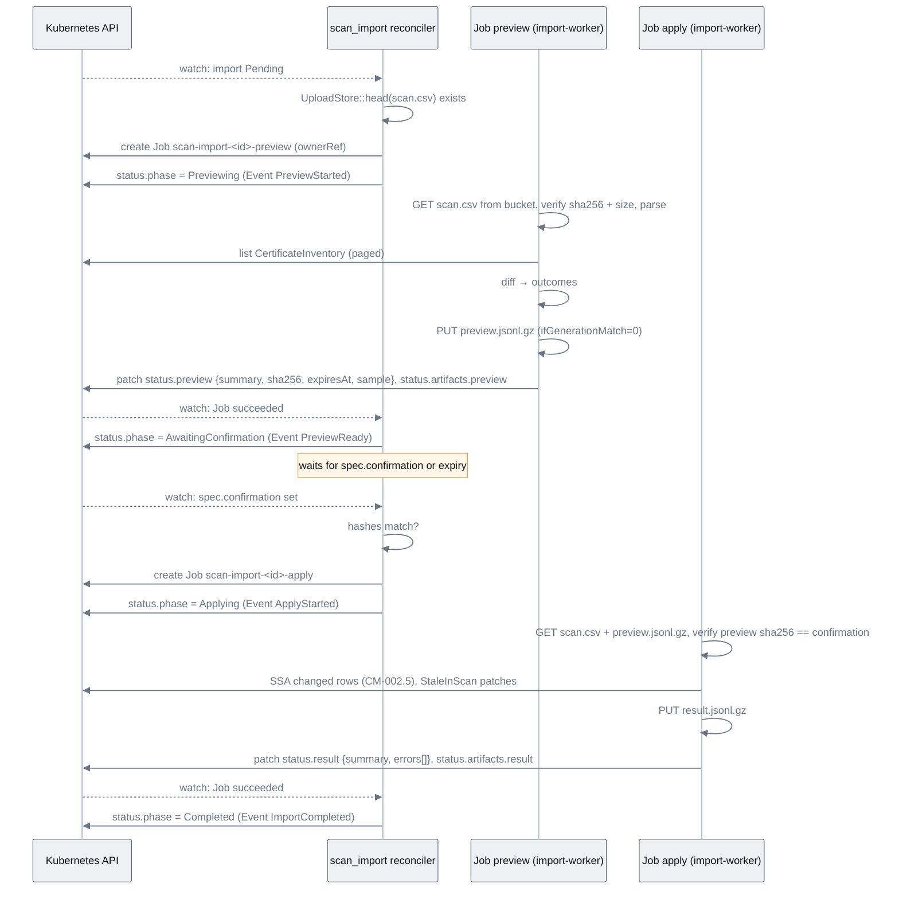

### Functional requirements

| ID | Requirement |
|----|-------------|
| **FR-002.4-01** | MUST implement the phase machine exactly as diagrammed, with every transition writing `status.phase`, `status.conditions[Ready]`, `status.updatedAt` and emitting an Event with the reason named in the Description |
| **FR-002.4-02** | MUST create the preview Job with the spec described (image, args, `restartPolicy`, `backoffLimit`, `activeDeadlineSeconds`, `ttlSecondsAfterFinished`, ServiceAccount, resources, ownerReference) |
| **FR-002.4-03** | MUST create the apply Job only when `spec.confirmation.previewSha256` equals `status.preview.sha256` and the preview has not expired |
| **FR-002.4-04** | MUST move to `Expired` 15 minutes after `status.preview.expiresAt` without confirmation and emit `PreviewExpired` |
| **FR-002.4-05** | MUST implement `import-worker preview` and `import-worker apply` subcommands as described, reading `scan.csv` through `UploadStore` and recomputing and verifying its sha256 and size against `spec.source` before use |
| **FR-002.4-06** | MUST surface worker failures: the worker writes a termination message (`/dev/termination-log`) and `status.result.errors[]`; the reconciler copies the message into `status.lastError` and the `Failed` Event |
| **FR-002.4-07** | MUST handle `spec.cancelled` in every non-terminal phase, deleting any running Job (propagation `Background`) |
| **FR-002.4-08** | MUST move imports in `AwaitingUpload` whose signed URL has expired (`spec.source.uploadExpiresAt`) to `Expired` and MUST never delete bucket objects |
| **FR-002.4-09** | MUST make both worker modes idempotent under re-execution (Job retries) |
| **FR-002.4-10** | SHOULD set `status.preview.sample` to at most 200 rows per outcome and `status.result.errors` to at most 200 entries; the full sets live in the bucket artifacts (`status.artifacts.preview`, `status.artifacts.result`) |
| **FR-002.4-11** | SHOULD allow `spec.mode: applyDirect` (skip confirmation) for the CLI path in `CM-002.6`, gated by a controller flag `ALLOW_DIRECT_APPLY=true` |

### Non-functional requirements

| ID | Category | Requirement |
|----|----------|-------------|
| **NFR-002.4-01** | Performance | Preview of the 5,368-row export against 5,000 existing records completes in < 30 s wall-clock on the dev cluster; apply of 5,368 creates in < 60 s (SSA at ≥ 100 objects/s with 8-way concurrency) |
| **NFR-002.4-02** | Reliability | Controller restart during any phase resumes correctly from the persisted phase and existing Job state; no duplicate Jobs (deterministic names, `AlreadyExists` treated as success) |
| **NFR-002.4-03** | Security | The worker ServiceAccount has no Secret access and no `delete` on inventories; the apply SA is distinct from the preview SA and is the only identity with `patch` on `certificateinventories`; the worker GSA has `objects.get`/`objects.create` on the bucket and no delete |
| **NFR-002.4-04** | Observability | Metrics `dcops_scan_import_phase{phase}` (gauge per import, removed on terminal), `dcops_scan_import_duration_seconds{stage}` (histogram), `dcops_scan_import_jobs_total{stage,result}`; worker logs are JSON with `importId` |
| **NFR-002.4-05** | Resource safety | Worker memory bounded: streaming object reads, paged lists, SSA batches of 50; `limits.memory: 1Gi` |

### Acceptance criteria

| ID | Given / When / Then |
|----|---------------------|
| **AC-002.4-01** | **Given** a new import **When** reconciled **Then** a Job `scan-import-<id>-preview` exists with an ownerReference to the import and the phase is `Previewing` within 5 s |
| **AC-002.4-02** | **Given** the preview Job succeeds **Then** phase is `AwaitingConfirmation`, `status.preview.summary` has the five counters, `preview.jsonl.gz` exists in the bucket and `status.artifacts.preview` points at it, and an Event `PreviewReady` is recorded |
| **AC-002.4-03** | **Given** no confirmation for 15 min **Then** phase is `Expired` and Event `PreviewExpired` exists; the apply Job is never created |
| **AC-002.4-04** | **Given** a confirmation with the matching hash **Then** `scan-import-<id>-apply` runs, phase becomes `Completed`, `status.result.summary` counters sum to the number of parsed rows, Event `ImportCompleted` carries the counters |
| **AC-002.4-05** | **Given** the controller is killed while phase is `Applying` and the Job is still running **When** it restarts **Then** no second Job is created and the import still reaches `Completed` |
| **AC-002.4-06** | **Given** a worker that panics (fault injection env `WORKER_FAIL_AT=diff`) **Then** after `backoffLimit` the phase is `Failed` and `status.lastError` contains the termination message |
| **AC-002.4-07** | **Given** `spec.cancelled` set during `Previewing` **Then** the Job is deleted and phase is `Cancelled` within 10 s |
| **AC-002.4-08** | **Given** an import in `AwaitingUpload` whose signed URL expired 1 min ago **Then** it is `Expired` within one reconcile interval; **Given** any terminal import **Then** its bucket objects still exist (DCops never deletes them) |

### Unit test criteria

| ID | Test | Covers |
|----|------|--------|
| **UT-002.4-01** | `reconciler/scan_import_test.rs::pending_creates_preview_job` — `MockKubeApi<CertificateScanImport>`, `MockKubeApi<Job>`, `MockUploadStore` (head → exists); asserts Job spec fields and ownerRef | FR-002.4-01/02, AC-002.4-01 |
| **UT-002.4-02** | `reconciler/scan_import_test.rs::phase_table` — table-driven over every transition in the state diagram incl. cancel from each phase | FR-002.4-01/07, AC-002.4-07 |
| **UT-002.4-03** | `reconciler/scan_import_test.rs::apply_job_only_on_matching_hash_and_unexpired` | FR-002.4-03/04, AC-002.4-03 |
| **UT-002.4-04** | `reconciler/scan_import_test.rs::already_exists_is_idempotent` | NFR-002.4-02, AC-002.4-05 |
| **UT-002.4-05** | `reconciler/scan_import_test.rs::failed_job_copies_termination_message` | FR-002.4-06, AC-002.4-06 |
| **UT-002.4-06** | `reconciler/scan_import_test.rs::expires_stale_awaiting_upload_and_never_deletes_objects` — `MockUploadStore` asserts zero delete calls (the trait has none; the test asserts no `put`/`get` either) | FR-002.4-08, AC-002.4-08 |
| **UT-002.4-07** | `worker/preview_test.rs::diff_outcomes_from_fixture_inventory` — in-memory inventory of 1,000 objects vs fixture export; asserts counters and sample truncation | FR-002.4-05/10 |
| **UT-002.4-08** | `worker/preview_test.rs::sha_or_size_mismatch_aborts` (`MockUploadStore` serves a tampered object) and `worker/apply_test.rs::preview_hash_guard` | FR-002.4-05, FR-002.4-03 |
| **UT-002.4-09** | `worker/apply_test.rs::rerun_is_idempotent` — apply twice against `MockKubeApi`, second run issues zero patches | FR-002.4-09 |
| **UT-002.4-10** | `metrics_test::scan_import_families` | NFR-002.4-04 |

### Integration test criteria

| ID | Test | Environment | Covers |
|----|------|-------------|--------|
| **IT-002.4-01** | `tests/import_end_to_end.rs` (feature `integration`) — puts `scan.csv` into MinIO and creates the CR directly (bypassing the API), waits for `AwaitingConfirmation`, patches confirmation, waits for `Completed`, asserts inventory count and counters; then re-runs with the same file and asserts `unchanged == total` | kind/k3s via Tilt | AC-002.4-01/02/04, NFR-002.4-01 |
| **IT-002.4-02** | `tests/import_resilience.rs` — deletes the controller pod mid-`Applying`; fault-injects the worker; sets `cancelled` | kind/k3s via Tilt | AC-002.4-05/06/07 |
| **IT-002.4-03** | `tests/rbac_worker.rs` — SubjectAccessReview matrix for both worker ServiceAccounts | kind/k3s via Tilt | NFR-002.4-03 |

### QA process

1. `just dev-up`; upload via `CM-002.3` or `just cert-import --no-confirm-wait certificates.csv`. `kubectl -n certificates get jobs,certificatescanimports -w` — observe `AwaitingUpload` → `Pending` → `-preview` Job → `Previewing` → `AwaitingConfirmation`; list the bucket and confirm `preview.jsonl.gz` appeared. `kubectl describe certificatescanimport import-<id>` — Events `PreviewStarted`, `PreviewReady`.
2. Confirm through the API; observe `-apply` Job and `Completed`; `kubectl get certificateinventories -n certificates | wc -l` ≈ 5,369.
3. Re-import the same file; confirm; `status.result.summary.unchanged` equals total, `created=0`.
4. Negative paths: (a) let a preview sit 16 min → `Expired`; (b) `kubectl delete pod -l app=certificate-controller` during `Applying` → still `Completed`, one apply Job; (c) set `WORKER_FAIL_AT=diff` on the controller Deployment, upload → `Failed` with `lastError`; unset; (d) cancel during `Previewing`.
5. `kubectl top pod -l job-name=scan-import-<id>-apply` during apply — record peak memory against NFR-002.4-05. Port-forward `/metrics`; capture `dcops_scan_import_*`.
6. Attach: `kubectl get -w` transcript, describe output with Events, timing for preview and apply, metrics snapshot, nextest report.

---

## CM-002.5 — Apply semantics: Server-Side Apply, field ownership, stale marking, never delete

**As the** DCops maintainer, **I want** the apply step to write only scan-derived fields through Server-Side Apply with the `dcops-scan-import` field manager, mark absent rows stale and never delete **so that** repeated imports converge to the same state and human-owned fields are protected by the API server, not by convention.

### Description

Implements `certificate-scan::diff` and `certificate-scan::apply` (feature `kube`) used by the worker. **Diff**: for every parsed row, look up the inventory object named by the normalised host. Absent → `created`. Present with annotation `dcops.microscaler.io/scan-row-hash` equal to the row hash → `unchanged` (no write at all). Present with a different hash → `updated`, unless the apply fragment would touch a field currently owned by another field manager (inspected via `metadata.managedFields`) → `conflict` (recorded, never forced). Every inventory object with `scan-source` annotation equal to this scan's `spec.source.kind`/source id that is absent from the file → `stale`. Rows with `RowError` → `error`.

**Apply fragment** (the *only* fields this manager ever owns): `spec.endpoints[]` (host, port 443, sni = host — list-map keyed by `host`+`port`), `spec.issuance.expectedIssuers` **only** while `spec.issuance.mode` is `unknown` (once a human or `CM-006.4` sets the mode, the importer stops touching issuers), annotations `scan-source`, `scan-row-hash`, `scan-last-seen`, and — through the status subresource with the same manager — `status.scan{lastSeen, firstSeen, expiry, observedCount, classification, businessUnits, issuers, automated, severity, recommendedAction}` and the `StaleInScan` condition entry (conditions are a list-map keyed by `type`, so this manager owns only its own entry). Ownership fields (`spec.ownership`, `spec.bucket`, `spec.policy`, `spec.acknowledgement`, `spec.references`) never appear in the fragment, so SSA with `force=false` cannot overwrite them even if a bug tried, and a 409 from the API server is recorded as `conflict` with the owning manager's name. New objects are created with the same fragment; `spec.bucket` defaults to `unclassified` and `issuance.mode` to `unknown` via CRD defaults, not by the importer. **Stale**: `StaleInScan=True` with `reason: AbsentFromScan`, message naming the import; `status.scan.lastSeen` is left at its previous value. A host seen again clears the condition. **Never delete**: no code path issues a delete; the CRD's implementation checklist records this as a reviewed invariant. Writes are batched 50 at a time with 8-way concurrency and per-object retry on 429/5xx with `BackoffCalculator`; a 409 is terminal for that row (recorded), never retried with `force`.

### Diagrams

Outcome decision per row (flowchart).

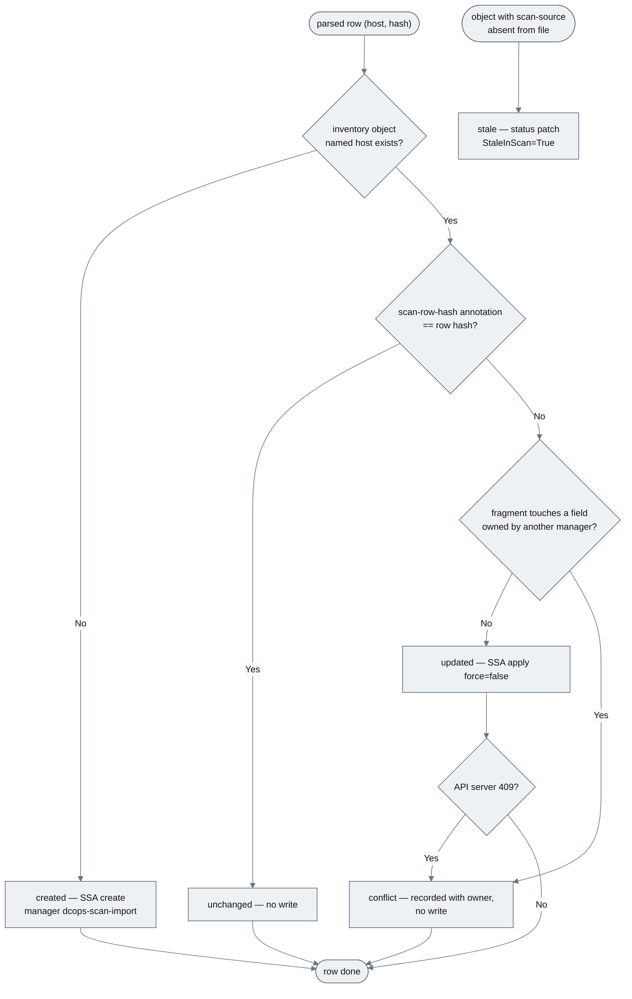

Field ownership after an import and a human edit (erDiagram used as an ownership map: each entity is a field manager and its attributes are the fields it owns).

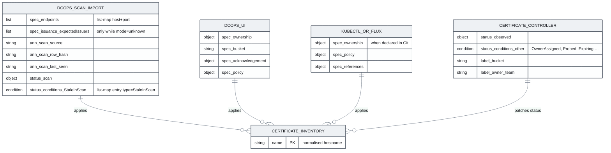

### Functional requirements

| ID | Requirement |
|----|-------------|
| **FR-002.5-01** | MUST classify every row as `created`, `updated`, `unchanged`, `conflict` or `error`, and every previously scanned object absent from the file as `stale`, exactly as described |
| **FR-002.5-02** | MUST perform all writes as Server-Side Apply with `fieldManager: dcops-scan-import` and `force: false` |
| **FR-002.5-03** | MUST restrict the apply fragment to the fields enumerated in the Description; a unit test asserts the fragment's JSON contains no other top-level spec keys |
| **FR-002.5-04** | MUST skip the write entirely for `unchanged` rows (zero API calls) |
| **FR-002.5-05** | MUST apply `spec.issuance.expectedIssuers` only when the current object has `spec.issuance.mode == unknown` (or does not exist) |
| **FR-002.5-06** | MUST set `StaleInScan=True` (reason `AbsentFromScan`) on stale objects and `False` when a host reappears, via the status subresource with the same manager |
| **FR-002.5-07** | MUST record a 409 as `conflict` including the owning manager and field path from the API server's error, and MUST NOT retry with `force: true` |
| **FR-002.5-08** | MUST NOT contain any code path that deletes a `CertificateInventory` |
| **FR-002.5-09** | MUST batch writes (50 per batch, 8 concurrent) and retry 429/5xx with `BackoffCalculator`, at most 5 attempts per object |
| **FR-002.5-10** | MUST write `status.result.summary` counters and `errors[]` (row line, host, reason) at the end; partial progress is written every 500 rows so a retried Job can resume by skipping objects whose annotation already matches |

### Non-functional requirements

| ID | Category | Requirement |
|----|----------|-------------|
| **NFR-002.5-01** | Idempotency | Applying the same file twice produces zero writes on the second run (`unchanged == total`), verified in IT-002.4-01 |
| **NFR-002.5-02** | Safety | A human-owned field cannot be overwritten by the importer under any input, proven by a test that pre-owns `spec.ownership` with manager `dcops-ui` and asserts the object is unchanged and the row is `conflict`-free (the fragment never includes it) |
| **NFR-002.5-03** | Performance | ≥ 100 SSA writes/s sustained against the dev API server; total apply of 5,368 creates < 60 s |
| **NFR-002.5-04** | Observability | Counters `dcops_scan_import_rows_total{outcome}` incremented per row; per-row conflicts logged at `warn` with manager and field |

### Acceptance criteria

| ID | Given / When / Then |
|----|---------------------|
| **AC-002.5-01** | **Given** an empty namespace **When** the export is applied **Then** `created == 5,368` (minus dedupes), each object has the three `scan-*` annotations and `status.scan` populated, `spec.bucket == unclassified`, `spec.issuance.mode == unknown` |
| **AC-002.5-02** | **Given** that state **When** the same file is applied again **Then** `unchanged == total` and the API server audit log shows no `apply` requests to `certificateinventories` |
| **AC-002.5-03** | **Given** an object whose `spec.ownership.team` was set via `dcops-ui` and whose `spec.issuance.mode` was set to `external` **When** a new export changes its issuers and expiry **Then** `status.scan.expiry` updates, `spec.ownership` and `spec.issuance` are unchanged, and the row is `updated` |
| **AC-002.5-04** | **Given** an object whose `spec.endpoints` was set by `kubectl` **When** the export lists that host with a different endpoint **Then** the row is `conflict` naming manager `kubectl` and path `spec.endpoints`, and the object is unchanged |
| **AC-002.5-05** | **Given** a host present in the previous import and absent now **Then** `StaleInScan=True` with reason `AbsentFromScan` and `status.scan.lastSeen` is the previous date; **When** it reappears **Then** `StaleInScan=False` |
| **AC-002.5-06** | **Given** the worker is interrupted after 2,000 rows and retried **Then** the retry skips objects whose annotation already matches and the final counters equal a clean run's |

### Unit test criteria

| ID | Test | Covers |
|----|------|--------|
| **UT-002.5-01** | `apply_test::fragment_contains_only_allowed_fields` — JSON-schema-style allowlist over the generated apply fragment | FR-002.5-03, NFR-002.5-02 |
| **UT-002.5-02** | `diff_test::outcome_table` — table-driven over absent / same-hash / different-hash / other-manager-owned / stale / row-error | FR-002.5-01, AC-002.5-01..05 |
| **UT-002.5-03** | `apply_test::unchanged_rows_issue_no_calls` — `MockKubeApi` call count 0 | FR-002.5-04, AC-002.5-02 |
| **UT-002.5-04** | `apply_test::expected_issuers_only_when_mode_unknown` | FR-002.5-05, AC-002.5-03 |
| **UT-002.5-05** | `apply_test::stale_condition_set_and_cleared` | FR-002.5-06, AC-002.5-05 |
| **UT-002.5-06** | `apply_test::conflict_409_recorded_never_forced` — mock returns 409 with a managedFields conflict body; assert no second call with `force` | FR-002.5-07, AC-002.5-04 |
| **UT-002.5-07** | `apply_test::no_delete_symbol` — compile-time: the `kube` feature module has no `delete` call (grep test over the module source in `build.rs` or a unit test scanning the file) | FR-002.5-08 |
| **UT-002.5-08** | `apply_test::batching_retry_and_resume` — 429 then success; interrupted-at-2000 resume | FR-002.5-09/10, AC-002.5-06 |

### Integration test criteria

| ID | Test | Environment | Covers |
|----|------|-------------|--------|
| **IT-002.5-01** | Covered by IT-002.4-01 (first and second apply) plus `tests/import_ownership.rs` — pre-sets `spec.ownership` with manager `dcops-ui` and `spec.endpoints` with `kubectl`, applies a changed export, asserts AC-002.5-03/04/05 against the real API server's managedFields behaviour | kind/k3s via Tilt | NFR-002.5-01/02, AC-002.5-03/04/05 |

### QA process

1. After the first full import (CM-002.4 QA step 2): `kubectl -n certificates get certificateinventory www-dev.metro-vto.es -o yaml` — confirm annotations, `status.scan`, `managedFields` shows `dcops-scan-import` for `spec.endpoints` only.
2. `kubectl patch certificateinventory www-dev.metro-vto.es --type=merge -p '{"spec":{"ownership":{"team":"platform"},"issuance":{"mode":"external"}}}'` (this uses manager `kubectl`). Edit a copy of the CSV changing that host's expiry and issuer; import and confirm. Verify `status.scan.expiry` changed, `spec.ownership.team` and `spec.issuance.mode` intact, row outcome `updated`.
3. `kubectl apply --server-side --field-manager=kubectl -f` a fragment setting `spec.endpoints[0].port: 8443` on another host; import a CSV with that host → outcome `conflict`, object unchanged, `status.result.errors[]` names `kubectl` and `spec.endpoints`.
4. Remove a host from the CSV; import → `StaleInScan=True`; add it back; import → `False`.
5. Negative path: attempt `kubectl delete` through the worker SA (`--as`) → forbidden; confirm no delete verb in `config/certificate-controller/rbac-worker.yaml`.
6. Attach: the three `-o yaml` excerpts (before/after), the `status.result` of each import, nextest report.

---

## CM-002.6 — `dcops-certctl import`, `just cert-import` and import metrics

**As an** engineer, **I want** a CLI that drives the same API (with a direct-apply option for bootstrap) and import metrics on `/metrics` **so that** automation and initial loads do not need the UI and Operations can see import health in Datadog.

### Description

Adds `crates/dcops-certctl` (binary `dcops-certctl`, clap, `reqwest` rustls) with subcommands: `parse --dry-run <csv>` (runs `certificate-scan` locally and prints the summary and column mapping — no network); `import <csv> [--namespace] [--note] [--wait] [--auto-confirm] [--token-cmd]` which computes the file's sha256 and 8 KiB sample, calls `POST /imports`, `PUT`s the file to the returned signed URL with the required headers, calls `POST …/uploaded`, streams `/events`, prints the preview summary, and either waits for a human `y` or, with `--auto-confirm`, confirms immediately; `status <importId>`; `list`. Tokens come from `--token-cmd` (e.g. a Sesame-IDAM client-credentials helper) or `DCOPS_TOKEN`. `just cert-import <csv>` wraps `dcops-certctl import --wait` with the dev token helper. A `--direct` flag (engineers only) obtains the signed URL by calling the API like any other client but skips the preview (`spec.mode: applyDirect`) — it never uses bucket credentials of its own and there is no path that bypasses the API to write to the bucket; it requires `ALLOW_DIRECT_APPLY=true` on the controller (`FR-002.4-11`). `download <importId> --artifact scan|preview|result` follows the signed-`GET` redirect from `CM-002.3`.

Metrics: on the API, `dcops_api_imports_total{result}` (`accepted|deduplicated|rejected_format|rejected_size|error`), `dcops_api_import_intake_duration_seconds`; on the controller, the families from `CM-002.4` plus `dcops_scan_import_rows_total{outcome}` (`CM-002.5`) and `dcops_scan_import_last_timestamp_seconds{source}` set on `Completed`. Names match design §8.1 so EPIC-CM-007/008 pick them up unchanged.

### Diagrams

CLI flow (flowchart).

```mermaid
%%{init: {'theme':'base','themeVariables': {'fontFamily': 'Inter, Segoe UI, Helvetica, Arial, sans-serif', 'fontSize': '14px', 'primaryColor': '#EEF1F4', 'primaryTextColor': '#111318', 'primaryBorderColor': '#5E6672', 'secondaryColor': '#EAF3FF', 'secondaryTextColor': '#111318', 'secondaryBorderColor': '#2F80ED', 'tertiaryColor': '#EAF8F0', 'tertiaryTextColor': '#111318', 'tertiaryBorderColor': '#2FA36B', 'lineColor': '#6B7684', 'textColor': '#6B7684', 'nodeBorder': '#5E6672', 'nodeTextColor': '#111318', 'mainBkg': '#EEF1F4', 'clusterBkg': '#F7F9FB', 'clusterBorder': '#BAC1C9', 'titleColor': '#111318', 'edgeLabelBackground': '#F7F9FB', 'actorBkg': '#EEF1F4', 'actorBorder': '#5E6672', 'actorTextColor': '#111318', 'actorLineColor': '#BAC1C9', 'signalColor': '#6B7684', 'signalTextColor': '#6B7684', 'labelBoxBkgColor': '#EAF3FF', 'labelBoxBorderColor': '#2F80ED', 'labelTextColor': '#111318', 'loopTextColor': '#111318', 'noteBkgColor': '#FFF6E7', 'noteBorderColor': '#E6A23C', 'noteTextColor': '#111318', 'activationBkgColor': '#DCE6F7', 'activationBorderColor': '#2F80ED', 'sequenceNumberColor': '#FFFFFF', 'labelColor': '#111318', 'altBackground': '#F7F9FB', 'attributeBackgroundColorOdd': '#FFFFFF', 'attributeBackgroundColorEven': '#F7F9FB', 'classText': '#111318'}}}%%
flowchart LR
    csv(["certificates.csv"]) --> parse["dcops-certctl parse --dry-run<br/>(local, no network)"]
    csv --> imp["dcops-certctl import --wait"]
    imp --> tok["token: --token-cmd | DCOPS_TOKEN"]
    tok --> post["POST /imports {sha256, sample}"]
    post --> put["PUT scan.csv → signed URL"]
    put --> upl["POST /uploaded"]
    upl --> sse["stream /events"]
    sse --> prev["print preview summary"]
    prev --> q{"--auto-confirm?"}
    q -->|Yes| conf["POST /confirm"]
    q -->|No| ask["prompt y/N"] --> conf
    conf --> wait["wait Completed / Failed"]
    wait --> out(["exit 0 / 1 with summary"])
    csv -. "--direct" .-> direct["same API flow, spec.mode applyDirect<br/>(controller flag ALLOW_DIRECT_APPLY)"]
```

### Functional requirements

| ID | Requirement |
|----|-------------|
| **FR-002.6-01** | MUST provide `dcops-certctl` with `parse --dry-run`, `import` (create → signed `PUT` → `uploaded` → events → confirm), `status`, `list`, `download` subcommands as described |
| **FR-002.6-02** | MUST obtain the bearer token from `--token-cmd` or `DCOPS_TOKEN` and never log it |
| **FR-002.6-03** | MUST exit non-zero when the import ends `Failed`, `Expired` or `Cancelled`, or when `--wait` times out (default 10 min) |
| **FR-002.6-04** | MUST implement `--direct` as the normal API flow with `spec.mode: applyDirect` (no bucket credentials in the CLI, ever) and refuse with a clear message if the controller reports direct apply disabled (Event/condition on the CR) |
| **FR-002.6-05** | MUST add `just cert-import` and document it in `CONTRIBUTING.md` |
| **FR-002.6-06** | MUST expose the API and controller metric families listed with exact names and labels |
| **FR-002.6-07** | SHOULD print the preview summary as a table and, with `--json`, as machine-readable output |

### Non-functional requirements

| ID | Category | Requirement |
|----|----------|-------------|
| **NFR-002.6-01** | Security | The CLI holds only the bearer token and the short-lived signed URL; it never embeds or reads bucket or Google credentials; tokens and signed URLs are redacted in `--verbose` output |
| **NFR-002.6-02** | Compatibility | Builds for `linux/amd64`, `linux/arm64`, `darwin/arm64`; released with the controller image tag |
| **NFR-002.6-03** | Observability | Metric cardinality: no `importId` label on any family |

### Acceptance criteria

| ID | Given / When / Then |
|----|---------------------|
| **AC-002.6-01** | **Given** the export **When** `dcops-certctl parse --dry-run` runs **Then** it prints 5,368 rows, zero errors and the column mapping, without network access |
| **AC-002.6-02** | **Given** a dev token **When** `just cert-import certificates.csv` runs **Then** it prints the preview summary, prompts, and on `y` waits until `Completed` and exits 0 |
| **AC-002.6-03** | **Given** `--auto-confirm` **Then** no prompt; **Given** the worker fails **Then** exit 1 with the `lastError` |
| **AC-002.6-04** | **Given** `ALLOW_DIRECT_APPLY` unset **When** `--direct` is used **Then** the CLI exits 2 with the reason from the CR condition |
| **AC-002.6-05** | **Given** one accepted, one deduplicated and one rejected upload **When** `/metrics` on the API is scraped **Then** `dcops_api_imports_total` shows 1/1/1 by `result` |
| **AC-002.6-06** | **Given** a completed import **When** the controller `/metrics` is scraped **Then** `dcops_scan_import_rows_total{outcome}` sums to the row count and `dcops_scan_import_last_timestamp_seconds{source="bitsight"}` is recent |

### Unit test criteria

| ID | Test | Covers |
|----|------|--------|
| **UT-002.6-01** | `cli_test::parse_dry_run_output` — snapshot of summary table for the fixture | FR-002.6-01, AC-002.6-01 |
| **UT-002.6-02** | `cli_test::import_flow_against_wiremock` — wiremock API + wiremock bucket: 201 with signed URL, `PUT` with the returned headers, `uploaded` 202, SSE phases, confirm, Completed; asserts exit code and that neither the token nor the signed URL appears in captured logs | FR-002.6-01/02/03, AC-002.6-02/03 |
| **UT-002.6-03** | `cli_test::direct_refused_when_disabled` — fake CR condition | FR-002.6-04, AC-002.6-04 |
| **UT-002.6-04** | `impl/src/metrics_test.rs::api_import_families` and `controllers/certificate/src/metrics_test.rs::scan_import_families` | FR-002.6-06, NFR-002.6-03, AC-002.6-05/06 |

### Integration test criteria

| ID | Test | Environment | Covers |
|----|------|-------------|--------|
| **IT-002.6-01** | `tests/cli_end_to_end.rs` — runs the built `dcops-certctl import --auto-confirm --wait` against Tilt, asserts exit 0 and inventory count; scrapes both `/metrics` | kind/k3s via Tilt | AC-002.6-02/05/06 |

### QA process

1. `cargo run -p dcops-certctl -- parse --dry-run certificates.csv` with networking disabled (`unshare -n` or airplane mode) — succeeds.
2. `just cert-import certificates.csv` — walk through prompt; confirm exit 0 and summary. Repeat with `--auto-confirm` on the same file → summary shows all unchanged.
3. Port-forward API and controller `/metrics`; capture the families in AC-002.6-05/06.
4. Negative paths: `DCOPS_TOKEN` unset → clear error, exit 2; `--direct` without the controller flag → exit 2 with reason; kill the worker mid-run (`WORKER_FAIL_AT=apply`) → exit 1 with `lastError`.
5. Attach: terminal transcripts, metrics snapshots, nextest report.

---

## CM-002.7 — `UploadStore`: GCS bucket on GKE with Workload Identity and one-time signed URLs; MinIO in dev

**As a** platform engineer, **I want** scan uploads and import artifacts persisted in a GCS bucket behind an `UploadStore` trait — signed by the API's Workload Identity through IAM `signBlob`, never by a key file — with MinIO standing in for the bucket in development **so that** originals are kept immutably for audit, nothing large flows through the API, DCops needs no database, and no service-account JSON key exists anywhere in the estate.

### Description

Production is GKE. The API and the import worker run as Kubernetes ServiceAccounts bound to Google service accounts through Workload Identity; they obtain short-lived access tokens from the GKE metadata server and nothing else. Signed URLs are produced by asking the IAM Credentials API to `signBlob` the V4 canonical request with the API's own GSA — the private key never leaves Google. There is deliberately **no** key-file signer, **no** `GOOGLE_APPLICATION_CREDENTIALS` file path, and no `type: service_account` JSON anywhere: not in Secrets, not in CI, not in Tilt. A repository lint (`scripts/check_no_sa_keys.py`, run in `just verify` and CI) fails on any file or manifest containing `"type": "service_account"`, a `private_key` PEM under a Google-looking client email, or `GOOGLE_APPLICATION_CREDENTIALS`; CI that needs GCP (the GKE manual-gate job) uses GitHub's Workload Identity Federation, keyless.

Creates `crates/upload-store` (workspace member; default features pull no async runtime so the BRRTRouter impl crate can use it; the worker enables `tokio`). Public surface: `trait UploadStore { fn sign_put(&self, key, content_type, content_length, ttl) -> Result<SignedUrl>; fn sign_get(&self, key, ttl) -> Result<SignedUrl>; fn head(&self, key) -> Result<Option<ObjectMeta>>; fn get(&self, key) -> Result<Box<dyn Read>>; fn put(&self, key, content_type, reader) -> Result<ObjectMeta>; }` with `ObjectMeta { size, etag, generation, updated }` and `SignedUrl { url, method, headers, expires_at }`. Two backends:

- `GcsStore` (production): V4 signing where the canonical request is built locally and the signature comes from `IamSignBlobSigner` (metadata-server token, cached until 5 min before expiry; one `signBlob` call per URL). `sign_put` binds the URL to one key, method `PUT`, a ≤ 15-minute expiry, and the signed headers `content-type`, `content-length` **and `x-goog-if-generation-match: 0`** — the precondition makes the URL a genuine one-time write: it can create the object once and can never overwrite it, even before expiry. `sign_get` is `GET`-only, ≤ 5 minutes. Data-plane `head`/`get`/`put` use the same identity over the JSON API, `put` with `ifGenerationMatch=0`. HTTP goes through BRRTRouter's native rustls client under default features and `reqwest` under `tokio`.
- `S3Store` (development and CI): SigV4 presigning for MinIO (or any S3-compatible store), same trait and layout, and the same one-time semantics expressed as `If-None-Match: *` in the signed headers. MinIO credentials in dev are MinIO's own access key/secret from the Tilt-managed dev instance — a scoped, disposable dev credential, not a Google key — supplied to the API and worker as a Kubernetes Secret in the dev overlay only; the production overlay has no such Secret and `UPLOAD_STORE=s3` is rejected at startup when `ENVIRONMENT=production`.

`MockUploadStore` (feature `testing`) records signing requests and serves in-memory objects. Bucket layout `imports/<namespace>/<importId>/{scan.csv, preview.jsonl.gz, result.jsonl.gz}`; uniform bucket-level access; object versioning on; lifecycle rule (Terraform under `config/upload-store/`) deletes `preview.*`/`result.*` after 30 days and `scan.csv` after the configured retention (default 400 days, the Level 2 audit horizon); CORS allowing `PUT` from the UI origin with `Content-Type`, `Content-Length`, `x-goog-if-generation-match`; optional CMEK. Required IAM: the API's GSA has `storage.objects.create`, `get`, `list` on the bucket (IAM condition: `imports/` prefix) and `roles/iam.serviceAccountTokenCreator` on **itself** (that is what `signBlob` needs); the worker's GSA has `objects.get` and `objects.create`; nobody has `objects.delete`. Both GSAs are bound to their KSAs with `iam.workloadIdentityUser`. Configuration: `UPLOAD_STORE=gcs|s3`, `UPLOAD_BUCKET`, `UPLOAD_PREFIX`, `GCS_SIGNER_EMAIL` (the API GSA), `S3_ENDPOINT`, `S3_REGION`, `S3_CREDENTIALS_SECRET` (dev only), `ENVIRONMENT`; identical variables in the API and controller so the two agree. Dev: Tilt runs MinIO (`config/dev/minio.yaml`) with the bucket, CORS and a 1-day lifecycle rule pre-created; `just dev-up` selects `UPLOAD_STORE=s3` against it.

Deliberately not here: any import logic; any object deletion API; any key-file path; browser code (the UI follows the `upload{url, method, headers}` it is handed, `CM-004.3`).

### Diagrams

Trait, backends and where the signature comes from (classDiagram).

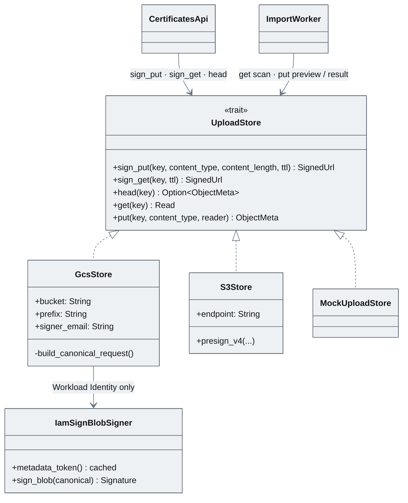

How a one-time signed `PUT` is produced and enforced in production (sequenceDiagram).

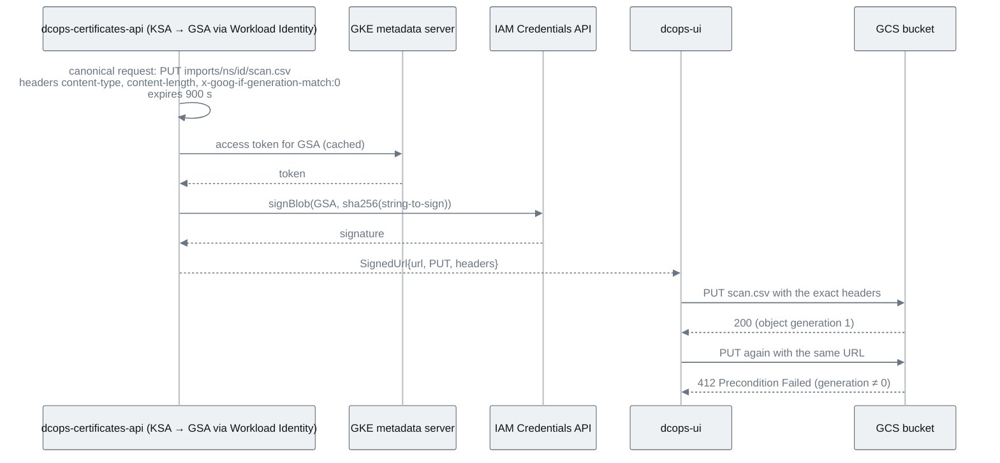

Who holds which credential and what each may do (flowchart).

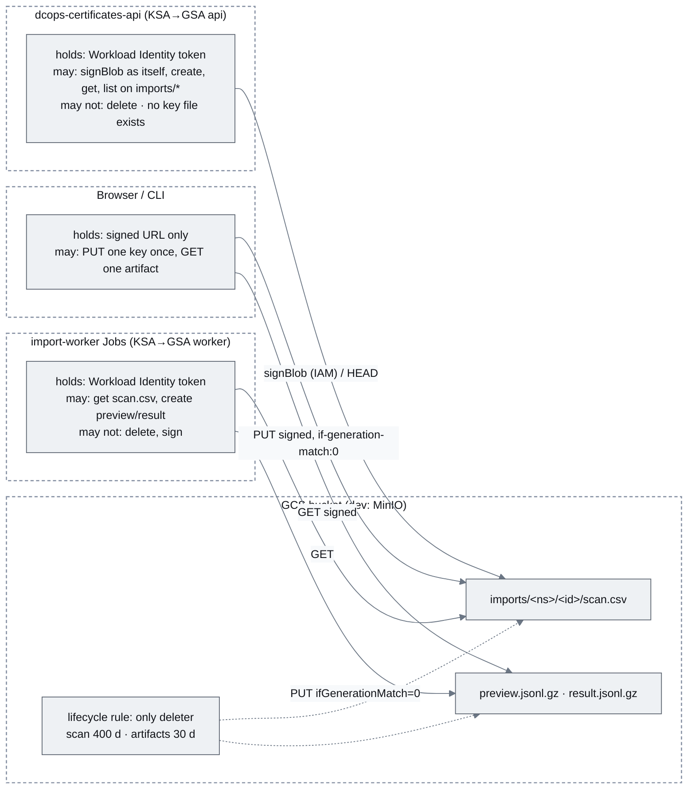

### Functional requirements

| ID | Requirement |
|----|-------------|
| **FR-002.7-01** | MUST provide the `UploadStore` trait and `GcsStore` producing V4 signed `PUT`/`GET` URLs bound to key, method, expiry and, for `PUT`, the signed headers `content-type`, `content-length` and `x-goog-if-generation-match: 0` |
| **FR-002.7-02** | MUST sign exclusively through `IamSignBlobSigner` (Workload Identity access token + IAM Credentials `signBlob` with the API's own GSA); the crate MUST NOT contain any code path that reads a service-account key file or `GOOGLE_APPLICATION_CREDENTIALS` |
| **FR-002.7-03** | MUST implement `head`, `get` and `put` over the GCS JSON API with the pod identity; `put` MUST set `ifGenerationMatch=0` |
| **FR-002.7-04** | MUST use the layout `imports/<namespace>/<importId>/{scan.csv, preview.jsonl.gz, result.jsonl.gz}` and refuse keys outside `UPLOAD_PREFIX` |
| **FR-002.7-05** | MUST expose no delete operation in the trait |
| **FR-002.7-06** | MUST provide `S3Store` (SigV4 presign with `If-None-Match: *` in signed headers) for MinIO in dev/CI, and `MockUploadStore` behind feature `testing`; MUST refuse `UPLOAD_STORE=s3` at startup when `ENVIRONMENT=production` |
| **FR-002.7-07** | MUST ship bucket and IAM provisioning as Terraform under `config/upload-store/`: versioning, lifecycle rules, CORS, uniform access, the two GSAs, Workload Identity bindings to the KSAs, `serviceAccountTokenCreator` on the API GSA for itself, prefix-conditioned object roles, optional CMEK, bucket audit logging |
| **FR-002.7-08** | MUST ship `config/dev/minio.yaml` and Tilt wiring so `just dev-up` provides a working presigned-URL bucket with no Google credentials |
| **FR-002.7-09** | MUST read the same `UPLOAD_*` configuration in the API and the controller and fail fast at startup on misconfiguration (missing bucket, `signBlob` denied, bucket not writable, key-file variables present) |
| **FR-002.7-10** | MUST add `scripts/check_no_sa_keys.py` to `just verify` and CI, failing on any `"type": "service_account"` JSON, Google-style `private_key` PEM, or `GOOGLE_APPLICATION_CREDENTIALS` reference in the repository, manifests or Tiltfile |
| **FR-002.7-11** | SHOULD emit `dcops_upload_store_requests_total{backend,op,result}` and `dcops_upload_store_sign_duration_seconds` |

### Non-functional requirements

| ID | Category | Requirement |
|----|----------|-------------|
| **NFR-002.7-01** | Security | No service-account JSON key exists in the repository, images, Secrets, ConfigMaps, CI or developer tooling; production identity is Workload Identity only; a `GOOGLE_APPLICATION_CREDENTIALS` variable present at startup is a fatal error |
| **NFR-002.7-02** | Security | Signed `PUT` URLs are one-time by construction (`x-goog-if-generation-match: 0` / `If-None-Match: *`) and ≤ 15 min; signed `GET` URLs ≤ 5 min; no long-lived bucket credential is ever sent to a client; signed URLs are logged only as a hash |
| **NFR-002.7-03** | Security | Objects are immutable once written (precondition + versioning); deletion is only by lifecycle rule; bucket audit logging is on |
| **NFR-002.7-04** | Performance | `sign_put` < 150 ms p95 with `IamSignBlobSigner` (token cached; one `signBlob` round-trip); `S3Store` presign < 5 ms |
| **NFR-002.7-05** | Reliability | Transient 429/5xx from GCS/IAM are retried with `BackoffCalculator` up to 3 times; a signing failure surfaces as `503 store_unavailable` from the API, never as a 500 |
| **NFR-002.7-06** | Compatibility | Production target is GKE with Workload Identity; dev/CI target is MinIO; no other deployment mode is supported and none is emulated |
| **NFR-002.7-07** | Portability | The crate has no `tokio` dependency under default features (used by the `may`-based API) |

### Acceptance criteria

| ID | Given / When / Then |
|----|---------------------|
| **AC-002.7-01** | **Given** `GcsStore` on a GKE pod with Workload Identity **When** `sign_put` is called **Then** the URL carries `X-Goog-Algorithm=GOOG4-RSA-SHA256`, the API GSA as `X-Goog-Credential`, an expiry ≤ 900 s and `X-Goog-SignedHeaders` including `content-type;content-length;x-goog-if-generation-match`; a `PUT` with those headers succeeds and a second `PUT` with the same URL returns 412 |
| **AC-002.7-02** | **Given** a `PUT` to that URL with a different `Content-Length`, a different `Content-Type`, or a different key **Then** GCS rejects it with 403 |
| **AC-002.7-03** | **Given** an existing `preview.jsonl.gz` **When** `put` is called for the same key **Then** it fails with `PreconditionFailed` and the original is intact |
| **AC-002.7-04** | **Given** the API's GSA **When** `gcloud storage rm` is attempted with its identity **Then** it is denied; **Given** the lifecycle rule **Then** objects older than the retention are removed (verified with a 1-day rule on the dev-project bucket) |
| **AC-002.7-05** | **Given** `just dev-up` with no Google credentials on the machine **Then** an upload through the UI succeeds against MinIO, a second `PUT` with the same presigned URL is rejected, and the intake integration test passes |
| **AC-002.7-06** | **Given** `ENVIRONMENT=production` and `UPLOAD_STORE=s3`, or any `GOOGLE_APPLICATION_CREDENTIALS` variable, or a misconfigured bucket **When** the API or controller starts **Then** it exits non-zero within 10 s with a clear message |
| **AC-002.7-07** | **Given** a commit adding a `service_account` JSON anywhere in the repository (test fixture) **When** CI runs **Then** `check_no_sa_keys` fails the build |
| **AC-002.7-08** | **Given** `cargo tree -p upload-store` **Then** no crate for key-file or ADC credential loading is present (e.g. `gcp_auth`'s file providers are not compiled in) |

### Unit test criteria

| ID | Test | Covers |
|----|------|--------|
| **UT-002.7-01** | `gcs/sign_test.rs::v4_canonical_request_matches_google_examples` — golden vectors from Google's signed-URL documentation, with a fake signer returning a fixed signature | FR-002.7-01 |
| **UT-002.7-02** | `gcs/sign_test.rs::put_signs_type_length_and_generation_match` and `::get_is_get_only_and_short_lived` | FR-002.7-01, NFR-002.7-02 |
| **UT-002.7-03** | `gcs/iam_signer_test.rs::signblob_called_with_cached_metadata_token` — wiremock metadata server + IAM Credentials API; asserts one `signBlob` per URL and token reuse | FR-002.7-02, NFR-002.7-04 |
| **UT-002.7-04** | `gcs/data_test.rs::put_sets_if_generation_match_zero` and `::head_maps_404_to_none` — wiremock JSON API | FR-002.7-03, AC-002.7-03 |
| **UT-002.7-05** | `store_test::rejects_key_outside_prefix` | FR-002.7-04 |
| **UT-002.7-06** | `store_test::trait_has_no_delete` — doc test that fails to compile if a `delete` method exists | FR-002.7-05 |
| **UT-002.7-07** | `s3/presign_test.rs::sigv4_golden_vectors_with_if_none_match` | FR-002.7-06 |
| **UT-002.7-08** | `config_test::production_rejects_s3_and_key_file_vars` and `::fail_fast_on_missing_bucket` | FR-002.7-06/09, AC-002.7-06 |
| **UT-002.7-09** | `retry_test::transient_errors_retried_then_503` | NFR-002.7-05 |
| **UT-002.7-10** | `scripts/tests/test_check_no_sa_keys.py` — fixtures for JSON key, PEM under a `gserviceaccount.com` email, env var reference; asserts detection and clean pass | FR-002.7-10, AC-002.7-07 |
| **UT-002.7-11** | `build_test::no_credential_file_crates` — `cargo tree` assertion in CI | AC-002.7-08 |

### Integration test criteria

| ID | Test | Environment | Covers |
|----|------|-------------|--------|
| **IT-002.7-01** | `tests/s3_minio.rs` (feature `integration`) — presign, `PUT`, second `PUT` rejected, `HEAD`, `GET`, precondition failure, wrong-length rejection against MinIO in the Tilt cluster | kind/k3s via Tilt + MinIO | AC-002.7-05 |
| **IT-002.7-02** | `tests/gcs_gke.rs` (feature `gke`, CI job authenticated by GitHub Workload Identity Federation — keyless) — runs on a GKE dev-project cluster: sign via `signBlob`, `PUT`, second `PUT` 412, wrong headers 403, `put` precondition, delete denied | GKE dev project | AC-002.7-01/02/03/04, AC-002.7-08 |
| **IT-002.7-03** | CI job `no-sa-keys` — runs `scripts/check_no_sa_keys.py` on every PR | GitHub Actions | FR-002.7-10, AC-002.7-07 |

### QA process

1. `just dev-up`; confirm `minio` green in Tilt and `dcops-certificates-api` logs `upload store: s3 (dev) endpoint=minio bucket=dcops-imports`. Confirm no `GOOGLE_APPLICATION_CREDENTIALS` in any pod env (`kubectl get pods -o yaml | grep -c GOOGLE_APPLICATION_CREDENTIALS` → 0).
2. Run the intake sequence from `CM-002.3` QA step 1; `mc ls dev/dcops-imports/imports/certificates/<id>/` shows `scan.csv`. Replay the same presigned `PUT` → rejected. `PUT` with a modified length → rejected.
3. On the GKE dev project (deployed from `config/upload-store/` Terraform and the production overlay): confirm the API pod's KSA annotation `iam.gke.io/gcp-service-account`; upload through the UI; in the console confirm the object, its generation, and that the API GSA has no `objects.delete`; run `gcloud storage rm` as that GSA → denied; replay the signed URL → 412.
4. `kubectl get secrets -A -o json | jq '.items[].data | keys[]' | grep -i -E 'json|credentials'` → nothing Google-related; `scripts/check_no_sa_keys.py` → clean.
5. Negative path: add a fixture `service_account` JSON under `tests/fixtures/` on a branch → CI fails; remove. Set `GOOGLE_APPLICATION_CREDENTIALS=/tmp/x` on the API Deployment → pod exits with the fatal message; revert. Set `ENVIRONMENT=production` with `UPLOAD_STORE=s3` → same.
6. Attach: Tilt screenshot, `mc ls` output, console screenshots (IAM, lifecycle, object generation), curl transcripts for 412/403, CI links for `no-sa-keys` and the GKE job, nextest report.
