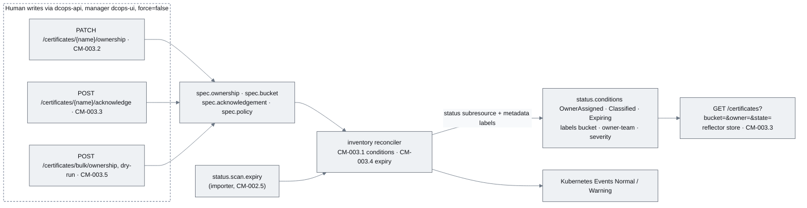
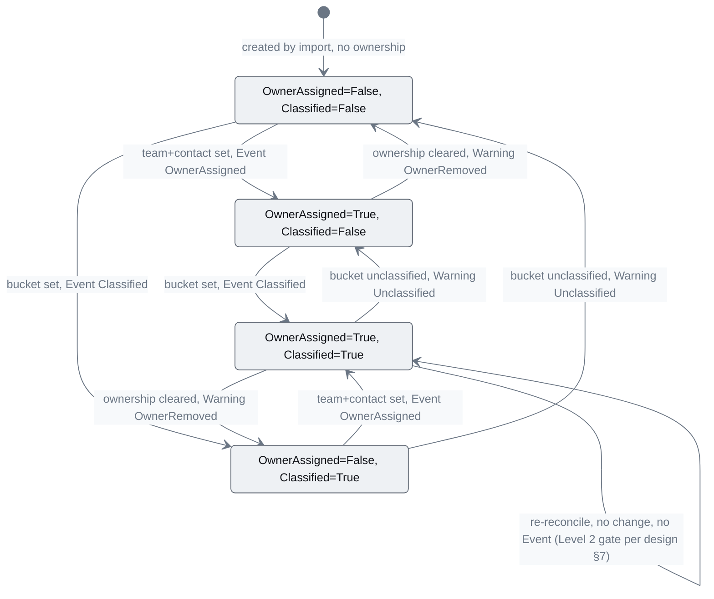
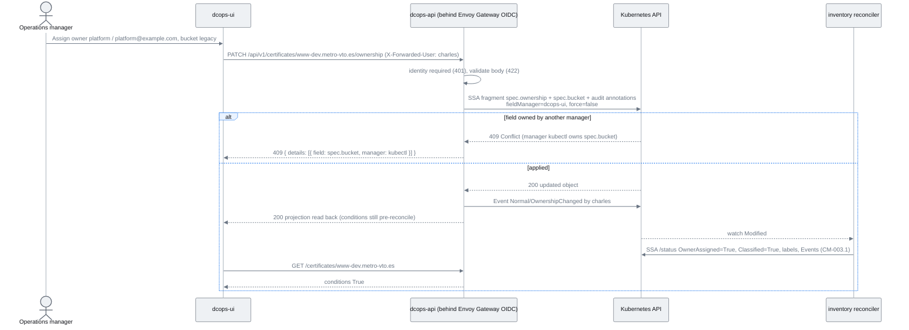
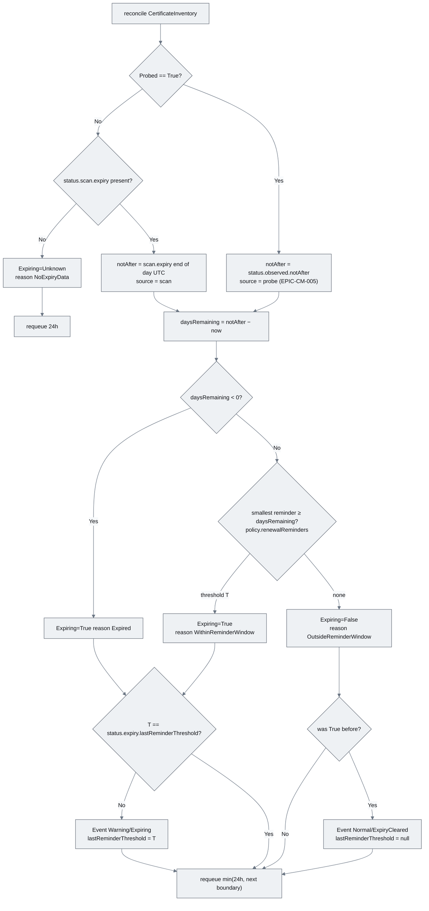
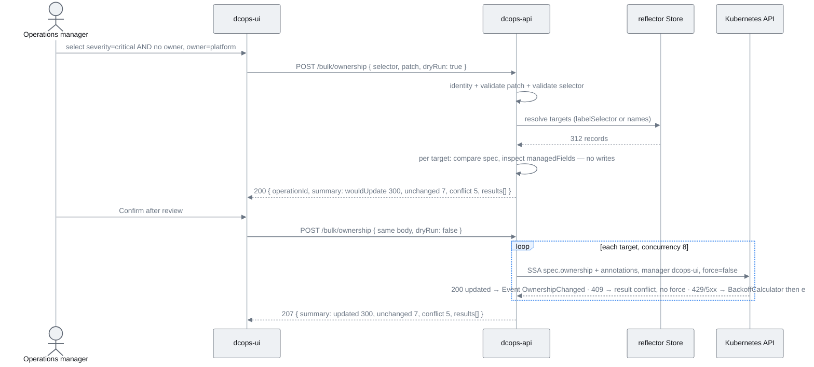

# EPIC-CM-003: Ownership, classification & Level-2 conditions

> **Parent:** [Certificate Management Design](../../CERTIFICATE_MANAGEMENT_DESIGN.md) §4, §5.2, §5.3, §6.1, §6.3, §7
> **Phase:** 1 — Inventory
> **CMMI level advanced:** Level 2 · Managed (owned, classified, tracked with reminders)
> **Status:** Draft — awaiting implementation
> **Priority:** P0
> **Estimated effort:** 10–13 days
> **Depends on:** EPIC-CM-001 (CRDs with list-map conditions, `controller-common` traits and mocks), EPIC-CM-002 (`dcops-certificates-api` OpenAPI contract and BRRTRouter service, `Identity` extractor, `ErrorEnvelope`, imported records with `status.scan.*`)

---

## Overview

After EPIC-CM-002 the cluster holds one `CertificateInventory` per scanned host, but the scan says 2,829 of them have no accountable owner and most have `bucket=unclassified`. Design §7 puts every such record at Level 1. This epic delivers the Level 2 mechanics: the inventory reconciler evaluates `OwnerAssigned` and `Classified` from spec and emits Events on every transition; `dcops-api` gains the write endpoints an Operations manager needs (`PATCH …/ownership`, `POST …/acknowledge`, a bulk owner-assignment endpoint with dry-run) and the filtered, paged list the inventory table reads; and a scan-derived `Expiring` condition produces reminders from `status.scan.expiry` before any live probe exists.

The field-ownership rule from design §6.3 governs every write here as it did the importer: all human-initiated writes are Server-Side Apply with field manager `dcops-ui`, `force=false`, touching only `spec.ownership`, `spec.bucket`, `spec.acknowledgement` and the audit annotations. A field that Git owns (manager `kubectl`/Flux) produces a 409 that the API surfaces with the owning manager, never overrides. The reconciler writes only `status` and the mirror labels; it never mutates spec (design §5.3). Caller identity comes from the bearer JWT validated by BRRTRouter's `JwksBearerProvider` and the `Identity` extractor in `CM-002.2`; every write records who and when.

Out of scope: the UI screens that call these endpoints (EPIC-CM-004), TLS probing and the probe-based `Expiring`/`SloBreached`/`Verified` conditions (EPIC-CM-005, which supersedes `CM-003.4`'s data source), escalation Events (EPIC-CM-005), maturity level computation (EPIC-CM-009), Git export of ownership (EPIC-CM-010), and any RBAC beyond identity capture (authorisation stays at the gateway per design §6.1).

## Epic-level diagram

How the Level 2 write path and the reconciler's evaluation loop connect (flowchart, because the point is that humans write spec through the API, the reconciler writes status, and nothing else crosses that line).

## Stories

| ID | Story | Persona | Effort |
|----|-------|---------|--------|
| **CM-003.1** | As an Operations manager, I want every record to show `OwnerAssigned` and `Classified` conditions derived from its spec, with an Event when they change, so that the unowned and unclassified estate is visible without reading YAML | Operations manager | 2 d |
| **CM-003.2** | As an Operations manager, I want to assign an owner, escalation chain, bucket, business units and environment to a record through the API so that ownership becomes data the controller can enforce | Operations manager | 2.5 d |
| **CM-003.3** | As an Operations manager, I want to acknowledge an alert on a record and list records filtered by bucket, owner, state and namespace so that the inventory table and the acknowledge action work | Operations manager | 2.5 d |
| **CM-003.4** | As an Operations manager, I want reminders when a scan-reported expiry falls inside a policy threshold, before the probe exists, so that Level 2 alerting starts on day one of the inventory | Operations manager | 2 d |
| **CM-003.5** | As an Operations manager, I want to assign an owner to many records at once by selector or list, with a dry-run, so that the 2,829 "assign accountable owner" rows can be cleared in bulk | Operations manager | 2 d |

## Definition of Done (epic)

- [ ] Every story's ACs pass
- [ ] `just verify` (fmt, clippy with workspace lints, nextest) is green
- [ ] Docs updated: README capability list gains "Ownership, classification and expiry reminders", `docs/implementationChecklists/CertificateInventory.md` Level 2 section ticked, `docs/api/dcops-api.md` lists every route with request/response examples
- [ ] On the dev cluster, after a full import and a bulk owner assignment, `kubectl get certificateinventories -l dcops.microscaler.io/owner-team=platform | wc -l` matches the API's filtered count
- [ ] A record owned through the API survives a subsequent scan import (`CM-002.5`) with ownership intact
- [ ] `kubectl get events --field-selector reason=Expiring` shows one Warning per record inside a reminder window, not one per reconcile

## Open questions

| ID | Question | Default if unresolved |
|----|----------|----------------------|
| **Q1** | Is `OwnerAssigned=True` satisfied by `ownership.team` alone, or does it require `ownership.contact` too? | Both required: a team without a reachable contact is what the scan's "assign accountable owner" rows already have in spirit |
| **Q2** | Environment values: fixed enum or free text? | Enum `production`, `staging`, `development`, `test`; mirrored into no label (multi-valued business units and environment are aggregated via `owner_team` per design §8.1) |
| **Q3** | Should the filtered list be served from the Kubernetes API with label selectors or from the controller's reflector store? | Reflector store shared with the controller (already held for the watch); label selectors cannot express condition-derived `state`, and the store answers 5.4k rows in memory |
| **Q4** | Should an acknowledgement be cleared automatically once the expiry moves out of the reminder window (renewal happened)? | No — the reconciler never writes spec. The acknowledgement stays as history; `Expiring=False` makes it moot and the UI shows it as historical. Revisit with escalation in EPIC-CM-005 |

---

## CM-003.1 — Inventory reconciler sets `OwnerAssigned` and `Classified`

**As an** Operations manager, **I want** each `CertificateInventory` to carry `OwnerAssigned` and `Classified` conditions computed from its spec, with a Kubernetes Event on each transition, **so that** the Level 2 gate in design §7 is visible on every record and in `kubectl wait`.

### Description

Replaces the `CM-001.4` stub in `controllers/certificate/src/reconciler/inventory.rs` and adds `reconciler/conditions.rs` containing a pure function `evaluate_level2(spec: &CertificateInventorySpec, status: &CertificateInventoryStatus, now) -> Vec<Condition>` (table-driven, no I/O) and `conditions::merge(existing, desired) -> Option<Vec<Condition>>` which returns `None` when nothing but `lastTransitionTime` would change. `OwnerAssigned=True` reason `OwnerSet` requires non-empty `spec.ownership.team` and `spec.ownership.contact`; otherwise `False` with reason `NoOwner` (both missing) or `ContactMissing`/`TeamMissing`. `Classified=True` reason `BucketSet` when `spec.bucket` is `fast-track` or `legacy`; `False` reason `Unclassified` otherwise. Each condition sets `observedGeneration` to `metadata.generation` and a human-readable `message`.

Status is written by SSA on the `/status` subresource with manager `certificate-controller`; because `conditions` is a list-map keyed by `type` (`CM-001.2`), the reconciler owns only the entries it emits and the importer's `StaleInScan` entry (`CM-002.5`) is untouched. The reconciler also mirrors `spec.bucket` into label `dcops.microscaler.io/bucket`, `spec.ownership.team` into `dcops.microscaler.io/owner-team` and `status.scan.severity` (lowercased) into `dcops.microscaler.io/severity` via an SSA metadata patch with the same manager; labels are map entries so ownership is per key. Missing values remove the label (the apply fragment omits it).

Events go through `EventRecorderTrait`: `Normal/OwnerAssigned` ("owner set to platform (platform@example.com) by charles" — the actor from the `last-modified-by` annotation written in `CM-003.2` when present), `Warning/OwnerRemoved`, `Normal/Classified` ("bucket legacy"), `Warning/Unclassified`. An Event is emitted only when `merge` reports a change in that condition's `status`, so re-reconciles are silent. The `Probed=False/NotImplemented` condition from `CM-001.4` is preserved until EPIC-CM-005 replaces it. Requeue stays at 1 h; spec changes arrive through the watch.  Not done here: any spec write, condition types other than the two above (`Expiring` is `CM-003.4`), maturity level (EPIC-CM-009).

### Diagrams

Condition transitions for one record and the Event each edge fires (stateDiagram-v2, because this is the contract the UI's state column and `kubectl wait` depend on).

### Functional requirements

| ID | Requirement |
|----|-------------|
| **FR-003.1-01** | MUST implement `conditions::evaluate_level2` as a pure function returning `OwnerAssigned` and `Classified` with the reasons `OwnerSet`, `NoOwner`, `TeamMissing`, `ContactMissing`, `BucketSet`, `Unclassified` and `observedGeneration=metadata.generation` |
| **FR-003.1-02** | MUST write conditions via SSA on `/status` with manager `certificate-controller`, touching only its own condition entries and never `StaleInScan` or `status.scan.*` |
| **FR-003.1-03** | MUST skip the status patch entirely when `conditions::merge` reports no change other than `lastTransitionTime` |
| **FR-003.1-04** | MUST emit `OwnerAssigned`/`Classified` (Normal) and `OwnerRemoved`/`Unclassified` (Warning) Events exactly once per `status` transition of the respective condition, naming the actor from `dcops.microscaler.io/last-modified-by` when present |
| **FR-003.1-05** | MUST mirror `spec.bucket`, `spec.ownership.team` and lowercased `status.scan.severity` into labels `dcops.microscaler.io/{bucket,owner-team,severity}` via SSA metadata patch with manager `certificate-controller`, removing a label when its source is empty |
| **FR-003.1-06** | MUST preserve the existing `Probed` condition and requeue at 1 h on success |
| **FR-003.1-07** | MUST NOT write any field under `spec` — the reconciler's `KubeApiTrait` handle for the main resource is used only for the metadata label fragment |
| **FR-003.1-08** | SHOULD set `message` text suitable for direct display in the UI state column (e.g. "no owner recorded — assign one") |

### Non-functional requirements

| ID | Category | Requirement |
|----|----------|-------------|
| **NFR-003.1-01** | Idempotency | Reconciling an unchanged record 100 times produces zero status patches, zero label patches and zero Events after the first |
| **NFR-003.1-02** | Performance | `evaluate_level2` runs in < 50 µs; a full sweep of 5,400 records after controller restart completes its initial status patches in < 60 s at the `CM-001.4` concurrency |
| **NFR-003.1-03** | Reliability | A status patch error is retried with `BackoffCalculator` (1–30 min) and counted in `dcops_controller_reconcile_total{kind="CertificateInventory",result="error"}` |
| **NFR-003.1-05** | Compatibility | Label values are validated against the Kubernetes label regex before applying; an invalid `team` (should be impossible after `CM-003.2` validation, possible from Git) logs a warning and omits the label rather than failing the reconcile |

### Acceptance criteria

| ID | Given / When / Then |
|----|---------------------|
| **AC-003.1-01** | **Given** a freshly imported record with no ownership and `bucket=unclassified` **When** reconciled **Then** `OwnerAssigned=False/NoOwner` and `Classified=False/Unclassified` are present and `kubectl wait --for=condition=OwnerAssigned=false` returns immediately |
| **AC-003.1-02** | **Given** that record **When** `spec.ownership.team=platform` and `contact=platform@example.com` are set **Then** within 10 s `OwnerAssigned=True/OwnerSet`, a `Normal` Event `OwnerAssigned` exists, and label `dcops.microscaler.io/owner-team=platform` is present |
| **AC-003.1-03** | **Given** a record with `team` set but no `contact` **When** reconciled **Then** `OwnerAssigned=False/ContactMissing` |
| **AC-003.1-04** | **Given** an owned record **When** `spec.ownership` is removed **Then** `OwnerAssigned=False`, a `Warning` Event `OwnerRemoved` exists and the `owner-team` label is gone |
| **AC-003.1-05** | **Given** `spec.bucket=legacy` **When** reconciled **Then** `Classified=True/BucketSet` and label `dcops.microscaler.io/bucket=legacy` |
| **AC-003.1-06** | **Given** a record with `StaleInScan=True` set by the importer **When** the reconciler patches conditions **Then** `StaleInScan` is still `True` and `managedFields` shows it owned by `dcops-scan-import` |
| **AC-003.1-07** | **Given** a Level 2 record **When** the controller reconciles it ten more times **Then** `resourceVersion` is unchanged and no new Events appear |

### Unit test criteria

| ID | Test | Covers |
|----|------|--------|
| **UT-003.1-01** | `reconciler::conditions_test::evaluate_level2_table` — table over (team, contact, bucket) → statuses, reasons and display-ready messages | FR-003.1-01/08, AC-003.1-01/03/05 |
| **UT-003.1-02** | `reconciler::conditions_test::merge_returns_none_when_only_transition_time_differs` | FR-003.1-03, NFR-003.1-01, AC-003.1-07 |
| **UT-003.1-03** | `reconciler::inventory_test::status_patch_is_ssa_with_controller_manager_and_own_entries_only` — `MockKubeApi` records the patch; asserts manager, no `StaleInScan`, no `scan` key | FR-003.1-02, AC-003.1-06 |
| **UT-003.1-04** | `reconciler::inventory_test::events_once_per_transition` — `MockEventRecorder` over a sequence unowned → owned → owned → removed; asserts exactly `OwnerAssigned` then `OwnerRemoved` | FR-003.1-04, AC-003.1-02/04 |
| **UT-003.1-05** | `reconciler::inventory_test::event_names_actor_from_annotation` | FR-003.1-04 |
| **UT-003.1-06** | `reconciler::inventory_test::labels_mirrored_and_removed` — asserts label fragment contents including omission on empty and lowercase severity | FR-003.1-05, AC-003.1-02/04/05 |
| **UT-003.1-07** | `reconciler::inventory_test::never_patches_spec` — every recorded patch body is asserted to have no `spec` key | FR-003.1-07 |
| **UT-003.1-08** | `reconciler::inventory_test::probed_condition_preserved_and_requeue_1h` | FR-003.1-06 |
| **UT-003.1-09** | `reconciler::inventory_test::invalid_label_value_skipped_with_warning` | NFR-003.1-05 |
| **UT-003.1-10** | `reconciler::inventory_test::patch_error_uses_backoff_and_metric` | NFR-003.1-03 |

### Integration test criteria

| ID | Test | Environment | Covers |
|----|------|-------------|--------|
| **IT-003.1-01** | `tests/level2_conditions.rs` (feature `integration`) — applies an unowned example, waits for conditions, patches ownership and bucket with `kubectl apply --server-side --field-manager=dcops-ui`, asserts conditions, labels, Events and `StaleInScan` ownership; then loops ten reconciles and asserts stable `resourceVersion` | kind/k3s via Tilt, `cargo nextest --features integration` | AC-003.1-01..07 |

### QA process

1. `just dev-up`; run a full import (`CM-002.6` QA step 2). `kubectl -n certificates get certificateinventories -o custom-columns=NAME:.metadata.name,OWNER:.status.conditions[?\(@.type==\"OwnerAssigned\"\)].status,CLASS:.status.conditions[?\(@.type==\"Classified\"\)].status | head` — all `False`.
2. `kubectl wait --for=condition=OwnerAssigned=false certificateinventory/<host> -n certificates --timeout=5s` — returns immediately.
3. Set ownership and bucket on one record with `kubectl apply --server-side --field-manager=dcops-ui -f owned.yaml` (spec-only manifest). Within 10 s: `kubectl describe` shows both conditions `True`, Events `OwnerAssigned` and `Classified`, and `kubectl get -l dcops.microscaler.io/owner-team=platform` lists it.
4. Confirm `StaleInScan` still owned by the importer: `kubectl get … -o jsonpath='{.metadata.managedFields}' | jq` — the `conditions` entry keyed `type=StaleInScan` under manager `dcops-scan-import`.
5. Negative path: apply a manifest with `team` but no `contact` → `OwnerAssigned=False/ContactMissing`. Remove ownership entirely → `Warning OwnerRemoved` Event, label gone. Apply a `team` value with an uppercase letter via `kubectl` → reconcile succeeds, label omitted, warning in logs.
6. Idempotency: note `resourceVersion`, trigger ten reconciles (`kubectl annotate … touch=$(date +%s) --overwrite` is a metadata change and must not create Events; also restart the controller once) → `resourceVersion` changes only from the annotate, Event count unchanged.
7. Attach: custom-columns output, `describe` Events, `managedFields` excerpt, negative-path outputs, nextest report.

---

## CM-003.2 — `PATCH /api/v1/certificates/{name}/ownership`

**As an** Operations manager, **I want** to set owner, escalation chain, bucket, business units and environment on a record through the API, with my identity recorded, **so that** ownership becomes enforced data and every change is attributable.

### Description

Adds `controllers/certificate/src/api/ownership.rs` and `api/validate.rs`. The request body is `{ owner?: {team, contact}, escalation?: [{after, to}], bucket?, businessUnits?: [], environment? }` — at least one key required, `namespace` as a query parameter defaulting to `IMPORT_DEFAULT_NAMESPACE`. Validation (returned as 422 with per-field `details[]`): `team` matches the label-value regex `^[a-z0-9]([-a-z0-9]{0,61}[a-z0-9])?$` because `CM-003.1` mirrors it into a label; `contact` is an email or a `@handle` of ≤ 254 characters; each `escalation[].after` matches `^[0-9]+(h|d)$` and `to` is a contact; `bucket` is one of `fast-track`, `legacy`, `unclassified`; `businessUnits` has ≤ 20 entries of ≤ 128 characters; `environment` is one of the Q2 enum. `owner: null` clears ownership explicitly; omitted keys are left untouched.

The handler builds an SSA fragment containing only the provided keys under `spec.ownership`/`spec.bucket` plus annotations `dcops.microscaler.io/last-modified-by=<identity>` and `dcops.microscaler.io/last-modified-at=<RFC3339>`, applied with `PatchParams::apply("dcops-ui")`, `force=false`, through `KubeApiTrait::apply`. A 409 from the API server is mapped to HTTP 409 with `details[]` listing `{field, manager}` and a message such as "spec.bucket is managed by kubectl — change it in Git". The handler then emits `Normal/OwnershipChanged` via `EventRecorderTrait` naming the identity and the changed keys (values for `team`, `bucket`, `environment`; count only for `escalation` and `businessUnits`). The response is 200 with the record projection from `CM-003.3` (`name`, `namespace`, `ownership`, `bucket`, `conditions`, `labels`), read back after the apply so the caller sees the server's view. Because the reconciler evaluates asynchronously, the response carries the pre-reconcile conditions and a `Cache-Control: no-store` header; the UI re-fetches.  Identity is mandatory on this route regardless of `API_REQUIRE_IDENTITY` — an ownership change with no actor is refused with 401, since the audit annotation and Event would be meaningless.

### Diagrams

The ownership PATCH from gateway to reconciler (sequenceDiagram, because the interesting part is the SSA conflict branch and the asynchronous condition update).

### Functional requirements

| ID | Requirement |
|----|-------------|
| **FR-003.2-01** | MUST mount `PATCH /api/v1/certificates/{name}/ownership` with `?namespace=` accepting the body shape in the Description and rejecting an empty body with 422 |
| **FR-003.2-02** | MUST validate every field per the Description and return 422 with `details[{field, message}]` listing all failures at once |
| **FR-003.2-03** | MUST apply only the provided keys under `spec.ownership`, `spec.bucket` and the two audit annotations, as SSA with manager `dcops-ui` and `force=false` |
| **FR-003.2-04** | MUST map an API-server 409 to HTTP 409 with `details[{field, manager}]` and MUST NOT retry with `force` |
| **FR-003.2-05** | MUST require a caller identity on this route and record it in `dcops.microscaler.io/last-modified-by` with `last-modified-at` in RFC 3339 UTC |
| **FR-003.2-06** | MUST emit `Normal/OwnershipChanged` naming the identity and changed keys after a successful apply |
| **FR-003.2-07** | MUST return 200 with the record projection read back after the apply, 404 for an unknown record, and `Cache-Control: no-store` |
| **FR-003.2-08** | MUST support `owner: null` to clear `spec.ownership` (the fragment applies an empty `ownership` object owned by `dcops-ui`, which removes fields previously owned by `dcops-ui` only) |

### Non-functional requirements

| ID | Category | Requirement |
|----|----------|-------------|
| **NFR-003.2-01** | Security | Identity is taken only from a JWT validated against the configured JWKS (`CM-002.2`); a request without a valid bearer token is 401, and one without the write role is 403 |
| **NFR-003.2-02** | Security | Identity and body values are treated as untrusted text: annotation values are truncated to 253 characters and control characters are stripped; nothing from the body is interpolated into a label except the validated `team` |
| **NFR-003.2-03** | Idempotency | Repeating the same PATCH yields 200, an unchanged `resourceVersion`, and no second `OwnershipChanged` Event (the handler compares the object before and after apply) |
| **NFR-003.2-04** | Performance | p95 latency < 300 ms on the dev cluster including the read-back |
| **NFR-003.2-05** | Observability | One `tracing` event per call with `name`, `namespace`, `identity`, `changed_keys`, `status`; no contact addresses in logs beyond the identity |

### Acceptance criteria

| ID | Given / When / Then |
|----|---------------------|
| **AC-003.2-01** | **Given** an unowned record **When** `PATCH` with owner, escalation, bucket `legacy`, business units and environment via the gateway **Then** 200, the spec fields are set, annotations `last-modified-by=charles` and `last-modified-at` exist, `managedFields` shows `dcops-ui` owning them, and an `OwnershipChanged` Event names charles |
| **AC-003.2-02** | **Given** that record **When** a scan import (`CM-002.5`) runs **Then** ownership, bucket, business units and environment are unchanged |
| **AC-003.2-03** | **Given** a record whose `spec.bucket` was applied by manager `kubectl` **When** `PATCH {bucket: "fast-track"}` **Then** 409 with `details[0].manager == "kubectl"` and the object is unchanged |
| **AC-003.2-04** | **Given** `{owner: {team: "Platform Team", contact: "nobody"}}` **When** patched **Then** 422 listing both `owner.team` and `owner.contact` |
| **AC-003.2-05** | **Given** a request without a trusted identity **When** patched **Then** 401 and no object change |
| **AC-003.2-06** | **Given** an owned record **When** `PATCH {owner: null}` **Then** `spec.ownership` is empty and the reconciler sets `OwnerAssigned=False` with an `OwnerRemoved` Warning |
| **AC-003.2-07** | **Given** the same PATCH sent twice **When** compared **Then** the second returns 200 with the same `resourceVersion` and no new Event |
| **AC-003.2-08** | **Given** an unknown name **When** patched **Then** 404 |

### Unit test criteria

| ID | Test | Covers |
|----|------|--------|
| **UT-003.2-01** | `api::ownership_test::apply_fragment_contains_only_provided_keys_and_audit_annotations` — `MockKubeApi` records the SSA body and `PatchParams` (manager `dcops-ui`, `force=false`) | FR-003.2-03/05, AC-003.2-01 |
| **UT-003.2-02** | `api::validate_test::ownership_body_table` — every rule in FR-003.2-02 with valid and invalid samples, asserting all failures are reported together | FR-003.2-02, AC-003.2-04 |
| **UT-003.2-03** | `api::ownership_test::conflict_409_mapped_with_manager_and_not_forced` | FR-003.2-04, AC-003.2-03 |
| **UT-003.2-04** | `api::ownership_test::requires_identity_even_when_not_globally_required` | FR-003.2-05, NFR-003.2-01, AC-003.2-05 |
| **UT-003.2-05** | `api::ownership_test::event_emitted_with_identity_and_changed_keys` — `MockEventRecorder` | FR-003.2-06, AC-003.2-01 |
| **UT-003.2-06** | `api::ownership_test::response_is_readback_with_no_store_and_404_on_missing` | FR-003.2-07, AC-003.2-08 |
| **UT-003.2-07** | `api::ownership_test::owner_null_clears_ownership` | FR-003.2-08, AC-003.2-06 |
| **UT-003.2-08** | `api::ownership_test::repeat_patch_no_second_event` | NFR-003.2-03, AC-003.2-07 |
| **UT-003.2-10** | `api::validate_test::annotation_values_sanitised` — control characters stripped, 253-char truncation | NFR-003.2-02 |
| **UT-003.2-11** | `api::ownership_test::empty_body_422` | FR-003.2-01 |

### Integration test criteria

| ID | Test | Environment | Covers |
|----|------|-------------|--------|
| **IT-003.2-01** | `tests/api_ownership.rs` (feature `integration`) — PATCH through the HTTPRoute, assert spec, annotations, `managedFields`, Event, then the reconciler's conditions; re-import the fixture and assert ownership intact | kind/k3s via Tilt, `cargo nextest --features integration` | AC-003.2-01/02/06/07 |
| **IT-003.2-02** | `tests/api_ownership_conflict.rs` — sets `spec.bucket` with `kubectl apply --server-side`, PATCHes, asserts 409 and unchanged object; sends a request bypassing the gateway and asserts 401 | kind/k3s via Tilt | AC-003.2-03/05 |

### QA process

1. `just dev-up`; import the fixture. Pick a host `H`. Through the gateway (`$API` is the HTTPRoute hostname, the OIDC layer injects your user): `curl -X PATCH "$API/api/v1/certificates/$H/ownership?namespace=certificates" -H 'Content-Type: application/json' -d '{"owner":{"team":"platform","contact":"platform@example.com"},"escalation":[{"after":"14d","to":"platform-lead@example.com"}],"bucket":"legacy","businessUnits":["METRO France"],"environment":"production"}' | jq` → 200.
2. `kubectl -n certificates get certificateinventory $H -o yaml` — spec fields, annotations, `managedFields` with `dcops-ui`; `kubectl describe` shows `OwnershipChanged` then (`CM-003.1`) `OwnerAssigned` and `Classified` Events.
3. Re-run `just cert-import certificates.csv --yes`; `kubectl get … -o yaml` again — ownership block byte-identical (`diff` the two dumps restricted to `.spec.ownership`).
4. Negative path: `kubectl apply --server-side --field-manager=kubectl` a manifest for another host with `spec.bucket: legacy`; PATCH `{"bucket":"fast-track"}` → 409 naming `kubectl`. PATCH `{"owner":{"team":"Platform Team","contact":"nobody"}}` → 422 with two details. From a `kubectl run curl` pod hit the Service directly with `X-Forwarded-User: mallory` → 401 and no `last-modified-by=mallory` anywhere (`kubectl get certificateinventories -A -o json | grep -c mallory` is 0).
5. Repeat step 1's command; confirm the same `resourceVersion` and no new Event. Attach: curl outputs (200, 409, 422, 401), the two YAML dumps and their `diff`, `describe` Events, nextest report.

---

## CM-003.3 — Acknowledgement and filtered inventory list

**As an** Operations manager, **I want** to acknowledge a record's alert with a note, and to list records filtered by bucket, owner, state and namespace with paging, **so that** the acknowledge action and the inventory table on deck slide 9 have an API.

### Description

Adds `controllers/certificate/src/api/{acknowledge.rs, list.rs, projection.rs}` and `api/store.rs`. `POST /api/v1/certificates/{name}/acknowledge` with body `{note}` (≤ 1,024 characters, control characters stripped) applies `spec.acknowledgement = {by: <identity>, at: <now>, note}` as an SSA fragment with manager `dcops-ui`, `force=false`, the same audit annotations as `CM-003.2`, and emits `Normal/Acknowledged`. `DELETE …/acknowledge` clears it (MAY). The identity requirement mirrors `CM-003.2`.

`GET /api/v1/certificates` is served from a `kube_runtime::reflector::Store<CertificateInventory>` that the controller already maintains for its watch (`CM-001.4`); `ApiState` receives a clone of the reader so the API answers from memory with no API-server round trip. Query parameters: `namespace` (default all watched), `bucket` (repeatable), `owner` (matches `spec.ownership.team`), `state` (repeatable; derived from conditions: `unowned` = `OwnerAssigned=False`, `unclassified` = `Classified=False`, `expiring` = `Expiring=True`, `stale` = `StaleInScan=True`, `acknowledged` = `spec.acknowledgement.at` set, `level2` = both gates `True`), `q` (case-insensitive substring on name), `severity`, `sort` (`name` default, `expiry`, `daysRemaining`, `owner`, `bucket`; `desc=true`), `limit` (default 100, max 1,000) and `offset`. The response is `{ total, offset, limit, items[] }` where each item is the projection in `projection.rs`: `name`, `namespace`, `host` (first endpoint), `bucket`, `owner{team,contact}`, `environment`, `severity` (from `status.scan.severity`), `expiry` (from `status.observed.notAfter` when `Probed=True`, else `status.scan.expiry`, with `expirySource: probe|scan`), `daysRemaining`, `states[]`, `conditions[]` (type/status/reason), `acknowledgement`, `lastSeen`, `labels`. `GET /api/v1/certificates/{name}` returns one full projection plus `spec.policy` and `references`. A `facets` object with counts per bucket/state/owner for the current filter is included when `?facets=true`, so the UI filter chips show counts without a second call.  Not done here: the `state` values that depend on probing (`verified`, `drifted`, `policy-violation`) — they are added in EPIC-CM-005 by extending the same enum.

### Diagrams

How a filtered list request is answered from the reflector store (flowchart, because the point is that no request reaches the Kubernetes API and where paging happens relative to filtering).

```mermaid
%%{init: {'theme':'base','themeVariables': {'fontFamily': 'Inter, Segoe UI, Helvetica, Arial, sans-serif', 'fontSize': '14px', 'primaryColor': '#EEF1F4', 'primaryTextColor': '#111318', 'primaryBorderColor': '#5E6672', 'secondaryColor': '#EAF3FF', 'secondaryTextColor': '#111318', 'secondaryBorderColor': '#2F80ED', 'tertiaryColor': '#EAF8F0', 'tertiaryTextColor': '#111318', 'tertiaryBorderColor': '#2FA36B', 'lineColor': '#6B7684', 'textColor': '#6B7684', 'nodeBorder': '#5E6672', 'nodeTextColor': '#111318', 'mainBkg': '#EEF1F4', 'clusterBkg': '#F7F9FB', 'clusterBorder': '#BAC1C9', 'titleColor': '#111318', 'edgeLabelBackground': '#F7F9FB', 'actorBkg': '#EEF1F4', 'actorBorder': '#5E6672', 'actorTextColor': '#111318', 'actorLineColor': '#BAC1C9', 'signalColor': '#6B7684', 'signalTextColor': '#6B7684', 'labelBoxBkgColor': '#EAF3FF', 'labelBoxBorderColor': '#2F80ED', 'labelTextColor': '#111318', 'loopTextColor': '#111318', 'noteBkgColor': '#FFF6E7', 'noteBorderColor': '#E6A23C', 'noteTextColor': '#111318', 'activationBkgColor': '#DCE6F7', 'activationBorderColor': '#2F80ED', 'sequenceNumberColor': '#FFFFFF', 'labelColor': '#111318', 'altBackground': '#F7F9FB', 'attributeBackgroundColorOdd': '#FFFFFF', 'attributeBackgroundColorEven': '#F7F9FB', 'classText': '#111318'}}}%%
flowchart LR
    req["GET /certificates?bucket=legacy&state=unowned&sort=expiry&limit=100"] --> ident["identity check (read: optional)"]
    ident --> store["reflector Store snapshot<br/>5.4k CertificateInventory in memory"]
    store --> ns{"namespace filter"}
    ns --> filt["filter: bucket · owner · severity · q<br/>state derived from conditions + acknowledgement"]
    filt --> facets{"facets=true?"}
    facets -->|"Yes"| count["count per bucket / state / owner<br/>on the filtered set"]
    facets -->|"No"| sort
    count --> sort["sort by expiry (probe else scan) asc"]
    sort --> page["offset / limit slice"]
    page --> proj["projection per item<br/>expiry source · daysRemaining · states"]
    proj --> resp["{ total, offset, limit, items, facets? }"]
    watch["controller watch"] -.->|"keeps store current"| store
```

### Functional requirements

| ID | Requirement |
|----|-------------|
| **FR-003.3-01** | MUST mount `POST /api/v1/certificates/{name}/acknowledge` writing `spec.acknowledgement{by, at, note}` via SSA manager `dcops-ui`, `force=false`, with audit annotations, an identity requirement and a `Normal/Acknowledged` Event; 404 on unknown name, 409 mapped as in `CM-003.2` |
| **FR-003.3-02** | MUST validate `note` (≤ 1,024 chars after stripping control characters) and return 422 otherwise |
| **FR-003.3-03** | MUST serve `GET /api/v1/certificates` from the shared reflector store with the filters, sort, `limit`/`offset` and response envelope in the Description, `total` being the count after filtering |
| **FR-003.3-04** | MUST derive `states[]` from conditions exactly as listed (`unowned`, `unclassified`, `expiring`, `stale`, `acknowledged`, `level2`) and reject unknown `state` values with 422 |
| **FR-003.3-05** | MUST compute `expiry`/`expirySource`/`daysRemaining` from `status.observed.notAfter` when `Probed=True` and from `status.scan.expiry` otherwise, in a function shared with `CM-003.4` |
| **FR-003.3-06** | MUST mount `GET /api/v1/certificates/{name}` returning the full projection including `policy` and `references` |
| **FR-003.3-07** | MUST return `facets{bucket, state, owner}` counts for the filtered set when `facets=true` |
| **FR-003.3-08** | MUST cap `limit` at 1,000 and return 422 for negative `offset` or unknown `sort` |

### Non-functional requirements

| ID | Category | Requirement |
|----|----------|-------------|
| **NFR-003.3-01** | Performance | `GET /certificates` over 5,400 stored records with two filters, sort and `limit=100` responds in < 150 ms p95; with `facets=true` < 250 ms; the store snapshot is taken once per request (bench `list_filter_sort` in CI) |
| **NFR-003.3-02** | Performance | Response size for `limit=100` is < 200 KiB; no field with unbounded size (`recommendedAction` truncated to 512 chars in the list projection, full in the single GET) |
| **NFR-003.3-03** | Security | Acknowledge requires a trusted identity as in `CM-003.2`; `note` is stored verbatim minus control characters and is never interpolated into labels or Event reasons |
| **NFR-003.3-04** | Idempotency | Acknowledging twice with the same note updates `at` only; the second call emits no Event when `note` is unchanged |
| **NFR-003.3-05** | Reliability | If the reflector store has not completed its initial list, the list endpoint returns 503 `StoreNotReady` rather than an empty page |

### Acceptance criteria

| ID | Given / When / Then |
|----|---------------------|
| **AC-003.3-01** | **Given** a record **When** `POST …/acknowledge {note: "INC-4411 raised"}` via the gateway **Then** 200, `spec.acknowledgement.by` is the caller, `at` is within 5 s of now, an `Acknowledged` Event exists and `states[]` for the record includes `acknowledged` |
| **AC-003.3-02** | **Given** an imported estate where 20 records were owned via `CM-003.2` **When** `GET /certificates?state=unowned&namespace=certificates&limit=1` **Then** `total` equals row count minus 20 and `items.len()==1` |
| **AC-003.3-03** | **Given** `?bucket=legacy&bucket=fast-track&sort=expiry` **When** called **Then** every item's bucket is one of the two and `expiry` is non-decreasing across pages |
| **AC-003.3-04** | **Given** an unprobed record with `status.scan.expiry=2026-12-20` **When** listed on 2026-09-08 **Then** `expirySource=scan` and `daysRemaining=103` |
| **AC-003.3-05** | **Given** `?facets=true&state=unowned` **When** called **Then** `facets.bucket` counts sum to `total` |
| **AC-003.3-06** | **Given** `?state=verified` (not yet defined) **When** called **Then** 422 |
| **AC-003.3-07** | **Given** a note of 2,000 characters **When** posted **Then** 422 |
| **AC-003.3-08** | **Given** the controller has just started **When** the list is requested before the initial watch completes **Then** 503 `StoreNotReady`, then 200 once ready |
| **AC-003.3-09** | **Given** `GET /certificates/{name}` **When** called **Then** the projection includes `policy.renewalReminders` and `references` |

### Unit test criteria

| ID | Test | Covers |
|----|------|--------|
| **UT-003.3-01** | `api::acknowledge_test::apply_fragment_and_event` — `MockKubeApi` and `MockEventRecorder` assert the SSA body (`by`, `at`, `note`, annotations), manager, `force=false`, Event | FR-003.3-01, AC-003.3-01 |
| **UT-003.3-02** | `api::acknowledge_test::note_validation_and_sanitising` | FR-003.3-02, NFR-003.3-03, AC-003.3-07 |
| **UT-003.3-03** | `api::acknowledge_test::same_note_twice_updates_at_only_no_event` | NFR-003.3-04 |
| **UT-003.3-04** | `api::list_test::filters_table` — in-memory store seeded with 50 crafted records; asserts each filter, combination, and `total` | FR-003.3-03/04, AC-003.3-02/03 |
| **UT-003.3-05** | `api::list_test::states_derived_from_conditions` — one record per state plus `level2` | FR-003.3-04, AC-003.3-01 |
| **UT-003.3-06** | `api::projection_test::expiry_source_probe_vs_scan_and_days_remaining` with a fixed clock | FR-003.3-05, AC-003.3-04 |
| **UT-003.3-07** | `api::list_test::sort_and_paging_stable`, `::limit_capped_offset_negative_422`, `::unknown_state_422` | FR-003.3-03/08, AC-003.3-03/06 |
| **UT-003.3-08** | `api::list_test::facets_sum_to_total` | FR-003.3-07, AC-003.3-05 |
| **UT-003.3-09** | `api::list_test::store_not_ready_503` | NFR-003.3-05, AC-003.3-08 |
| **UT-003.3-10** | `api::list_test::single_get_includes_policy_and_references` | FR-003.3-06, AC-003.3-09 |

### Integration test criteria

| ID | Test | Environment | Covers |
|----|------|-------------|--------|
| **IT-003.3-01** | `tests/api_list.rs` (feature `integration`) — imports the fixture, owns 20 records via the PATCH, then asserts `total`, paging, sort, facets and `expirySource=scan` through the HTTPRoute; times the calls against NFR-003.3-01 | kind/k3s via Tilt, `cargo nextest --features integration` | AC-003.3-02..05 |
| **IT-003.3-02** | `tests/api_acknowledge.rs` — acknowledge, assert spec, Event and `states`; restart the controller and assert 503 then 200 on the list | kind/k3s via Tilt | AC-003.3-01/08 |

### QA process

1. `just dev-up`; import the fixture; own 20 records with `CM-003.5` (or a loop over `CM-003.2`).
2. `curl "$API/api/v1/certificates?namespace=certificates&state=unowned&limit=5&facets=true" | jq '{total, facets}'` — `total` is row count minus 20; facets sum. `curl "...?bucket=legacy&sort=expiry&limit=100" | jq '.items[].expiry'` — non-decreasing.
3. `curl "$API/api/v1/certificates/$H" | jq` — includes `policy`, `references`, `expirySource: "scan"`, `daysRemaining` consistent with the scan expiry (compute with `date`).
4. `curl -X POST "$API/api/v1/certificates/$H/acknowledge" -d '{"note":"INC-4411 raised"}' -H 'Content-Type: application/json'` → 200; `kubectl get … -o jsonpath='{.spec.acknowledgement}'` shows your identity; `describe` shows `Acknowledged`; the list with `state=acknowledged` includes `H`.
5. Time ten list calls: `for i in $(seq 10); do curl -o /dev/null -s -w '%{time_total}\n' "...?bucket=legacy&state=unowned&sort=expiry&limit=100"; done` — record p95 against NFR-003.3-01.
6. Negative path: `?state=verified` → 422; `?limit=5000` → items capped at 1,000; a 2,000-character note → 422; acknowledge from an untrusted peer → 401. `kubectl -n dcops-system rollout restart deploy/certificate-controller` and call the list immediately → 503 `StoreNotReady`, then 200 within 30 s.
7. Attach: jq outputs from steps 2–4, timing list, negative-path responses, nextest report.

---

## CM-003.4 — Scan-derived `Expiring` condition and reminders

**As an** Operations manager, **I want** records whose scan-reported expiry falls inside a `policy.renewalReminders` threshold to carry `Expiring=True` and a Warning Event **so that** Level 2 alerting works from the day of the first import, before live probing exists.

### Description

Extends `reconciler/inventory.rs` and adds `reconciler/expiry.rs`. `expiry::source(status) -> Option<ExpiryData { not_after, source: Probe | Scan }>` returns `status.observed.notAfter` when the `Probed` condition is `True`, otherwise `status.scan.expiry` interpreted as end of day UTC; this is the single switch that EPIC-CM-005 flips by making `Probed=True`, so no code in this story is thrown away. `expiry::evaluate(data, policy.renewalReminders, now) -> ExpiryEval { days_remaining, threshold: Option<Duration>, expired: bool }` picks the smallest reminder threshold that `days_remaining` is at or below.

The reconciler sets `Expiring=True` reason `WithinReminderWindow` (message "scan-reported expiry 2026-12-20 is 23 days away, inside the 30d reminder") or reason `Expired` when `days_remaining < 0`; `Expiring=False` reason `OutsideReminderWindow`; `Expiring=Unknown` reason `NoExpiryData` when neither probe nor scan expiry exists. Reminder state lives in `status.expiry {source, notAfter, daysRemaining, lastReminderThreshold, evaluatedAt}` — a new additive status block owned by `certificate-controller` (the importer's `status.scan.*` is read, never written). A `Warning/Expiring` Event is emitted when `Expiring` transitions to `True` and again each time `lastReminderThreshold` moves to a smaller threshold (90d → 60d → 30d …), never on repeated reconciles at the same threshold; `Normal/ExpiryCleared` fires when it returns to `False` (a newer scan with a later expiry). Records with `StaleInScan=True` are still evaluated (the certificate may still be live) but the message notes the staleness.

Requeue is `min(24h, time until the next threshold boundary or midnight UTC)`, so day-granular scan data does not cause hourly churn. `SloBreached` is not set from scan data (EPIC-CM-005 — the SLO is about verified facts).

### Diagrams

Expiry evaluation and the once-per-threshold Event rule (flowchart, because the idempotency of the Event is the subtle requirement).

### Functional requirements

| ID | Requirement |
|----|-------------|
| **FR-003.4-01** | MUST implement `expiry::source` returning `status.observed.notAfter` when `Probed=True` and `status.scan.expiry` (end of day UTC) otherwise |
| **FR-003.4-02** | MUST implement `expiry::evaluate` selecting the smallest `policy.renewalReminders` threshold ≥ `daysRemaining`, using `CertificateInventorySpec` defaults (`90d,60d,30d,14d,7d`) when the policy is absent |
| **FR-003.4-03** | MUST set `Expiring` with reasons `WithinReminderWindow`, `Expired`, `OutsideReminderWindow`, `NoExpiryData` and a message naming the source, date, days remaining and threshold |
| **FR-003.4-04** | MUST write `status.expiry{source, notAfter, daysRemaining, lastReminderThreshold, evaluatedAt}` via SSA on `/status` with manager `certificate-controller` and never write `status.scan.*` |
| **FR-003.4-05** | MUST emit `Warning/Expiring` on the transition to `True` and on each decrease of `lastReminderThreshold`, and `Normal/ExpiryCleared` on the transition to `False`; no Event on an unchanged threshold |
| **FR-003.4-06** | MUST requeue at `min(24h, time to next threshold boundary or next midnight UTC)` |
| **FR-003.4-07** | MUST evaluate records with `StaleInScan=True` and append "(scan data stale)" to the message |
| **FR-003.4-08** | MUST NOT set `SloBreached` from scan-derived data |
| **FR-003.4-09** | SHOULD expose the same `days_remaining` computation to `CM-003.3`'s projection so the list and the condition never disagree |

### Non-functional requirements

| ID | Category | Requirement |
|----|----------|-------------|
| **NFR-003.4-01** | Idempotency | 1,000 consecutive reconciles of a record at the same threshold produce exactly one `Expiring` Event and at most one status patch (the first, writing `evaluatedAt` is allowed only when another field changes — `evaluatedAt` alone does not trigger a patch) |
| **NFR-003.4-02** | Performance | Evaluation is pure and < 20 µs; the initial sweep after enabling the story over 5,400 records emits Events at the recorder's rate limit without dropping any (`EventRecorderTrait` batches; assert count in IT) |
| **NFR-003.4-03** | Reliability | A malformed `policy.renewalReminders` entry (impossible via CRD validation, possible via older objects) is logged and the defaults are used; the reconcile does not fail |
| **NFR-003.4-05** | Compatibility | When EPIC-CM-005 sets `Probed=True`, the only behavioural change is the source; message wording changes from "scan-reported" to "observed" |

### Acceptance criteria

| ID | Given / When / Then |
|----|---------------------|
| **AC-003.4-01** | **Given** an unprobed record with `status.scan.expiry` 23 days away and default reminders **When** reconciled **Then** `Expiring=True/WithinReminderWindow`, `status.expiry.lastReminderThreshold=30d`, `daysRemaining=23`, and one `Warning` Event `Expiring` |
| **AC-003.4-02** | **Given** that record **When** reconciled again ten times the same day **Then** no new Event and `resourceVersion` unchanged |
| **AC-003.4-03** | **Given** the clock advances so `daysRemaining` is 13 **When** reconciled **Then** `lastReminderThreshold=14d` and a second `Expiring` Event |
| **AC-003.4-04** | **Given** a scan expiry 200 days away **When** reconciled **Then** `Expiring=False/OutsideReminderWindow` and no Event |
| **AC-003.4-05** | **Given** a record with expiry yesterday **When** reconciled **Then** `Expiring=True/Expired` with a Warning Event |
| **AC-003.4-06** | **Given** a record with no `status.scan.expiry` and `Probed=False` **When** reconciled **Then** `Expiring=Unknown/NoExpiryData` |
| **AC-003.4-07** | **Given** an `Expiring=True` record **When** a new scan import moves its expiry 200 days out **Then** `Expiring=False` and a `Normal` Event `ExpiryCleared` |
| **AC-003.4-08** | **Given** `spec.policy.renewalReminders=[10d]` **When** expiry is 15 days away **Then** `Expiring=False`; at 9 days **Then** `True` with threshold `10d` |
| **AC-003.4-09** | **Given** a record with `Probed=True` and `status.observed.notAfter` (simulated by patching status) **When** reconciled **Then** `status.expiry.source=probe` and the scan date is ignored |

### Unit test criteria

| ID | Test | Covers |
|----|------|--------|
| **UT-003.4-01** | `reconciler::expiry_test::source_prefers_probe_when_probed_true` | FR-003.4-01, AC-003.4-09 |
| **UT-003.4-02** | `reconciler::expiry_test::evaluate_threshold_table` — table over days remaining × reminder sets including defaults, custom `[10d]`, unsorted input, expired | FR-003.4-02, AC-003.4-01/04/05/08 |
| **UT-003.4-03** | `reconciler::inventory_test::expiring_condition_reasons_and_messages` — asserts reason strings and message contents including the stale suffix | FR-003.4-03/07, AC-003.4-06 |
| **UT-003.4-04** | `reconciler::inventory_test::expiry_status_block_written_not_scan` — `MockKubeApi` patch body has `expiry` and no `scan` key, manager `certificate-controller` | FR-003.4-04 |
| **UT-003.4-05** | `reconciler::inventory_test::expiring_event_once_per_threshold` — `MockEventRecorder` over a clock sequence 40 → 23 → 23 → 13 → 5 → 200 days; asserts Events at 23, 13, 5 and `ExpiryCleared` at 200 | FR-003.4-05, NFR-003.4-01, AC-003.4-01/02/03/07 |
| **UT-003.4-06** | `reconciler::inventory_test::requeue_until_next_boundary_capped_24h` | FR-003.4-06 |
| **UT-003.4-07** | `reconciler::inventory_test::slo_breached_never_set_from_scan` | FR-003.4-08 |
| **UT-003.4-08** | `reconciler::expiry_test::days_remaining_matches_projection` — same inputs through `api::projection` and `expiry::evaluate` | FR-003.4-09 |
| **UT-003.4-09** | `reconciler::expiry_test::malformed_reminder_falls_back_to_defaults` | NFR-003.4-03 |

### Integration test criteria

| ID | Test | Environment | Covers |
|----|------|-------------|--------|
| **IT-003.4-01** | `tests/expiry_reminders.rs` (feature `integration`) — imports a crafted CSV with hosts expiring in −1, 5, 23, 45, 200 days; asserts each record's condition, threshold and Event count; re-imports with the 23-day host moved to 200 days and asserts `ExpiryCleared`; patches one record's status to `Probed=True` with `observed.notAfter` and asserts `source=probe` | kind/k3s via Tilt, `cargo nextest --features integration` | AC-003.4-01/04/05/07/09 |
| **IT-003.4-02** | `tests/expiry_idempotent.rs` — after the sweep, waits 5 minutes of reconciles and asserts Event count unchanged | kind/k3s via Tilt | AC-003.4-02, NFR-003.4-01 |

### QA process

1. `just dev-up`; create `expiry-qa.csv` from five real rows with expiry columns rewritten to yesterday, +5, +23, +45 and +200 days (M/D/YYYY). `just cert-import expiry-qa.csv --yes`.
2. `kubectl -n certificates get certificateinventories -o custom-columns=NAME:.metadata.name,EXP:.status.expiry.daysRemaining,THR:.status.expiry.lastReminderThreshold,EXPIRING:.status.conditions[?\(@.type==\"Expiring\"\)].reason` — expect `Expired`, 7d, 30d, 60d, `OutsideReminderWindow`.
3. `kubectl get events -n certificates --field-selector reason=Expiring` — four Warnings, one per record inside a window; none for the +200 record.
4. Wait 10 minutes (several reconciles); repeat step 3 — count unchanged. `kubectl get … -o jsonpath='{.metadata.resourceVersion}'` for the +23 record unchanged.
5. Rewrite the +23 row to +200 in the CSV and re-import → that record `Expiring=False`, `ExpiryCleared` Event present.
6. Negative path: patch a record's policy to `renewalReminders: ["10d"]` via `kubectl apply --server-side --field-manager=kubectl`; the +23 record should be `False`; then patch its scan expiry (via re-import) to +9 → `True` with threshold `10d`. Simulate the probe: `kubectl patch … --subresource=status --type=merge -p '{"status":{"observed":{"notAfter":"<now+400d>"},"conditions":[{"type":"Probed","status":"True","reason":"QA"}]}}'` → `status.expiry.source=probe`, `Expiring=False`, `ExpiryCleared`.
7. Attach: custom-columns outputs before/after, Event lists with counts, the two negative-path outputs, nextest report.

---

## CM-003.5 — Bulk owner assignment with dry-run

**As an** Operations manager, **I want** to assign an owner (and optionally bucket and environment) to many records selected by label selector or by name list, previewing the effect first, **so that** the "assign accountable owner" backlog can be cleared per business unit or vendor in one action.

### Description

Adds `controllers/certificate/src/api/bulk.rs`. `POST /api/v1/certificates/bulk/ownership` accepts `{ namespace?, selector: { labelSelector?: string, names?: string[] }, patch: { owner?, escalation?, bucket?, environment? }, dryRun: bool }`. Exactly one of `labelSelector` (Kubernetes syntax, e.g. `dcops.microscaler.io/severity=critical,dcops.microscaler.io/owner-team!=platform`) or `names` (≤ 2,000) must be given; `patch` is validated by `CM-003.2`'s `validate.rs` and `businessUnits` is deliberately excluded from bulk (per-record data). Targets are resolved from the reflector store (`CM-003.3`) for selectors or by name; unknown names are reported as `notFound` without failing the call.

With `dryRun=true` nothing is written: for each target the handler predicts `wouldUpdate`, `unchanged` (spec already equal) or `conflict` (a field in `patch` is owned by a manager other than `dcops-ui` in `managedFields`) and returns `{ operationId, dryRun: true, summary{wouldUpdate, unchanged, conflict, notFound}, results[] }`. With `dryRun=false` it applies the same SSA fragment as `CM-003.2` (manager `dcops-ui`, `force=false`, audit annotations plus `dcops.microscaler.io/bulk-operation=<operationId>`) per record with concurrency 8 and `BackoffCalculator` on 429/5xx, records per-record outcomes (`updated`, `unchanged`, `conflict`, `notFound`, `error`), emits one `Normal/OwnershipChanged` Event per updated record (so per-record audit is identical to a single PATCH) and returns 200 when every result is `updated`/`unchanged`, otherwise 207 with the full `results[]`. The identity requirement and header trust mirror `CM-003.2`. `results[]` is capped at 2,000 entries by the target limit, so the response stays well under 1 MiB.  Not done here: undo (the UI can re-run with the previous owner), scheduling, and any write to business units or acknowledgement.

### Diagrams

Dry-run then apply, with the per-record outcome branches (sequenceDiagram, because the point is that the apply path is the single-record path in a loop and nothing is forced).

### Functional requirements

| ID | Requirement |
|----|-------------|
| **FR-003.5-01** | MUST mount `POST /api/v1/certificates/bulk/ownership` accepting exactly one of `selector.labelSelector` or `selector.names` (≤ 2,000), a `patch` validated by `CM-003.2` rules with `businessUnits` rejected, and `dryRun` |
| **FR-003.5-02** | MUST resolve targets from the reflector store, honouring `namespace`, and report unknown names as `notFound` |
| **FR-003.5-03** | MUST, when `dryRun=true`, write nothing and return per-record `wouldUpdate`/`unchanged`/`conflict`/`notFound` with `summary` and `operationId` |
| **FR-003.5-04** | MUST, when `dryRun=false`, apply the `CM-003.2` SSA fragment per record with manager `dcops-ui`, `force=false`, the audit annotations and `dcops.microscaler.io/bulk-operation=<operationId>`, at concurrency `BULK_CONCURRENCY` (default 8) |
| **FR-003.5-05** | MUST record 409 as `conflict` with the manager and never retry with `force`; retry 429/5xx with `BackoffCalculator` (1–30 s, 5 attempts) then `error` |
| **FR-003.5-06** | MUST emit `Normal/OwnershipChanged` per updated record naming the identity and `operationId` |
| **FR-003.5-07** | MUST return 200 when all results are `updated`/`unchanged`, else 207, with `summary` and full `results[]` |
| **FR-003.5-08** | MUST require a trusted identity (401 otherwise) and reject an invalid label selector with 422 |

### Non-functional requirements

| ID | Category | Requirement |
|----|----------|-------------|
| **NFR-003.5-01** | Performance | Dry-run over 2,000 targets responds in < 1 s; apply over 2,000 targets completes in < 60 s on the dev cluster |
| **NFR-003.5-02** | Idempotency | Re-running the same non-dry-run body yields all `unchanged`, zero Events and no `resourceVersion` changes |
| **NFR-003.5-03** | Reliability | A single record's failure never aborts the operation; the response always lists every target once |
| **NFR-003.5-04** | Security | Bulk writes carry the same field restrictions as single PATCH (`spec.ownership`, `spec.bucket`, annotations only); identity is recorded per record; the selector cannot reach outside the watched namespaces |
| **NFR-003.5-05** | Reliability | Response body < 1 MiB by construction (≤ 2,000 results × ≤ 400 bytes) |

### Acceptance criteria

| ID | Given / When / Then |
|----|---------------------|
| **AC-003.5-01** | **Given** an imported estate **When** `dryRun=true` with `labelSelector=dcops.microscaler.io/severity=critical` and owner `platform` **Then** `summary.wouldUpdate` equals the number of critical records without that owner, and no object changed (`resourceVersion`s identical) |
| **AC-003.5-02** | **Given** the same body with `dryRun=false` **When** applied **Then** 200, every critical record has `spec.ownership.team=platform`, annotations `last-modified-by` and `bulk-operation`, one `OwnershipChanged` Event each, and within 30 s `OwnerAssigned=True` on all of them |
| **AC-003.5-03** | **Given** the same body again **When** applied **Then** all `unchanged`, no new Events |
| **AC-003.5-04** | **Given** `names` containing one unknown host and one host whose `spec.ownership` is owned by `kubectl` **When** applied **Then** 207 with `notFound` and `conflict` results and the other names `updated` |
| **AC-003.5-05** | **Given** both `labelSelector` and `names` **When** posted **Then** 422 |
| **AC-003.5-06** | **Given** `patch.businessUnits` **When** posted **Then** 422 |
| **AC-003.5-07** | **Given** 2,001 names **When** posted **Then** 422 |
| **AC-003.5-08** | **Given** no trusted identity **When** posted **Then** 401 and no object changed |

### Unit test criteria

| ID | Test | Covers |
|----|------|--------|
| **UT-003.5-01** | `api::bulk_test::selector_xor_names_and_limits` — both, neither, 2,001 names, invalid selector, `businessUnits` present | FR-003.5-01/08, AC-003.5-05/06/07 |
| **UT-003.5-02** | `api::bulk_test::targets_resolved_from_store_with_not_found` — seeded store; asserts `notFound` entries | FR-003.5-02, AC-003.5-04 |
| **UT-003.5-03** | `api::bulk_test::dry_run_writes_nothing_and_predicts_outcomes` — `MockKubeApi` call count zero; outcomes from crafted `managedFields` | FR-003.5-03, AC-003.5-01 |
| **UT-003.5-04** | `api::bulk_test::apply_uses_single_patch_fragment_per_record` — asserts the recorded SSA bodies equal `CM-003.2`'s fragment plus `bulk-operation`, manager `dcops-ui`, `force=false` | FR-003.5-04, NFR-003.5-04, AC-003.5-02 |
| **UT-003.5-05** | `api::bulk_test::conflict_not_forced_and_5xx_retried` | FR-003.5-05, AC-003.5-04 |
| **UT-003.5-06** | `api::bulk_test::event_per_updated_record` — `MockEventRecorder` count equals `updated` | FR-003.5-06, AC-003.5-02 |
| **UT-003.5-07** | `api::bulk_test::status_200_vs_207` | FR-003.5-07, AC-003.5-04 |
| **UT-003.5-08** | `api::bulk_test::rerun_all_unchanged_no_events` | NFR-003.5-02, AC-003.5-03 |
| **UT-003.5-09** | `api::bulk_test::concurrency_bounded_and_single_failure_does_not_abort` | FR-003.5-04, NFR-003.5-03 |
| **UT-003.5-10** | `api::bulk_test::requires_identity` | FR-003.5-08, AC-003.5-08 |

### Integration test criteria

| ID | Test | Environment | Covers |
|----|------|-------------|--------|
| **IT-003.5-01** | `tests/api_bulk.rs` (feature `integration`) — imports the fixture, dry-runs by severity selector, asserts unchanged `resourceVersion`s, applies, asserts ownership, annotations, Events and `OwnerAssigned=True` across all targets, re-applies and asserts all `unchanged`; times both calls against NFR-003.5-01 | kind/k3s via Tilt, `cargo nextest --features integration` | AC-003.5-01/02/03 |
| **IT-003.5-02** | `tests/api_bulk_partial.rs` — one `kubectl`-owned record and one unknown name in `names`; asserts 207 with the right outcomes | kind/k3s via Tilt | AC-003.5-04 |

### QA process

1. `just dev-up`; import the fixture. `kubectl -n certificates get certificateinventories -l dcops.microscaler.io/severity=critical --no-headers | wc -l` — note `N`. Snapshot `resourceVersion`s: `kubectl get … -o jsonpath='{range .items[*]}{.metadata.name}={.metadata.resourceVersion}{"\n"}{end}' > rv-before.txt`.
2. Dry run through the gateway: `curl -X POST "$API/api/v1/certificates/bulk/ownership" -H 'Content-Type: application/json' -d '{"namespace":"certificates","selector":{"labelSelector":"dcops.microscaler.io/severity=critical"},"patch":{"owner":{"team":"platform","contact":"platform@example.com"}},"dryRun":true}' | jq .summary` — `wouldUpdate == N`. Re-snapshot `resourceVersion`s → `diff` empty.
3. Apply with `dryRun:false`; record `time`. `kubectl get … -l dcops.microscaler.io/owner-team=platform --no-headers | wc -l` == `N` within 30 s; `kubectl get events --field-selector reason=OwnershipChanged | wc -l` ≥ `N`; pick one record and confirm `bulk-operation` annotation equals the response `operationId`.
4. Re-run the apply → `summary.unchanged == N`, Event count unchanged. Negative path: `kubectl apply --server-side --field-manager=kubectl` ownership on one critical host, then post `names: [that host, "does-not-exist.example", <a valid host>]` → 207 with `conflict`, `notFound`, `updated`. Post with both `labelSelector` and `names` → 422. Post from an untrusted peer → 401 and `diff` of `resourceVersion` snapshots empty.
5. Attach: dry-run and apply JSON, the `diff` outputs, `wc -l` outputs, timing, the 207 response, nextest report.
