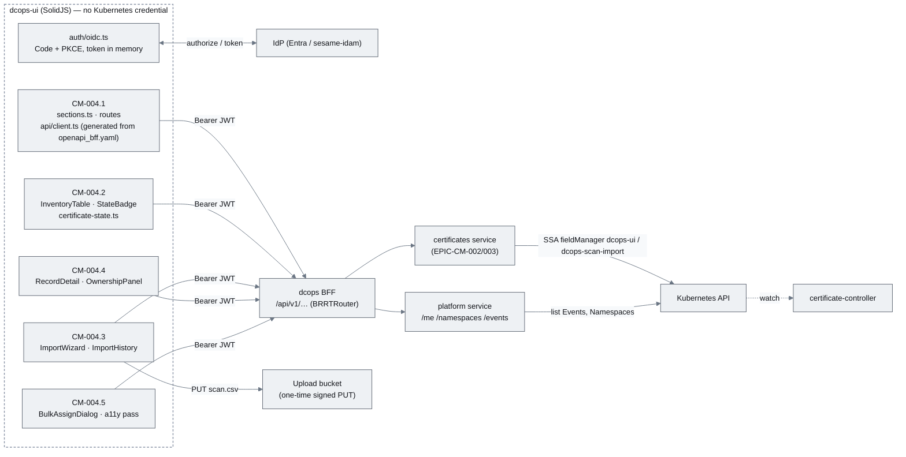
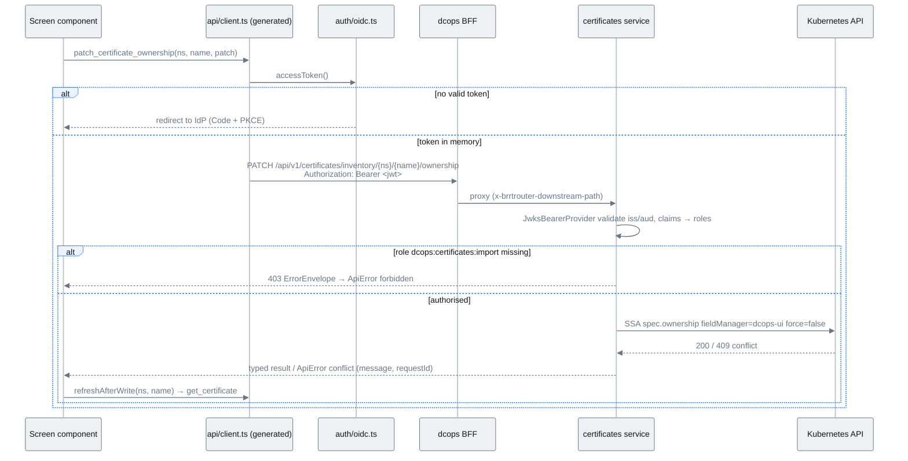
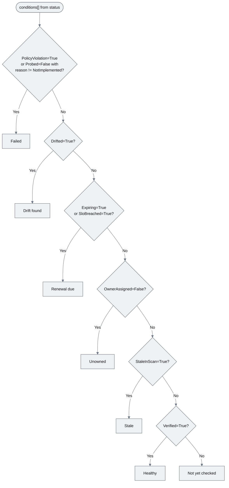
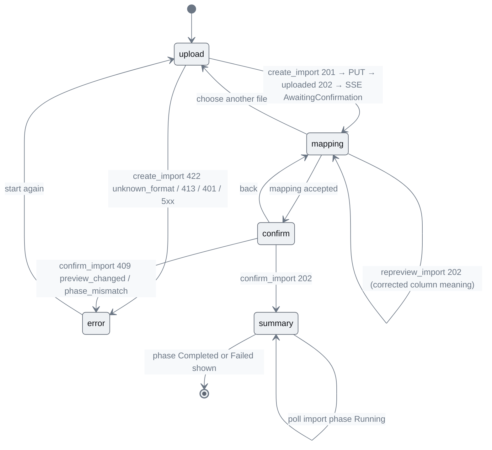
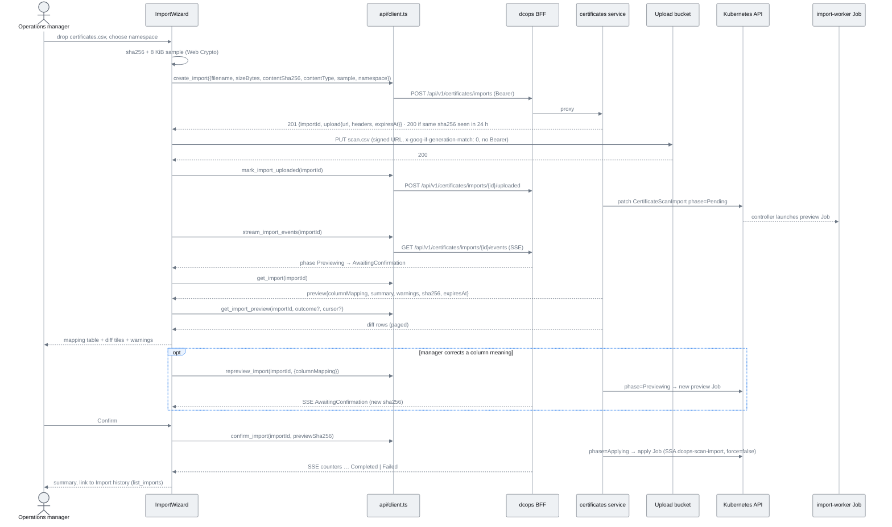
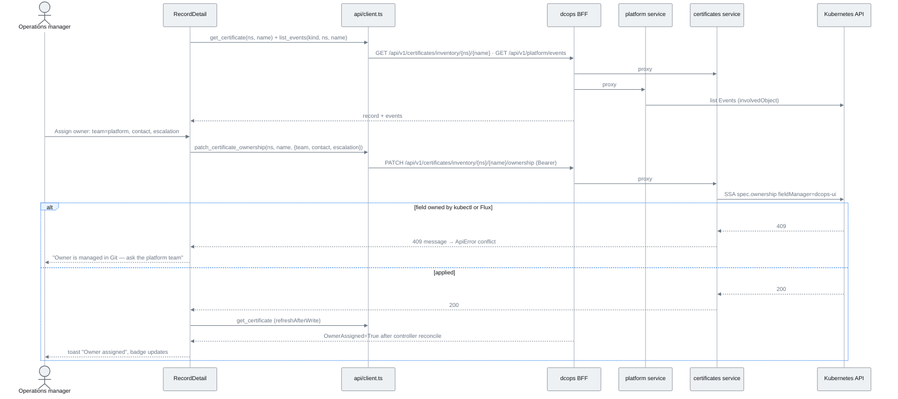
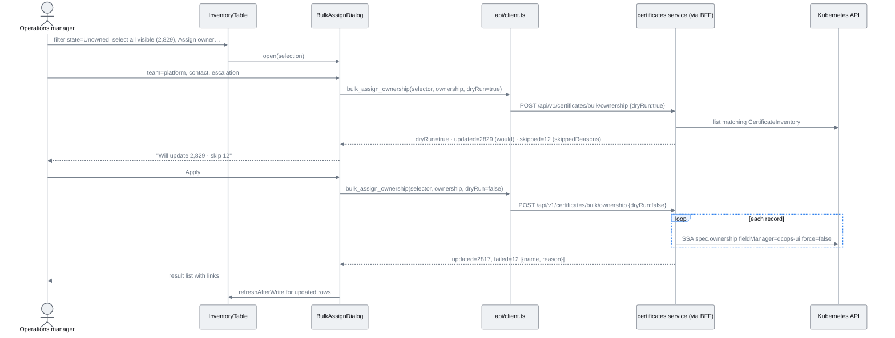

# EPIC-CM-004: UI — Certificates section

> **Parent:** [Certificate Management Design](../../CERTIFICATE_MANAGEMENT_DESIGN.md) §6.1, §6.2, §6.4
> **Phase:** 1 — Inventory
> **CMMI level advanced:** Level 2 · Managed
> **Status:** Draft — awaiting implementation
> **Priority:** P0
> **Estimated effort:** 14–17 days
> **Depends on:** EPIC-CM-002 (`certificates` service: import intake, preview, confirm, events; `openapi/dcops/certificates/openapi.yaml`), EPIC-CM-003 (ownership, acknowledge, filtered list and bulk-assign endpoints; `OwnerAssigned`/`Classified`/`Expiring` conditions), the `dcops` BFF suite (`openapi/dcops/openapi_bff.yaml`, README delta 16)

---

## Overview

Design §1 sets the operating constraint for the whole capability: the estate is run by **non-technical Operations managers through the DCops UI, not by engineers running `kubectl`**. Everything EPIC-CM-002 and EPIC-CM-003 built is an HTTP or Kubernetes surface; this epic is the only place those surfaces become something an Operations manager can use. It adds the *Certificates* section that design §6.4 describes — three screens (inventory table, import wizard, record detail) plus the import-history list and a bulk owner-assignment flow — to the existing SolidJS + Vite + Tailwind SPA under `ui/`, alongside the IPAM/DCIM/Tenancy/Boot categories already served from `src/data/sections.ts`.

**The browser talks only to the BFF.** README delta 16 replaces the read/write split that design §6.1 originally described: the SPA holds no Kubernetes credential of any kind, performs no CRD discovery, and never calls `/api/v1/namespaces` or `/apis/…`. Every read and every write goes through the `dcops` BFF (`openapi/dcops/openapi_bff.yaml`, served at `/api/v1/<service>/…`), which proxies to one BRRTRouter service per domain. For this epic that means the `certificates` service (EPIC-CM-002/003) for inventory, ownership, maturity and imports, and the `platform` service for `/me`, `/namespaces`, `/kinds` and `/events`. `src/api/k8s-client.ts` and `config/dcops-ui/role.yaml` are deleted in `CM-004.1`; the SPA's only network dependency is the BFF origin and, for the one-time scan upload, the signed bucket URL the API mints.

Identity reaches the BFF as a bearer JWT: the SPA obtains an access token from the platform IdP through an OIDC Authorization Code + PKCE flow (BRRTRouter's browser posture is Bearer/JWKS only, no server sessions — see `CM-002.2`; the IdP is deployment configuration, Entra or sesame-idam, README delta 15) and sends `Authorization: Bearer` on every BFF call. The token is held in memory only, never in `localStorage`, and is never sent to the bucket host (the signed URL carries its own authorisation). Roles for gating write buttons come from `GET /api/v1/platform/me`, not from decoding the token in the browser.

Two rules shape every screen. **No YAML anywhere**: the UI renders plain-language state labels derived from the §5.2 conditions (*Healthy · Renewal due · Drift found · Failed · Unowned · Stale*), never condition JSON, and the detail page shows observed vs expected facts as a comparison table rather than a status dump. **The 5,368-row scan is the normal case, not the stress case**: the table is virtualised and filters in memory in under 100 ms. Out of scope: any direct Kubernetes access from the SPA (removed, not merely read-only), the BFF and services themselves (EPIC-CM-002 builds the `certificates` service; the `platform` service and the BFF scaffold are `CM-002.2` deliverables), maturity-level tiles (`CM-009.2`), bucket-promotion staging checks (`CM-010.3`), and Datadog links (EPIC-CM-008).

## Epic-level diagram

How the five stories sit on one generated client and the BFF (flowchart, because "browser → BFF only" is the architectural point).

## Stories

| ID | Story | Persona | Effort |
|----|-------|---------|--------|
| **CM-004.1** | As a UI developer, I want the *Certificates* section, the generated BFF client and the OIDC plumbing so that every later screen has one typed, testable way to read and write — through the BFF only | Developer | 2 d |
| **CM-004.2** | As an Operations manager, I want a table of every certificate-bearing endpoint with a plain-language state, expiry and owner that I can filter and sort so that I can see what needs attention today | Operations manager | 3 d |
| **CM-004.3** | As an Operations manager, I want to upload the scanner's CSV, check the column mapping and preview the changes before confirming so that repeated imports are safe and auditable | Operations manager | 4 d |
| **CM-004.4** | As an Operations manager, I want a detail page for one certificate showing what was observed versus expected, its history and the planned action, with Assign owner / Acknowledge / Change bucket so that I can action an alert without engineering help | Operations manager | 3 d |
| **CM-004.5** | As an Operations manager, I want to assign an owner to many records at once, and as a keyboard or screen-reader user I want every certificate screen to be usable so that the 2,829 "assign accountable owner" rows can be cleared by anyone | Operations manager, accessibility auditor | 3 d |

## Definition of Done (epic)

- [ ] Every story's ACs pass
- [ ] `just verify` (fmt, clippy with workspace lints, nextest), `just ui-verify` (tsc, eslint, vitest) and `just ui-e2e` (Playwright against Tilt with `dcops-api` and the controller) are green
- [ ] Docs updated: README capability list gains "Certificates UI (inventory, import, ownership)"; `docs/01_dashboard_design.md` already describes the SPA → BFF architecture (amended with delta 16) — verify nothing in this epic contradicts it; `docs/implementationChecklists/CertificateInventory.md` UI rows ticked
- [ ] `src/api/k8s-client.ts`, `src/api/crd-discovery.ts` and `config/dcops-ui/role.yaml` are gone; `grep -r "/apis/\|/api/v1/namespaces" ui/src ui/dist` is empty
- [ ] axe report attached to the epic PR with zero WCAG 2.1 AA violations on all five screens; `ui/src/i18n/en.ts` reviewed for any "yaml", "kubectl" or condition-identifier copy

## Open questions

| ID | Question | Default if unresolved |
|----|----------|----------------------|
| **Q1** | ~~Events for the detail page: read via the SPA's ClusterRole or proxy through `dcops-api`?~~ **Resolved by delta 16:** Events come from `GET /api/v1/platform/events?kind=CertificateInventory&namespace=&name=` (platform service). No SPA RBAC exists any more. | — |
| **Q2** | Label for a record the controller has not probed yet (`Probed=False/NotImplemented`, all records until EPIC-CM-005)? | Show *Not yet checked* as a neutral seventh label; it disappears once EPIC-CM-005 lands and is not offered as a filter chip. |

---

## CM-004.1 — Certificates section, generated BFF client and OIDC plumbing

**As a** UI developer, **I want** the *Certificates* section wired into navigation, a client generated from the BFF spec, and bearer-token handling **so that** the four screens that follow share one data layer and the browser never touches Kubernetes.

### Description

Three additions and two deletions. First, `src/data/sections.ts` gains a *Certificates* section with routes `/certificates` (table), `/certificates/import` (wizard), `/certificates/imports` (history), `/certificates/maturity` (placeholder until `CM-009.2`) and `/certificates/:namespace/:name` (detail). Section visibility no longer depends on browser-side CRD discovery: the shell calls `GET /api/v1/platform/kinds` once at start-up and hides any section whose kinds the suite does not report (`certificates` is reported once EPIC-CM-002 is deployed). Second, `src/api/client.ts` is **generated** from `openapi/dcops/openapi_bff.yaml` (`just ui-gen-client`, `openapi-typescript` + a thin fetch wrapper; the generated file is committed and CI fails on drift, the same rule as `openapi_bff.yaml` itself). The operations this epic uses, by their spec `operationId`: `get_certificates_summary`, `list_certificates`, `get_certificate`, `patch_certificate_ownership`, `acknowledge_certificate`, `bulk_assign_ownership`, `create_import`, `list_imports`, `get_import`, `mark_import_uploaded`, `get_import_preview`, `repreview_import`, `get_import_artifact`, `confirm_import`, `cancel_import`, `stream_import_events` (SSE), plus `get_me`, `list_namespaces`, `list_kinds` and `list_events` from the platform service. `uploadToSignedUrl(upload, file, onProgress)` is the one hand-written function: it `PUT`s to the URL `create_import` returned with the headers it returned, and sends no `Authorization` header. Types come from the generated file (`components['schemas']['CertificatesImportAccepted']` etc.); `src/api/certificates/types.ts` re-exports them under the short names the screens use (`ImportAccepted`, `ImportStatus`, `ImportDiffPage`, `ImportDiffRow`, `CertificateRow`, `OwnershipPatch`). The wrapper attaches `Authorization: Bearer <access token>` from `src/auth/oidc.ts` (Authorization Code + PKCE against `VITE_OIDC_ISSUER`/`VITE_OIDC_CLIENT_ID`/`VITE_OIDC_AUDIENCE`; silent refresh; token kept in memory) to every BFF call and to nothing else. Errors are mapped from `ErrorEnvelope` to a discriminated `ApiError` (`unauthorised` 401, `forbidden` 403, `conflict` 409, `validation` 400/422, `notFound` 404, `gone` 410, `unavailable` 5xx/network) carrying `message` and `requestId` so screens render plain language and support can find the request. The base URL is `/api/v1` (same origin through the HTTPRoute), overridable by `VITE_DCOPS_API_BASE` for local Vite. Third, `src/stores/certificates.ts` holds shared reactive state with Solid `createStore`: rows, active filter, the selection set used by `CM-004.5`, the caller's roles from `get_me` (a `can('dcops:certificates:import')` helper gates every write button), and `refreshAfterWrite(namespace, name)` which re-fetches one row via `get_certificate`. `src/i18n/en.ts` and a minimal `t(key)` helper are introduced here so every later story adds copy in one place. The deletions: `src/api/k8s-client.ts`, `src/api/crd-discovery.ts` and `config/dcops-ui/role.yaml` are removed, together with the `kubectl proxy` / in-cluster ServiceAccount notes in `ui/README.md`; the SPA has no code path to the Kubernetes API at all.

### Diagrams

Request path for a write, showing where identity is attached and that the SPA holds no cluster credential (sequenceDiagram, because the auth hop ordering is the point).

### Functional requirements

| ID | Requirement |
|----|-------------|
| **FR-004.1-01** | MUST add a *Certificates* section to `sections.ts` with the five routes above, shown only when `list_kinds` reports the `certificates` category |
| **FR-004.1-02** | MUST generate `src/api/client.ts` from `openapi/dcops/openapi_bff.yaml` with `just ui-gen-client`; the committed file MUST match a fresh generate (CI drift check) |
| **FR-004.1-03** | MUST expose every operation listed in the Description by its spec `operationId`, typed from the spec's components |
| **FR-004.1-04** | MUST attach `Authorization: Bearer` to every BFF request and MUST NOT attach it to the signed upload URL; MUST NOT persist the token outside memory |
| **FR-004.1-05** | MUST map `ErrorEnvelope` to the `ApiError` union and surface `message` and `requestId` verbatim |
| **FR-004.1-06** | MUST delete `src/api/k8s-client.ts`, `src/api/crd-discovery.ts` and `config/dcops-ui/role.yaml`; no module may import `@kubernetes/*` or build `/apis/` URLs |
| **FR-004.1-07** | MUST provide `stores/certificates.ts` with rows, filter, selection, roles (`can(role)`) and `refreshAfterWrite` |
| **FR-004.1-08** | SHOULD introduce `i18n/en.ts` + `t()` and use it for all copy added by this epic |

### Non-functional requirements

| ID | Category | Requirement |
|----|----------|-------------|
| **NFR-004.1-01** | Security | The production bundle contains no request to any path outside `/api/v1/` except the signed bucket URL (verified by grepping `dist/` for `/apis/` and `/api/v1/namespaces`); the OIDC access token is sent only to the BFF origin and is held in memory only |
| **NFR-004.1-02** | Reliability | Network failure and 5xx are retried once with 500 ms jitter for idempotent GETs only; writes are never retried automatically |
| **NFR-004.1-03** | Maintainability | A change to a service spec that breaks a screen fails `tsc` after `just ui-gen-client`, not at runtime |

### Acceptance criteria

| ID | Given / When / Then |
|----|---------------------|
| **AC-004.1-01** | **Given** the `certificates` service is deployed **When** the SPA loads **Then** `list_kinds` reports `certificates` and the sidebar shows *Certificates* with Inventory, Import, Import history and Maturity entries |
| **AC-004.1-02** | **Given** a deployment without the `certificates` service **When** the SPA loads **Then** the *Certificates* section is absent and no console error is logged |
| **AC-004.1-03** | **Given** the BFF returns 401 **When** any client function is called **Then** it rejects with `ApiError{kind:'unauthorised'}` and the shell starts the OIDC flow; **given** 403 **Then** the screen shows "Your account cannot do that (needs dcops:certificates:import)" |
| **AC-004.1-04** | **Given** a production build **When** `dist/` is inspected **Then** no `/apis/`, `/api/v1/namespaces` or `kubectl` strings and no `VITE_DEV_*` branch are present |
| **AC-004.1-05** | **Given** a 409 from `patch_certificate_ownership` **When** mapped **Then** `ApiError{kind:'conflict', message, requestId}` carries the server message; **and given** every operation in the Description called against the BRRTRouter TestApp **Then** each hits its spec path with the documented method, and after a successful write `refreshAfterWrite` refetches only that row |
| **AC-004.1-06** | **Given** `openapi_bff.yaml` changes **When** `just ui-verify` runs without regenerating the client **Then** it fails with a drift message |

### Unit test criteria

| ID | Test | Covers |
|----|------|--------|
| **UT-004.1-01** | `src/data/__tests__/sections.test.ts::certificates_section_follows_list_kinds` — mocks `list_kinds` with and without the category | FR-004.1-01, AC-004.1-01/02 |
| **UT-004.1-02** | `src/api/__tests__/client.test.ts::each_operation_hits_its_spec_path` and `::sends_bearer_only_to_bff` — `mockFetch` (`vi.stubGlobal('fetch')`) captures URL, method and `RequestInit`; the upload helper is asserted to send no `Authorization` | FR-004.1-03/04, AC-004.1-05, NFR-004.1-01 |
| **UT-004.1-03** | `src/api/__tests__/client.test.ts::maps_error_envelope_to_api_error` — table-driven over 400/401/403/404/409/410/422/500/network | FR-004.1-05, AC-004.1-03/05 |
| **UT-004.1-04** | `src/api/__tests__/client.test.ts::no_kubernetes_paths` — static assertion over the generated file that no path starts with `/apis/` | FR-004.1-06, AC-004.1-04 |
| **UT-004.1-05** | `src/api/__tests__/client.test.ts::retries_get_once_never_write` | NFR-004.1-02 |
| **UT-004.1-06** | `src/stores/__tests__/certificates.test.ts::refresh_after_write_replaces_single_row` and `::can_reads_roles_from_me` with `MockBff`; `i18n/en.ts` + `t()` are covered by `UT-004.5-08` / `AC-004.5-08` | FR-004.1-07/08, AC-004.1-05 |

### Integration test criteria

| ID | Test | Environment | Covers |
|----|------|-------------|--------|
| **IT-004.1-01** | `ui/e2e/certificates/section.spec.ts` — loads the SPA through the dev gateway, asserts the section appears, and asserts via `page.route` capture that every request is to `/api/v1/*` (or the MinIO signed URL during upload) and carries `Authorization` only on `/api/v1/*` | Playwright against Tilt (BFF + `certificates` + `platform` services + controller) | AC-004.1-01, NFR-004.1-01 |
| **IT-004.1-02** | `ui/scripts/check-client-drift.sh` in CI — regenerates the client into a temp dir and diffs | Cargo/CI | AC-004.1-06, FR-004.1-02 |

### QA process

1. `just dev-up`; confirm the BFF, `certificates`, `platform` and `certificate-controller` resources are green in Tilt. Open the UI through the gateway hostname; confirm the *Certificates* section is listed. In DevTools → Network filter by host: every request goes to the gateway origin except one `PUT` to MinIO during an upload; `Authorization: Bearer` present on `/api/v1/*` only.
2. Disable the `certificates` service in Tilt; reload; the section must disappear silently. Restore.
3. Negative path (unauthorised): revoke the token in the IdP (or wait for expiry with refresh disabled) and call any write from the console via the exposed client; observe the sign-in redirect, not a stack trace. Negative path (forbidden): sign in as a user without the import role; every write button is hidden and a forced call returns the role message.
4. `npm run build && grep -r "/apis/\|/api/v1/namespaces\|kubectl\|VITE_DEV_" dist/` — expect no matches. `just ui-gen-client && git diff --exit-code ui/src/api/client.ts` — expect clean.
5. Attach: sidebar screenshot, Network-tab screenshot of headers, grep output, vitest report.

---

## CM-004.2 — Inventory table with plain-language state

**As an** Operations manager, **I want** one table of every certificate-bearing endpoint showing target, vendor/bucket, certificate, expiry, state and owner, with filters and sorting that respond instantly **so that** I can see what needs attention without reading conditions or YAML.

### Description

`src/components/certificates/InventoryTable.tsx` implements deck slide 9 as design §6.4 specifies. Columns: **Target** (record name = normalised hostname, plus port when not 443), **Vendor / bucket** (issuer from `status.observed.issuer` when probed, otherwise `spec.issuance.expectedIssuers[0]`, with a bucket chip *Fast-track / Legacy / Unclassified*), **Certificate** (short fingerprint `AB:CD:…:EF` or "—"), **Expires** (`status.observed.notAfter`, falling back to the scan expiry from `status.scan` per `CM-003.4`, rendered as a date plus relative "in 23 days"), **State** (`StateBadge.tsx`), **Owner** (`spec.ownership.team`, "Nobody yet" when unset). Rows link to the detail page (`CM-004.4`). The state label is computed by a pure function in `src/lib/certificate-state.ts` from the §5.2 conditions, in a fixed precedence so one record has exactly one label: *Failed* (`PolicyViolation=True`, or `Probed=False` with a reason other than `NotImplemented`) → *Drift found* (`Drifted=True`) → *Renewal due* (`Expiring=True` or `SloBreached=True`) → *Unowned* (`OwnerAssigned=False`) → *Stale* (`StaleInScan=True`) → *Healthy* (`Verified=True`) → *Not yet checked* (Q2). Each label has a colour, an icon and an `aria-label`, and the same vocabulary is what `GET /api/v1/certificates/inventory?state=` accepts (`CM-003.3`), so a filter chip maps 1:1 to a query value. Data flow: on mount the table pages through `listCertificates` (page size 1,000, following the cursor) into `stores/certificates.ts`; the full set is held in memory as compact `CertificateRow` objects. Filters (state chips, bucket, owner, namespace, free-text on target) and sort are applied in a `createMemo` over the store — no network round-trip — and the visible slice is rendered through `@tanstack/solid-virtual` so DOM size is bounded at roughly 40 rows. The URL query string mirrors filter and sort so views are shareable. A "Refresh" control re-pages the list; a subtle "updated 2 min ago" indicator shows staleness.

Not in this story: row selection and bulk actions (`CM-004.5`), column configuration, CSV export.

### Diagrams

State-label derivation from conditions (flowchart — decision logic with a fixed precedence).

### Functional requirements

| ID | Requirement |
|----|-------------|
| **FR-004.2-01** | MUST render the six columns Target, Vendor / bucket, Certificate, Expires, State, Owner in that order |
| **FR-004.2-02** | MUST derive the state label with the exact precedence in the flowchart via `deriveState(conditions)` in `certificate-state.ts` |
| **FR-004.2-03** | MUST show expiry from `status.observed.notAfter` when present, else `status.scan` expiry, with an absolute date and a relative phrase |
| **FR-004.2-04** | MUST provide filters for state (multi-select chips), bucket, owner team, namespace and free text on target; filters combine with AND |
| **FR-004.2-05** | MUST sort on any column, default Expires ascending with unknown expiry last |
| **FR-004.2-06** | MUST mirror filter and sort into the URL query string and restore them on load |
| **FR-004.2-07** | MUST load rows through `listCertificates` following the cursor until exhausted, and MUST apply filters in memory |
| **FR-004.2-08** | MUST virtualise rendering so the DOM holds only the visible window plus overscan |
| **FR-004.2-09** | MUST NOT render any condition type, reason string, JSON or YAML in the table; SHOULD show a count "312 of 5,368" reflecting the active filter |

### Non-functional requirements

| ID | Category | Requirement |
|----|----------|-------------|
| **NFR-004.2-01** | Performance | With 5,400 rows loaded, changing any filter re-renders in < 100 ms (measured with `performance.mark` in the IT and Chrome Performance panel in QA) |
| **NFR-004.2-02** | Security | Free-text filter is applied client-side only; no user text is interpolated into a URL without encoding |

### Acceptance criteria

| ID | Given / When / Then |
|----|---------------------|
| **AC-004.2-01** | **Given** `just cert-import` has loaded the 5,368-row scan **When** the table opens **Then** all rows are counted, six columns show, unprobed rows show the scan expiry with a relative phrase, and no cell contains a condition name |
| **AC-004.2-02** | **Given** a record with `OwnerAssigned=False` and `Expiring=True` **When** rendered **Then** its state is *Renewal due* (precedence over *Unowned*) |
| **AC-004.2-03** | **Given** a record with `Probed=False` reason `NotImplemented` and no other True condition **When** rendered **Then** its state is *Not yet checked* |
| **AC-004.2-04** | **Given** 5,400 rows loaded **When** the *Unowned* chip is clicked **Then** the visible set updates in < 100 ms and the count reads "2,829 of 5,368" |
| **AC-004.2-05** | **Given** filters state=Unowned and text=metro **When** the URL is copied into a new tab **Then** the same filtered view appears |
| **AC-004.2-06** | **Given** a record with no observed and no scan expiry **When** sorted by Expires ascending **Then** it appears last |
| **AC-004.2-07** | **Given** the table **When** inspected with the DOM inspector while scrolled mid-list **Then** fewer than 80 `<tr>` elements exist |

### Unit test criteria

| ID | Test | Covers |
|----|------|--------|
| **UT-004.2-01** | `src/lib/__tests__/certificate-state.test.ts::precedence_table` — table-driven over every pair of conditions in the flowchart, plus the empty-conditions case | FR-004.2-02, AC-004.2-02/03 |
| **UT-004.2-02** | `src/components/certificates/__tests__/InventoryTable.test.tsx::renders_six_columns_no_condition_text` — renders 20 fixture rows via `@solidjs/testing-library` with `MockBff.listCertificates`; `::virtualises_5400_rows` renders 5,400 generated rows in a fixed-height container and asserts < 80 `<tr>` | FR-004.2-01/08/09, AC-004.2-01/07 |
| **UT-004.2-03** | `InventoryTable.test.tsx::expiry_fallback_and_relative` — observed vs scan expiry, `vi.setSystemTime` for the relative phrase | FR-004.2-03, AC-004.2-01 |
| **UT-004.2-04** | `InventoryTable.test.tsx::filters_combine_and_count` and `::sort_unknown_expiry_last` — chips + text produce the AND result and the count string; sort on each column | FR-004.2-04/05/09, AC-004.2-04/06 |
| **UT-004.2-05** | `InventoryTable.test.tsx::url_roundtrip` — `@solidjs/router` memory history, filter → URL → filter | FR-004.2-06, AC-004.2-05 |
| **UT-004.2-06** | `src/stores/__tests__/certificates.test.ts::pages_until_cursor_null` — `MockBff` returns three pages | FR-004.2-07, AC-004.2-01 |

### Integration test criteria

| ID | Test | Environment | Covers |
|----|------|-------------|--------|
| **IT-004.2-01** | `ui/e2e/certificates/table.spec.ts` — after `just cert-import tests/fixtures/certificates.csv`, opens the table, asserts count, clicks chips, reads `performance.measure('filter')` from the page and asserts < 100 ms, counts `<tr>` while scrolled | Playwright against Tilt | AC-004.2-01/04/07, NFR-004.2-01 |
| **IT-004.2-02** | `ui/e2e/certificates/table.spec.ts::state_labels_match_conditions` — patches three inventories via `kubectl` in `beforeAll` (Unowned, Expiring, StaleInScan) and asserts the badge text | Playwright against Tilt | AC-004.2-02 |

### QA process

1. `just dev-up && just cert-import tests/fixtures/certificates.csv --namespace certificates`; wait for `CertificateScanImport` `Completed`. Open *Certificates → Inventory*; confirm "5,368 of 5,368" and six columns. Screenshot.
2. Open Chrome Performance, record while clicking *Unowned* then *Renewal due*; the longest task must be < 100 ms. Screenshot the trace.
3. `kubectl patch certificateinventory www-dev.metro-vto.es -n certificates --subresource=status --type=merge -p '{"status":{"conditions":[{"type":"Expiring","status":"True"},{"type":"OwnerAssigned","status":"False"}]}}'`; click Refresh; the row shows *Renewal due*.
4. Sort by each column; copy the URL into a private window (after signing in) and confirm the same view. Negative path: `kubectl scale deploy certificate-controller --replicas=0 -n dcops-system`; click Refresh; the table keeps the last data and shows "Could not refresh — the certificate service is not responding" without clearing rows. Restore.
5. Attach: table screenshot, Performance trace screenshot, patched-row screenshot, Playwright report.

---

## CM-004.3 — Import wizard and import history

**As an** Operations manager, **I want** to upload the scanner's CSV, confirm the column mapping, preview exactly which records will be created, updated, left alone, flagged stale or conflict, and then confirm **so that** I can re-run the import every month without fear of overwriting what colleagues have entered.

### Description

`src/components/certificates/ImportWizard/` implements design §6.2 and §6.4 as a four-step flow driven by a small state machine in `ImportWizard.tsx` (`upload → mapping → confirm → summary`, with `error` reachable from any step). **Upload** (`UploadStep.tsx`): a drag-and-drop zone with a file input fallback, namespace selector (default `certificates`), client-side checks limited to size (≤ 12 MiB) and extension; the step computes the file's SHA-256 and an 8 KiB sample with Web Crypto, calls `createImport` to obtain the signed upload URL (`CM-002.3`), `PUT`s the file directly to the bucket with the returned headers (progress bar from the XHR upload events), then calls `markUploaded`; the bucket's signed URL is used once and never stored. **Mapping and preview** (`MappingStep.tsx` + `PreviewDiff.tsx`): shows the column mapping the server detected (`CM-002.3` returns it from the preview written by the worker) as a table of *column → meaning* with a dropdown per column so the manager can correct a misdetection and re-preview; below it the diff totals as five tiles (Created / Updated / Unchanged / Conflict / Stale) and a filterable, virtualised row list reusing the table primitives from `CM-004.2`; warnings (malformed rows, BOM stripped, duplicate hosts) are listed in plain language with row numbers. Conflict rows explain which field is owned by another manager ("Owner was set by Charles on 3 Sep — the scan will not change it"). **Confirm** (`ConfirmStep.tsx`): restates the totals and the preview expiry (15 min TTL from `CM-002.4`) and requires an explicit button press; **Summary** (`SummaryStep.tsx`): calls `confirmImport(importId, previewSha256)`, then follows the SSE `events` stream (falling back to polling `getImport(id)` every 2 s) until phase is `Completed` or `Failed` (`CM-002.4`), showing counters as they grow and per-row errors at the end. `src/components/certificates/ImportHistory.tsx` lists imports through `list_imports` (`GET /api/v1/certificates/imports?namespace=&phase=&limit=&cursor=`, newest first): who, when, source hash (shortened), the four counters and phase, each linking to a read-only summary view that reuses `SummaryStep`. This is the Level 2 audit view design §6.3 promises.

The wizard never shows raw CSV beyond the first five rows in the mapping step (so the manager can see what a column contains) and never shows the resulting YAML. It does not parse the CSV itself — parsing, normalisation and hashing live in the `certificate-scan` crate used by the import worker (`CM-002.1`) so the CLI and the UI cannot diverge.

### Diagrams

Wizard steps and the transitions between them (stateDiagram-v2 — this is a lifecycle the tests enumerate).

Wizard ↔ BFF ↔ bucket ↔ `certificates` service, including the one-time signed upload, the preview Job and the SSE stream (sequenceDiagram, mirroring `CM-002.3`/`CM-002.4` from the UI's side).

### Functional requirements

| ID | Requirement |
|----|-------------|
| **FR-004.3-01** | MUST implement the four steps and the transitions in the state diagram, with browser Back mapped to the wizard's back action |
| **FR-004.3-02** | MUST register the file with `create_import` (sha256, size, content type, 8 KiB sample), `PUT` it to the returned signed URL with the returned headers and no `Authorization`, then call `mark_import_uploaded`; no client-side parsing beyond size/extension checks and the sample |
| **FR-004.3-03** | MUST render the server's column mapping as editable *column → meaning* rows with a five-row sample, and re-preview when changed |
| **FR-004.3-04** | MUST show diff totals for created/updated/unchanged/conflict/stale and a filterable row list with the per-row outcome |
| **FR-004.3-05** | MUST render each conflict row with the owning field manager and the field, in plain language, and MUST NOT offer a force option |
| **FR-004.3-06** | MUST list server warnings with row numbers and MUST block Confirm when the preview has zero parseable rows |
| **FR-004.3-07** | MUST require an explicit Confirm, show the preview expiry countdown, and handle 409 "preview expired" by returning to mapping with a re-preview prompt |
| **FR-004.3-08** | MUST follow `stream_import_events` (SSE) until `Completed`/`Failed`, falling back to polling `get_import` every 2 s when the stream is unavailable, and show counters and per-row errors |
| **FR-004.3-09** | MUST implement Import history from `list_imports` (BFF), newest first with cursor paging, linking to a read-only summary |
| **FR-004.3-10** | MUST NOT display YAML or raw condition data at any step |

### Non-functional requirements

| ID | Category | Requirement |
|----|----------|-------------|
| **NFR-004.3-01** | Performance | Preview of the 5,368-row file renders the diff list within 1 s of the response; the row list is virtualised |
| **NFR-004.3-02** | Security | The file is held only in the `File` object and the one-time `PUT` body; the signed URL is used once and never stored; no CSV content is written to `localStorage` or logged |
| **NFR-004.3-03** | Idempotency | Re-importing the same file shows Unchanged = total and Confirm produces zero SSA writes (verified through `CM-002.5` counters in the summary) |

### Acceptance criteria

| ID | Given / When / Then |
|----|---------------------|
| **AC-004.3-01** | **Given** the fixture CSV **When** dropped on Upload **Then** Mapping shows ten columns with the detected meanings, the tiles read 312 / 76 / 4,980 / 0 / 41 (per the seeded cluster fixture), and no step shows YAML |
| **AC-004.3-02** | **Given** a preview **When** the manager changes column 8 from "Automation flag" to "Ignore" **Then** a new preview is requested and the tiles update |
| **AC-004.3-03** | **Given** an inventory whose owner was set through the UI **When** the same host appears in the scan with a different issuer **Then** the row is *Updated* for issuer and the preview states that owner is kept |
| **AC-004.3-04** | **Given** a preview older than 15 min **When** Confirm is pressed **Then** the wizard shows "This preview has expired — we will check the file again" and returns to Mapping; browser Back from Confirm also returns to Mapping |
| **AC-004.3-05** | **Given** Confirm pressed **When** the controller completes the import **Then** Summary shows final counters, the record appears at the top of Import history with the signed-in user's name |
| **AC-004.3-06** | **Given** the same file imported twice **When** the second preview renders **Then** Unchanged equals the row count and Created is 0 |
| **AC-004.3-07** | **Given** a malformed file (wrong column count) **When** previewed **Then** an error step explains "Row 1 has 7 columns; the scanner export has 10" and offers Start again |

### Unit test criteria

| ID | Test | Covers |
|----|------|--------|
| **UT-004.3-01** | `ImportWizard/__tests__/machine.test.ts::transitions_match_state_diagram` — every edge in the diagram, invalid edges rejected, Back maps to the back action | FR-004.3-01, AC-004.3-04 |
| **UT-004.3-02** | `ImportWizard/__tests__/UploadStep.test.tsx::registers_puts_and_marks_uploaded_and_rejects_oversize` with `MockBff.create_import`/`mark_import_uploaded`, a stubbed `PUT` and a 13 MB `File` | FR-004.3-02, AC-004.3-01 |
| **UT-004.3-03** | `ImportWizard/__tests__/MappingStep.test.tsx::edit_column_triggers_repreview` | FR-004.3-03, AC-004.3-02 |
| **UT-004.3-04** | `ImportWizard/__tests__/PreviewDiff.test.tsx::tiles_rows_conflict_copy` — fixture preview with one conflict row; asserts the "Owner was set by …" sentence and absence of a force control | FR-004.3-04/05, AC-004.3-03 |
| **UT-004.3-05** | `ImportWizard/__tests__/ConfirmStep.test.tsx::blocks_on_zero_rows_and_handles_409_expired` | FR-004.3-06/07, AC-004.3-04/07 |
| **UT-004.3-06** | `ImportWizard/__tests__/SummaryStep.test.tsx::polls_until_completed` — `vi.useFakeTimers`, `MockBff.getImport` returns Running×2 then Completed | FR-004.3-08, AC-004.3-05 |
| **UT-004.3-07** | `__tests__/ImportHistory.test.tsx::lists_newest_first_from_bff` with `MockBff.list_imports` | FR-004.3-09, AC-004.3-05 |
| **UT-004.3-08** | `__tests__/ImportWizard.test.tsx::no_yaml_strings_rendered` — snapshot contains no `apiVersion`/`kind:` | FR-004.3-10, AC-004.3-01 |

### Integration test criteria

| ID | Test | Environment | Covers |
|----|------|-------------|--------|
| **IT-004.3-01** | `ui/e2e/certificates/import.spec.ts::full_import` — uploads `tests/fixtures/certificates.csv`, asserts tiles, confirms, waits for Completed, then `kubectl get certificatescanimports` count +1 and one sampled inventory exists | Playwright against Tilt | AC-004.3-01/05 |
| **IT-004.3-02** | `import.spec.ts::second_import_is_noop` — repeats, asserts Unchanged = total and `dcops_scan_import_rows_total{outcome="created"}` unchanged on `/metrics` | Playwright against Tilt | AC-004.3-06, NFR-004.3-03 |
| **IT-004.3-03** | `import.spec.ts::owner_survives_import` — sets an owner via the API, re-imports with a changed issuer, asserts owner intact on the CRD | Playwright against Tilt | AC-004.3-03 |
| **IT-004.3-04** | `import.spec.ts::malformed_csv` — uploads `tests/fixtures/certificates-7col.csv`, asserts the error copy | Playwright against Tilt | AC-004.3-07 |

### QA process

1. `just dev-up && just cert-examples` (seeds the `certificates` namespace). *Certificates → Import*: drag `tests/fixtures/certificates.csv`; screenshot Mapping with the ten detected meanings and the five tiles. Change one column meaning; observe the re-preview and updated tiles; change it back.
2. Before confirming, in another tab set an owner on `www-dev.metro-vto.es` via the detail page (`CM-004.4`). Return, Confirm; on Summary confirm counters; `kubectl get certificateinventory www-dev.metro-vto.es -n certificates -o jsonpath='{.spec.ownership.team}'` still shows the owner.
3. Open *Import history*; the new record is first, with your name from the OIDC session. Click it; the read-only summary matches.
4. Import the same file again; tiles show Unchanged = total; confirm; `kubectl get certificatescanimport <new> -o jsonpath='{.status.created}'` is `0`. Negative path (malformed): upload `certificates-7col.csv`; expect the plain-language error and Start again. Negative path (expired): preview, wait 16 min, Confirm; expect the expiry message. Negative path (unauthorised): expire the access token mid-wizard, Confirm; expect the sign-in message and no `CertificateScanImport` created.
5. Attach: Mapping/Preview/Summary/History screenshots, `kubectl` outputs from steps 2 and 4, Playwright report.

---

## CM-004.4 — Record detail page with Assign owner / Acknowledge / Change bucket

**As an** Operations manager, **I want** a page for one certificate that shows what the controller observed against what is expected, its recent history and the planned action, and lets me assign an owner, acknowledge an alert or change the bucket **so that** I can close an alert from the page it points at.

### Description

`src/components/certificates/RecordDetail.tsx` at `/certificates/:namespace/:name`. The page reads the record through `get_certificate` (`GET /api/v1/certificates/inventory/{ns}/{name}` — a pre-shaped `CertificateDetail`: `ownership`, `observedVsExpected[]`, `statusLines[]`, `conditions[]`, `plannedAction`, `acknowledgement`; the service does the translation from CRD fields so the SPA never sees raw spec/status JSON) and its Events through `list_events` (`GET /api/v1/platform/events?kind=CertificateInventory&namespace=&name=`); writes go through the same generated client. Layout, top to bottom: a header with target, state badge (same `deriveState` as `CM-004.2`) and owner; an **Observed vs expected** table rendered from `observedVsExpected[]` — the service emits one row each for *Fingerprint* (observed leaf vs the cert-manager Secret's when `issuanceMode=cert-manager`, else "—, external certificate"), *Issuer*, *Names covered*, *Expires* (observed vs cert-manager `renewalTime`) and *Chain* (valid / invalid / not checked), each with a *matches* / *differs* / *not checked* marker; a **Status** list from `statusLines[]` (one plain-language sentence per §5.2 condition, produced server-side from `i18n`-keyed reasons: "Nobody is recorded as owner", "Renewal is due — 23 days left", "Last checked 8 Sep 08:40"); a **History** list of Events (reason, plain message, time) newest first; a **Planned action** panel from `plannedAction` (recommended action, next reminder date, next escalation contact) and any `acknowledgement` note. The **action panel** (`OwnershipPanel.tsx`) has three tabs. *Assign owner*: team, contact, escalation chain (up to three `after → to` rows), business units (multi-select from values present in the inventory), environment; submits `patchOwnership`. *Acknowledge*: note field, shows who last acknowledged and when; submits `acknowledge`. *Change bucket*: radio Fast-track / Legacy / Unclassified with a one-line description of each; submits `patchOwnership({bucket})`. Every submit shows optimistic-free behaviour: the button disables, the request completes, `refreshAfterWrite(name)` reloads the record, and a toast confirms. 409 conflicts (another manager or Git owns the field) show the server message and a "Reload and try again" link; nothing is retried automatically.

Not in this story: the promotion pre-checks for legacy → fast-track (`CM-010.3`, the radio simply writes the bucket), editing `spec.policy`, deleting records.

### Diagrams

Assign-owner round trip and the read-back that updates the page (sequenceDiagram, because the page mixes two services behind one BFF in one interaction).

### Functional requirements

| ID | Requirement |
|----|-------------|
| **FR-004.4-01** | MUST load the record via `get_certificate` and its Events via `list_events` (platform service) and render header, Observed vs expected, Status, History and Planned action sections |
| **FR-004.4-02** | MUST render the Observed vs expected rows listed in the Description with a *matches* / *differs* / *not checked* marker per row |
| **FR-004.4-03** | MUST render `statusLines[]` verbatim and MUST NOT render `conditions[]` JSON; `conditions[]` is used only for the state badge and the *not checked* marker (`Probed=False`) |
| **FR-004.4-04** | MUST show Planned action from `plannedAction` (recommended action, next reminder date, next escalation contact) and the latest `acknowledgement` |
| **FR-004.4-05** | MUST implement the Assign owner form and submit via `patchOwnership` with client-side validation (contact is an email, `after` matches `^[0-9]+(h|d)$`) |
| **FR-004.4-06** | MUST implement Acknowledge via `acknowledge(name, note)`, enabled only for *Renewal due*, *Drift found* or *Failed* |
| **FR-004.4-07** | MUST implement Change bucket via `patchOwnership({bucket})` with the three values and their descriptions |
| **FR-004.4-08** | MUST reload the record after every successful write and show a confirmation toast |
| **FR-004.4-09** | MUST render 409 responses with the server message and a reload affordance, and MUST NOT retry or force |
| **FR-004.4-10** | MUST NOT render YAML, JSON or raw condition objects; a "Copy name for engineers" control MAY copy `namespace/name` |

### Non-functional requirements

| ID | Category | Requirement |
|----|----------|-------------|
| **NFR-004.4-01** | Security | The page never fetches Secrets and never displays key material; fingerprints are shown, PEM is not (the `certificates` service exposes no Secret data and `CertificateDetail` has no PEM field) |
| **NFR-004.4-02** | Accessibility | Tabs follow the WAI-ARIA tabs pattern; form errors are associated via `aria-describedby`; toasts use `role="status"` |
| **NFR-004.4-03** | Reliability | If the Events read fails (platform service unavailable), the page still renders with "History unavailable" and no console error; Events are capped at the latest 50 |

### Acceptance criteria

| ID | Given / When / Then |
|----|---------------------|
| **AC-004.4-01** | **Given** the §5.1 example record **When** opened **Then** header shows `www-dev.metro-vto.es`, *Legacy*, owner *platform*, Observed vs expected shows Issuer *matches* Sectigo, the Status list reads as sentences with no condition identifiers, and no YAML or JSON appears |
| **AC-004.4-02** | **Given** an unowned record **When** opened **Then** the Assign owner tab is active, and after submitting team `platform` and contact `platform-oncall@example.com` the badge changes from *Unowned* within one reconcile and the `OwnerAssigned` Event appears once in History |
| **AC-004.4-03** | **Given** a record with `Expiring=True` **When** Acknowledge is submitted with note "INC-4411 raised" **Then** `spec.acknowledgement.by` equals the signed-in user and the note shows in Planned action |
| **AC-004.4-04** | **Given** a *Healthy* record **When** the panel renders **Then** the Acknowledge tab is disabled with the reason shown on hover/focus |
| **AC-004.4-05** | **Given** `spec.ownership` managed by `kubectl` field manager **When** Assign owner is submitted **Then** the 409 message is shown verbatim and the form is not cleared |
| **AC-004.4-06** | **Given** Change bucket set to Fast-track **When** submitted **Then** the label `dcops.microscaler.io/bucket` and `spec.bucket` read `fast-track` and the chip updates |

### Unit test criteria

| ID | Test | Covers |
|----|------|--------|
| **UT-004.4-01** | `__tests__/RecordDetail.test.tsx::renders_sections_from_fixture` — `MockBff.get_certificate`/`list_events` return the §5.1/§5.2 example; asserts section headings, match/differ markers and (with `vi.setSystemTime`) the next reminder and escalation contact in Planned action | FR-004.4-01/02/04, AC-004.4-01/03 |
| **UT-004.4-02** | `__tests__/condition-copy.test.ts::every_condition_has_sentence` — iterates the ten condition types × True/False and asserts an `en.ts` entry exists and contains no condition identifier | FR-004.4-03, FR-004.4-10, AC-004.4-01 |
| **UT-004.4-03** | `__tests__/OwnershipPanel.test.tsx::assign_owner_validates_and_submits` with `MockBff.patchOwnership` | FR-004.4-05, AC-004.4-02 |
| **UT-004.4-04** | `__tests__/OwnershipPanel.test.tsx::acknowledge_enabled_only_for_alert_states` | FR-004.4-06, AC-004.4-04 |
| **UT-004.4-05** | `__tests__/OwnershipPanel.test.tsx::bucket_change_submits_patch` | FR-004.4-07, AC-004.4-06 |
| **UT-004.4-06** | `__tests__/OwnershipPanel.test.tsx::conflict_shows_message_keeps_form` — `MockBff` rejects with `ApiError conflict` | FR-004.4-09, AC-004.4-05 |
| **UT-004.4-07** | `__tests__/RecordDetail.test.tsx::events_failure_degrades` — `MockBff.list_events` rejects with 503 | NFR-004.4-03 |
| **UT-004.4-08** | `__tests__/OwnershipPanel.test.tsx::double_submit_sends_once` | FR-004.4-08, AC-004.4-02 |

### Integration test criteria

| ID | Test | Environment | Covers |
|----|------|-------------|--------|
| **IT-004.4-01** | `ui/e2e/certificates/detail.spec.ts::assign_owner_end_to_end` — opens an unowned fixture record, assigns owner, waits for the badge to change, asserts `kubectl get … -o jsonpath` and an `OwnerAssigned` Event | Playwright against Tilt | AC-004.4-02/06 |
| **IT-004.4-02** | `detail.spec.ts::acknowledge_records_identity` — patches `Expiring=True` via `kubectl`, acknowledges, asserts `spec.acknowledgement.by` equals the e2e test user | Playwright against Tilt | AC-004.4-03 |
| **IT-004.4-03** | `detail.spec.ts::git_owned_field_conflicts` — `kubectl apply --server-side --field-manager=kubectl` sets ownership, UI submit shows the 409 message | Playwright against Tilt | AC-004.4-05 |

### QA process

1. `just dev-up && just cert-examples`; open `www-dev.metro-vto.es` from the table. Screenshot the whole page; verify each section against `kubectl get certificateinventory www-dev.metro-vto.es -n certificates -o yaml` (QA may read YAML; the page must not show it).
2. Open an unowned fixture record; assign team, contact, one escalation row; observe the toast, then the badge changing after the controller reconciles; `kubectl get events -n certificates --field-selector involvedObject.name=<name>` shows the transition Event and the page's History shows the same.
3. `kubectl patch … --subresource=status` to set `Expiring=True`; reload; Acknowledge with a note; verify `spec.acknowledgement` and that Planned action shows the note and your name. Change bucket to Fast-track; verify label and spec; change back.
4. Negative path (409): `kubectl apply --server-side --field-manager=kubectl -f` a manifest setting `spec.ownership.team` on the same record, then submit Assign owner from the UI; expect the verbatim conflict message, form intact. Negative path (unauthorised): expire the access token, submit Acknowledge; expect the sign-in message and no spec change. Negative path (events unavailable): scale the `platform` service to 0 in Tilt; reload; page renders with "History unavailable". Restore.
5. Attach: full-page screenshot, before/after badge screenshots, `kubectl get events` output, `kubectl get -o jsonpath` outputs for owner, acknowledgement, bucket, Playwright report.

---

## CM-004.5 — Bulk owner assignment and accessibility pass

**As an** Operations manager, **I want** to select many rows and assign an owner once, with a dry-run count first, **so that** the 2,829 "assign accountable owner" rows can be cleared in an afternoon; **and as a** keyboard or screen-reader user, **I want** every certificate screen to meet WCAG 2.1 AA **so that** the section is usable by everyone on the Operations team.

### Description

**Bulk assignment.** `InventoryTable.tsx` gains a selection column (checkbox per row, header checkbox for *all visible* — i.e. the filtered set, not the page — with a count "2,829 selected") backed by the selection set in `stores/certificates.ts`. A sticky action bar offers *Assign owner…*, opening `src/components/certificates/BulkAssignDialog.tsx`: the same owner form as `CM-004.4` (team, contact, escalation, business units, environment) plus a summary of the selection. The dialog first calls `bulk_assign_ownership(selector, ownership, dryRun=true)` (`CM-003.5`) and shows "Will update 2,829 · will skip 12 already owned elsewhere (Git)"; the manager then presses Apply and the same call runs with `dryRun=false`. The selector sent is the explicit list of names when the selection is ≤ 500, otherwise the label selector/query that produced the filtered set (the API accepts both), so a whole filtered view can be assigned without shipping thousands of names. Results show per-record failures (409, validation) in a list with links to the detail page; successes trigger a refresh of the affected rows. **Accessibility pass.** Applies across `CM-004.1`–`004.4` and this story: semantic landmarks (`<main>`, `<nav aria-label="Certificates">`), visible focus rings meeting 3:1 contrast, colour contrast ≥ 4.5:1 for text and ≥ 3:1 for badge/icon graphics (Tailwind palette audited and adjusted in `tailwind.config.ts`), state badges with text and icon, tables with `<caption>`, sortable headers as buttons with `aria-sort`, the virtualised table exposing `aria-rowcount`/`aria-rowindex`, wizard steps as a `<nav aria-label="Import steps">` list with `aria-current="step"`, dialogs using `role="dialog"` + `aria-modal` with focus trap and Escape, `aria-live` regions for filter counts and toasts, skip-link, and `prefers-reduced-motion` respected. All strings via `t()` from `i18n/en.ts` so a locale file can be added without code changes; dates and numbers formatted with `Intl.*` using the browser locale. An `@axe-core/playwright` scan runs on every screen in CI and fails on any AA violation.

Not in this story: bulk bucket change or bulk acknowledge (the API endpoint is owner-only in `CM-003.5`), translation into any language, high-contrast theme.

### Diagrams

Bulk assignment with dry-run gate (sequenceDiagram, because the two-phase call is the safety property).

The keyboard order the a11y tests walk is: skip link → filter chips → header checkbox → rows (Arrow keys, Space selects) → action bar → dialog (focus trapped, Escape closes) → dry-run summary (`aria-live`) → Apply → result list (focus moved to its heading) → Escape back to *Assign owner…*.

### Functional requirements

| ID | Requirement |
|----|-------------|
| **FR-004.5-01** | MUST add row and header selection to the table, header selecting all rows in the current filtered set, with a live selected count |
| **FR-004.5-02** | MUST open `BulkAssignDialog` from a sticky action bar when at least one row is selected |
| **FR-004.5-03** | MUST call `bulk_assign_ownership` with `dryRun=true` first and display would-update / would-skip counts with reasons before enabling Apply |
| **FR-004.5-04** | MUST send an explicit `names` list when the selection is ≤ 500, otherwise the filter-derived `selector` (`namespace`, `state`, `bucket`, `owner`, `severity`, `businessUnit`, `search` — the same fields as the table filters) |
| **FR-004.5-05** | MUST show `failed[]` and `skippedReasons[]` after Apply with links to the detail page and refresh updated rows |
| **FR-004.5-06** | MUST meet WCAG 2.1 AA on all five screens as measured by `@axe-core/playwright` with the `wcag2a`, `wcag2aa`, `wcag21a`, `wcag21aa` tags |
| **FR-004.5-07** | MUST make every interactive element reachable and operable by keyboard in the order shown in the flowchart, with dialogs trapping focus and closing on Escape |
| **FR-004.5-08** | MUST provide screen-reader names for badges, icons-only buttons, sort state, row counts and wizard steps |
| **FR-004.5-09** | MUST route all user-facing strings through `t()` and format dates/numbers with `Intl` |
| **FR-004.5-10** | SHOULD respect `prefers-reduced-motion` for the wizard transitions and toasts |

### Non-functional requirements

| ID | Category | Requirement |
|----|----------|-------------|
| **NFR-004.5-01** | Accessibility | Text contrast ≥ 4.5:1, non-text ≥ 3:1, focus indicator ≥ 3:1 against adjacent colours; verified by axe and a manual check of the six badge colours |
| **NFR-004.5-02** | Security | Bulk apply is never sent without a preceding dry-run in the same dialog session; the request carries `Authorization: Bearer` only, no cookie |
| **NFR-004.5-03** | Reliability | A partial failure leaves successful updates in place and reports the failures; the dialog never claims success for a failed record |
| **NFR-004.5-04** | Compatibility | Verified with NVDA + Firefox and VoiceOver + Safari; 200% browser zoom produces no clipped content |

### Acceptance criteria

| ID | Given / When / Then |
|----|---------------------|
| **AC-004.5-01** | **Given** the table filtered to *Unowned* **When** the header checkbox is ticked **Then** the bar reads "2,829 selected" and *Assign owner…* is enabled |
| **AC-004.5-02** | **Given** the dialog with a valid owner **When** it opens **Then** Apply is disabled until the dry-run result "Will update N · skip M" is shown |
| **AC-004.5-03** | **Given** 12 of the selected records have Git-managed ownership **When** Apply runs **Then** the result lists 12 failures with reasons and links, and the other rows show the new owner after refresh |
| **AC-004.5-04** | **Given** a selection of 600 rows **When** dry-run is requested **Then** the request body contains a selector, not 600 names |
| **AC-004.5-05** | **Given** any of the five screens, with and without `prefers-reduced-motion` emulated **When** axe runs **Then** zero violations at AA, and with reduced motion no CSS transition longer than 0 ms is applied to wizard steps or toasts |
| **AC-004.5-06** | **Given** keyboard only **When** a user follows the flowchart from the skip link to Apply and back **Then** every step is reachable, focus is visible, and Escape returns focus to *Assign owner…* |
| **AC-004.5-07** | **Given** a screen reader **When** the *Renewal due* badge is focused **Then** it announces "State: Renewal due" not a colour or icon name |
| **AC-004.5-08** | **Given** the browser locale `fr-FR` **When** the table renders **Then** dates and the row count use French formatting while copy remains English |

### Unit test criteria

| ID | Test | Covers |
|----|------|--------|
| **UT-004.5-01** | `__tests__/InventoryTable.selection.test.tsx::header_selects_filtered_set_and_counts` — also asserts the action bar appears only with ≥ 1 selected | FR-004.5-01/02, AC-004.5-01 |
| **UT-004.5-02** | `__tests__/BulkAssignDialog.test.tsx::dry_run_gates_apply` with `MockBff.bulk_assign_ownership` asserting call order and `dryRun` flags | FR-004.5-03, AC-004.5-02, NFR-004.5-02 |
| **UT-004.5-03** | `__tests__/BulkAssignDialog.test.tsx::selector_vs_names_threshold` — 500 and 501 selections | FR-004.5-04, AC-004.5-04 |
| **UT-004.5-04** | `__tests__/BulkAssignDialog.test.tsx::partial_failure_rendered` | FR-004.5-05, AC-004.5-03, NFR-004.5-03 |
| **UT-004.5-05** | `__tests__/a11y.test.tsx::axe_on_each_component` — `vitest-axe` over InventoryTable, ImportWizard steps, RecordDetail, BulkAssignDialog with fixture data; `::reduced_motion_disables_transitions` via `window.matchMedia` mock | FR-004.5-06/10, AC-004.5-05 |
| **UT-004.5-06** | `__tests__/BulkAssignDialog.test.tsx::focus_trap_and_escape` — `@solidjs/testing-library` + `user-event` Tab cycling and Escape | FR-004.5-07, AC-004.5-06 |
| **UT-004.5-07** | `__tests__/StateBadge.test.tsx::aria_label_per_state` | FR-004.5-08, AC-004.5-07 |
| **UT-004.5-08** | `__tests__/i18n.test.ts::no_hardcoded_strings` — scans `src/components/certificates/**` JSX text nodes for literals not wrapped in `t()`; `Intl` formatting under `fr-FR` | FR-004.5-09, FR-004.1-08, AC-004.5-08 |

### Integration test criteria

| ID | Test | Environment | Covers |
|----|------|-------------|--------|
| **IT-004.5-01** | `ui/e2e/certificates/bulk.spec.ts::assign_all_unowned` — seeds 12 Git-owned records via `kubectl apply --server-side --field-manager=kubectl`, selects all *Unowned*, dry-runs, applies, asserts counts against `kubectl get certificateinventories -l dcops.microscaler.io/owner-team=platform` | Playwright against Tilt | AC-004.5-01/02/03 |
| **IT-004.5-02** | `ui/e2e/certificates/a11y.spec.ts` — `@axe-core/playwright` on `/certificates`, `/certificates/import` (each step), `/certificates/imports`, a detail page and the open bulk dialog, once normally and once with `page.emulateMedia({reducedMotion:'reduce'})`; asserts zero AA violations and writes `playwright-report/axe.json`; `::keyboard_walk` drives the order in the Diagrams section with `page.keyboard`, asserting `document.activeElement` at each step | Playwright against Tilt | AC-004.5-05/06, FR-004.5-06/07/10 |

### QA process

1. `just dev-up && just cert-import tests/fixtures/certificates.csv`; apply `tests/fixtures/git-owned-12.yaml` with `--server-side --field-manager=kubectl`.
2. Filter *Unowned*; tick the header checkbox; screenshot the "2,829 selected" bar. Open *Assign owner…*; fill the form; confirm Apply is disabled until the dry-run line appears. Screenshot.
3. Apply; confirm the result shows 2,817 updated and 12 failed with reasons; click one failure link and confirm the detail page shows the Git-owned owner. `kubectl get certificateinventories -n certificates -l dcops.microscaler.io/owner-team=platform --no-headers | wc -l` matches.
4. Keyboard walk (mouse untouched) in the order in the Diagrams section; note any element unreachable or without a visible focus ring. Screen reader: NVDA + Firefox on the table (badge announcement, sort state, row count) and the dialog; VoiceOver + Safari on the wizard steps; record the announcements heard. Then 200% zoom with a `fr-FR` locale; screenshot the table.
5. Negative path (409 in bulk): the 12 Git-owned records above — verify the dialog never reports them as updated. Negative path (unauthorised): expire the access token between dry-run and Apply; expect the sign-in message and zero updates (`kubectl` count unchanged). Negative path (stale selection): reload the page after selecting rows; selection is cleared and no stale bulk call is possible.
6. Run `just ui-e2e -- a11y.spec.ts`; open `playwright-report/axe.json`. Attach: selection/dry-run/result screenshots, `kubectl` counts, keyboard-walk and screen-reader notes, 200%/fr-FR screenshot, `axe.json`, Playwright report.
