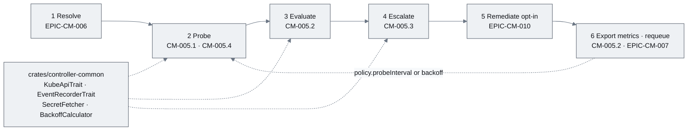
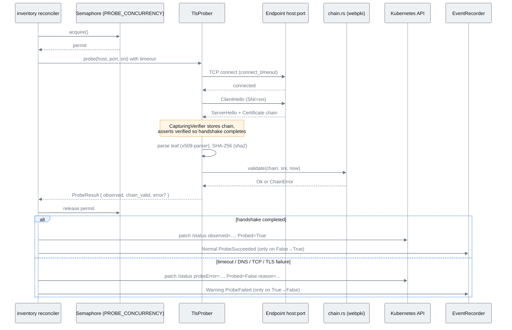
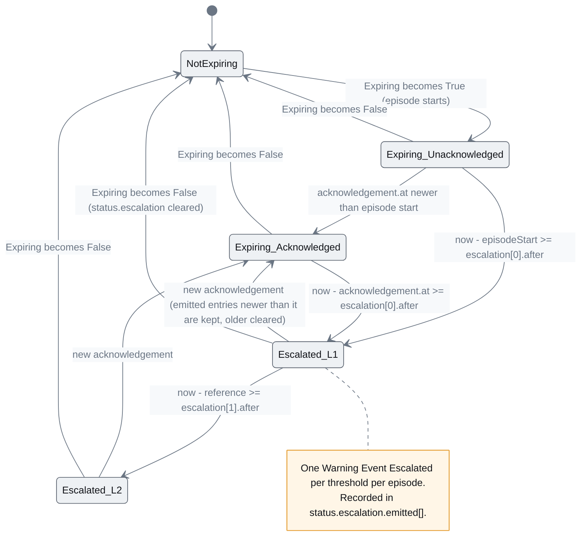
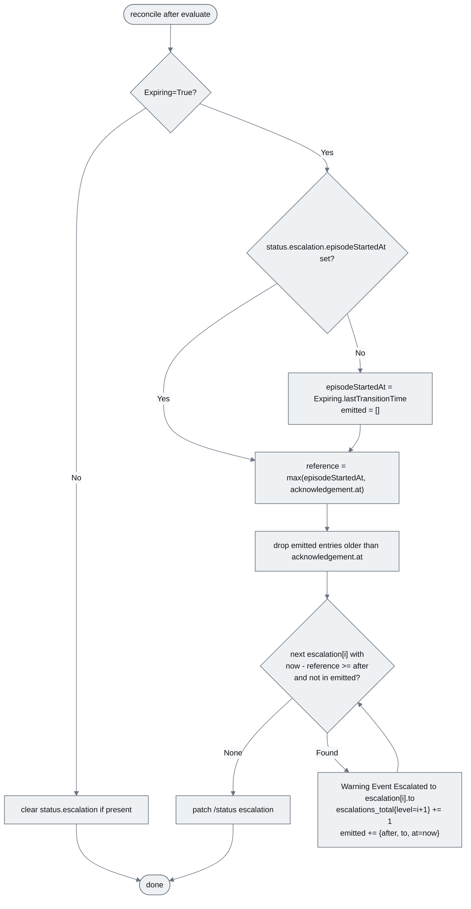
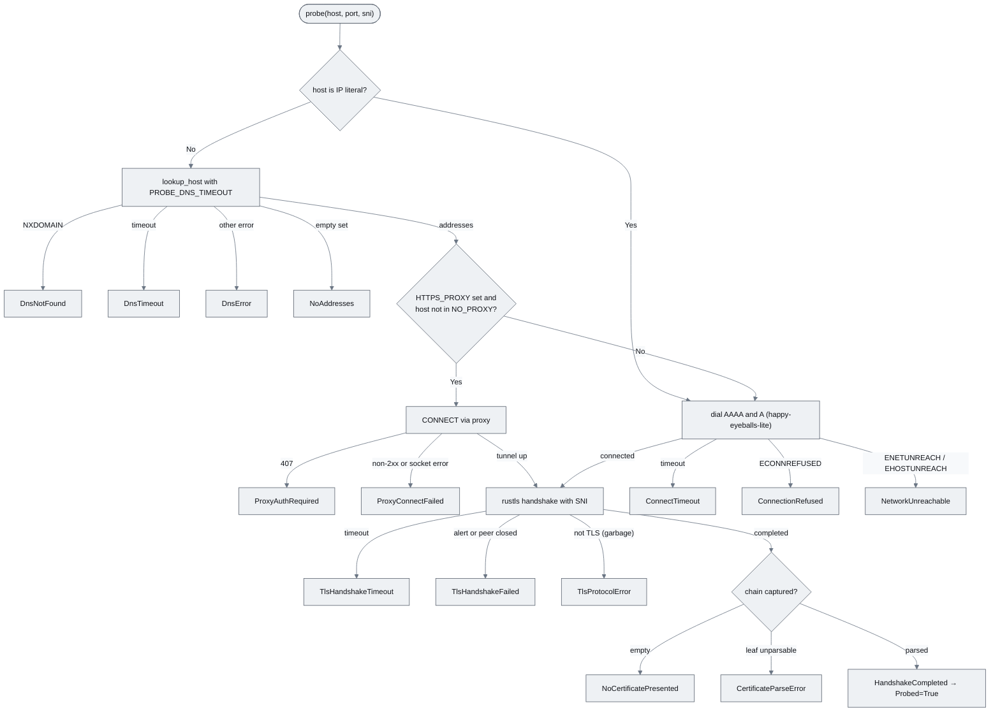
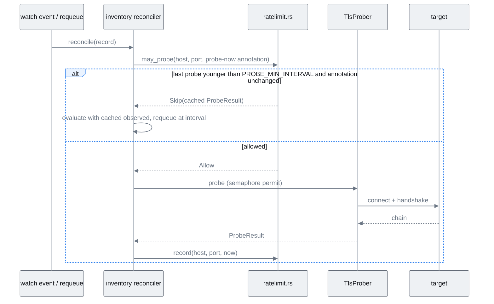

# EPIC-CM-005: Live TLS probe & conditions

> **Parent:** [Certificate Management Design](../../CERTIFICATE_MANAGEMENT_DESIGN.md) §5.2, §5.3, §3
> **Phase:** 2 — Verification
> **CMMI level advanced:** Level 3 · Defined → Level 4 · Quantitatively managed (for owned records)
> **Status:** Draft — awaiting implementation
> **Priority:** P0
> **Estimated effort:** 9–12 days
> **Depends on:** EPIC-CM-001 (controller skeleton, `controller-common` traits, `PROBE_CONCURRENCY`), EPIC-CM-003 (`OwnerAssigned`/`Classified`, acknowledgement, scan-derived `Expiring` this epic supersedes)

---

## Overview

Up to EPIC-CM-003 the inventory only knows what the scanner said. This epic makes the controller find out for itself: on every reconcile it opens a TLS connection to each `spec.endpoints[]` entry with SNI, captures the presented chain, validates it against the webpki root store (plus an optional custom trust bundle), and writes `status.observed` — fingerprint, issuer, SANs, `notBefore`/`notAfter`, `daysRemaining`, `chainValid`, `probedAt`, `probeError` — exactly as design §5.2. From those facts it sets `Probed`, `Expiring`, `SloBreached`, `PolicyViolation` and `Verified`, emits Kubernetes Events on transitions, and escalates unacknowledged expiries along `spec.ownership.escalation[]` with idempotent `Escalated` Events. This is steps 2, 3, 4 and 6 of the reconciler in design §5.3; step 1 (cert-manager resolve) is EPIC-CM-006 and step 5 (remediation) is EPIC-CM-010.

The probe is deliberately capture-first: rustls is configured with a verifier that records the chain and accepts the handshake, and chain validation is a separate pass. That is what lets the controller report *"reachable, presents an expired Sectigo certificate"* rather than a bare handshake error, which is the difference between an inventory and a monitoring check. Everything is bounded: per-connection timeouts, a `tokio::sync::Semaphore` sized by `PROBE_CONCURRENCY`, a per-target minimum re-probe interval, and `BackoffCalculator` on failure, so that a 5,000-host estate is swept comfortably inside `policy.probeInterval`.

Out of scope: cert-manager read-through, `Drifted` and `IssuanceAutomated` (EPIC-CM-006); per-inventory Prometheus gauges (EPIC-CM-007 — this epic only registers `dcops_certificate_escalations_total`); Teams/email fan-out (Datadog monitors, EPIC-CM-008); maturity level computation (EPIC-CM-009); any remediation; `OwnerAssigned`, `Classified`, `StaleInScan` (EPIC-CM-002/003). The probe agent for endpoints unreachable from the management cluster (design §12.3) is not built here — such endpoints surface as `Probed=False` with a reason from the taxonomy in `CM-005.4`.

## Epic-level diagram

Where each story sits in the §5.3 reconcile loop (flowchart, because the stories are literally the steps of one function).

## Stories

| ID | Story | Persona | Effort |
|----|-------|---------|--------|
| **CM-005.1** | As a platform operator, I want the controller to probe every endpoint over TLS and record what it actually presents so that the inventory reflects reality rather than the last scan | Operator | 3.5 d |
| **CM-005.2** | As an Operations manager, I want `Expiring`, `SloBreached`, `PolicyViolation` and `Verified` derived from the probe with Events on every transition so that the UI state column and Datadog are driven by live facts | Operations manager | 2.5 d |
| **CM-005.3** | As an Operations manager, I want unacknowledged expiries escalated along the record's escalation chain exactly once per threshold so that a forgotten alert reaches the next accountable person | Operations manager | 1.5 d |
| **CM-005.4** | As a platform operator, I want the probe to be safe at estate scale — rate-limited, DNS-aware, IPv6- and proxy-capable, with a fixed failure taxonomy — so that a 5,000-host sweep completes inside the probe interval without harming targets | Operator | 2.5 d |

## Definition of Done (epic)

- [ ] Every story's ACs pass
- [ ] `just verify` (fmt, clippy with workspace lints, nextest) is green
- [ ] `README.md` capability list gains "Certificate management — live TLS verification"; `docs/implementationChecklists/CertificateInventory.md` Probe/Evaluate/Escalate rows ticked
- [ ] The `Probed=False` reason taxonomy is documented in `docs/02_certificate_management/PROBE_REASONS.md` and matches the Rust enum
- [ ] The scan-derived `Expiring` path from `CM-003.4` is retired in favour of the probe-derived one when `Probed=True`, with `CM-003.4` tests updated rather than deleted
- [ ] Full sweep of the 5,000-host synthetic fixture on the dev cluster completes in < 30 min at `PROBE_CONCURRENCY=16` (measured and recorded in the PR)

## Open questions

| ID | Question | Default if unresolved |
|----|----------|----------------------|
| **Q1** | Where does escalation idempotency state live? Design §5.2 has no field for it. | Add an additive `status.escalation{episodeStartedAt, emitted[]{after,to,at}}` to `CertificateInventoryStatus` in `crates/crds` (schema change is backward compatible). Annotations were rejected because they are not protected by the status subresource. |
| **Q2** | Is a probe-latency histogram needed for the p95 NFR? It is not in design §8.1. | Measure through `dcops_controller_reconcile_duration_seconds{kind="CertificateInventory"}` and tracing spans; do not add a metric until §8.1 is amended. |
| **Q3** | Custom trust bundle: per-record (`policy.trustBundleRef`) or controller-wide? | Controller-wide `PROBE_TRUST_BUNDLE_SECRET=<ns>/<name>` (key `ca.crt`) read through `SecretFetcher`; a per-record ref can be added later without breaking anything. |
| **Q4** | Should a private endpoint that is never reachable from the management cluster be marked `Probed=False` forever or excluded from probing? | `Probed=False` with reason `NetworkUnreachable`; a `spec.policy.probe: false` opt-out is deferred to the probe-agent work (design §12.3). |

---

## CM-005.1 — `probe` module: TLS connect, chain capture, `Probed` and `status.observed`

**As a** platform operator, **I want** the controller to open a TLS connection to each inventoried endpoint with SNI, capture and parse the presented chain, validate it against a trust store and write the result to `status.observed` **so that** every record carries an observed fingerprint, SANs and expiry the business can rely on.

### Description

Adds `controllers/certificate/src/probe/` with `mod.rs` (the `Prober` trait and `TlsProber` implementation, plus `MockProber` behind `test-support`), `tls.rs` (rustls 0.23 with the `ring` provider: a `CapturingVerifier` implementing `rustls::client::danger::ServerCertVerifier` that stores the presented `CertificateDer` chain and returns `ServerCertVerified::assertion()` so the handshake completes regardless of validity), `parse.rs` (`x509-parser` → `LeafSummary { fingerprint_sha256, issuer, subject_alt_names, not_before, not_after }`, `sha2::Sha256` over the DER leaf, formatted as upper-case colon-separated hex as in design §5.2), `chain.rs` (a second, real `WebPkiServerVerifier` built from `webpki-roots` plus the optional bundle, run against the captured chain to produce `chainValid` and a typed `ChainError`), and `trust.rs` (root store construction; optional extra bundle Secret via `SecretFetcher`, key `ca.crt`, loaded once at startup and refreshed hourly).

`reconciler/inventory.rs` (the stub from `CM-001.4`) is replaced by `reconciler/inventory/mod.rs` with `probe_step.rs`: for each `spec.endpoints[]` it calls `Prober::probe(Endpoint { host, port, sni })` under the `tokio::sync::Semaphore` sized by `PROBE_CONCURRENCY`, wrapped in `tokio::time::timeout`. The first endpoint is authoritative for `status.observed`; additional endpoints must present the same fingerprint or the record is flagged (`PolicyViolation` reason `EndpointMismatch`, in `CM-005.2`). `Probed=True` means "handshake completed and a leaf certificate was parsed" — an expired or untrusted certificate is still `Probed=True` with `chainValid=false`. `Probed=False` carries `reason` from the taxonomy defined in `CM-005.4` and `status.observed.probeError` carries the message; previous observed values are retained so the UI can show "last known" data.

Reuses `KubeApiTrait` for the status patch, `EventRecorderTrait` for `Probed` transitions, `SecretFetcher` for the trust bundle, `BackoffCalculator` for requeue on failure (all from `crates/controller-common`, `CM-001.3`). Does not: verify hostnames against SANs as part of the handshake (that is a policy check in `CM-005.2`), touch cert-manager objects (EPIC-CM-006), read any private key (nothing in this story has access to one), or write spec.

### Diagrams

One probe cycle for a single record (sequenceDiagram, because the interplay of capture-verifier, real verifier and status patch is the subtle part).

The `Prober` trait surface is `probe(endpoint, deadline) -> Result<ProbeResult, ProbeError>` with `ProbeResult { chain, leaf: LeafSummary, chain_valid, chain_error, probed_at }`; `MockProber` offers `with_result(host, …)`, `with_error(host, …)` and `calls()`.

### Functional requirements

| ID | Requirement |
|----|-------------|
| **FR-005.1-01** | MUST open a TLS 1.2/1.3 connection to `endpoints[].host:port` using rustls 0.23 (`ring` provider) with `server_name` set to `endpoints[].sni`, defaulting to `host` when `sni` is absent |
| **FR-005.1-02** | MUST capture the full presented chain through a `ServerCertVerifier` that accepts the handshake, so that expired, self-signed and untrusted certificates are still observed |
| **FR-005.1-03** | MUST parse the leaf with `x509-parser` and write `status.observed.{fingerprintSha256, issuer, subjectAltNames, notBefore, notAfter, daysRemaining, probedAt}` exactly as design §5.2; fingerprint is SHA-256 of the DER leaf in upper-case colon-separated hex |
| **FR-005.1-04** | MUST validate the captured chain against `webpki-roots` (plus the optional bundle from `PROBE_TRUST_BUNDLE_SECRET`) for the SNI name at `probedAt`, and write `status.observed.chainValid` |
| **FR-005.1-05** | MUST set `Probed=True` reason `HandshakeCompleted` when a leaf was parsed, and `Probed=False` with a reason from the `CM-005.4` taxonomy and `status.observed.probeError` otherwise, retaining prior observed values |
| **FR-005.1-06** | MUST bound each probe with `PROBE_CONNECT_TIMEOUT` (default 5 s) and `PROBE_HANDSHAKE_TIMEOUT` (default 10 s) and never exceed `PROBE_CONCURRENCY` concurrent probes across all reconciles (`tokio::sync::Semaphore`) |
| **FR-005.1-07** | MUST probe every entry in `spec.endpoints[]`; the first entry populates `status.observed`, and a fingerprint difference between entries is surfaced to `CM-005.2` as `EndpointMismatch` |
| **FR-005.1-08** | MUST emit a `Normal` Event `ProbeSucceeded` on `Probed` False→True and a `Warning` Event `ProbeFailed` (message = reason + sanitised error) on True→False; no Event when the status is unchanged |
| **FR-005.1-09** | MUST expose the probe behind a `Prober` trait with a `MockProber` under the `test-support` feature |
| **FR-005.1-10** | SHOULD record `daysRemaining` as a signed integer (negative when already expired) computed from `notAfter` against an injected clock |
| **FR-005.1-11** | SHOULD reload the custom trust bundle hourly and on SIGHUP without restarting the controller |

### Non-functional requirements

| ID | Category | Requirement |
|----|----------|-------------|
| **NFR-005.1-01** | Security | No private key material is handled anywhere in this story; the probe holds only server-presented public certificates, and `tls.rs` has no code path that loads client certificates or keys |
| **NFR-005.1-02** | Security | The capturing verifier is used solely to observe; `chainValid` is computed only by the real webpki verifier, and the controller never reuses the capturing connection for any application data |
| **NFR-005.1-03** | Security | The probe sends only a ClientHello and closes immediately after the handshake (`close_notify`); no HTTP request is sent to the target |
| **NFR-005.1-04** | Performance | p95 probe duration (connect + handshake + parse) < 5 s and p50 < 1 s against the local test server; with 5,000 hosts at `PROBE_CONCURRENCY=16` a full sweep completes within `policy.probeInterval` (6 h default) with ≥ 10× headroom |
| **NFR-005.1-05** | Reliability | A panic, timeout or malformed certificate in one probe never affects another; every `Result` is handled (`unwrap_used = deny`) |
| **NFR-005.1-06** | Observability | Every probe is a tracing span with `host`, `port`, `sni`, `outcome`, `duration_ms` fields; certificate DER is never logged |
| **NFR-005.1-07** | Compatibility | The `Prober` trait is object-safe (`Arc<dyn Prober>`) so `CM-011.3` can reuse it for binding verification |

### Acceptance criteria

| ID | Given / When / Then |
|----|---------------------|
| **AC-005.1-01** | **Given** an inventory whose endpoint presents a valid publicly trusted chain **When** reconciled **Then** `status.observed` is populated with the leaf's fingerprint, issuer, SANs, `notBefore`, `notAfter`, positive `daysRemaining`, `chainValid=true`, `probeError=null` and `Probed=True/HandshakeCompleted` |
| **AC-005.1-02** | **Given** an endpoint presenting an expired certificate **When** reconciled **Then** `Probed=True`, `chainValid=false`, `daysRemaining` is negative and `status.observed.fingerprintSha256` is the expired leaf's fingerprint |
| **AC-005.1-03** | **Given** an endpoint presenting a self-signed certificate not in any bundle **When** reconciled **Then** `Probed=True`, `chainValid=false`, `probeError` is `null` (the probe itself succeeded) |
| **AC-005.1-04** | **Given** the same self-signed CA loaded through `PROBE_TRUST_BUNDLE_SECRET` **When** reconciled **Then** `chainValid=true` |
| **AC-005.1-05** | **Given** an endpoint that accepts TCP but never completes a handshake **When** reconciled **Then** within `PROBE_HANDSHAKE_TIMEOUT` + 1 s the record shows `Probed=False` reason `TlsHandshakeTimeout` and previously observed values are unchanged |
| **AC-005.1-06** | **Given** `sni` differs from `host` **When** reconciled **Then** the ClientHello carries `sni` (verified by the test server's SNI callback) |
| **AC-005.1-07** | **Given** 100 inventories and `PROBE_CONCURRENCY=4` **When** all reconcile at once **Then** the test server never observes more than 4 concurrent connections |
| **AC-005.1-08** | **Given** a record already `Probed=True` **When** the next probe also succeeds with identical observed values **Then** no Event is emitted and the status patch changes only `probedAt` |
| **AC-005.1-09** | **Given** two endpoints on one record presenting different certificates **When** reconciled **Then** `status.observed` reflects the first endpoint and the evaluate step receives an `EndpointMismatch` signal |

### Unit test criteria

| ID | Test | Covers |
|----|------|--------|
| **UT-005.1-01** | `probe::tls_test::captures_chain_from_local_rustls_server` — spawns a tokio rustls server with a generated leaf + intermediate (`rcgen`, test-only dep), asserts the captured chain length and leaf DER equality | FR-005.1-01/02, AC-005.1-01 |
| **UT-005.1-02** | `probe::tls_test::sni_is_sent` — server `ResolvesServerCert` records the requested SNI; assert it equals `endpoint.sni` | FR-005.1-01, AC-005.1-06 |
| **UT-005.1-03** | `probe::parse_test::leaf_summary_matches_fixture` — parse `fixtures/leaf.der`, compare fingerprint to `openssl x509 -fingerprint -sha256` output stored in the fixture, SANs, dates | FR-005.1-03, AC-005.1-01 |
| **UT-005.1-04** | `probe::parse_test::days_remaining_with_fixed_clock` — fixed clock before, on, and after `notAfter`; asserts positive/zero/negative | FR-005.1-10, AC-005.1-02 |
| **UT-005.1-05** | `probe::chain_test::valid_untrusted_expired_matrix` — generated CA; cases {trusted-valid, trusted-expired, untrusted, wrong-name} → `chainValid` and `ChainError` variant | FR-005.1-04, AC-005.1-02/03 |
| **UT-005.1-06** | `probe::trust_test::bundle_from_mock_secret_fetcher` — `MockSecretFetcher` returns a PEM bundle; assert the root store gains the CA and validation flips to true | FR-005.1-04/11, AC-005.1-04 |
| **UT-005.1-07** | `probe::tls_test::handshake_timeout_maps_to_reason` — server accepts TCP and sleeps; assert `ProbeError::TlsHandshakeTimeout` inside the deadline | FR-005.1-05/06, AC-005.1-05 |
| **UT-005.1-08** | `probe::mod_test::semaphore_bounds_concurrency` — `MockProber` counting in-flight calls under `PROBE_CONCURRENCY=4` with 100 records; max in-flight ≤ 4 | FR-005.1-06, AC-005.1-07 |
| **UT-005.1-09** | `reconciler::inventory::probe_step_test::status_patch_and_events` — `MockProber` + `MockKubeApi` + `MockEventRecorder`; asserts the exact `/status` patch body for success, failure, and unchanged (no Event) | FR-005.1-05/08/09, AC-005.1-01/08 |
| **UT-005.1-10** | `reconciler::inventory::probe_step_test::multi_endpoint_mismatch` — two endpoints, different fingerprints; assert `observed` = first and mismatch flag set | FR-005.1-07, AC-005.1-09 |
| **UT-005.1-11** | `probe::tls_test::no_application_data_sent` — server asserts the client sends `close_notify` immediately after handshake and zero application bytes | NFR-005.1-03 |

### Integration test criteria

| ID | Test | Environment | Covers |
|----|------|-------------|--------|
| **IT-005.1-01** | `tests/probe_nginx.rs` (feature `integration`) — Tilt cluster with cert-manager, a self-signed `ClusterIssuer`, an nginx Deployment serving a cert-manager-issued certificate (`tests/kubernetes/nginx-tls.yaml`, mirroring integrations-core `cert_manager/tests/kubernetes`); applies an inventory pointing at the nginx Service, asserts `status.observed.fingerprintSha256` equals the Secret's leaf fingerprint computed by the test | kind/k3s via Tilt, `cargo nextest --features integration` | AC-005.1-01/03/04 |
| **IT-005.1-02** | `tests/probe_nginx.rs::expired_certificate` — second nginx with a pre-generated expired certificate mounted from a Secret | kind/k3s via Tilt | AC-005.1-02 |
| **IT-005.1-03** | `tests/probe_nginx.rs::handshake_timeout` — a `tcp-blackhole` pod (`nc -l` without TLS) as the endpoint | kind/k3s via Tilt | AC-005.1-05 |

### QA process

1. `just dev-up`; confirm `cert-manager` and the `selfsigned` ClusterIssuer are present (`kubectl get clusterissuer`). Apply `config/examples/certificates/qa/nginx-tls.yaml` (nginx + cert-manager `Certificate`); wait for `kubectl get certificate -n cert-qa nginx -o jsonpath='{.status.conditions}'` to show `Ready=True`.
2. `just cert-examples`; apply `config/examples/certificates/qa/inventory-nginx.yaml` (host = `nginx.cert-qa.svc`, port 443, sni `nginx.cert-qa.svc`). Within one reconcile: `kubectl get certificateinventory nginx.cert-qa.svc -o yaml` — confirm `status.observed` fields and `Probed=True`. Compare `fingerprintSha256` to `kubectl get secret -n cert-qa nginx-tls -o jsonpath='{.data.tls\.crt}' | base64 -d | openssl x509 -noout -fingerprint -sha256`.
3. `chainValid` is `false` (self-signed issuer). Create the trust bundle Secret from the issuer CA, set `PROBE_TRUST_BUNDLE_SECRET` in the Tilt env, restart, re-check: `chainValid=true`. Screenshot both states.
4. Apply `inventory-public.yaml` (e.g. `www.microscaler.io:443`) and confirm `chainValid=true` without the bundle.
5. Negative paths: (a) `inventory-expired.yaml` against the expired nginx — expect `Probed=True`, `chainValid=false`, negative `daysRemaining`; (b) `inventory-blackhole.yaml` against the `nc` pod — expect `Probed=False/TlsHandshakeTimeout` and a `Warning ProbeFailed` Event in `kubectl describe`; (c) edit `sni` to `wrong.example` on the nginx record — expect `Probed=True`, `chainValid=false` with `probeError=null` (the SAN policy check is `CM-005.2`).
6. `kubectl logs` — confirm each probe span has `host`, `sni`, `outcome`, `duration_ms` and that no line contains `-----BEGIN`.
7. Exit criteria: AC-005.1-01..05 observed on the cluster. Attach: `kubectl get -o yaml` for each record, `openssl` fingerprint comparison, `describe` Events, log excerpt, nextest report for `controllers/certificate`.

---

## CM-005.2 — Evaluation: `Expiring`, `SloBreached`, `PolicyViolation`, `Verified`, Events and requeue

**As an** Operations manager, **I want** the record's conditions derived from the observed certificate against `spec.policy` and `spec.issuance.expectedIssuers`, with a Kubernetes Event on every transition **so that** the UI state column, `kubectl wait` and the Datadog monitors all react to the same live facts.

### Description

Adds `controllers/certificate/src/reconciler/inventory/evaluate.rs`: a pure function `evaluate(spec, observed, existing_conditions, now) -> Vec<ConditionChange>` that is table-tested without Kubernetes. Rules, in design §5.2 order: `Expiring=True` when `daysRemaining` is below the nearest threshold in `policy.renewalReminders` (reason `Within<N>d`, message names the threshold and `notAfter`); `SloBreached=True` when `daysRemaining < policy.sloMinimumRemaining`; `PolicyViolation=True` with one reason per failing check — `IssuerNotExpected` (observed issuer CN/O not matched by any `issuance.expectedIssuers` entry, case-insensitive substring), `ChainInvalid` (`observed.chainValid=false`), `SanMismatch` (no SAN matches `sni` including wildcard rules), `EndpointMismatch` (from `CM-005.1`) — the message lists every failing check; `Verified=True` only when `Probed=True` and `Expiring`, `SloBreached`, `PolicyViolation` are all `False` and, when present, `Drifted=False` (EPIC-CM-006 sets it; absent counts as healthy in this epic). When `Probed=False`, `Expiring`/`SloBreached` fall back to the scan-derived computation from `CM-003.4` and `Verified=False` reason `NotProbed`; `PolicyViolation` is left unchanged.

`reconciler/inventory/mod.rs` applies the changes via `KubeApiTrait::patch_status`, emits one Event per changed condition through `EventRecorderTrait` (`Warning` on `Expiring`/`SloBreached`/`PolicyViolation` becoming True, `Normal` on any of them becoming False and on `Verified` becoming True), and returns the requeue: `policy.probeInterval` with ±10% jitter on a successful probe, `BackoffCalculator::calculate_for_error_count(n)` (min 1 min, max `probeInterval`) on probe failure, where `n` is derived from the `Probed=False` condition age. Conditions use `metav1.Condition` with `observedGeneration`. This story registers no per-inventory gauge; the export step is a hook that EPIC-CM-007 fills. Does not evaluate `Drifted`, `IssuanceAutomated` (EPIC-CM-006) or `OwnerAssigned`/`Classified`/`StaleInScan` (EPIC-CM-003/002), and does not write spec.

### Diagrams

The evaluate decision (flowchart, because it is the rule table reviewers must agree on).

```mermaid
%%{init: {'theme':'base','themeVariables': {'fontFamily': 'Inter, Segoe UI, Helvetica, Arial, sans-serif', 'fontSize': '14px', 'primaryColor': '#EEF1F4', 'primaryTextColor': '#111318', 'primaryBorderColor': '#5E6672', 'secondaryColor': '#EAF3FF', 'secondaryTextColor': '#111318', 'secondaryBorderColor': '#2F80ED', 'tertiaryColor': '#EAF8F0', 'tertiaryTextColor': '#111318', 'tertiaryBorderColor': '#2FA36B', 'lineColor': '#6B7684', 'textColor': '#6B7684', 'nodeBorder': '#5E6672', 'nodeTextColor': '#111318', 'mainBkg': '#EEF1F4', 'clusterBkg': '#F7F9FB', 'clusterBorder': '#BAC1C9', 'titleColor': '#111318', 'edgeLabelBackground': '#F7F9FB', 'actorBkg': '#EEF1F4', 'actorBorder': '#5E6672', 'actorTextColor': '#111318', 'actorLineColor': '#BAC1C9', 'signalColor': '#6B7684', 'signalTextColor': '#6B7684', 'labelBoxBkgColor': '#EAF3FF', 'labelBoxBorderColor': '#2F80ED', 'labelTextColor': '#111318', 'loopTextColor': '#111318', 'noteBkgColor': '#FFF6E7', 'noteBorderColor': '#E6A23C', 'noteTextColor': '#111318', 'activationBkgColor': '#DCE6F7', 'activationBorderColor': '#2F80ED', 'sequenceNumberColor': '#FFFFFF', 'labelColor': '#111318', 'altBackground': '#F7F9FB', 'attributeBackgroundColorOdd': '#FFFFFF', 'attributeBackgroundColorEven': '#F7F9FB', 'classText': '#111318'}}}%%
flowchart TD
    start(["observed + spec + now"]) --> probed{"Probed=True?"}
    probed -->|No| scan["Expiring / SloBreached from status.scan.expiry (CM-003.4)<br/>Verified=False reason NotProbed<br/>PolicyViolation unchanged"]
    scan --> requeueB["requeue = BackoffCalculator(n)"]
    probed -->|Yes| exp{"daysRemaining below<br/>nearest renewalReminders threshold?"}
    exp -->|Yes| expT["Expiring=True reason WithinNd"]
    exp -->|No| expF["Expiring=False"]
    expT --> slo{"daysRemaining <<br/>sloMinimumRemaining?"}
    expF --> slo
    slo -->|Yes| sloT["SloBreached=True"]
    slo -->|No| sloF["SloBreached=False"]
    sloT --> pol["Policy checks"]
    sloF --> pol
    pol --> issuer{"issuer in expectedIssuers?"}
    issuer -->|No| v1["+ IssuerNotExpected"]
    issuer -->|Yes or list empty| chain{"chainValid?"}
    v1 --> chain
    chain -->|No| v2["+ ChainInvalid"]
    chain -->|Yes| san{"SAN covers sni?"}
    v2 --> san
    san -->|No| v3["+ SanMismatch"]
    san -->|Yes| epm{"all endpoints same fingerprint?"}
    v3 --> epm
    epm -->|No| v4["+ EndpointMismatch"]
    epm -->|Yes| agg{"any violation?"}
    v4 --> agg
    agg -->|Yes| polT["PolicyViolation=True<br/>reason = first failing check"]
    agg -->|No| polF["PolicyViolation=False"]
    polT --> ver{"Expiring, SloBreached, PolicyViolation all False<br/>and Drifted not True?"}
    polF --> ver
    ver -->|Yes| verT["Verified=True"]
    ver -->|No| verF["Verified=False reason = first unhealthy condition"]
    verT --> events["Event per changed condition<br/>Warning on unhealthy True, Normal on recovery"]
    verF --> events
    events --> requeueA["requeue = probeInterval ± 10%"]
```

### Functional requirements

| ID | Requirement |
|----|-------------|
| **FR-005.2-01** | MUST set `Expiring=True` with reason `Within<N>d` when `status.observed.daysRemaining` is strictly below the smallest `policy.renewalReminders` threshold it is under, and `Expiring=False` otherwise; `N` is that threshold in days |
| **FR-005.2-02** | MUST set `SloBreached=True` when `daysRemaining < policy.sloMinimumRemaining` (default 30d), `False` otherwise |
| **FR-005.2-03** | MUST set `PolicyViolation=True` when any of `IssuerNotExpected`, `ChainInvalid`, `SanMismatch`, `EndpointMismatch` fails; `reason` is the first failing check in that order and `message` lists all of them |
| **FR-005.2-04** | MUST treat an empty `issuance.expectedIssuers` as "any issuer accepted" and match non-empty lists case-insensitively against the observed issuer's `O` and `CN` attributes |
| **FR-005.2-05** | MUST evaluate SAN coverage per RFC 6125 (exact match; single-label wildcard in the left-most label only; no wildcard match for the bare apex) against `endpoints[0].sni` |
| **FR-005.2-06** | MUST set `Verified=True` only when `Probed=True` and `Expiring`, `SloBreached`, `PolicyViolation` are `False` and `Drifted` is absent or `False`; otherwise `Verified=False` with `reason` = first unhealthy condition type (or `NotProbed`) |
| **FR-005.2-07** | MUST, when `Probed=False`, compute `Expiring`/`SloBreached` from `status.scan.expiry` as in `CM-003.4` and leave `PolicyViolation` unchanged |
| **FR-005.2-08** | MUST emit exactly one Event per condition whose `status` changed: `Warning` `<Type>` when an unhealthy condition becomes True, `Normal` `<Type>Cleared` when it becomes False, `Normal` `Verified` when `Verified` becomes True |
| **FR-005.2-09** | MUST write conditions with `lastTransitionTime` updated only on `status` change, `observedGeneration = metadata.generation`, and stable ordering as design §5.2 |
| **FR-005.2-10** | MUST requeue at `policy.probeInterval` ± 10% jitter after a successful probe, and at `BackoffCalculator` (min 1 min, max `probeInterval`) after a failed probe |
| **FR-005.2-11** | MUST expose `evaluate` as a pure function with an injected clock and no Kubernetes dependency |
| **FR-005.2-12** | SHOULD re-evaluate immediately (no probe) when only `spec.policy` or `spec.issuance.expectedIssuers` changed and `probedAt` is younger than `PROBE_MIN_INTERVAL` (see `CM-005.4`) |

### Non-functional requirements

| ID | Category | Requirement |
|----|----------|-------------|
| **NFR-005.2-01** | Security | Event messages and condition messages contain only issuer names, SAN lists, thresholds and dates — never raw certificate DER/PEM and never key material |
| **NFR-005.2-02** | Idempotency | Running `evaluate` twice on identical input produces identical conditions and zero Events the second time |
| **NFR-005.2-03** | Performance | `evaluate` completes in < 1 ms for a record with 50 SANs and 10 expected issuers (benchmarked in a unit test with a generous 10 ms ceiling) |
| **NFR-005.2-04** | Reliability | Malformed policy values (e.g. unsorted reminders, `sloMinimumRemaining` larger than every reminder) are handled by sorting/clamping, never by panicking; a `Warning` Event `PolicyInvalid` is emitted once |
| **NFR-005.2-05** | Observability | The requeue duration and the reason (`interval` or `backoff(n)`) are logged at `debug` and the reconcile result labels `dcops_controller_reconcile_total{kind="CertificateInventory",result}` are `success`, `probe_failed`, `error` |
| **NFR-005.2-06** | Compatibility | `kubectl wait --for=condition=Verified certificateinventory/<name>` works unchanged |

### Acceptance criteria

| ID | Given / When / Then |
|----|---------------------|
| **AC-005.2-01** | **Given** reminders `[90d,60d,30d,14d,7d]` and `daysRemaining=25` **When** evaluated **Then** `Expiring=True` reason `Within30d` and `SloBreached=True` (default 30d) |
| **AC-005.2-02** | **Given** `daysRemaining=95` **When** evaluated **Then** `Expiring=False`, `SloBreached=False` |
| **AC-005.2-03** | **Given** `expectedIssuers=["Sectigo Limited"]` and observed issuer `CN=R11,O=Let's Encrypt` **When** evaluated **Then** `PolicyViolation=True` reason `IssuerNotExpected` |
| **AC-005.2-04** | **Given** `sni=api.example.com` and SANs `["*.example.com"]` **When** evaluated **Then** no `SanMismatch`; **Given** `sni=example.com` with the same SANs **Then** `SanMismatch` |
| **AC-005.2-05** | **Given** `chainValid=false` and an unexpected issuer **When** evaluated **Then** `PolicyViolation` reason `IssuerNotExpected` and message contains both `IssuerNotExpected` and `ChainInvalid` |
| **AC-005.2-06** | **Given** all checks pass **When** evaluated **Then** `Verified=True` and a single `Normal` `Verified` Event is emitted; a second identical evaluation emits nothing |
| **AC-005.2-07** | **Given** a record `Verified=True` **When** the certificate is replaced by one expiring in 5 days **Then** Events `Warning Expiring`, `Warning SloBreached` and `Verified=False` reason `Expiring` appear, and after renewal to 300 days `Normal ExpiringCleared`, `Normal SloBreachedCleared`, `Normal Verified` |
| **AC-005.2-08** | **Given** `Probed=False` and `status.scan.expiry` 10 days ahead **When** evaluated **Then** `Expiring=True` from scan data and `Verified=False` reason `NotProbed` |
| **AC-005.2-09** | **Given** three consecutive probe failures **When** the requeue is computed **Then** durations grow with `BackoffCalculator` and never exceed `policy.probeInterval` |
| **AC-005.2-10** | **Given** `kubectl wait --for=condition=Verified --timeout=60s` against the nginx QA record **When** the endpoint is healthy **Then** the wait succeeds |

### Unit test criteria

| ID | Test | Covers |
|----|------|--------|
| **UT-005.2-01** | `reconciler::inventory::evaluate_test::expiring_threshold_table` — table of (`daysRemaining`, reminders) → (`status`, `reason`) including boundary values 7, 8, 30, 90, 91 and negative | FR-005.2-01/11, AC-005.2-01/02 |
| **UT-005.2-02** | `evaluate_test::slo_breached_boundary` — 29/30/31 days against 30d | FR-005.2-02, AC-005.2-01 |
| **UT-005.2-03** | `evaluate_test::issuer_matching` — empty list, exact `O`, exact `CN`, case-insensitive, no match | FR-005.2-03/04, AC-005.2-03 |
| **UT-005.2-04** | `evaluate_test::san_wildcard_rules` — RFC 6125 matrix incl. `*.example.com` vs `a.b.example.com` (no match) and IDNA hosts | FR-005.2-05, AC-005.2-04 |
| **UT-005.2-05** | `evaluate_test::policy_violation_reason_order_and_message` | FR-005.2-03, AC-005.2-05 |
| **UT-005.2-06** | `evaluate_test::verified_composite` — every combination of the three unhealthy conditions plus `Drifted` absent/False/True | FR-005.2-06, AC-005.2-06 |
| **UT-005.2-07** | `evaluate_test::not_probed_falls_back_to_scan` — with and without `status.scan.expiry` | FR-005.2-07, AC-005.2-08 |
| **UT-005.2-08** | `evaluate_test::idempotent_no_changes_second_run` | NFR-005.2-02, AC-005.2-06 |
| **UT-005.2-09** | `reconciler::inventory::events_test::one_event_per_transition` — `MockEventRecorder` asserts type, reason, message for the AC-005.2-07 sequence with a fixed clock | FR-005.2-08, AC-005.2-07 |
| **UT-005.2-10** | `reconciler::inventory::conditions_test::last_transition_time_only_on_status_change` — fixed clock; message-only change keeps `lastTransitionTime` | FR-005.2-09, AC-005.2-07 |
| **UT-005.2-11** | `reconciler::inventory::requeue_test::interval_jitter_and_backoff_cap` — seeded RNG; three failures via `BackoffCalculator`; cap at `probeInterval` | FR-005.2-10, AC-005.2-09 |
| **UT-005.2-12** | `evaluate_test::invalid_policy_is_clamped_not_panicked` — unsorted reminders, SLO larger than max reminder | NFR-005.2-04 |
| **UT-005.2-13** | `reconciler::inventory::mod_test::spec_only_change_reevaluates_without_probe` — `MockProber` call count stays 0 | FR-005.2-12, AC-005.2-03 |

### Integration test criteria

| ID | Test | Environment | Covers |
|----|------|-------------|--------|
| **IT-005.2-01** | `tests/conditions_nginx.rs` (feature `integration`) — against the `IT-005.1-01` nginx: sets `expectedIssuers=["Sectigo Limited"]`, asserts `PolicyViolation/IssuerNotExpected`; clears the list, asserts `Verified=True` and `kubectl wait --for=condition=Verified` semantics via the API | kind/k3s via Tilt | AC-005.2-03/06/10 |
| **IT-005.2-02** | `tests/conditions_nginx.rs::expiring_transition` — patches the cert-manager `Certificate.spec.duration` to 48h and `renewBefore` to 47h so the reissued certificate expires within the 7d reminder; asserts `Expiring=True`, `SloBreached=True` and the Events; restores and asserts `*Cleared` Events | kind/k3s via Tilt | AC-005.2-07 |

### QA process

1. With the `CM-005.1` nginx QA record `Probed=True`: `kubectl get certificateinventory nginx.cert-qa.svc -o jsonpath='{.status.conditions}' | jq` — confirm all seven Level 3–4 conditions present in §5.2 order, `Verified=True`.
2. `kubectl wait --for=condition=Verified certificateinventory/nginx.cert-qa.svc --timeout=30s` — succeeds.
3. Patch `spec.issuance.expectedIssuers=["Sectigo Limited"]` via `kubectl edit` (Git path) — expect `PolicyViolation=True/IssuerNotExpected`, `Verified=False/PolicyViolation`, a `Warning PolicyViolation` Event. Revert — expect `PolicyViolationCleared` and `Verified` Events.
4. Patch the QA `Certificate` to a 48h duration; wait for cert-manager to reissue; observe `Expiring=True/Within7d`, `SloBreached=True`, Warning Events; restore 90d; observe recoveries. Screenshot `kubectl describe` Events section.
5. Negative paths: (a) `inventory-expired.yaml` — expect `Expiring=True`, `SloBreached=True`, `PolicyViolation/ChainInvalid`, `Verified=False/Expiring`; (b) wrong chain: serve the leaf without its intermediate (nginx `ssl_certificate` = leaf only) — expect `PolicyViolation/ChainInvalid` while `Probed=True`; (c) SNI mismatch: set `sni: other.cert-qa.svc` — expect `PolicyViolation/SanMismatch` (plus `ChainInvalid`, listed in message); (d) blackhole endpoint — `Verified=False/NotProbed`, `Expiring` from scan data if present.
6. Confirm requeue behaviour from logs: successful probes log `requeue=interval`, blackhole logs `requeue=backoff(n)` with growing `n`.
7. Exit criteria: AC-005.2-01..10 observed. Attach: condition JSON before/after each step, `describe` Events, log excerpt of requeue lines, nextest report.

---

## CM-005.3 — Escalation of unacknowledged expiries

**As an** Operations manager, **I want** an `Escalated` Event addressed to the next contact in `spec.ownership.escalation[]` when an `Expiring` record has not been acknowledged within each threshold **so that** a renewal nobody actioned reaches someone who can, exactly once per threshold.

### Description

Adds `controllers/certificate/src/reconciler/inventory/escalate.rs` implementing step 4 of design §5.3. An *episode* starts when `Expiring` transitions to True (its `lastTransitionTime`). The *reference time* is `spec.acknowledgement.at` if it is set and later than the episode start, otherwise the episode start; an acknowledgement newer than the episode start therefore restarts the clock, which is what "acknowledged" means operationally. For every `ownership.escalation[i]` (sorted ascending by `after`) with `now − reference ≥ after` that has not yet been emitted in this episode, the reconciler emits one `Warning` Event `Escalated` with message `Unacknowledged for <after>: escalating to <to> (notAfter <date>, <daysRemaining>d remaining)` and increments `dcops_certificate_escalations_total{host, namespace, owner_team, level}` where `level` is the 1-based index of the escalation entry. Emitted thresholds are recorded in `status.escalation.emitted[]` (`after`, `to`, `at`) — the additive status field from Open question Q1 — and the whole block is cleared when `Expiring` becomes False, ending the episode. An acknowledgement newer than an emitted threshold clears that threshold's entry so it can fire again if the record stays unacknowledged for another `after`.

The controller emits Events and a metric only. Teams/email fan-out is done by Datadog monitors on `dcops_certificate_escalations_total` and the `Expiring` condition series (design §5.3 step 4, §8.3) — this story adds no webhook or SMTP code. Reuses `EventRecorderTrait`, `KubeApiTrait::patch_status`, and the `prometheus` registry from `metrics.rs` (`CM-001.4`). Does not evaluate `Expiring` itself (`CM-005.2`), does not write `spec.acknowledgement` (`CM-003.3`), and does not escalate `SloBreached`, `Drifted` or `PolicyViolation` — those route through Datadog monitors directly.

### Diagrams

Escalation lifecycle for one record (stateDiagram-v2, because the idempotency contract is a set of state transitions).

Decision per reconcile (flowchart).

### Functional requirements

| ID | Requirement |
|----|-------------|
| **FR-005.3-01** | MUST start an escalation episode when `Expiring` transitions to True and record `status.escalation.episodeStartedAt = Expiring.lastTransitionTime` |
| **FR-005.3-02** | MUST compute the reference time as `max(episodeStartedAt, spec.acknowledgement.at)`; an absent acknowledgement uses `episodeStartedAt` |
| **FR-005.3-03** | MUST emit one `Warning` Event `Escalated` for each `ownership.escalation[i]` whose `after` has elapsed since the reference time and which is not present in `status.escalation.emitted[]`, with the message naming `after`, `to`, `notAfter` and `daysRemaining` |
| **FR-005.3-04** | MUST record every emitted threshold in `status.escalation.emitted[]` (`after`, `to`, `at`) in the same status patch as the Event so a crash between the two cannot double-emit more than once |
| **FR-005.3-05** | MUST increment `dcops_certificate_escalations_total{host, namespace, owner_team, level}` once per emitted Event, `level` = 1-based index into `escalation[]` |
| **FR-005.3-06** | MUST clear `status.escalation` when `Expiring` becomes False and emit no `Escalated` Event while `Expiring=False` |
| **FR-005.3-07** | MUST remove `emitted[]` entries whose `at` is older than a newer `spec.acknowledgement.at`, so an acknowledged record that is again left for `after` escalates again |
| **FR-005.3-08** | MUST evaluate `escalation[]` sorted ascending by `after` regardless of spec order, and emit all overdue thresholds in one reconcile (e.g. after a controller outage) as separate Events |
| **FR-005.3-09** | MUST treat an empty or absent `ownership.escalation[]` as "no escalation" without Events or errors |
| **FR-005.3-10** | SHOULD emit a `Normal` Event `Acknowledged` (once per acknowledgement, keyed by `acknowledgement.at`) when an acknowledgement is observed during an episode |

### Non-functional requirements

| ID | Category | Requirement |
|----|----------|-------------|
| **NFR-005.3-01** | Idempotency | Reconciling the same record 100 times within one threshold window emits exactly one `Escalated` Event per elapsed threshold; verified with a fixed clock |
| **NFR-005.3-02** | Security | Event messages carry the escalation contact from spec and the certificate dates only; no key material, no acknowledgement `note` text longer than 200 characters (truncated) |
| **NFR-005.3-03** | Observability | `dcops_certificate_escalations_total` follows design §8.1 exactly (name, type, labels) so EPIC-CM-007/008 need no rename; business units are not a label |
| **NFR-005.3-04** | Reliability | Clock skew tolerance: thresholds are compared with a 60 s grace so a reconcile a few seconds early does not delay escalation by a full `probeInterval` |
| **NFR-005.3-05** | Compatibility | `status.escalation` is optional in the CRD schema; records written by older controllers deserialise without it |

### Acceptance criteria

| ID | Given / When / Then |
|----|---------------------|
| **AC-005.3-01** | **Given** `escalation=[{after:14d,to:lead},{after:7d,to:security}]`, `Expiring` True since T0 and no acknowledgement **When** reconciled at T0+7d **Then** one `Escalated` Event to `security` (level 2 by spec index, but first by `after`), `emitted` has one entry, metric `level="2"` = 1 |
| **AC-005.3-02** | **Given** AC-005.3-01 state **When** reconciled again at T0+7d+1h **Then** no new Event and the metric is unchanged |
| **AC-005.3-03** | **Given** AC-005.3-01 state **When** reconciled at T0+14d **Then** one more `Escalated` Event to `lead`, `emitted` has two entries |
| **AC-005.3-04** | **Given** `acknowledgement.at = T0+2d` **When** reconciled at T0+7d **Then** no Event (5d since acknowledgement < 7d); **When** reconciled at T0+9d **Then** the 7d Event fires |
| **AC-005.3-05** | **Given** an emitted 7d threshold at T0+7d and a new `acknowledgement.at = T0+8d` **When** reconciled at T0+15d **Then** the 7d threshold fires again (7d since acknowledgement) and `emitted` contains only entries newer than T0+8d |
| **AC-005.3-06** | **Given** any escalated record **When** the certificate is renewed and `Expiring` becomes False **Then** `status.escalation` is absent and no further `Escalated` Events occur |
| **AC-005.3-07** | **Given** the controller was down from T0 to T0+20d **When** it reconciles once at T0+20d **Then** both thresholds fire in that reconcile as two Events |
| **AC-005.3-08** | **Given** `ownership.escalation` absent **When** `Expiring=True` for 30 days **Then** no `Escalated` Event and no error |

### Unit test criteria

| ID | Test | Covers |
|----|------|--------|
| **UT-005.3-01** | `reconciler::inventory::escalate_test::first_threshold_fires_once` — fixed clock stepped T0+7d, T0+7d+1h; `MockEventRecorder` count 1; registry counter 1 | FR-005.3-01/03/04/05, AC-005.3-01/02, NFR-005.3-01 |
| **UT-005.3-02** | `escalate_test::second_threshold_at_14d` | FR-005.3-03/08, AC-005.3-03 |
| **UT-005.3-03** | `escalate_test::acknowledgement_resets_reference` | FR-005.3-02, AC-005.3-04 |
| **UT-005.3-04** | `escalate_test::newer_acknowledgement_prunes_emitted_and_refires` | FR-005.3-07, AC-005.3-05 |
| **UT-005.3-05** | `escalate_test::cleared_when_expiring_false` — assert the `/status` patch body removes `escalation` via `MockKubeApi` | FR-005.3-06, AC-005.3-06 |
| **UT-005.3-06** | `escalate_test::catch_up_after_outage_emits_all_overdue` | FR-005.3-08, AC-005.3-07 |
| **UT-005.3-07** | `escalate_test::unsorted_spec_is_sorted_by_after` | FR-005.3-08 |
| **UT-005.3-08** | `escalate_test::no_escalation_chain_is_noop` | FR-005.3-09, AC-005.3-08 |
| **UT-005.3-09** | `escalate_test::status_patch_and_event_in_same_reconcile` — `MockKubeApi` failing `patch_status` → the Event is not published (patch first, then Event) | FR-005.3-04 |
| **UT-005.3-10** | `metrics_test::escalations_total_labels` — scrape registry; labels exactly `host,namespace,owner_team,level` | FR-005.3-05, NFR-005.3-03 |
| **UT-005.3-11** | `escalate_test::acknowledged_event_once_per_ack` | FR-005.3-10, AC-005.3-04 |

### Integration test criteria

| ID | Test | Environment | Covers |
|----|------|-------------|--------|
| **IT-005.3-01** | `tests/escalation.rs` (feature `integration`) — inventory with `escalation=[{after:1h,to:a},{after:2h,to:b}]` against the 48h-certificate nginx from `IT-005.2-02` (so `Expiring=True`); the controller is started with `CLOCK_OFFSET_SECONDS` (test-only env honoured by the injected clock) advanced by 3700 s then 7300 s; asserts one then two `Escalated` Events and the metric via `/metrics` | kind/k3s via Tilt | AC-005.3-01/03 |

### QA process

1. From the `CM-005.2` QA state with the 48h certificate (`Expiring=True`), apply `config/examples/certificates/qa/inventory-escalation.yaml` with `escalation: [{after: 1h, to: platform-lead@example.com}, {after: 2h, to: security@example.com}]`.
2. After 1 h (or with `CLOCK_OFFSET_SECONDS=3700` set on the Tilt resource and a restart): `kubectl describe certificateinventory …` shows one `Warning Escalated` Event naming `platform-lead@example.com`; `kubectl get … -o jsonpath='{.status.escalation}'` shows one emitted entry; `curl :9090/metrics | grep escalations_total` shows `level="1"` = 1.
3. Trigger several reconciles (`kubectl annotate … dcops.microscaler.io/probe-now=$(date +%s)`, see `CM-005.4`) — Event count stays 1.
4. Acknowledge via `POST /api/v1/certificates/<name>/acknowledge` (`CM-003.3`); confirm `Normal Acknowledged` Event and that the 2 h threshold does not fire until 2 h after the acknowledgement.
5. Negative paths: (a) remove `ownership.escalation` — no Events, no errors in logs; (b) restore the 90d certificate — `Expiring=False`, `status.escalation` gone; (c) set `escalation` with an `after` that is not a valid duration — CRD validation rejects it (`CM-001.2` pattern).
6. Exit criteria: AC-005.3-01..04 and 06 observed on the cluster (05, 07, 08 by unit tests). Attach: `describe` Events, `status.escalation` JSON, `/metrics` excerpt, nextest report.

---

## CM-005.4 — Probe safety and scale: rate limiting, DNS, IPv6, egress proxy, failure taxonomy

**As a** platform operator, **I want** the probe to respect targets and the network — one probe per target per minimum interval, sane DNS handling, IPv6, an egress proxy where the cluster requires one — and to classify every failure into a fixed reason set **so that** a 5,000-host sweep is harmless, diagnosable and finishes well inside the probe interval.

### Description

Extends `controllers/certificate/src/probe/` with `dns.rs` (resolution through tokio's `lookup_host` with a `PROBE_DNS_TIMEOUT` default 3 s, classifying `NXDOMAIN`, `SERVFAIL`/other, timeout, and "resolved but no addresses"), `dial.rs` (address-family ordering: try the first AAAA and the first A in parallel with a 250 ms head start for the family named by `PROBE_PREFER_FAMILY` — "happy-eyeballs-lite" — and record which address answered in the tracing span; an `Endpoint.host` that is an IP literal, including bracketed IPv6, is dialled directly with `sni` as the server name), `proxy.rs` (when `HTTPS_PROXY`/`https_proxy` is set and the host is not matched by `NO_PROXY`, open an HTTP `CONNECT host:port` tunnel — with optional basic auth from the proxy URL — and run the rustls handshake through it; SOCKS is not supported), `ratelimit.rs` (a per-target `HashMap<(host,port), Instant>` guarded by a `Mutex`, refusing to re-probe a target within `PROBE_MIN_INTERVAL` default 60 s unless the annotation `dcops.microscaler.io/probe-now` changed; a refused probe returns the cached last result, not a failure), and `reason.rs` — the `ProbeReason` enum with `Display` giving the `Probed=False` reason strings: `DnsNotFound`, `DnsTimeout`, `DnsError`, `NoAddresses`, `ConnectTimeout`, `ConnectionRefused`, `NetworkUnreachable`, `TlsHandshakeTimeout`, `TlsHandshakeFailed`, `TlsProtocolError`, `NoCertificatePresented`, `CertificateParseError`, `ProxyConnectFailed`, `ProxyAuthRequired`, `InternalError`. `HandshakeCompleted` is the sole `Probed=True` reason.

Scale is addressed by the reconciler scheduling rather than by a separate sweeper: `kube_runtime::Controller` concurrency is `PROBE_CONCURRENCY` (`CM-001.4`), the semaphore from `CM-005.1` bounds sockets, and requeue jitter from `CM-005.2` spreads 5,000 records evenly over `probeInterval` rather than in a thundering herd at startup (initial reconcile is additionally spread with a random delay of up to `PROBE_INITIAL_SPREAD` default 10 min). A `just cert-probe-bench` recipe applies `config/examples/certificates/bench/` (5,000 inventories generated against a local multi-SNI rustls server pod) and reports sweep time from `dcops_controller_reconcile_total`. Does not add a probe agent, does not change the metric set (design §8.1), and does not retry within a single reconcile beyond the parallel A/AAAA dial — retry is the requeue backoff.

### Diagrams

Failure classification (flowchart, because the taxonomy is the contract the UI and Datadog monitors depend on).

Rate limit and scheduling interplay (sequenceDiagram).

### Functional requirements

| ID | Requirement |
|----|-------------|
| **FR-005.4-01** | MUST classify every probe failure into exactly one `ProbeReason` from the enum above, used verbatim as the `Probed=False` condition `reason`, and document the set in `docs/02_certificate_management/PROBE_REASONS.md` |
| **FR-005.4-02** | MUST resolve hostnames with a `PROBE_DNS_TIMEOUT` (default 3 s) and distinguish `DnsNotFound`, `DnsTimeout`, `DnsError`, `NoAddresses` |
| **FR-005.4-03** | MUST dial IPv6 and IPv4 addresses (first AAAA and first A in parallel, `PROBE_PREFER_FAMILY` default `ipv6` gets a 250 ms head start) and accept IP-literal hosts including bracketed IPv6 with `sni` used as server name |
| **FR-005.4-04** | MUST honour `HTTPS_PROXY`/`https_proxy` and `NO_PROXY`/`no_proxy` (comma list of suffixes, IPs and CIDRs, `*`) by tunnelling through HTTP `CONNECT` with optional basic auth, and classify proxy failures as `ProxyConnectFailed`/`ProxyAuthRequired` |
| **FR-005.4-05** | MUST NOT probe the same `(host, port)` more than once per `PROBE_MIN_INTERVAL` (default 60 s) across all records, returning the cached result instead, unless `dcops.microscaler.io/probe-now` changed since the last probe |
| **FR-005.4-06** | MUST spread initial reconciles over `PROBE_INITIAL_SPREAD` (default 10 min) at startup and rely on the `CM-005.2` jitter thereafter |
| **FR-005.4-07** | MUST keep the total number of open probe sockets ≤ `PROBE_CONCURRENCY` and close every socket on timeout (no leaked tasks — verified by the tokio runtime metrics in tests) |
| **FR-005.4-08** | MUST provide `just cert-probe-bench` that applies 5,000 generated inventories against a multi-SNI test server pod and prints sweep duration and reason histogram |
| **FR-005.4-09** | SHOULD include the answering address family and address in the probe tracing span and in the `ProbeFailed` Event message (address only, never certificate bytes) |
| **FR-005.4-10** | SHOULD treat a `Probed=False` reason change (e.g. `DnsNotFound` → `ConnectTimeout`) as a status change that updates `reason`/`message` without emitting a new `ProbeFailed` Event |

### Non-functional requirements

| ID | Category | Requirement |
|----|----------|-------------|
| **NFR-005.4-01** | Performance | 5,000 hosts swept within `policy.probeInterval` at `PROBE_CONCURRENCY=16` with p95 probe < 5 s; target on the bench harness (local server, 1 s p50): full sweep < 15 min, i.e. ≥ 24× headroom under a 6 h interval |
| **NFR-005.4-02** | Reliability | Under a DNS outage (`SERVFAIL` for every name) the controller stays `Ready`, memory stays flat (< 20 MiB growth over 1 h) and every record reaches `Probed=False/DnsError` within one sweep |
| **NFR-005.4-03** | Reliability | Every timeout is enforced with `tokio::time::timeout` around the awaited future, so a hung proxy or blackholed route never holds a semaphore permit beyond `connect + handshake` timeouts |
| **NFR-005.4-04** | Security | Proxy credentials from `HTTPS_PROXY` are never logged (URL is logged with userinfo redacted) and never written to status or Events |
| **NFR-005.4-05** | Security | The probe never follows redirects, never sends HTTP, and never dials ports other than the one in spec; `NO_PROXY` entries are matched by suffix/CIDR, never by substring |
| **NFR-005.4-06** | Observability | The rate limiter exposes skip counts through the reconcile result label `result="probe_skipped_ratelimit"` and a `debug` log per skip |
| **NFR-005.4-07** | Compatibility | IPv6-only and IPv4-only clusters both work; on a v4-only node the AAAA dial fails fast with `NetworkUnreachable` and the A dial wins without delaying beyond the 250 ms head start |

### Acceptance criteria

| ID | Given / When / Then |
|----|---------------------|
| **AC-005.4-01** | **Given** `host: does-not-exist.invalid` **When** reconciled **Then** `Probed=False` reason `DnsNotFound` within `PROBE_DNS_TIMEOUT` + 1 s |
| **AC-005.4-02** | **Given** a resolver that never answers **When** reconciled **Then** reason `DnsTimeout` after 3 s ± 0.5 s |
| **AC-005.4-03** | **Given** `host: "[::1]"`, port of the local IPv6 test listener, `sni: localhost` **When** reconciled **Then** `Probed=True` and the span shows `family=ipv6` |
| **AC-005.4-04** | **Given** a dual-stack name where the AAAA listener is closed and the A listener serves TLS **When** reconciled **Then** `Probed=True` via IPv4 within 250 ms + connect time |
| **AC-005.4-05** | **Given** `HTTPS_PROXY=http://user:pw@proxy:3128` and a local CONNECT proxy **When** reconciled **Then** the proxy log shows `CONNECT host:443`, `Probed=True`, and controller logs show `http://***@proxy:3128` |
| **AC-005.4-06** | **Given** the proxy returns 407 **When** reconciled **Then** reason `ProxyAuthRequired` |
| **AC-005.4-07** | **Given** `NO_PROXY=.cert-qa.svc,10.0.0.0/8` and `host: nginx.cert-qa.svc` **When** reconciled **Then** the proxy receives no `CONNECT` and the probe succeeds directly |
| **AC-005.4-08** | **Given** two records with the same `host:port` **When** both reconcile within 60 s **Then** the target sees one connection and both records get the same `observed.probedAt` |
| **AC-005.4-09** | **Given** a record probed 10 s ago **When** `dcops.microscaler.io/probe-now` is annotated with a new value **Then** it is probed immediately |
| **AC-005.4-10** | **Given** `just cert-probe-bench` with 5,000 records at `PROBE_CONCURRENCY=16` **When** the sweep runs **Then** all 5,000 reach `Probed=True` in < 15 min and the p95 reconcile duration histogram bucket is ≤ 5 s |
| **AC-005.4-11** | **Given** a port that is closed (`ECONNREFUSED`) **When** reconciled **Then** reason `ConnectionRefused`; **Given** a plain-HTTP listener **Then** `TlsProtocolError`; **Given** a TLS server that sends an alert (no shared cipher) **Then** `TlsHandshakeFailed` |
| **AC-005.4-12** | **Given** a record `Probed=False/DnsNotFound` **When** the next probe fails with `ConnectTimeout` **Then** the condition `reason` changes and no second `ProbeFailed` Event is emitted |

### Unit test criteria

| ID | Test | Covers |
|----|------|--------|
| **UT-005.4-01** | `probe::reason_test::display_strings_match_docs` — every `ProbeReason` variant appears in `PROBE_REASONS.md` (file read in test) | FR-005.4-01 |
| **UT-005.4-02** | `probe::dns_test::classification_with_mock_resolver` — resolver trait mocked for NXDOMAIN / SERVFAIL / timeout / empty | FR-005.4-02, AC-005.4-01/02 |
| **UT-005.4-03** | `probe::dial_test::ipv6_literal_and_bracket_parsing` — `[::1]:8443`, `::1`, `127.0.0.1`, hostname | FR-005.4-03, AC-005.4-03 |
| **UT-005.4-04** | `probe::dial_test::happy_eyeballs_falls_back_to_ipv4` — local listeners on `::1` (closed) and `127.0.0.1` (rustls server); assert success, `family` span field, and elapsed < 250 ms + connect | FR-005.4-03/09, AC-005.4-03/04, NFR-005.4-07 |
| **UT-005.4-05** | `probe::proxy_test::connect_tunnel_with_basic_auth` — in-process CONNECT proxy (hyper) forwarding to the local rustls server; asserts `Proxy-Authorization` header and tunnelled handshake | FR-005.4-04, AC-005.4-05 |
| **UT-005.4-06** | `probe::proxy_test::status_407_and_502_map_to_reasons` | FR-005.4-04, AC-005.4-06 |
| **UT-005.4-07** | `probe::proxy_test::no_proxy_matching_matrix` — suffix, exact, IP, CIDR, `*`, and non-matching substring (`example.com` must not match `notexample.com`) | FR-005.4-04, AC-005.4-07, NFR-005.4-05 |
| **UT-005.4-08** | `probe::proxy_test::credentials_redacted_in_logs` — `tracing_test` subscriber captures the startup line | NFR-005.4-04 |
| **UT-005.4-09** | `probe::ratelimit_test::same_target_within_interval_is_skipped_and_annotation_bypasses` — fixed clock | FR-005.4-05, AC-005.4-08/09 |
| **UT-005.4-10** | `probe::tls_test::refused_plaintext_and_alert_reasons` — closed port, plain TCP echo, rustls server with disjoint cipher suites | FR-005.4-01, AC-005.4-11 |
| **UT-005.4-11** | `probe::mod_test::timeouts_release_permits_and_tasks` — blackhole listener; after timeout, semaphore available permits equal `PROBE_CONCURRENCY` and no lingering tasks | FR-005.4-07, NFR-005.4-03 |
| **UT-005.4-12** | `reconciler::inventory::schedule_test::initial_spread_and_reason_change_no_event` — seeded RNG; reason change updates status without a second `ProbeFailed` Event via `MockEventRecorder` | FR-005.4-06/10, AC-005.4-10/12 |

### Integration test criteria

| ID | Test | Environment | Covers |
|----|------|-------------|--------|
| **IT-005.4-01** | `tests/probe_scale.rs` (feature `integration`, `#[ignore]` unless `CERT_BENCH=1`) — deploys `tests/kubernetes/multi-sni-server.yaml` (rustls server pod answering any SNI with a generated cert) and 5,000 inventories via generated manifests; polls until all `Probed=True`; asserts sweep < 15 min and reads the reconcile duration histogram for p95 ≤ 5 s; the same harness backs `just cert-probe-bench` | kind/k3s via Tilt | FR-005.4-08, AC-005.4-10, NFR-005.4-01 |
| **IT-005.4-02** | `tests/probe_network.rs` — inventories for `does-not-exist.invalid`, a closed port on the nginx Service, an HTTP-only nginx port, an IPv6 Service address (when the cluster is dual-stack, else skipped with a message) | kind/k3s via Tilt | AC-005.4-01/03/11 |
| **IT-005.4-03** | `tests/probe_proxy.rs` — deploys a squid pod with basic auth, sets `HTTPS_PROXY`/`NO_PROXY` on the controller Deployment via kustomize overlay `config/certificate-controller/overlays/proxy-test`, asserts `CONNECT` lines in squid's access log and the redacted URL in controller logs | kind/k3s via Tilt | AC-005.4-05/06/07 |

### QA process

1. `just dev-up`; apply `config/examples/certificates/qa/inventory-negatives.yaml` (records for `does-not-exist.invalid`, `nginx.cert-qa.svc:8080` (HTTP), `nginx.cert-qa.svc:9999` (closed), `[fd00::1]:443` if the cluster is dual-stack). `kubectl get certificateinventories -n cert-qa -o custom-columns=NAME:.metadata.name,PROBED:.status.conditions[?(@.type=="Probed")].reason` — expect `DnsNotFound`, `TlsProtocolError`, `ConnectionRefused`, and `HandshakeCompleted` or `NetworkUnreachable` for IPv6 depending on cluster support. Record which.
2. Rate limit: create a second record for `nginx.cert-qa.svc:443`; `kubectl logs` shows `probe_skipped_ratelimit` for the second; both records share `probedAt`. Annotate one with `probe-now` and confirm an immediate probe.
3. Proxy: `just tilt-overlay proxy-test` (squid + env); confirm `CONNECT nginx.cert-qa.svc:443` in `kubectl logs deploy/squid`, `Probed=True`, and that controller logs redact the proxy password. Change the squid password → `ProxyAuthRequired`. Add `.cert-qa.svc` to `NO_PROXY` → proxy log silent, probe still succeeds. Remove the overlay.
4. Scale: `just cert-probe-bench` (5,000 records against the multi-SNI pod). Record sweep time, `kubectl top pod`, and the reason histogram printed by the recipe; expect all `HandshakeCompleted` in < 15 min.
5. Negative paths: (a) DNS outage — scale CoreDNS to 0 for 5 min; expect `DnsError`/`DnsTimeout` on new probes, controller `Ready` and RSS flat; scale back and confirm recovery to `HandshakeCompleted` without restart; (b) blackhole route (`NetworkPolicy` denying egress from the controller pod to the nginx namespace) — expect `ConnectTimeout`, permits not exhausted (other records still probed); (c) `PROBE_CONCURRENCY=1` — bench still completes, just slower, proving no deadlock.
6. Exit criteria: AC-005.4-01, 05–11 observed (02–04 by unit tests); `PROBE_REASONS.md` matches the reasons seen. Attach: custom-columns output, proxy and controller log excerpts, bench report, `kubectl top` before/during/after, nextest report incl. `probe_scale` when run.
