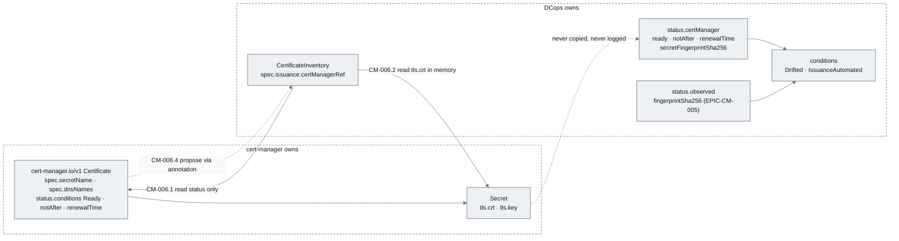
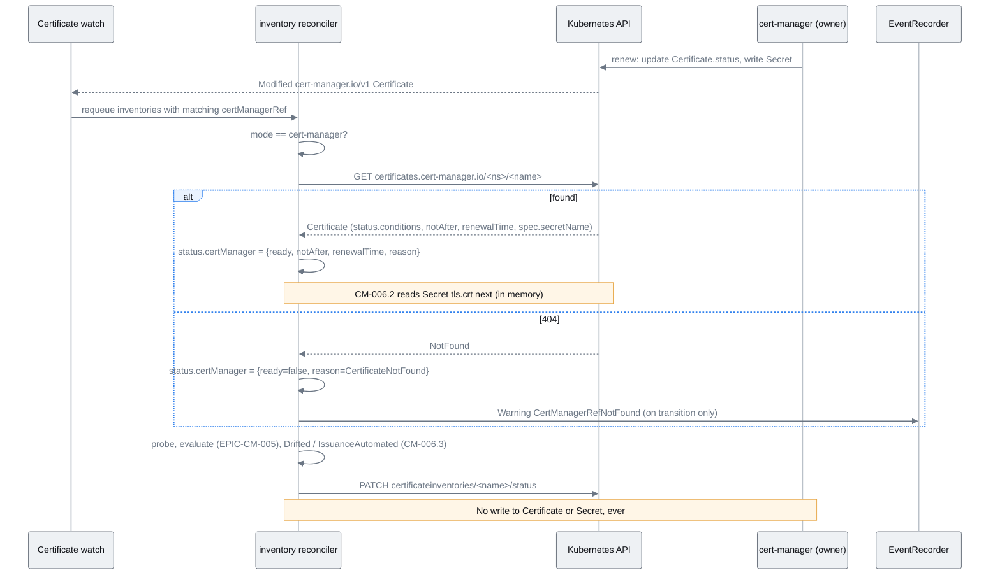
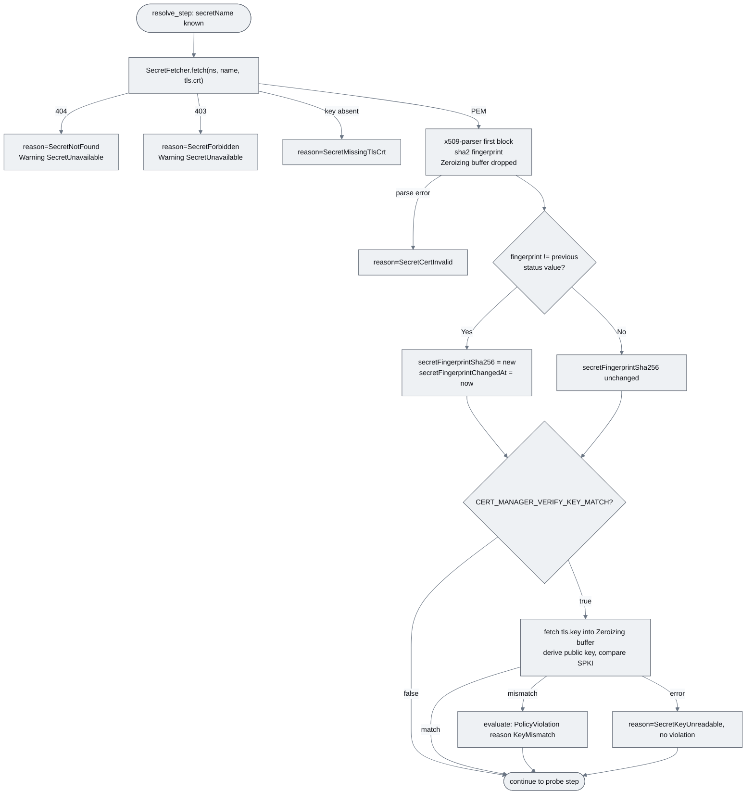
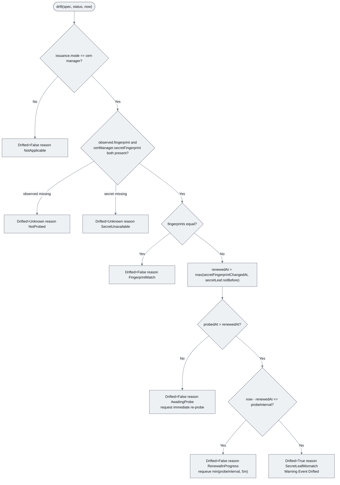
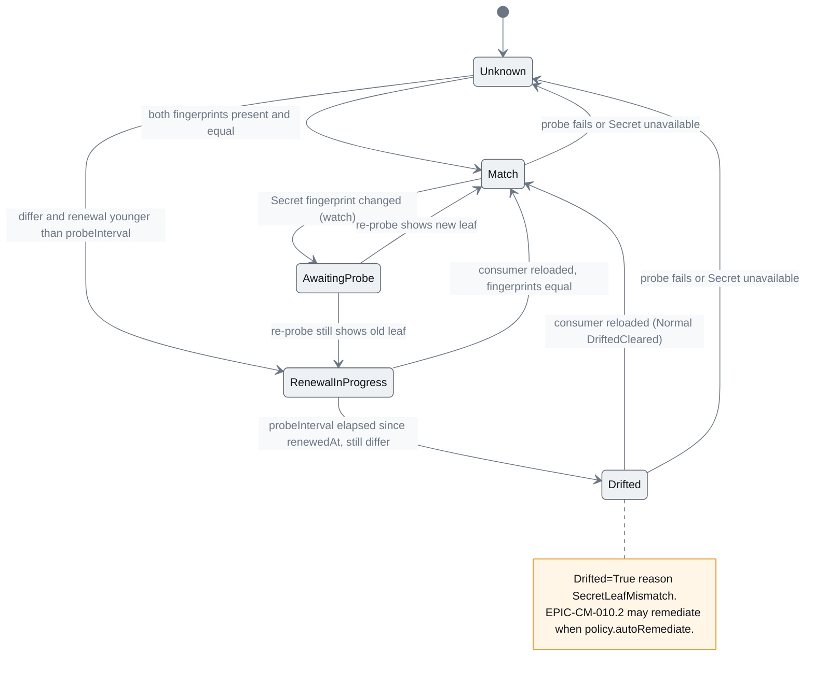
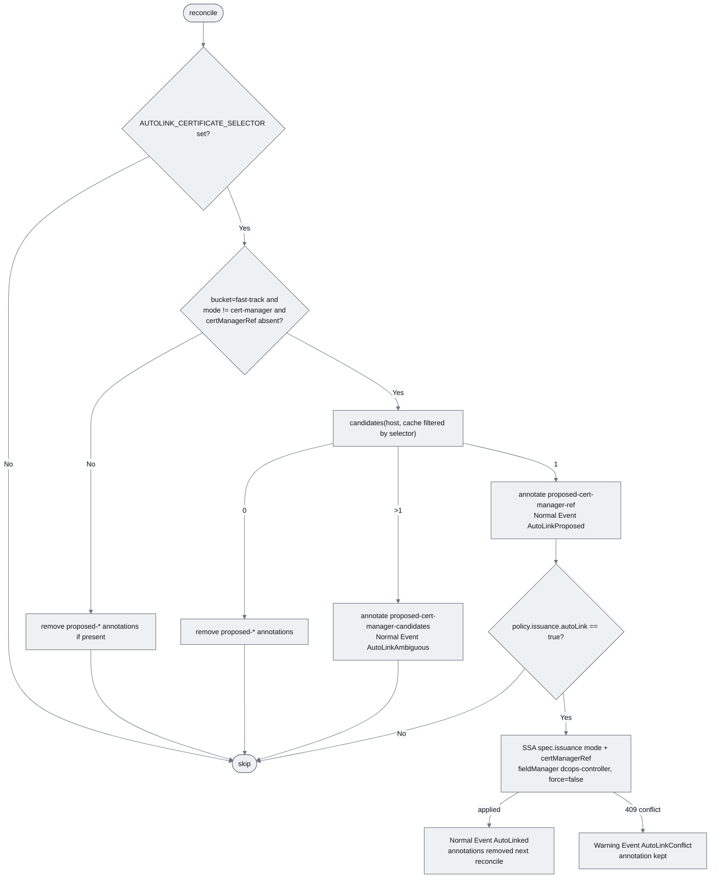

# EPIC-CM-006: cert-manager read-through & drift

> **Parent:** [Certificate Management Design](../../CERTIFICATE_MANAGEMENT_DESIGN.md) §3, §5.2, §5.3
> **Phase:** 2 — Verification
> **CMMI level advanced:** Level 4 · Quantitatively managed (fast-track records; prerequisite for Level 5 in EPIC-CM-009/010)
> **Status:** Draft — awaiting implementation
> **Priority:** P0
> **Estimated effort:** 7–9 days
> **Depends on:** EPIC-CM-005 (probe, `status.observed`, evaluate/Verified rule, Events, requeue), EPIC-CM-001 (RBAC skeleton, `SecretFetcher`)

---

## Overview

A fast-track record points at a cert-manager `Certificate` through `spec.issuance.certManagerRef`. This epic implements step 1 of the reconciler in design §5.3 — *Resolve* — and the two conditions that only make sense once both sides are known: `Drifted` (the live endpoint presents something other than the leaf in cert-manager's Secret) and `IssuanceAutomated` (cert-manager reports `Ready=True`). It is the mechanism behind the design's central rule (§3): cert-manager owns the certificate, DCops owns the operational facts about it. The controller reads `Certificate.status.conditions[Ready]`, `status.notAfter`, `status.renewalTime` and `spec.secretName`, reads the Secret's `tls.crt` in memory, computes the leaf fingerprint, and surfaces all of it under `status.certManager`. It copies nothing into spec — no `dnsNames`, no `issuerRef`, no `duration`.

Drift is defined with a grace window because renewal is not instantaneous: cert-manager writes the new Secret, and consumers pick it up on their own schedule (ingress controllers within seconds, a Deployment only on restart). `Drifted=True` therefore requires the observed fingerprint to differ from the Secret leaf for longer than one `policy.probeInterval` after the renewal. Within the window the record is `Drifted=False` reason `RenewalInProgress`, which is the signal EPIC-CM-010's opt-in rollout-restart remediation will later act on. The last story adds auto-link discovery for fast-track records that have no reference yet: the controller finds the `Certificate` whose `dnsNames` cover the host and *proposes* it through an annotation. The reference itself is set by a human (UI/Git) unless `policy.issuance.autoLink` is explicitly true.

Out of scope: creating `Certificate` resources (EPIC-CM-010.1), any remediation (EPIC-CM-010.2), binding-based drift for legacy records (EPIC-CM-011.4), the per-inventory `dcops_certificate_drift` gauge (EPIC-CM-007, which reads the condition this epic sets), and the maturity effect of `Drifted`/`IssuanceAutomated` (EPIC-CM-009).

## Epic-level diagram

Read-through data flow and the boundary it must not cross (flowchart, because ownership direction is the point of design §3).

## Stories

| ID | Story | Persona | Effort |
|----|-------|---------|--------|
| **CM-006.1** | As a platform operator, I want the controller to resolve `certManagerRef` and surface cert-manager's Ready/notAfter/renewalTime on the inventory record so that Operations sees issuance state without opening cert-manager objects | Operator | 2 d |
| **CM-006.2** | As a security engineer, I want the Secret's leaf fingerprint computed in memory with least-privilege RBAC and no key exposure so that drift can be detected without DCops ever holding key material | Security engineer | 2 d |
| **CM-006.3** | As an Operations manager, I want `Drifted` and `IssuanceAutomated` conditions with a renewal grace window so that a stale consumer is flagged only after cert-manager has done its job and the consumer has not | Operations manager | 2 d |
| **CM-006.4** | As an Operations manager, I want unlinked fast-track records to receive a proposed `Certificate` link I can accept in the UI so that linking 1,000+ records does not require engineers | Operations manager | 1.5 d |

## Definition of Done (epic)

- [ ] Every story's ACs pass
- [ ] `just verify` (fmt, clippy with workspace lints, nextest) is green
- [ ] `README.md` capability list gains "Certificate management — cert-manager read-through and drift detection"; implementation checklist Resolve row ticked
- [ ] `config/certificate-controller/` RBAC diff reviewed by a second maintainer: `certificates.cert-manager.io` get/list/watch only, `secrets` get only, no list/watch on Secrets
- [ ] `grep -rn "tls.key"` across `controllers/certificate/src` shows the key is read in exactly one function (`certmanager::secret::key_matches`) and appears in no `tracing` field, status type, Event message or metric label
- [ ] `config/examples/certificates/inventory-fast-track.yaml` reconciles on the dev cluster to `IssuanceAutomated=True`, `Drifted=False`

## Open questions

| ID | Question | Default if unresolved |
|----|----------|----------------------|
| **Q1** | Design §5.2 lists `status.certManager.{ready, renewalTime, secretFingerprintSha256}`; this epic needs `notAfter` (plan CM-006.1), a reason/message for missing/NotReady, and the time the Secret fingerprint last changed for the grace window. | Add additive optional fields `notAfter`, `reason`, `message`, `secretFingerprintChangedAt` to `CertificateInventoryStatus.certManager` in `crates/crds`; propose a §5.2 amendment in the PR. |
| **Q2** | `resourceNames` on Secrets cannot be expressed statically for an open-ended set of Certificates. | Keep the ClusterRole at `get` only (no list/watch) and ship `just cert-rbac-secrets` which renders a per-namespace `Role` with `resourceNames` from the current `Certificate.spec.secretName` set for clusters that want the tighter grant. |
| **Q3** | Is `policy.issuance.autoLink=true` a spec write the reconciler is allowed to make, given §5.3 "the reconciler never mutates spec"? | Yes, as the single documented exception, recorded in ADR-002; default `false`, SSA with `fieldManager=dcops-controller`, `force=false`, so a Git- or UI-owned `issuance` block is never overwritten. |
| **Q4** | Should the key-match check be on by default? | Off (`CERT_MANAGER_VERIFY_KEY_MATCH=false`); it adds a Secret key read that most clusters do not need because cert-manager already guarantees the pair. |

---

## CM-006.1 — Resolve `certManagerRef` and read `Certificate` status

**As a** platform operator, **I want** the controller to fetch the referenced cert-manager `Certificate` and surface `Ready`, `notAfter` and `renewalTime` under `status.certManager` **so that** a fast-track record shows cert-manager's view next to the probe's view without anyone opening cert-manager objects.

### Description

Adds `controllers/certificate/src/certmanager/` with `mod.rs`, `certificate.rs` (a minimal typed `cert-manager.io/v1 Certificate` — `spec.secretName`, `spec.dnsNames`, `status.conditions`, `status.notAfter`, `status.renewalTime`, `status.revision` — defined with `kube::CustomResource`-compatible derives so `Api<Certificate>` and `KubeApiTrait<Certificate>` work without depending on a cert-manager crate) and `resolve.rs` (`resolve(ref) -> Resolved { ready, ready_reason, not_after, renewal_time, secret_name, revision }`). `reconciler/inventory/resolve_step.rs` runs first in the reconcile (design §5.3 step 1) when `spec.issuance.mode = cert-manager`: it fetches the `Certificate` through `KubeApiTrait::get`, writes `status.certManager.{ready, notAfter, renewalTime}` and, from Open question Q1, `reason`/`message`. A missing `Certificate` yields `status.certManager.ready=false`, `reason=CertificateNotFound`, and a `Warning` Event `CertManagerRefNotFound` once per transition; `Ready=False` yields `reason=CertManagerNotReady` with cert-manager's own reason/message copied verbatim into `message`. `mode != cert-manager` clears `status.certManager`.

`controller.rs` (from `CM-001.4`) gains a `watches(Api<Certificate>)` mapper that requeues every inventory whose `certManagerRef` matches a changed `Certificate`, using an in-memory index maintained from the inventory reflector, so a renewal triggers reconcile within seconds instead of waiting for `probeInterval`. RBAC in `config/certificate-controller/clusterrole.yaml` is verified to be `get`, `list`, `watch` on `certificates.cert-manager.io` and nothing else in that group. Does not read Secrets (`CM-006.2`), does not set `Drifted`/`IssuanceAutomated` (`CM-006.3`), never writes to any cert-manager object, and never copies `dnsNames`, `issuerRef` or `duration` anywhere.

### Diagrams

Read-through on one reconcile (sequenceDiagram, because the ordering relative to the probe and the "read only" boundary is what reviewers check).

### Functional requirements

| ID | Requirement |
|----|-------------|
| **FR-006.1-01** | MUST, when `spec.issuance.mode = cert-manager`, fetch `cert-manager.io/v1 Certificate` at `certManagerRef.namespace/name` (namespace defaults to the inventory's namespace) via `KubeApiTrait::get` before the probe step |
| **FR-006.1-02** | MUST write `status.certManager.ready` from the `Ready` condition, `status.certManager.notAfter` from `status.notAfter`, `status.certManager.renewalTime` from `status.renewalTime`, leaving absent upstream fields `null` |
| **FR-006.1-03** | MUST set `status.certManager.reason=CertificateNotFound` with `ready=false` when the object does not exist and emit one `Warning` Event `CertManagerRefNotFound` per transition into that state |
| **FR-006.1-04** | MUST set `reason=CertManagerNotReady` and copy cert-manager's `Ready` condition `reason`/`message` into `status.certManager.message` when `Ready` is `False` or `Unknown` |
| **FR-006.1-05** | MUST clear `status.certManager` when `mode` is `external` or `unknown`, and when `mode = cert-manager` but `certManagerRef` is absent set `reason=MissingRef` (auto-link in `CM-006.4` may then propose one) |
| **FR-006.1-06** | MUST NOT write any field of the `Certificate` or copy `spec.dnsNames`, `spec.issuerRef` or `spec.duration` into the inventory spec or status |
| **FR-006.1-07** | MUST add a `Certificate` watch that requeues every inventory referencing the changed object within 5 s, using an index maintained from the inventory reflector (no `list` of inventories per event) |
| **FR-006.1-08** | MUST tolerate the CRD `certificates.cert-manager.io` being absent from the cluster: the watch is skipped with a single `warn` log, and `mode = cert-manager` records get `reason=CertManagerUnavailable` |
| **FR-006.1-09** | MUST keep RBAC on `cert-manager.io` at `certificates` `get`/`list`/`watch` only |
| **FR-006.1-10** | SHOULD emit a `Normal` Event `CertManagerReady` when `ready` transitions false→true |

### Non-functional requirements

| ID | Category | Requirement |
|----|----------|-------------|
| **NFR-006.1-01** | Security | Key material never appears in status, Events, logs or metrics — this story reads no Secret, and the `Certificate` type deliberately has no field that could carry one |
| **NFR-006.1-02** | Security | The controller's ServiceAccount cannot `create`, `update`, `patch` or `delete` anything in `cert-manager.io` (verified by SubjectAccessReview in IT) |
| **NFR-006.1-03** | Performance | Resolve adds one `GET` per reconcile of a cert-manager-mode record (served from the reflector cache when the watch is active) and completes in < 50 ms p95 |
| **NFR-006.1-04** | Reliability | API errors other than 404 are `ControllerError::Transient` → `BackoffCalculator` requeue; the probe step still runs so `status.observed` stays fresh |
| **NFR-006.1-05** | Compatibility | Works with cert-manager ≥ 1.12 (fields used are stable since v1); tested against the version pinned in the Tilt setup |
| **NFR-006.1-06** | Observability | Reconcile spans carry `cert_manager_ref`, `cert_manager_ready`, `cert_manager_reason` fields |

### Acceptance criteria

| ID | Given / When / Then |
|----|---------------------|
| **AC-006.1-01** | **Given** a fast-track inventory referencing a `Ready=True` `Certificate` **When** reconciled **Then** `status.certManager.ready=true`, `notAfter` and `renewalTime` equal the `Certificate.status` values, `reason` is absent |
| **AC-006.1-02** | **Given** `certManagerRef` names an object that does not exist **When** reconciled **Then** `ready=false`, `reason=CertificateNotFound`, one `Warning CertManagerRefNotFound` Event; a second reconcile adds no Event |
| **AC-006.1-03** | **Given** a `Certificate` with `Ready=False` reason `Failed` message `...ACME challenge...` **When** reconciled **Then** `reason=CertManagerNotReady` and `message` contains the cert-manager message |
| **AC-006.1-04** | **Given** the `Certificate` is renewed (cert-manager updates `status.renewalTime`) **When** the watch fires **Then** the inventory is reconciled within 5 s and `status.certManager.renewalTime` reflects the new value |
| **AC-006.1-05** | **Given** `mode` changed from `cert-manager` to `external` **When** reconciled **Then** `status.certManager` is absent |
| **AC-006.1-06** | **Given** `kubectl auth can-i patch certificates.cert-manager.io --as=system:serviceaccount:dcops-system:certificate-controller` **Then** `no`; `can-i get certificates.cert-manager.io` **Then** `yes` |
| **AC-006.1-07** | **Given** a cluster without cert-manager CRDs **When** the controller starts **Then** it becomes `Ready`, logs one warning, and cert-manager-mode records show `reason=CertManagerUnavailable` |
| **AC-006.1-08** | **Given** any reconciled fast-track record **When** `kubectl get -o yaml` is inspected **Then** neither spec nor status contains `dnsNames`, `issuerRef` or `duration` |

### Unit test criteria

| ID | Test | Covers |
|----|------|--------|
| **UT-006.1-01** | `certmanager::certificate_test::deserialise_real_certificate_status` — fixture captured from cert-manager 1.15 (`fixtures/certificate-ready.json`, `-notready.json`) round-trips; unknown fields ignored | FR-006.1-02/04, NFR-006.1-05 |
| **UT-006.1-02** | `reconciler::inventory::resolve_step_test::ready_certificate_populates_status` — `MockKubeApi<Certificate>` returns the ready fixture; assert exact `/status` patch body via `MockKubeApi<CertificateInventory>` | FR-006.1-01/02, AC-006.1-01 |
| **UT-006.1-03** | `resolve_step_test::not_found_sets_reason_and_single_event` — `MockKubeApi` returns 404 twice; `MockEventRecorder` count 1 | FR-006.1-03, AC-006.1-02 |
| **UT-006.1-04** | `resolve_step_test::not_ready_copies_message` | FR-006.1-04, AC-006.1-03 |
| **UT-006.1-05** | `resolve_step_test::external_mode_clears_and_missing_ref_reason` | FR-006.1-05, AC-006.1-05 |
| **UT-006.1-06** | `resolve_step_test::no_spec_fields_copied` — after reconcile the inventory spec patch is empty and status contains no `dnsNames`/`issuerRef`/`duration` keys (JSON scan) | FR-006.1-06, AC-006.1-08 |
| **UT-006.1-07** | `controller_test::certificate_watch_mapper_uses_index` — three inventories, two referencing the same `Certificate`; mapper returns exactly those two `ObjectRef`s without calling `list` on `MockKubeApi` | FR-006.1-07, AC-006.1-04 |
| **UT-006.1-08** | `resolve_step_test::transient_api_error_still_probes` — `MockKubeApi` returns 500; `MockProber` is still called and the result is `Transient` with backoff | NFR-006.1-04 |
| **UT-006.1-09** | `controller_test::missing_cert_manager_crd_is_tolerated` — discovery mock without `cert-manager.io`; assert warn log and `CertManagerUnavailable` | FR-006.1-08, AC-006.1-07 |
| **UT-006.1-10** | `resolve_step_test::ready_transition_emits_normal_event` — not-ready then ready fixtures; `MockEventRecorder` records one `CertManagerReady` | FR-006.1-10, AC-006.1-04 |

### Integration test criteria

| ID | Test | Environment | Covers |
|----|------|-------------|--------|
| **IT-006.1-01** | `tests/certmanager_readthrough.rs` (feature `integration`) — Tilt cluster with cert-manager, self-signed `ClusterIssuer`, the nginx endpoint from `IT-005.1-01`; applies `inventory-fast-track.yaml` referencing the nginx `Certificate`; asserts `status.certManager` matches `kubectl get certificate -o json`; then triggers a renewal (`cmctl renew` or delete the Secret) and asserts the inventory reconciles within 5 s | kind/k3s via Tilt, `cargo nextest --features integration` | AC-006.1-01/04 |
| **IT-006.1-02** | `tests/certmanager_readthrough.rs::not_found_and_not_ready` — dangling ref; and a `Certificate` with an issuer that does not exist (stays `Ready=False`) | kind/k3s via Tilt | AC-006.1-02/03 |
| **IT-006.1-03** | `tests/rbac.rs` extended — SubjectAccessReview matrix for `cert-manager.io` verbs | kind/k3s via Tilt | FR-006.1-09, AC-006.1-06, NFR-006.1-02 |

### QA process

1. `just dev-up`; confirm cert-manager and the `selfsigned` ClusterIssuer; the `cert-qa` nginx `Certificate` is `Ready=True`.
2. Apply `config/examples/certificates/qa/inventory-fast-track.yaml` (`mode: cert-manager`, `certManagerRef: {name: nginx, namespace: cert-qa}`). `kubectl get certificateinventory nginx.cert-qa.svc -o jsonpath='{.status.certManager}' | jq` — compare `ready`, `notAfter`, `renewalTime` with `kubectl get certificate -n cert-qa nginx -o jsonpath='{.status}'`.
3. `cmctl renew -n cert-qa nginx` (or `kubectl delete secret -n cert-qa nginx-tls`); watch `kubectl get certificateinventory … -w` — `renewalTime`/`notAfter` update within seconds of the `Certificate` status change.
4. Negative paths: (a) point `certManagerRef.name` at `missing` — `reason=CertificateNotFound`, one `Warning CertManagerRefNotFound` Event, count stays 1 across reconciles; (b) create `Certificate` `broken` with `issuerRef.name: nonexistent` and reference it — `reason=CertManagerNotReady`, `message` shows cert-manager's text; (c) set `mode: external` — `status.certManager` disappears.
5. Run the `auth can-i` matrix for `cert-manager.io` verbs; record answers.
6. Confirm `kubectl get certificateinventory … -o yaml` contains no `dnsNames`, `issuerRef` or `duration` anywhere.
7. Exit criteria: AC-006.1-01..06 observed (07 by unit test). Attach: side-by-side JSON of both objects, `-w` output, Events, `auth can-i` matrix, nextest report.

---

## CM-006.2 — Secret leaf fingerprint, in memory, with least-privilege RBAC

**As a** security engineer, **I want** the referenced Secret's `tls.crt` read only in memory and reduced to a SHA-256 leaf fingerprint under `status.certManager.secretFingerprintSha256`, with `tls.key` touched only by an opt-in key-match check that can never leak **so that** drift detection is possible without DCops ever holding, storing or logging key material.

### Description

Adds `controllers/certificate/src/certmanager/secret.rs`: `leaf_fingerprint(fetcher, ns, name) -> Result<SecretLeaf, SecretError>` reads `tls.crt` through `SecretFetcher::fetch(namespace, name, "tls.crt")` (`crates/controller-common`), parses the first PEM block with `x509-parser`, and returns `SecretLeaf { fingerprint_sha256, not_before, not_after, subject_alt_names }` computed with `sha2` in the same format as `probe/parse.rs` (`CM-005.1`) so the two fingerprints compare byte-for-byte. The PEM `String` lives in a `zeroize::Zeroizing<String>` and is dropped at function exit; nothing of it reaches status except the fingerprint and dates. `reconciler/inventory/resolve_step.rs` calls it after `CM-006.1` resolved `spec.secretName`, writes `status.certManager.secretFingerprintSha256`, and — when the fingerprint differs from the previous status value — writes `status.certManager.secretFingerprintChangedAt = now` (Open question Q1), which `CM-006.3` uses as the renewal instant. A missing Secret or missing key sets `reason=SecretNotFound` / `SecretMissingTlsCrt`; RBAC denial sets `reason=SecretForbidden`; all three keep the previous fingerprint absent and emit one `Warning` Event `SecretUnavailable` per transition.

The optional key-match check (`key_matches(fetcher, ns, name, leaf_spki) -> Result<bool, SecretError>`) exists only when the controller runs with `CERT_MANAGER_VERIFY_KEY_MATCH=true`: it reads `tls.key` into a `Zeroizing<Vec<u8>>`, derives the public key through `rustls::crypto::ring::sign::any_supported_type` and compares its SPKI bytes with the leaf's; the function returns a `bool`, is the only place in the crate that names `tls.key`, and is covered by a compile-time guard test. A mismatch surfaces as `PolicyViolation` reason `KeyMismatch` through the `CM-005.2` evaluate table. RBAC: `config/certificate-controller/clusterrole.yaml` keeps `secrets` at `get` only; a new `just cert-rbac-secrets` recipe renders `config/certificate-controller/generated/secrets-role-<ns>.yaml` (`Role` with `resourceNames` = every `Certificate.spec.secretName` in that namespace) plus a `RoleBinding`, for clusters that replace the cluster-wide `get` with per-namespace grants (Open question Q2). Reuses `SecretFetcher`, `KubeApiTrait`, `EventRecorderTrait`; extends the tracing redaction layer from `CM-001.4` (`NFR-001.4-02`) with the field names `tls_key`, `private_key_pem`. Does not compare fingerprints (`CM-006.3`), does not read Secrets for `mode != cert-manager`, never lists or watches Secrets.

### Diagrams

Secret read and key-match paths (flowchart, because the security review follows exactly these branches).

### Functional requirements

| ID | Requirement |
|----|-------------|
| **FR-006.2-01** | MUST read `tls.crt` of `Certificate.spec.secretName` in the `Certificate`'s namespace through `SecretFetcher`, parse the first PEM certificate with `x509-parser`, and write `status.certManager.secretFingerprintSha256` in the same upper-case colon-hex format as `status.observed.fingerprintSha256` |
| **FR-006.2-02** | MUST hold the PEM and DER bytes only in `Zeroizing` buffers scoped to the function and never store them in any struct that outlives the reconcile |
| **FR-006.2-03** | MUST set `status.certManager.secretFingerprintChangedAt` to the reconcile time whenever the fingerprint differs from the previously stored value, and leave it unchanged otherwise |
| **FR-006.2-04** | MUST map failures to `reason` values `SecretNotFound`, `SecretForbidden`, `SecretMissingTlsCrt`, `SecretCertInvalid` and emit one `Warning` Event `SecretUnavailable` per transition into a failure reason |
| **FR-006.2-05** | MUST read `tls.key` only when `CERT_MANAGER_VERIFY_KEY_MATCH=true`, only inside `certmanager::secret::key_matches`, returning a `bool`; a mismatch is reported to evaluate as `PolicyViolation` reason `KeyMismatch` |
| **FR-006.2-06** | MUST NOT log, store in status, include in any Event message or metric label, or return from any public function the contents of `tls.key`, `tls.crt` PEM, or the derived private key object |
| **FR-006.2-07** | MUST keep ClusterRole `secrets` verbs at `get` only (no `list`/`watch`), and MUST NOT read Secrets for records with `mode != cert-manager` |
| **FR-006.2-08** | MUST provide `just cert-rbac-secrets [namespace]` rendering a `Role`/`RoleBinding` with `resourceNames` from the namespace's `Certificate.spec.secretName` values, plus a `kustomize` overlay `overlays/secrets-resourcenames` that drops the cluster-wide Secret `get` |
| **FR-006.2-09** | SHOULD extend the `CM-001.4` tracing redaction layer with `tls_key`, `private_key_pem`, `tls_crt_pem` field names and add a clippy-enforced `#[deny(clippy::dbg_macro, clippy::print_stdout)]` on `secret.rs` |

### Non-functional requirements

| ID | Category | Requirement |
|----|----------|-------------|
| **NFR-006.2-01** | Security | Key material never appears in status, Events, logs or metrics: enforced by FR-006.2-06, the redaction layer, a test that scans every status patch, Event and captured log line for `-----BEGIN` and `PRIVATE KEY`, and the DoD grep |
| **NFR-006.2-02** | Security | `tls.key` is read at most once per reconcile and only under the env flag; with the flag off, the Secret `data` map is accessed for `tls.crt` only (`SecretFetcher::fetch` takes a single key) |
| **NFR-006.2-03** | Security | Memory holding PEM/DER/key bytes is zeroized on drop (`zeroize` crate, already used by rustls dependencies) |
| **NFR-006.2-04** | Performance | Secret read + fingerprint < 20 ms p95; one `GET secrets` per reconcile of a cert-manager-mode record, none for other modes |
| **NFR-006.2-05** | Reliability | A Secret being rewritten mid-read (renewal) is harmless: the next reconcile, triggered by the `Certificate` watch, re-reads it |
| **NFR-006.2-06** | Compatibility | Secrets of type `kubernetes.io/tls` and `Opaque` with `tls.crt` are both accepted; `ca.crt` is ignored |

### Acceptance criteria

| ID | Given / When / Then |
|----|---------------------|
| **AC-006.2-01** | **Given** a fast-track record whose `Certificate` is Ready **When** reconciled **Then** `status.certManager.secretFingerprintSha256` equals `openssl x509 -fingerprint -sha256` of the Secret's `tls.crt` and `secretFingerprintChangedAt` is set |
| **AC-006.2-02** | **Given** the Secret is renewed with a new leaf **When** reconciled **Then** the fingerprint changes and `secretFingerprintChangedAt` advances; a further reconcile without change leaves it untouched |
| **AC-006.2-03** | **Given** the Secret is deleted **When** reconciled **Then** `reason=SecretNotFound`, no fingerprint, one `Warning SecretUnavailable` Event |
| **AC-006.2-04** | **Given** the ServiceAccount loses `get` on that Secret (resourceNames overlay without the name) **When** reconciled **Then** `reason=SecretForbidden` and the controller keeps reconciling other records |
| **AC-006.2-05** | **Given** the controller logs at `trace` level during 100 reconciles **When** logs, all status patches and Events are scanned **Then** no line contains `-----BEGIN` or `PRIVATE KEY` |
| **AC-006.2-06** | **Given** `CERT_MANAGER_VERIFY_KEY_MATCH=true` and a Secret whose `tls.key` does not match `tls.crt` **When** reconciled **Then** `PolicyViolation=True` reason `KeyMismatch`; **Given** the flag is unset **Then** `tls.key` is never requested (`MockSecretFetcher` records keys fetched) |
| **AC-006.2-07** | **Given** `just cert-rbac-secrets cert-qa` **When** the rendered Role is applied with the `secrets-resourcenames` overlay **Then** `kubectl auth can-i get secret/nginx-tls -n cert-qa --as=…` is `yes` and `can-i get secret/other -n cert-qa` is `no`; `can-i list secrets` is `no` |
| **AC-006.2-08** | **Given** an `external` record **When** reconciled **Then** `MockSecretFetcher` records zero calls |

### Unit test criteria

| ID | Test | Covers |
|----|------|--------|
| **UT-006.2-01** | `certmanager::secret_test::fingerprint_matches_probe_format` — `MockSecretFetcher` serves a generated PEM; fingerprint equals `probe::parse` on the same DER | FR-006.2-01, AC-006.2-01 |
| **UT-006.2-02** | `certmanager::secret_test::first_pem_block_only_and_bundle_order` — full-chain PEM (leaf first) yields the leaf fingerprint | FR-006.2-01, NFR-006.2-06 |
| **UT-006.2-03** | `reconciler::inventory::resolve_step_test::changed_at_advances_only_on_change` — fixed clock, two fingerprints, three reconciles | FR-006.2-03, AC-006.2-02 |
| **UT-006.2-04** | `resolve_step_test::secret_failure_reasons_and_single_event` — `MockSecretFetcher` returns NotFound / Forbidden / missing key / garbage PEM; `MockEventRecorder` count 1 per transition | FR-006.2-04, AC-006.2-03/04 |
| **UT-006.2-05** | `certmanager::secret_test::key_match_true_false_with_generated_pairs` — `rcgen` key pairs; matching and swapped keys | FR-006.2-05, AC-006.2-06 |
| **UT-006.2-06** | `resolve_step_test::key_not_fetched_without_flag` — `MockSecretFetcher::fetched_keys()` contains only `tls.crt` | FR-006.2-05, NFR-006.2-02, AC-006.2-06 |
| **UT-006.2-07** | `certmanager::secret_test::no_key_material_in_patches_events_logs` — `tracing_test` capture at `trace`; scan `MockKubeApi` patch bodies, `MockEventRecorder` messages and logs for `-----BEGIN`, `PRIVATE KEY` and the raw base64 of the key; includes a span with field `tls_key` to prove the redaction layer drops it | FR-006.2-06/09, NFR-006.2-01, AC-006.2-05 |
| **UT-006.2-08** | `certmanager::secret_test::zeroizing_types_used` — compile-time assertion via `static_assertions` that `SecretLeaf` contains no `String`/`Vec<u8>` beyond the fingerprint, and `key_matches` returns `bool` | FR-006.2-02, NFR-006.2-03 |
| **UT-006.2-09** | `resolve_step_test::external_mode_reads_no_secret` | FR-006.2-07, AC-006.2-08 |
| **UT-006.2-10** | `scripts/rbac_render_test.py::resource_names_from_certificates` — renders the Role from a fixture list of Certificates and asserts `resourceNames` | FR-006.2-08, AC-006.2-07 |

### Integration test criteria

| ID | Test | Environment | Covers |
|----|------|-------------|--------|
| **IT-006.2-01** | `tests/certmanager_secret.rs` (feature `integration`) — against the `IT-006.1-01` setup: asserts fingerprint equality with the Secret, forces a renewal, asserts change and `secretFingerprintChangedAt`; deletes the Secret, asserts `SecretNotFound` and Event; cert-manager re-creates it, asserts recovery | kind/k3s via Tilt | AC-006.2-01/02/03 |
| **IT-006.2-02** | `tests/rbac.rs` extended — applies the `secrets-resourcenames` overlay and the rendered Role; SubjectAccessReview matrix incl. `list secrets = no`; reconciles a record whose Secret is not in `resourceNames` and asserts `SecretForbidden` | kind/k3s via Tilt | AC-006.2-04/07 |
| **IT-006.2-03** | `tests/certmanager_secret.rs::log_scan` — controller at `RUST_LOG=trace` for the whole suite; collects pod logs and scans for key material | kind/k3s via Tilt | AC-006.2-05 |

### QA process

1. From the `CM-006.1` QA state: `kubectl get certificateinventory nginx.cert-qa.svc -o jsonpath='{.status.certManager.secretFingerprintSha256}'` vs `kubectl get secret -n cert-qa nginx-tls -o jsonpath='{.data.tls\.crt}' | base64 -d | openssl x509 -noout -fingerprint -sha256`. Must be identical.
2. `cmctl renew -n cert-qa nginx`; confirm the fingerprint changes and `secretFingerprintChangedAt` advances; re-run `probe-now` twice and confirm it does not advance again.
3. Set `RUST_LOG=trace` on the Tilt resource; run 20 reconciles; `kubectl logs deploy/certificate-controller | grep -c -e '-----BEGIN' -e 'PRIVATE KEY'` — must be `0`. Also `kubectl get events -n cert-qa -o json | grep -c 'PRIVATE KEY'` — `0`.
4. Key-match: set `CERT_MANAGER_VERIFY_KEY_MATCH=true`; create Secret `mismatch-tls` from a leaf and an unrelated key, a `Certificate`-less inventory is not possible, so instead patch the nginx Secret's `tls.key` with the unrelated key (cert-manager will repair it shortly — observe quickly) — expect `PolicyViolation/KeyMismatch`; after cert-manager repairs, expect clearance. Unset the flag and confirm via logs at `debug` that `tls.key` is not fetched (`secret_key=tls.crt` only in fetch spans).
5. RBAC: `just cert-rbac-secrets cert-qa`; apply the overlay; run the `auth can-i` matrix from AC-006.2-07. Create `Certificate` `extra` in `cert-qa` without re-rendering; reference it — expect `SecretForbidden`; re-render and apply — expect recovery.
6. Negative paths: (a) delete Secret `nginx-tls` — `SecretNotFound` + Event, recovery after cert-manager reissues; (b) create an `Opaque` Secret without `tls.crt` and a `Certificate` pointing at it via a manual `secretName` — `SecretMissingTlsCrt`; (c) `mode: external` record — `kubectl logs` shows no Secret fetch span for it.
7. Exit criteria: AC-006.2-01..08 observed. Attach: fingerprint comparison, log grep counts, `auth can-i` matrix, rendered Role YAML, Events, nextest report.

---

## CM-006.3 — `Drifted` and `IssuanceAutomated` conditions

**As an** Operations manager, **I want** `Drifted=True` when the live endpoint keeps presenting a certificate other than cert-manager's for longer than one probe interval after renewal, and `IssuanceAutomated=True` when cert-manager reports Ready **so that** I am alerted to consumers that never picked up a renewal, without noise during the renewal itself.

### Description

Adds `controllers/certificate/src/reconciler/inventory/drift.rs` with a pure function `drift(spec, status, now) -> (ConditionChange /*Drifted*/, ConditionChange /*IssuanceAutomated*/)` called from the evaluate step between `PolicyViolation` and `Verified` (design §5.2 order), so the `Verified` composite from `CM-005.2` already accounts for `Drifted`. `Drifted` applies only to `mode = cert-manager` records (binding-based drift for legacy records is `CM-011.4`; `external` records get `Drifted=False` reason `NotApplicable`). Inputs: `status.observed.fingerprintSha256` and `probedAt` (`CM-005.1`), `status.certManager.secretFingerprintSha256`, `secretFingerprintChangedAt` (`CM-006.2`), the Secret leaf `notBefore` (returned in memory by `CM-006.2`'s `SecretLeaf`, not stored), and `policy.probeInterval`.

Decision: if either fingerprint is unavailable → `Drifted=Unknown` reason `NotProbed` or `SecretUnavailable`. If they match → `Drifted=False` reason `FingerprintMatch`. If they differ: `renewedAt = max(secretFingerprintChangedAt, secretLeaf.notBefore)`; if `now − renewedAt ≤ probeInterval` → `Drifted=False` reason `RenewalInProgress` (grace window) and the record is requeued at `min(probeInterval, 5 min)` so the window is checked promptly; the probe must also be newer than the renewal (`probedAt > renewedAt`) before drift can be asserted, otherwise reason `AwaitingProbe` with an immediate re-probe request (bypassing the `CM-005.4` rate limiter through the same path as `probe-now`). Otherwise → `Drifted=True` reason `SecretLeafMismatch`, message carrying both fingerprints and `renewedAt`. `IssuanceAutomated=True` reason `CertManagerReady` when `status.certManager.ready = true`; `False` with reason `CertManagerNotReady`, `CertificateNotFound`, `MissingRef`, `ExternalIssuance` (mode external/unknown) otherwise. Transitions emit Events per the `CM-005.2` convention (`Warning Drifted`, `Normal DriftedCleared`, `Normal IssuanceAutomated`, `Warning IssuanceAutomatedLost`). Does not remediate (EPIC-CM-010.2 consumes `Drifted=True` and `policy.autoRemediate`), does not export the drift gauge (EPIC-CM-007.1), and does not touch adapter/binding state.

### Diagrams

The `Drifted` decision with the grace window (flowchart).

Lifecycle across a renewal (stateDiagram-v2, because the grace window is a timed state).

### Functional requirements

| ID | Requirement |
|----|-------------|
| **FR-006.3-01** | MUST set `Drifted=False` reason `NotApplicable` when `issuance.mode != cert-manager` |
| **FR-006.3-02** | MUST set `Drifted=Unknown` reason `NotProbed` when `status.observed.fingerprintSha256` is absent and `SecretUnavailable` when `status.certManager.secretFingerprintSha256` is absent |
| **FR-006.3-03** | MUST set `Drifted=False` reason `FingerprintMatch` when the two fingerprints are equal |
| **FR-006.3-04** | MUST compute `renewedAt = max(status.certManager.secretFingerprintChangedAt, Secret leaf notBefore)` and set `Drifted=False` reason `RenewalInProgress` while `now − renewedAt ≤ policy.probeInterval`, requeuing at `min(probeInterval, 5m)` |
| **FR-006.3-05** | MUST set `Drifted=False` reason `AwaitingProbe` and request an immediate re-probe when the fingerprints differ but `status.observed.probedAt ≤ renewedAt` |
| **FR-006.3-06** | MUST set `Drifted=True` reason `SecretLeafMismatch` when the fingerprints differ, the probe is newer than `renewedAt`, and the grace window has elapsed; message includes both fingerprints and `renewedAt` |
| **FR-006.3-07** | MUST set `IssuanceAutomated=True` reason `CertManagerReady` iff `status.certManager.ready = true`; otherwise `False` with reason `CertManagerNotReady`, `CertificateNotFound`, `MissingRef` or `ExternalIssuance` |
| **FR-006.3-08** | MUST emit Events on transitions: `Warning Drifted`, `Normal DriftedCleared`, `Normal IssuanceAutomated`, `Warning IssuanceAutomatedLost`; `Unknown` transitions emit no Event |
| **FR-006.3-09** | MUST feed `Drifted` into the `CM-005.2` `Verified` rule so `Verified=False` reason `Drifted` when `Drifted` is `True` or `Unknown` |
| **FR-006.3-10** | MUST evaluate `drift` as a pure function with an injected clock, placed in the §5.2 order (after `PolicyViolation`, before `IssuanceAutomated` and `Verified`) |
| **FR-006.3-11** | SHOULD clear the grace window early (`Drifted=False/FingerprintMatch`) as soon as a probe observes the new leaf, without waiting for the requeue |

### Non-functional requirements

| ID | Category | Requirement |
|----|----------|-------------|
| **NFR-006.3-01** | Security | Condition messages and Events carry fingerprints and timestamps only; no key material and no certificate bytes (inherits `NFR-006.2-01`) |
| **NFR-006.3-02** | Idempotency | Repeated evaluation with the same inputs and clock produces the same `Drifted`/`IssuanceAutomated` and no Events after the first |
| **NFR-006.3-03** | Reliability | A controller restart during the grace window does not extend or shorten it: `renewedAt` is derived from persisted status and the Secret's `notBefore`, never from process uptime |
| **NFR-006.3-04** | Reliability | Clock skew between cert-manager (`notBefore`, often backdated by CAs) and the controller cannot produce false drift: `renewedAt` uses the later of the two sources |
| **NFR-006.3-05** | Observability | Reconcile span fields `drifted`, `drift_reason`, `renewed_at`, `grace_remaining_s` |
| **NFR-006.3-06** | Performance | `drift` completes in < 100 µs; no API calls of its own |

### Acceptance criteria

| ID | Given / When / Then |
|----|---------------------|
| **AC-006.3-01** | **Given** a fast-track record whose endpoint serves the Secret's leaf **When** reconciled **Then** `Drifted=False/FingerprintMatch`, `IssuanceAutomated=True/CertManagerReady`, `Verified=True` |
| **AC-006.3-02** | **Given** the Secret is renewed at T and the endpoint still serves the old leaf **When** reconciled at T+1m **Then** `Drifted=False/RenewalInProgress` (or `AwaitingProbe` until the re-probe lands) and no `Warning` Event |
| **AC-006.3-03** | **Given** AC-006.3-02 with `probeInterval=6h` **When** reconciled at T+6h+1m with the endpoint still serving the old leaf **Then** `Drifted=True/SecretLeafMismatch`, one `Warning Drifted` Event, `Verified=False/Drifted` |
| **AC-006.3-04** | **Given** AC-006.3-03 **When** the consumer restarts and the probe observes the new leaf **Then** `Drifted=False/FingerprintMatch`, `Normal DriftedCleared`, `Verified=True` |
| **AC-006.3-05** | **Given** the Secret is renewed at T and the endpoint picks it up at T+30s **When** reconciled at T+2m **Then** `Drifted=False/FingerprintMatch` and no Event was ever emitted for drift |
| **AC-006.3-06** | **Given** `Probed=False` **When** evaluated **Then** `Drifted=Unknown/NotProbed`, no Event, `Verified=False` |
| **AC-006.3-07** | **Given** `Certificate` `Ready=False` **When** evaluated **Then** `IssuanceAutomated=False/CertManagerNotReady` with a `Warning IssuanceAutomatedLost` Event if it was previously True |
| **AC-006.3-08** | **Given** an `external` record **When** evaluated **Then** `Drifted=False/NotApplicable` and `IssuanceAutomated=False/ExternalIssuance` |
| **AC-006.3-09** | **Given** the controller restarts halfway through the grace window **When** it reconciles **Then** the window ends at the original `renewedAt + probeInterval` |

### Unit test criteria

| ID | Test | Covers |
|----|------|--------|
| **UT-006.3-01** | `reconciler::inventory::drift_test::mode_and_availability_matrix` — external/unknown/cert-manager × observed present/absent × secret present/absent | FR-006.3-01/02, AC-006.3-06/08 |
| **UT-006.3-02** | `drift_test::match_is_false_fingerprint_match` | FR-006.3-03, AC-006.3-01 |
| **UT-006.3-03** | `drift_test::grace_window_boundaries_with_fixed_clock` — differ; now at renewedAt+1m, +6h, +6h+1s, +6h+1m; asserts reasons and requeue hint | FR-006.3-04/06, AC-006.3-02/03 |
| **UT-006.3-04** | `drift_test::awaiting_probe_when_probe_older_than_renewal` — asserts immediate re-probe request | FR-006.3-05, AC-006.3-02 |
| **UT-006.3-05** | `drift_test::renewed_at_uses_later_of_changed_at_and_not_before` — backdated `notBefore` (−1h) vs `changedAt`; and `changedAt` missing (restart) | FR-006.3-04, NFR-006.3-03/04, AC-006.3-09 |
| **UT-006.3-06** | `drift_test::early_clear_on_match_inside_window` | FR-006.3-11, AC-006.3-05 |
| **UT-006.3-07** | `drift_test::issuance_automated_reasons` — ready true/false × not found × missing ref × external | FR-006.3-07, AC-006.3-07/08 |
| **UT-006.3-08** | `reconciler::inventory::events_test::drift_and_issuance_transitions` — `MockEventRecorder` sequence for AC-006.3-02→03→04 and 07; `Unknown` emits nothing | FR-006.3-08, NFR-006.3-02 |
| **UT-006.3-09** | `reconciler::inventory::evaluate_test::verified_accounts_for_drifted_true_and_unknown` — extends `UT-005.2-06` | FR-006.3-09, AC-006.3-03/06 |
| **UT-006.3-10** | `reconciler::inventory::conditions_test::drift_placed_in_design_order` — condition array order equals §5.2 | FR-006.3-10, AC-006.3-01 |
| **UT-006.3-11** | `drift_test::message_contains_no_certificate_bytes` — scan message for `-----BEGIN` and base64 runs > 64 chars | NFR-006.3-01 |

### Integration test criteria

| ID | Test | Environment | Covers |
|----|------|-------------|--------|
| **IT-006.3-01** | `tests/drift_nginx.rs` (feature `integration`) — nginx Deployment mounting the cert-manager Secret with `subPath` (so it does **not** hot-reload) and `probeInterval: 2m`; asserts `Drifted=False/FingerprintMatch`; `cmctl renew`; asserts `RenewalInProgress`/`AwaitingProbe` within the window and no Warning Event; after > 2 m asserts `Drifted=True/SecretLeafMismatch` and the Event; `kubectl rollout restart` nginx; asserts `DriftedCleared` and `Verified=True` | kind/k3s via Tilt, `cargo nextest --features integration` | AC-006.3-01..04 |
| **IT-006.3-02** | `tests/drift_nginx.rs::hot_reload_consumer_never_drifts` — second nginx mounting the Secret as a directory volume plus a reload sidecar; renew; asserts `FingerprintMatch` throughout | kind/k3s via Tilt | AC-006.3-05 |
| **IT-006.3-03** | `tests/drift_nginx.rs::not_ready_certificate` — `Certificate` with a missing issuer; asserts `IssuanceAutomated=False/CertManagerNotReady` | kind/k3s via Tilt | AC-006.3-07 |

### QA process

1. From the `CM-006.2` QA state, set `policy.probeInterval: 2m` on `nginx.cert-qa.svc` (Git path). Confirm `Drifted=False/FingerprintMatch`, `IssuanceAutomated=True/CertManagerReady`, `Verified=True`.
2. Ensure the QA nginx mounts the Secret with `subPath` (`config/examples/certificates/qa/nginx-tls.yaml` default) so it will not reload. `cmctl renew -n cert-qa nginx`; within a minute: `kubectl get certificateinventory … -o jsonpath='{.status.conditions[?(@.type=="Drifted")]}'` shows `False` with `AwaitingProbe` then `RenewalInProgress`; `kubectl get events` shows no `Drifted` Warning.
3. After 2–3 minutes: `Drifted=True/SecretLeafMismatch`, message shows both fingerprints and `renewedAt`; `Warning Drifted` Event; `Verified=False/Drifted`. Screenshot.
4. `kubectl rollout restart deploy/nginx -n cert-qa`; after the next probe: `Drifted=False/FingerprintMatch`, `Normal DriftedCleared`, `Verified=True`.
5. Restart test: repeat step 2, then `kubectl rollout restart deploy/certificate-controller -n dcops-system` during the window; confirm the drift assertion still lands at `renewedAt + 2m`, not later.
6. Negative paths: (a) Secret missing (`kubectl delete secret nginx-tls`) — `Drifted=Unknown/SecretUnavailable`, no Event, `Verified=False`; (b) blackhole endpoint — `Drifted=Unknown/NotProbed`; (c) `Certificate` with a nonexistent issuer — `IssuanceAutomated=False/CertManagerNotReady`, `Warning IssuanceAutomatedLost` if it was True before; (d) `mode: external` — `NotApplicable`/`ExternalIssuance`.
7. Exit criteria: AC-006.3-01..09 observed (05 via the hot-reload nginx variant). Attach: condition JSON at each step with timestamps, Events, controller log lines with `grace_remaining_s`, nextest report.

---

## CM-006.4 — Auto-link: propose a `Certificate` for unlinked fast-track records

**As an** Operations manager, **I want** the controller to find the cert-manager `Certificate` whose `dnsNames` cover an unlinked fast-track host and propose it on the record **so that** linking the estate is a one-click acceptance in the UI rather than an engineering task, and nothing is linked silently.

### Description

Adds `controllers/certificate/src/certmanager/autolink.rs`: `candidates(host, certificates) -> Vec<CertificateRef>` matching `spec.dnsNames` against the record's `endpoints[0].host` (exact, or a single-label wildcard per the RFC 6125 rules already in `CM-005.2`; IDNA-normalised), sorted by specificity (exact before wildcard, then namespace/name). The candidate set comes from the `Certificate` reflector cache established in `CM-006.1`, filtered by the label selector in `AUTOLINK_CERTIFICATE_SELECTOR`; when the env is unset auto-link is disabled entirely, so operators opt in and scope it (e.g. `dcops.microscaler.io/autolink=true` or `app.kubernetes.io/managed-by=flux`). `reconciler/inventory/autolink_step.rs` runs only when `spec.bucket = fast-track`, `spec.issuance.mode != cert-manager` and `certManagerRef` is absent. Exactly one candidate → metadata annotation `dcops.microscaler.io/proposed-cert-manager-ref: <namespace>/<name>` and a `Normal` Event `AutoLinkProposed`; several → `dcops.microscaler.io/proposed-cert-manager-candidates: <ns/name,…>` (max 10, sorted) and `Normal AutoLinkAmbiguous`; none → both annotations removed. Annotations are written with `KubeApiTrait::patch` (merge patch on metadata only, `fieldManager=dcops-controller`) and are removed when the record gains a `certManagerRef` by any path.

The reference itself is set by a human: the UI detail page (EPIC-CM-004.4) shows the proposal, and acceptance goes through `dcops-api` (`PATCH /api/v1/certificates/{name}/issuance`, a small addition to `CM-003.2`'s handler with `fieldManager=dcops-ui`) or Git. The single exception is `policy.issuance.autoLink: true` (additive spec flag, Open question Q3): then, and only for an unambiguous candidate, the controller applies `spec.issuance.{mode: cert-manager, certManagerRef}` with Server-Side Apply, `fieldManager=dcops-controller`, `force=false`, so any `issuance` field already owned by `dcops-ui`, `dcops-scan-import` or `kubectl` causes a conflict that is recorded as a `Warning` Event `AutoLinkConflict` rather than overwritten. Does not create `Certificate` objects (EPIC-CM-010.1), does not consider `Ingress`/`Gateway` annotations, and never links legacy or unclassified records.

### Diagrams

Auto-link decision (flowchart).

### Functional requirements

| ID | Requirement |
|----|-------------|
| **FR-006.4-01** | MUST run auto-link only when `AUTOLINK_CERTIFICATE_SELECTOR` is set, and only for records with `bucket = fast-track`, `issuance.mode != cert-manager` and no `certManagerRef` |
| **FR-006.4-02** | MUST match `Certificate.spec.dnsNames` against `endpoints[0].host` with exact and single-label wildcard semantics (RFC 6125, shared with `CM-005.2`), after IDNA/lowercase normalisation, using the reflector cache filtered by the label selector (no `list` per reconcile) |
| **FR-006.4-03** | MUST, for exactly one candidate, set annotation `dcops.microscaler.io/proposed-cert-manager-ref=<ns>/<name>` and emit `Normal` Event `AutoLinkProposed` once per distinct proposal |
| **FR-006.4-04** | MUST, for several candidates, set `dcops.microscaler.io/proposed-cert-manager-candidates` (sorted, exact matches first, at most 10) and emit `Normal` Event `AutoLinkAmbiguous` once per distinct set |
| **FR-006.4-05** | MUST remove both annotations when there is no candidate or the record is no longer eligible (including once `certManagerRef` is set) |
| **FR-006.4-06** | MUST NOT write `spec` unless `policy.issuance.autoLink = true` and exactly one candidate exists; the write is SSA on `spec.issuance.{mode,certManagerRef}` with `fieldManager=dcops-controller`, `force=false` |
| **FR-006.4-07** | MUST record an SSA conflict as `Warning` Event `AutoLinkConflict` naming the conflicting manager and keep the proposal annotation |
| **FR-006.4-08** | MUST write annotations through a metadata-only merge patch that touches no other field |
| **FR-006.4-09** | SHOULD add `PATCH /api/v1/certificates/{name}/issuance` to `dcops-api` (`fieldManager=dcops-ui`) accepting `{mode, certManagerRef}` so the UI can accept a proposal; validation rejects refs to non-existent `Certificate`s |
| **FR-006.4-10** | SHOULD re-run auto-link when a matching `Certificate` is created or its `dnsNames` change (via the `CM-006.1` watch, mapped by dnsName index) |

### Non-functional requirements

| ID | Category | Requirement |
|----|----------|-------------|
| **NFR-006.4-01** | Security | Auto-link reads `Certificate.spec.dnsNames` and labels only; no Secret is read for candidates; key material never appears in status, Events, logs or metrics |
| **NFR-006.4-02** | Security | The selector is the blast-radius control: with it unset, no annotation is ever written; documentation states this and the kustomize base leaves it unset |
| **NFR-006.4-03** | Idempotency | Reconciling an unchanged eligible record produces no patch and no Event after the proposal is recorded (annotation compared before patching) |
| **NFR-006.4-04** | Performance | Candidate search over 5,000 cached `Certificate`s completes in < 5 ms using a pre-built `dnsName → refs` index rebuilt on watch events |
| **NFR-006.4-05** | Compatibility | Annotations survive scan re-imports (`dcops-scan-import` never touches `metadata.annotations` other than `scan-*`, `CM-002.5`) |
| **NFR-006.4-06** | Observability | Reconcile result label `result="autolink_proposed"` / `"autolink_ambiguous"` / `"autolink_conflict"` on `dcops_controller_reconcile_total` |

### Acceptance criteria

| ID | Given / When / Then |
|----|---------------------|
| **AC-006.4-01** | **Given** selector `dcops.microscaler.io/autolink=true`, a labelled `Certificate` with `dnsNames: [shop.example.com]` and a fast-track record `shop.example.com` with `mode: external` **When** reconciled **Then** the record carries `proposed-cert-manager-ref: web/shop` and one `AutoLinkProposed` Event; spec unchanged |
| **AC-006.4-02** | **Given** an unlabelled `Certificate` covering the host **When** reconciled **Then** no annotation |
| **AC-006.4-03** | **Given** two labelled `Certificate`s, `*.example.com` and `shop.example.com` **When** reconciled **Then** `proposed-cert-manager-candidates: web/shop,web/wildcard` (exact first) and `AutoLinkAmbiguous` |
| **AC-006.4-04** | **Given** AC-006.4-01 **When** the user accepts via `PATCH /api/v1/certificates/shop.example.com/issuance` **Then** `spec.issuance` is set with manager `dcops-ui`, the annotation is removed on the next reconcile, and `CM-006.1` read-through populates `status.certManager` |
| **AC-006.4-05** | **Given** `policy.issuance.autoLink: true` and one candidate **When** reconciled **Then** `spec.issuance.mode=cert-manager` and `certManagerRef` are set with manager `dcops-controller`, `Normal AutoLinked` Event |
| **AC-006.4-06** | **Given** `autoLink: true` but `spec.issuance` is owned by `kubectl` (applied from Git with `mode: external`) **When** reconciled **Then** SSA conflicts, `Warning AutoLinkConflict` names `kubectl`, spec unchanged, annotation kept |
| **AC-006.4-07** | **Given** a `legacy` record covered by a labelled `Certificate` **When** reconciled **Then** no annotation |
| **AC-006.4-08** | **Given** `AUTOLINK_CERTIFICATE_SELECTOR` unset **When** all QA records reconcile **Then** no `proposed-*` annotation exists anywhere |
| **AC-006.4-09** | **Given** a proposal exists **When** the matching `Certificate` is deleted **Then** the annotation is removed within one reconcile triggered by the watch |

### Unit test criteria

| ID | Test | Covers |
|----|------|--------|
| **UT-006.4-01** | `certmanager::autolink_test::candidate_matching_matrix` — exact, wildcard, multi-level (no match), IDNA, case; ordering exact-before-wildcard | FR-006.4-02, AC-006.4-01/03 |
| **UT-006.4-02** | `certmanager::autolink_test::selector_filters_cache` — labelled vs unlabelled `Certificate`s in a fake reflector store | FR-006.4-01/02, AC-006.4-02 |
| **UT-006.4-03** | `reconciler::inventory::autolink_step_test::single_candidate_annotates_once` — `MockKubeApi` patch body is metadata-only; second reconcile → no patch, no Event | FR-006.4-03/08, NFR-006.4-03, AC-006.4-01 |
| **UT-006.4-04** | `autolink_step_test::multiple_candidates_sorted_capped` — 12 candidates → 10 in annotation, `AutoLinkAmbiguous` | FR-006.4-04, AC-006.4-03 |
| **UT-006.4-05** | `autolink_step_test::annotations_removed_when_ineligible_or_no_candidates` — legacy bucket, ref set, certificate gone | FR-006.4-05, AC-006.4-07/09 |
| **UT-006.4-06** | `autolink_step_test::disabled_without_selector` | FR-006.4-01, NFR-006.4-02, AC-006.4-08 |
| **UT-006.4-07** | `autolink_step_test::autolink_flag_applies_ssa_force_false` — asserts SSA patch params `field_manager=dcops-controller`, `force=false`, body limited to `spec.issuance` | FR-006.4-06, AC-006.4-05 |
| **UT-006.4-08** | `autolink_step_test::conflict_emits_warning_and_keeps_annotation` — `MockKubeApi` returns 409 with manager `kubectl` | FR-006.4-07, AC-006.4-06 |
| **UT-006.4-09** | `api::issuance_test::patch_issuance_validates_and_uses_dcops_ui_manager` — axum `oneshot`; nonexistent `Certificate` → 422 | FR-006.4-09, AC-006.4-04 |
| **UT-006.4-10** | `controller_test::dnsname_index_maps_certificate_events` — `Certificate` change requeues records whose host is covered | FR-006.4-10, NFR-006.4-04, AC-006.4-09 |

### Integration test criteria

| ID | Test | Environment | Covers |
|----|------|-------------|--------|
| **IT-006.4-01** | `tests/autolink.rs` (feature `integration`) — controller overlay with `AUTOLINK_CERTIFICATE_SELECTOR=dcops.microscaler.io/autolink=true`; creates labelled/unlabelled/wildcard `Certificate`s with the self-signed `ClusterIssuer`; applies fast-track and legacy records; asserts annotations and Events; accepts via `dcops-api`; asserts spec managed by `dcops-ui` and annotation removal | kind/k3s via Tilt, `cargo nextest --features integration` | AC-006.4-01/02/03/04/07 |
| **IT-006.4-02** | `tests/autolink.rs::flag_and_conflict` — record with `autoLink: true` applied via `kubectl apply --server-side` (manager `kubectl`) with `mode: external`; asserts conflict Event; then a record with `issuance` unowned; asserts `AutoLinked` | kind/k3s via Tilt | AC-006.4-05/06 |

### QA process

1. `just dev-up` with the `autolink` overlay (`just tilt-overlay autolink`, sets the selector env). Apply `config/examples/certificates/qa/autolink/` — `Certificate`s `shop` (`shop.cert-qa.svc`, labelled), `wildcard` (`*.cert-qa.svc`, labelled), `unlabelled` (`api.cert-qa.svc`), and records `shop.cert-qa.svc` (fast-track, external), `api.cert-qa.svc` (fast-track, external), `till.cert-qa.svc` (legacy).
2. `kubectl get certificateinventories -n cert-qa -o custom-columns=NAME:.metadata.name,PROPOSED:.metadata.annotations.dcops\.microscaler\.io/proposed-cert-manager-ref,CANDS:.metadata.annotations.dcops\.microscaler\.io/proposed-cert-manager-candidates` — expect `shop` → candidates `cert-qa/shop,cert-qa/wildcard`; `api` → none (unlabelled); `till` → none. Delete `wildcard` → `shop` gets `proposed-cert-manager-ref: cert-qa/shop` and an `AutoLinkProposed` Event.
3. Open the record in the UI detail page (EPIC-CM-004.4, if merged) or call `curl -X PATCH …/api/v1/certificates/shop.cert-qa.svc/issuance -d '{"mode":"cert-manager","certManagerRef":{"name":"shop","namespace":"cert-qa"}}'`; confirm `spec.issuance` is set (`kubectl get … --show-managed-fields` shows `dcops-ui`), annotation removed, `status.certManager` populated.
4. Flag path: apply `record-autolink-flag.yaml` (`autoLink: true`, no `issuance` block); confirm `AutoLinked` Event and spec managed by `dcops-controller`. Apply `record-autolink-conflict.yaml` with `kubectl apply --server-side` (`mode: external`, `autoLink: true`); confirm `Warning AutoLinkConflict` naming `kubectl` and spec unchanged.
5. Negative paths: (a) remove the selector env and restart — no new annotations; existing ones are removed on next reconcile; (b) label `unlabelled` → `api` receives a proposal within a reconcile (watch); (c) `Certificate` `shop` NotReady (break its issuer) — proposal still made (readiness is not a linking criterion) and after acceptance `IssuanceAutomated=False/CertManagerNotReady`; (d) a Secret missing for the proposed `Certificate` has no effect on the proposal.
6. Exit criteria: AC-006.4-01..09 observed. Attach: custom-columns output at each step, Events, `--show-managed-fields` excerpt, API responses, nextest report.
