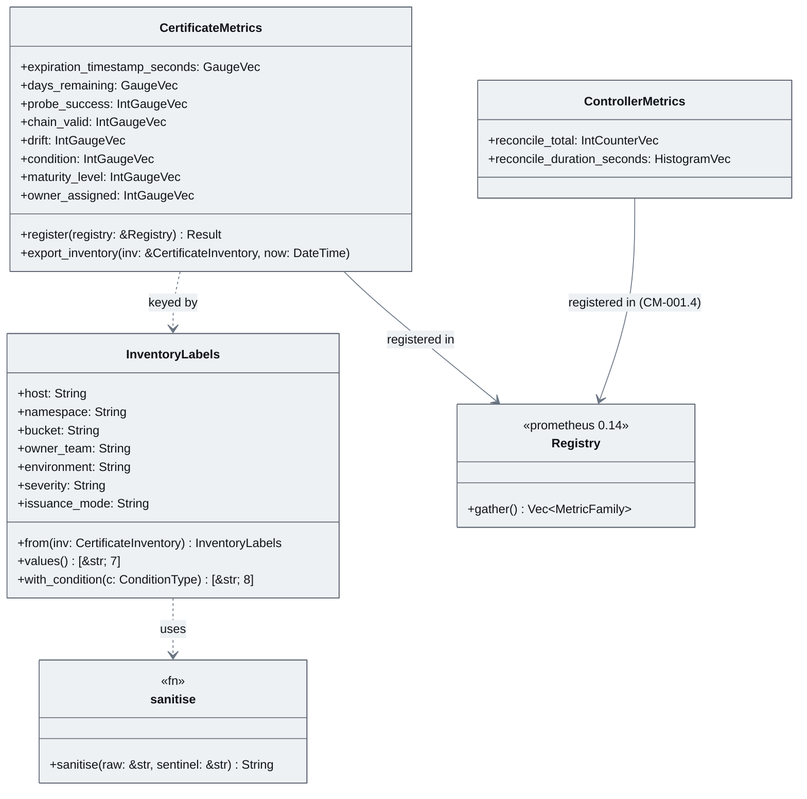
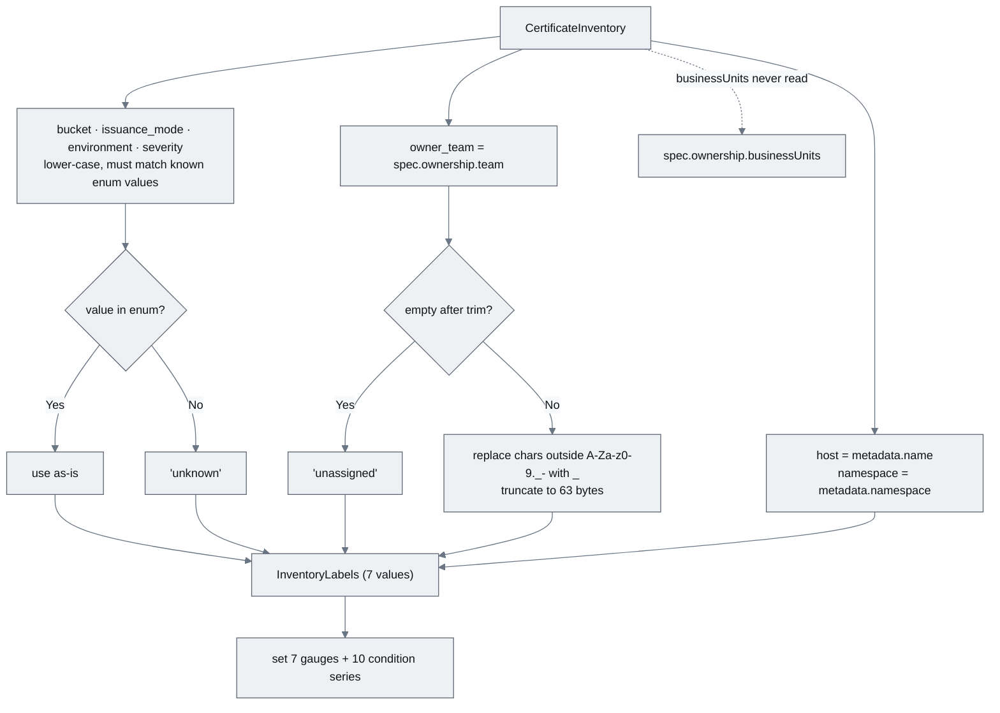
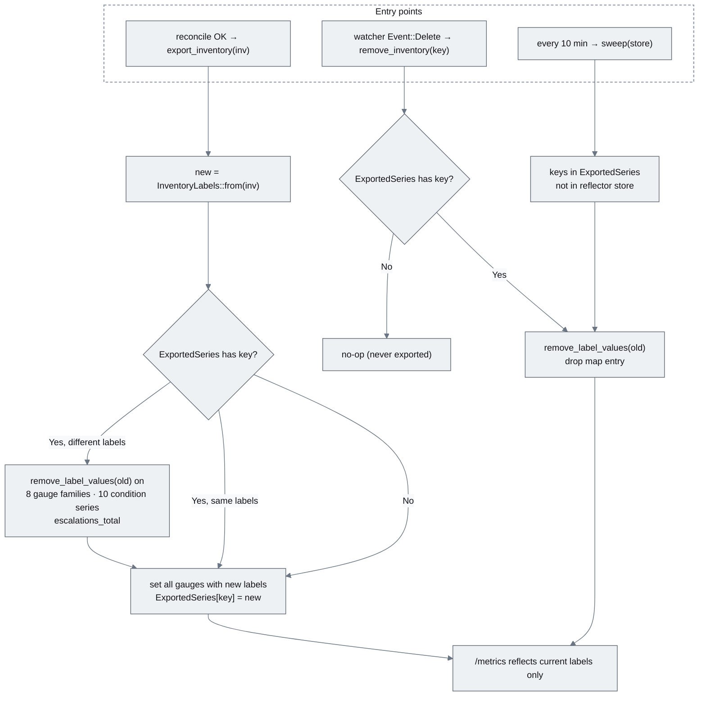
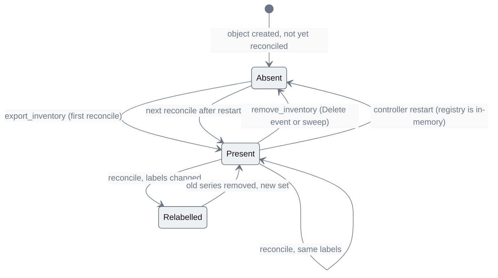
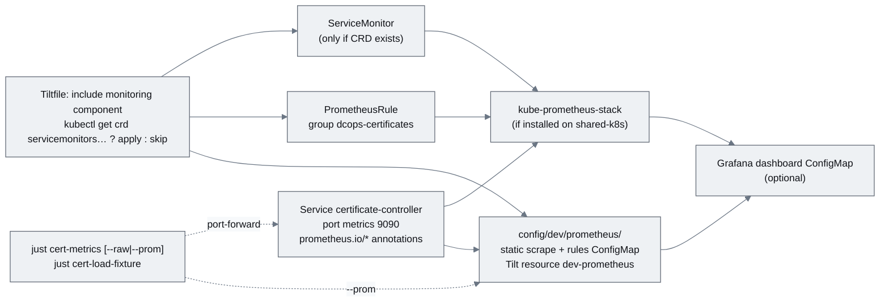

# EPIC-CM-007: Metrics exposition

> **Parent:** [Certificate Management Design](../../CERTIFICATE_MANAGEMENT_DESIGN.md) §8.1, §5.3 (step 6), §7
> **Phase:** 2 — Verification
> **CMMI level advanced:** Level 4 · Quantitatively managed
> **Status:** Draft — awaiting implementation
> **Priority:** P1
> **Estimated effort:** 5–7 days
> **Depends on:** EPIC-CM-001 (registry and `/metrics` route from `CM-001.4`), EPIC-CM-005 (probe results and conditions are the values exported), EPIC-CM-006 (`Drifted` and `status.certManager` feed the drift gauge)

---

## Overview

Levels 3 and 4 of the maturity scale are about *measurement*: the Operations dashboard on the proposal deck and the four Datadog monitors in design §8.2 are only as good as the numbers the controller exposes. This epic makes the certificate controller's `/metrics` endpoint — already served by the axum server from `CM-001.4` — carry every metric family in design §8.1 with exactly the names, types and labels fixed there. The metric table in §8.1 is the contract: EPIC-CM-008's `metrics.py` map, `metadata.csv`, dashboard queries and monitor JSON are all written against it, and any deviation here breaks the integration silently.

Two concerns dominate the design and get a story each. The first is **cardinality**: the fleet is ~5.4k hostnames and the hostname is a label by decision (§8.1), so every other label must be low-cardinality by construction — business units are multi-valued and are never a label, free-text values are sanitised, and unknowns collapse to a single sentinel value. The second is **series lifecycle**: gauges keyed by hostname outlive the objects that produced them unless the controller removes them, so an inventory that is deleted, or whose owner changes, must not leave stale series that make "unowned critical certificates" ring forever in Datadog. The third story wires Prometheus into the dev cluster so QA can see the numbers without an Agent, and adds the recording rule that expresses the Level-4 SLO ("100% of production certificates have more than 30 days remaining") as a single time series.

Out of scope: the Datadog check, dashboard and monitors (EPIC-CM-008); computing `status.maturityLevel` (EPIC-CM-009 — this epic exports whatever the status holds, defaulting to Level 1); binding metrics `dcops_binding_*` (EPIC-CM-011); any alerting from Prometheus itself (Alertmanager is not part of the dev stack; Datadog is the alerting plane per design §8.3).

## Epic-level diagram

Where metric values come from and where they go (flowchart, because the point is that one registry feeds two consumers and that the reconciler — not a scrape handler — owns series state).

```mermaid
%%{init: {'theme':'base','themeVariables': {'fontFamily': 'Inter, Segoe UI, Helvetica, Arial, sans-serif', 'fontSize': '14px', 'primaryColor': '#EEF1F4', 'primaryTextColor': '#111318', 'primaryBorderColor': '#5E6672', 'secondaryColor': '#EAF3FF', 'secondaryTextColor': '#111318', 'secondaryBorderColor': '#2F80ED', 'tertiaryColor': '#EAF8F0', 'tertiaryTextColor': '#111318', 'tertiaryBorderColor': '#2FA36B', 'lineColor': '#6B7684', 'textColor': '#6B7684', 'nodeBorder': '#5E6672', 'nodeTextColor': '#111318', 'mainBkg': '#EEF1F4', 'clusterBkg': '#F7F9FB', 'clusterBorder': '#BAC1C9', 'titleColor': '#111318', 'edgeLabelBackground': '#F7F9FB', 'actorBkg': '#EEF1F4', 'actorBorder': '#5E6672', 'actorTextColor': '#111318', 'actorLineColor': '#BAC1C9', 'signalColor': '#6B7684', 'signalTextColor': '#6B7684', 'labelBoxBkgColor': '#EAF3FF', 'labelBoxBorderColor': '#2F80ED', 'labelTextColor': '#111318', 'loopTextColor': '#111318', 'noteBkgColor': '#FFF6E7', 'noteBorderColor': '#E6A23C', 'noteTextColor': '#111318', 'activationBkgColor': '#DCE6F7', 'activationBorderColor': '#2F80ED', 'sequenceNumberColor': '#FFFFFF', 'labelColor': '#111318', 'altBackground': '#F7F9FB', 'attributeBackgroundColorOdd': '#FFFFFF', 'attributeBackgroundColorEven': '#F7F9FB', 'classText': '#111318'}}}%%
flowchart LR
    subgraph ctl["controllers/certificate"]
        rec["reconciler/inventory.rs<br/>step 6: export metrics"]
        scan["reconciler/scan_import.rs"]
        esc["escalation (CM-005.3)"]
        watch["controller.rs<br/>watch stream: Deleted"]
        reg["metrics/ (CM-007.1, CM-007.2)<br/>prometheus::Registry<br/>families · labels · lifecycle"]
        http["axum /metrics (CM-001.4)<br/>TextEncoder + gzip"]
    end
    subgraph dev["Dev cluster (CM-007.3)"]
        prom["Prometheus<br/>ServiceMonitor or scrape annotations"]
        rule["recording rule<br/>dcops:certificate_slo_production_ok:ratio"]
        graf["Grafana panel (optional)"]
    end
    dd["Datadog Agent<br/>dcops check (EPIC-CM-008)"]
    rec -->|"set gauges / conditions"| reg
    scan -->|"rows_total · last_timestamp"| reg
    esc -->|"escalations_total"| reg
    watch -->|"remove_inventory(key)"| reg
    reg --> http
    http --> prom --> rule --> graf
    http --> dd
    style ctl fill:transparent,stroke:#8A94A6,stroke-width:1.5px,stroke-dasharray:4 3
    style dev fill:transparent,stroke:#8A94A6,stroke-width:1.5px,stroke-dasharray:4 3
```



## Stories

| ID | Story | Persona | Effort |
|----|-------|---------|--------|
| **CM-007.1** | As an Operations manager, I want every inventory record exported as the §8.1 gauges with a fixed, low-cardinality label set so that the fleet dashboard and SLO monitors can be built once and never re-tagged | Operations manager | 2.5 d |
| **CM-007.2** | As a platform operator, I want counters, histograms and series lifecycle handled by the controller so that deleted or re-owned records disappear from `/metrics` instead of alerting forever | Operator | 2 d |
| **CM-007.3** | As a developer, I want Prometheus scraping the controller on the dev cluster, a `just cert-metrics` recipe and a recording rule for the Level-4 SLO so that I can verify every metric without a Datadog account | Developer | 1.5 d |

## Definition of Done (epic)

- [ ] Every story's ACs pass
- [ ] `just verify` (fmt, clippy with workspace lints, nextest) is green
- [ ] docs updated: README capability list gains "Certificate metrics (§8.1)"; `docs/implementationChecklists/CertificateInventory.md` metrics section ticked; `controllers/certificate/README.md` lists every family with labels
- [ ] `/metrics` on the dev cluster contains every family in design §8.1 with exactly the listed labels — verified by `IT-007.1-01` and attached to the PR as a captured payload (this capture becomes `tests/fixtures/dcops.txt` in EPIC-CM-008)
- [ ] Exposition size and latency at 5,368 inventories recorded against `NFR-007.1-01`/`NFR-007.1-02`
- [ ] No series survives deletion of its inventory on the dev cluster (`AC-007.2-01`)

## Open questions

| ID | Question | Default if unresolved |
|----|----------|----------------------|
| **Q1** | Emit `dcops_certificate_condition` for all ten condition types (≈10 series per record, ≈54k series at full fleet) or only for `True` conditions? | All ten, as §8.1 says "one series per condition type"; Datadog-side trimming via `exclude_metrics`/`exclude_labels` is documented in EPIC-CM-008 if cost forces it. |
| **Q2** | When a record has never been probed, should `days_remaining` fall back to the scan-reported expiry (`status.scan`), so Level-2 estates get a dashboard before EPIC-CM-005 lands everywhere? | Yes, with `probe_success=0` distinguishing scan-derived from observed values. No extra label — labels are fixed by §8.1. |
| **Q3** | Does `shared-k8s` run kube-prometheus-stack (`monitoring.coreos.com` CRDs) or not? | Ship both a `ServiceMonitor` (applied only when the CRD exists) and `prometheus.io/*` scrape annotations, plus a self-contained dev Prometheus under `config/dev/prometheus/` so integration tests never depend on cluster add-ons. |

---

## CM-007.1 — Per-inventory gauges with the §8.1 label set and a cardinality guard

**As an** Operations manager, **I want** every `CertificateInventory` exported as the gauges in design §8.1 with exactly the labels listed there **so that** the Datadog dashboard and monitors can be built once against a stable contract and business-unit data never blows up the tag budget.

### Description

Replaces the single-file `controllers/certificate/src/metrics.rs` from `CM-001.4` with a module `controllers/certificate/src/metrics/{mod.rs, families.rs, labels.rs, lifecycle.rs}` (lifecycle in `CM-007.2`) plus `*_test.rs` siblings. `mod.rs` keeps the `Registry` that the axum `/metrics` route already encodes, and the two shared `dcops_controller_*` families stay registered exactly as before. `families.rs` adds, from the `prometheus` 0.14 crate, one `IntGaugeVec`/`GaugeVec` per gauge row of §8.1:

| Family | Type | Value source |
| :--- | :--- | :--- |
| `dcops_certificate_expiration_timestamp_seconds` | `GaugeVec` (f64 epoch) | `status.observed.notAfter`; when absent and `status.scan` carries an expiry, that date at 00:00:00 UTC (Q2) |
| `dcops_certificate_days_remaining` | `GaugeVec` | floor((notAfter − now) / 86 400), same source rule; negative after expiry |
| `dcops_certificate_probe_success` | `IntGaugeVec` 0/1 | `Probed=True` and `status.observed.probeError == null` at the last reconcile |
| `dcops_certificate_chain_valid` | `IntGaugeVec` 0/1 | `status.observed.chainValid`; series emitted only when `Probed=True` |
| `dcops_certificate_drift` | `IntGaugeVec` 0/1 | `Drifted=True`; 0 when `issuance.mode = external` (nothing to drift from) |
| `dcops_certificate_condition` | `IntGaugeVec` 0/1 + `condition` | one series per §5.2 condition type, `1` when `status=True` |
| `dcops_certificate_maturity_level` | `IntGaugeVec` 1–5 | `status.maturityLevel`, defaulting to 1 until EPIC-CM-009 computes it |
| `dcops_certificate_owner_assigned` | `IntGaugeVec` 0/1 | `OwnerAssigned=True` |

`labels.rs` defines `InventoryLabels { host, namespace, bucket, owner_team, environment, severity, issuance_mode }` with a single constructor `InventoryLabels::from(&CertificateInventory)` that is the *only* place label values are derived: `host = metadata.name` (the normalised hostname, design §5), `namespace = metadata.namespace`, `bucket = spec.bucket`, `owner_team = spec.ownership.team`, `environment = spec.ownership.environment`, `severity` from the `dcops.microscaler.io/severity` label, `issuance_mode = spec.issuance.mode`. `spec.ownership.businessUnits` is deliberately not read. Every free-text value passes through `sanitise()`: trimmed, lower-cased for `bucket`/`environment`/`severity`/`issuance_mode` (enum-like fields), characters outside `[A-Za-z0-9._-]` replaced with `_`, truncated to 63 bytes on a character boundary, and empty results replaced by the sentinel `unassigned` (`owner_team`) or `unknown` (everything else). `host` and `namespace` are Kubernetes names and pass through unchanged apart from the length cap (253 for `host`).

The reconciler calls `metrics.export_inventory(&inv, now)` as the last step of a successful reconcile (design §5.3 step 6) and nothing else touches these families. Design §8.1's rule that business units are aggregated through `owner_team` and `environment`, not a label, is enforced by construction: there is no field for them in `InventoryLabels`, and `UT-007.1-05` fails the build if one is added without updating the test.

### Diagrams

Metric families and their label struct (classDiagram, because the deliverable is a set of Rust types whose fields are the §8.1 contract).



Label derivation and the cardinality guard (flowchart, because the sanitiser is decision logic reviewers must be able to check against the test table).



### Functional requirements

| ID | Requirement |
|----|-------------|
| **FR-007.1-01** | MUST register the eight per-inventory gauge families with exactly the names in design §8.1, each with the label names `host, namespace, bucket, owner_team, environment, severity, issuance_mode` in that order (`dcops_certificate_condition` additionally `condition`) |
| **FR-007.1-02** | MUST derive label values only via `InventoryLabels::from`, with `host = metadata.name`; `spec.ownership.businessUnits` MUST NOT contribute to any label |
| **FR-007.1-03** | MUST sanitise `owner_team` (character class `[A-Za-z0-9._-]`, 63-byte cap, sentinel `unassigned`) and MUST collapse unrecognised `bucket`/`issuance_mode`/`environment`/`severity` values to `unknown` |
| **FR-007.1-04** | MUST emit `dcops_certificate_condition{condition=<type>}` for each of the ten §5.2 condition types with value 1 for `True` and 0 otherwise (absent condition counts as 0) |
| **FR-007.1-05** | MUST set `expiration_timestamp_seconds` and `days_remaining` from `status.observed.notAfter` when present, else from the scan-reported expiry when present, else omit both series (Q2) |
| **FR-007.1-06** | MUST emit `chain_valid` only when `Probed=True`; MUST emit `probe_success`, `drift`, `owner_assigned`, `maturity_level` for every reconciled record (`drift=0` for `issuance.mode=external`, `maturity_level=1` when `status.maturityLevel` is unset) |
| **FR-007.1-07** | MUST call `export_inventory` exactly once per successful reconcile, after the status patch, and never from the `/metrics` handler |
| **FR-007.1-08** | MUST keep `dcops_controller_reconcile_total{kind,result}` and `dcops_controller_reconcile_duration_seconds{kind}` registered unchanged from `CM-001.4` |
| **FR-007.1-09** | SHOULD add `# HELP` text for every family quoting the §8.1 "Meaning" column verbatim |

### Non-functional requirements

| ID | Category | Requirement |
|----|----------|-------------|
| **NFR-007.1-01** | Performance | Series budget ≤ 18 per inventory record (7 gauges + 10 condition series + 1 headroom); at 5,368 records the registry holds ≤ 100,000 series. Verified by `UT-007.1-08` at 5,368 synthetic records |
| **NFR-007.1-02** | Performance | `/metrics` at 5,368 records: p95 generation + encode < 1 s, uncompressed payload ≤ 25 MiB, gzip-compressed ≤ 2.5 MiB (`tower-http` `CompressionLayer` enabled on the route). This supersedes `NFR-001.4-05`, which was measured with two families only |
| **NFR-007.1-03** | Security | No spec or status field containing contact details (`ownership.contact`, `escalation[].to`, `acknowledgement.by/note`) or key material appears in any label value or HELP text |
| **NFR-007.1-04** | Compatibility | Label names and metric names pass `promtool check metrics` with no warnings (units in names: `_seconds`; counters end `_total`) |
| **NFR-007.1-05** | Observability | Every sanitisation that changes a value is logged once per record at `debug` with `field` and `original_len` (never the original value) so cardinality incidents can be traced |

### Acceptance criteria

| ID | Given / When / Then |
|----|---------------------|
| **AC-007.1-01** | **Given** the §5.1 example inventory reconciled on the dev cluster **When** `/metrics` is scraped **Then** it contains `dcops_certificate_days_remaining{host="www-dev.metro-vto.es",namespace="certificates",bucket="legacy",owner_team="platform",environment="production",severity="critical",issuance_mode="external"}` and the same label set on the other six gauges |
| **AC-007.1-02** | **Given** that inventory **When** its ten conditions are inspected **Then** `/metrics` has exactly ten `dcops_certificate_condition{…,condition="…"}` series for the host, with values matching `status.conditions` |
| **AC-007.1-03** | **Given** an inventory with `ownership.team: "Platform Eng / EMEA (prod)"` and `businessUnits: ["METRO France","METRO digital"]` **When** exported **Then** `owner_team="Platform_Eng___EMEA__prod_"` and no label mentions METRO |
| **AC-007.1-04** | **Given** an inventory with no `ownership.team` and `bucket: legacy` **When** exported **Then** `owner_team="unassigned"` and `owner_assigned` is 0 |
| **AC-007.1-05** | **Given** an inventory that has never been probed but has a scan expiry of 2026-12-20 **When** exported **Then** `days_remaining` reflects that date, `probe_success=0` and no `chain_valid` series exists for the host |
| **AC-007.1-06** | **Given** 5,368 inventories on the dev cluster (`just cert-load-fixture`) **When** `/metrics` is fetched with `Accept-Encoding: gzip` **Then** the response arrives in < 1 s and the series count is ≤ 100,000 |
| **AC-007.1-07** | **Given** any inventory **When** `/metrics` output is grepped for the value of `ownership.contact` **Then** there are no matches |
| **AC-007.1-08** | **Given** `/metrics` **When** the `# HELP dcops_certificate_drift` line is read **Then** it carries the §8.1 meaning ("Observed ≠ expected (cert-manager or adapter)") and every `dcops_` family has a HELP line |

### Unit test criteria

| ID | Test | Covers |
|----|------|--------|
| **UT-007.1-01** | `metrics::families_test::all_families_registered_with_exact_names_and_labels` — gathers the registry and asserts the name/type/label-name tuple for each §8.1 gauge row, and that each family's HELP string is non-empty and equals the §8.1 "Meaning" text held in a test table | FR-007.1-01, FR-007.1-08, FR-007.1-09, AC-007.1-08 |
| **UT-007.1-02** | `metrics::labels_test::from_design_example` — builds `InventoryLabels` from the §5.1 YAML and asserts all seven values | FR-007.1-02, AC-007.1-01 |
| **UT-007.1-03** | `metrics::labels_test::sanitise_table` — table-driven: spaces, slashes, unicode, 300-char input, empty, whitespace-only → expected output and sentinel | FR-007.1-03, AC-007.1-03/04 |
| **UT-007.1-04** | `metrics::labels_test::unknown_enum_values_collapse` — `bucket: "Legacy "`, `environment: "PROD"`, `severity: ""` → `legacy`, `unknown`, `unknown` | FR-007.1-03 |
| **UT-007.1-05** | `metrics::labels_test::business_units_never_labelled` — inventory with three business units; asserts `InventoryLabels` has exactly 7 fields (compile-time destructuring) and no gathered label value contains any business-unit string | FR-007.1-02, AC-007.1-03 |
| **UT-007.1-06** | `metrics::export_test::condition_series_all_ten` — status with `Expiring=True`, others `False`, one missing → ten series, values 1/0/0 | FR-007.1-04, AC-007.1-02 |
| **UT-007.1-07** | `metrics::export_test::expiry_source_precedence` — observed only, scan only, neither → series values / absence; `chain_valid` absent when unprobed; `drift=0` for external | FR-007.1-05/06, AC-007.1-05 |
| **UT-007.1-08** | `metrics::export_test::series_budget_at_full_fleet` — 5,368 synthetic records exported; asserts gathered series ≤ 100,000 and `TextEncoder` output ≤ 25 MiB, timed < 1 s in release profile (`#[ignore]` in debug, run in CI `--release`) | NFR-007.1-01/02, AC-007.1-06 |
| **UT-007.1-09** | `reconciler::inventory_test::export_called_once_after_status_patch` — `MockKubeApi` records the status patch; a `MockMetricsSink` records one `export_inventory` call ordered after it; no call on reconcile error | FR-007.1-07 |
| **UT-007.1-10** | `metrics::export_test::no_pii_in_output` — inventory with contact/escalation/acknowledgement populated; encoded output contains none of those strings | NFR-007.1-03, AC-007.1-07 |

### Integration test criteria

| ID | Test | Environment | Covers |
|----|------|-------------|--------|
| **IT-007.1-01** | `tests/metrics_exposition.rs` (feature `integration`) — applies the §5.1 example, waits for `Probed`, scrapes `/metrics` through the Service, parses with the `prometheus-parse` crate and asserts `AC-007.1-01/02`; saves the payload as a test artefact | kind/k3s via Tilt | AC-007.1-01/02 |
| **IT-007.1-02** | `tests/metrics_scale.rs` — `just cert-load-fixture` (5,368 inventories generated from the scan CSV shape, endpoints pointing at the dev TLS stub), then times a gzip scrape and counts series | kind/k3s via Tilt | AC-007.1-06 |

### QA process

1. `just dev-up`; `just cert-examples`; wait until `kubectl get certificateinventory www-dev.metro-vto.es -o yaml` shows `Probed=True`.
2. `just cert-metrics` (from `CM-007.3`, or `kubectl port-forward` 9090 and `curl -s localhost:9090/metrics | grep '^dcops_certificate_'`). Save the output. Confirm the seven-label set on every gauge and the ten `condition` series for the host.
3. Assign an owner with a deliberately awkward team name via the UI or `PATCH /ownership` (`"Platform Eng / EMEA (prod)"`) and two business units. Re-scrape: confirm the sanitised `owner_team` value and `grep -c METRO` returns 0.
4. Negative path — label explosion attempt: `kubectl apply` an inventory whose `ownership.team` is a 2,000-character random string, and a second whose `environment` is `"prod; DROP TABLE"`. Re-scrape: `owner_team` is truncated to 63 bytes and `environment="unknown"`; `promtool check metrics < metrics.txt` reports no errors. Delete both.
5. Negative path — PII: set `ownership.contact` to a unique string; re-scrape and `grep` for it. Expect no match.
6. Scale: `just cert-load-fixture`; `time curl -s --compressed localhost:9090/metrics | wc -c`; count series with `grep -c '^dcops_'`. Record against `NFR-007.1-01/02`. `just cert-unload-fixture`.
7. Attach to the PR: the two captured `/metrics` payloads (example and scale run), `promtool` output, timing and series counts, nextest report for `controllers/certificate`.

---

## CM-007.2 — Counters, histograms and series lifecycle

**As a** platform operator, **I want** the counter and freshness families from design §8.1 registered in the shared registry, and every per-host series removed when its inventory is deleted or re-labelled, **so that** `/metrics` reflects the inventory as it is now and Datadog monitors do not alert on ghosts.

### Description

`families.rs` gains the remaining §8.1 rows: `dcops_certificate_escalations_total{host,namespace,owner_team,level}` (`IntCounterVec`; incremented by the escalation path of `CM-005.3`, which is updated to use this family if it introduced its own), `dcops_scan_import_rows_total{outcome}` (`IntCounterVec`, `outcome ∈ created|updated|unchanged|conflict|stale|error`; incremented by the scan-import reconciler of `CM-002.4`/`CM-002.5`, which this story aligns to the exact name) and `dcops_scan_import_last_timestamp_seconds{source}` (`GaugeVec`, set to the import's completion time when a `CertificateScanImport` reaches `Completed`). `dcops_controller_reconcile_*` are unchanged.

`lifecycle.rs` owns the series state. `ExportedSeries` is a `Mutex<HashMap<ObjectKey, InventoryLabels>>` recording the label values last exported for each `namespace/name`. `export_inventory` consults it first: if the record was exported before with different label values (owner reassigned, bucket promoted, severity changed), every family's series for the *old* values is removed with `remove_label_values` — including the ten `condition` series and any `escalations_total` series for the host — before the new values are set. `remove_inventory(key)` does the same removal and drops the map entry; `controller.rs` calls it from the watch stream on `watcher::Event::Delete` (kube 2.0) for `CertificateInventory`. Because delete events can be missed across a watch restart, a `sweep(store)` task runs every 10 minutes and removes any key in `ExportedSeries` that is not in the controller's reflector store. On process start the map is empty and the initial reconcile of every object repopulates it — series therefore never survive a restart, which is the correct behaviour for gauges.

Counter semantics: removing `escalations_total{host=…}` on inventory deletion resets that host's count if it is ever re-created; this is accepted and documented because the alternative (series accumulating for every hostname ever seen) is exactly the cardinality leak this story exists to prevent. Histogram series are never removed (`kind` is bounded).

### Diagrams

Series lifecycle for one inventory record (flowchart, because the three entry points — export, delete, sweep — must converge on the same removal logic).



Series states as seen by a scraper (stateDiagram-v2, because Datadog monitors care about the transition from *present* to *absent*, not the value).



### Functional requirements

| ID | Requirement |
|----|-------------|
| **FR-007.2-01** | MUST register `dcops_certificate_escalations_total{host,namespace,owner_team,level}`, `dcops_scan_import_rows_total{outcome}` and `dcops_scan_import_last_timestamp_seconds{source}` with exactly those names, types and labels, in the shared registry |
| **FR-007.2-02** | MUST increment `dcops_scan_import_rows_total` once per row per outcome when a scan import completes, and set `dcops_scan_import_last_timestamp_seconds{source}` to the completion epoch |
| **FR-007.2-03** | MUST record last-exported labels per `namespace/name` and, when a reconcile produces different label values, remove every series carrying the old values before setting new ones |
| **FR-007.2-04** | MUST remove every series for an inventory (all gauge families, all `condition` series, its `escalations_total` series) when the controller observes its deletion |
| **FR-007.2-05** | MUST run a sweep at a configurable interval (`METRICS_SWEEP_INTERVAL`, default `10m`) removing series whose object is absent from the reflector store |
| **FR-007.2-06** | MUST make removal idempotent: removing a key that was never exported, or removing twice, is a no-op without error |
| **FR-007.2-07** | MUST NOT remove `dcops_controller_reconcile_*` or `dcops_scan_import_*` series (bounded labels) |
| **FR-007.2-08** | SHOULD expose `dcops_metrics_exported_inventories` (gauge, no labels) = size of `ExportedSeries`, so lifecycle bugs are visible on the dashboard |

### Non-functional requirements

| ID | Category | Requirement |
|----|----------|-------------|
| **NFR-007.2-01** | Performance | `export_inventory` and `remove_inventory` are O(families) per call, hold the `ExportedSeries` lock for < 1 ms, and never block the `/metrics` handler beyond the registry's own lock |
| **NFR-007.2-02** | Reliability | A missed Delete event is corrected within one sweep interval; the sweep at 5,368 records completes in < 50 ms |
| **NFR-007.2-03** | Idempotency | Re-exporting the same record N times produces exactly one series per family (no duplicates, no growth of `ExportedSeries`) |
| **NFR-007.2-04** | Observability | Every removal logs at `info` with `key`, `reason ∈ relabel|delete|sweep` and `series_removed` count |
| **NFR-007.2-05** | Compatibility | `clippy::unwrap_used = deny` — `remove_label_values` returns `Result`; not-found errors are matched and ignored, all others logged at `warn` |

### Acceptance criteria

| ID | Given / When / Then |
|----|---------------------|
| **AC-007.2-01** | **Given** an exported inventory **When** `kubectl delete certificateinventory <host>` runs **Then** within 30 s no `dcops_certificate_*{host="<host>"}` series exists on `/metrics` |
| **AC-007.2-02** | **Given** an exported inventory with `owner_team="platform"` **When** ownership is changed to `web` via `PATCH /ownership` and the record reconciles **Then** `/metrics` has series for `owner_team="web"` and none for `owner_team="platform"` for that host |
| **AC-007.2-03** | **Given** a completed `CertificateScanImport` with 312 created, 76 updated, 4,980 unchanged, 41 stale **When** `/metrics` is scraped **Then** `dcops_scan_import_rows_total{outcome="created"}` ≥ 312 (and so on for each outcome) and `dcops_scan_import_last_timestamp_seconds{source="bitsight"}` is within 60 s of the import's `status.importedAt` |
| **AC-007.2-04** | **Given** an `Escalated` Event emitted for a host at level 2 **When** scraped **Then** `dcops_certificate_escalations_total{host=…,level="2"}` ≥ 1 |
| **AC-007.2-05** | **Given** the controller's watch is interrupted (pod restarted mid-delete) **When** the object was deleted during the gap **Then** the series is absent after at most one sweep interval (and in practice immediately, because the registry restarts empty) |
| **AC-007.2-06** | **Given** the controller is restarted **When** it becomes ready **Then** `dcops_metrics_exported_inventories` equals the number of inventories in its watch scope within one full reconcile pass |

### Unit test criteria

| ID | Test | Covers |
|----|------|--------|
| **UT-007.2-01** | `metrics::families_test::counter_families_registered` — asserts names, types and label names of the three families | FR-007.2-01 |
| **UT-007.2-02** | `reconciler::scan_import_test::completed_import_increments_rows_and_sets_timestamp` — `MockKubeApi` status with counters; gathers registry, asserts each `outcome` and the `source` gauge | FR-007.2-02, AC-007.2-03 |
| **UT-007.2-03** | `metrics::lifecycle_test::relabel_removes_old_series` — export with `owner_team=platform`, re-export with `web`; gathered output has no `platform` series for the host, all families and ten conditions present under `web` | FR-007.2-03, AC-007.2-02 |
| **UT-007.2-04** | `metrics::lifecycle_test::remove_inventory_clears_all_families` — export, increment `escalations_total` for the host, remove; assert zero series with that host across every family | FR-007.2-04, AC-007.2-01 |
| **UT-007.2-05** | `metrics::lifecycle_test::remove_is_idempotent_and_unknown_key_noop` | FR-007.2-06 |
| **UT-007.2-06** | `metrics::lifecycle_test::sweep_removes_keys_missing_from_store` — fake store with keys A,B; `ExportedSeries` A,B,C → C removed, A,B untouched; sweep of 5,368 keys timed | FR-007.2-05, NFR-007.2-02, AC-007.2-05 |
| **UT-007.2-07** | `metrics::lifecycle_test::repeated_export_no_growth` — 1,000 exports of one record → one series per family, map length 1 | NFR-007.2-03 |
| **UT-007.2-08** | `controller_test::delete_event_calls_remove_inventory` — feeds a `watcher::Event::Delete` through the stream adapter with a `MockMetricsSink`; asserts one `remove_inventory(key)` call | FR-007.2-04 |
| **UT-007.2-09** | `metrics::lifecycle_test::controller_families_never_removed` — remove/sweep leave `dcops_controller_*` and `dcops_scan_import_*` untouched | FR-007.2-07 |
| **UT-007.2-10** | `metrics::lifecycle_test::exported_inventories_gauge_tracks_map` | FR-007.2-08, AC-007.2-06 |

### Integration test criteria

| ID | Test | Environment | Covers |
|----|------|-------------|--------|
| **IT-007.2-01** | `tests/metrics_lifecycle.rs` (feature `integration`) — apply inventory, scrape, patch owner, scrape, delete, scrape; asserts presence/absence per `AC-007.2-01/02` using `prometheus-parse` | kind/k3s via Tilt | AC-007.2-01/02 |
| **IT-007.2-02** | `tests/metrics_lifecycle.rs::restart_repopulates` — `kubectl rollout restart`, wait ready, assert `dcops_metrics_exported_inventories` equals object count | kind/k3s via Tilt | AC-007.2-06 |
| **IT-007.2-03** | `tests/scan_import_metrics.rs` — runs `just cert-import` with the 5,368-row fixture CSV and asserts `AC-007.2-03` | kind/k3s via Tilt | AC-007.2-03 |

### QA process

1. `just dev-up && just cert-examples`. `just cert-metrics | grep 'host="www-dev.metro-vto.es"' | wc -l` — record the count (expect 17: 7 gauges + 10 conditions).
2. Change the owner team via the UI (EPIC-CM-004) or `curl -X PATCH …/ownership -d '{"team":"web"}'`. Wait one reconcile; re-run the grep filtered on `owner_team="platform"` (expect 0) and `owner_team="web"` (expect 17).
3. `kubectl delete certificateinventory www-dev.metro-vto.es`; within 30 s re-run the grep on the host (expect 0). `kubectl logs` shows one `series removed` line with `reason=delete`.
4. `just cert-import fixtures/certificates.csv`; when the `CertificateScanImport` is `Completed`, compare `dcops_scan_import_rows_total` per outcome with the import's status counters and check the `last_timestamp_seconds` gauge against `status.importedAt`.
5. Negative path — missed delete: `kubectl scale deploy certificate-controller --replicas=0`, delete an inventory, scale back to 1. After ready, confirm the host has no series and `dcops_metrics_exported_inventories` equals `kubectl get certificateinventories -A --no-headers | wc -l`.
6. Negative path — relabel storm: script 50 owner changes in a row on one host; confirm exactly 17 series for the host afterwards and no `warn` log lines from `remove_label_values`.
7. Attach: grep counts before/after each step, controller log excerpt with removal lines, import status vs counters table, nextest report.

---

## CM-007.3 — Prometheus dev wiring, `just cert-metrics` and the Level-4 SLO recording rule

**As a** developer, **I want** the controller scraped by Prometheus on the dev cluster, a one-command way to see its metrics, and a recording rule that states the Level-4 SLO as a time series **so that** I can verify every §8.1 family and the SLO arithmetic locally before any Datadog work starts.

### Description

Adds a kustomize component `config/certificate-controller/components/monitoring/` containing: (a) a patch adding `prometheus.io/scrape: "true"`, `prometheus.io/port: "9090"`, `prometheus.io/path: "/metrics"` annotations to the controller Service; (b) a `ServiceMonitor` (`monitoring.coreos.com/v1`) selecting the Service's `metrics` port with `interval: 30s` and `honorLabels: true` (the `host` label must not be rewritten by Prometheus's own `instance`/`job` handling); (c) a `PrometheusRule` with the recording rules below. The `Tiltfile` includes the component and applies the `ServiceMonitor`/`PrometheusRule` only when `kubectl get crd servicemonitors.monitoring.coreos.com` succeeds (Q3). For clusters without the operator, `config/dev/prometheus/` ships a single-replica Prometheus Deployment with a static scrape config for the controller Service and the same rules loaded from a ConfigMap; Tilt starts it as resource `dev-prometheus` in the DCops group, and integration tests target it.

Recording rules, in group `dcops-certificates` (evaluated every 1m):

```yaml
- record: dcops:certificate_production_total:count
  expr: count(dcops_certificate_days_remaining{environment="production"}) or vector(0)
- record: dcops:certificate_production_slo_ok:count
  expr: count(dcops_certificate_days_remaining{environment="production"} > 30) or vector(0)
- record: dcops:certificate_slo_production_ok:ratio
  expr: |
    dcops:certificate_production_slo_ok:count
    / clamp_min(dcops:certificate_production_total:count, 1)
- record: dcops:certificate_expiring_by_owner:count
  expr: sum by (owner_team) (dcops_certificate_condition{condition="Expiring"})
```

`dcops:certificate_slo_production_ok:ratio == 1` is the Level-4 SLO from design §5.1 (`sloMinimumRemaining: 30d`) and §7 (Level 4 requires no `SloBreached`); it is the number the estate must hold at 1.0 to claim Level 4, and EPIC-CM-008's `certificate_expiring` monitor is its Datadog counterpart. `just cert-metrics` port-forwards the controller Service and prints `/metrics` filtered to `dcops_` (with `--raw` for the full payload and `--prom` to open the dev Prometheus UI instead). `just cert-load-fixture` / `just cert-unload-fixture` (used by `CM-007.1` QA) generate and remove 5,368 inventories whose endpoints point at the dev TLS stub from `CM-005.4`. A Grafana dashboard JSON under `config/dev/grafana/dcops-certificates.json` (one panel per §8.1 family plus the SLO ratio) is a SHOULD and is loaded via a `grafana_dashboard: "1"` ConfigMap only when Grafana is present.

### Diagrams

Dev scrape path and where each artefact lives (flowchart, because the deliverable is wiring and the reviewer needs to see which piece is conditional).



### Functional requirements

| ID | Requirement |
|----|-------------|
| **FR-007.3-01** | MUST add the `monitoring` kustomize component with Service scrape annotations, a `ServiceMonitor` (`interval: 30s`, `honorLabels: true`, port `metrics`) and a `PrometheusRule` carrying the four recording rules above |
| **FR-007.3-02** | MUST make Tilt apply `ServiceMonitor`/`PrometheusRule` only when `servicemonitors.monitoring.coreos.com` exists, and always apply the annotations |
| **FR-007.3-03** | MUST ship `config/dev/prometheus/` (Deployment, ConfigMap with scrape config + identical rules, Service) as Tilt resource `dev-prometheus` |
| **FR-007.3-04** | MUST add `just cert-metrics` (filtered `/metrics`), `just cert-metrics --raw`, `just cert-metrics --prom` (opens the dev Prometheus UI at `/graph?g0.expr=dcops:certificate_slo_production_ok:ratio`) |
| **FR-007.3-05** | MUST add `just cert-load-fixture [N=5368]` and `just cert-unload-fixture`, generating inventories with `environment` split 70/30 production/staging and endpoints on the dev TLS stub |
| **FR-007.3-06** | MUST define `dcops:certificate_slo_production_ok:ratio` so that it is 1 when zero production records exist (no false SLO breach on an empty estate) and 0 ≤ ratio ≤ 1 otherwise |
| **FR-007.3-07** | MUST validate the rules file in CI with `promtool check rules` and unit-test them with `promtool test rules` |
| **FR-007.3-08** | SHOULD add the Grafana dashboard ConfigMap and a `just cert-grafana` recipe |
| **FR-007.3-09** | SHOULD document the wiring and the SLO rule in `controllers/certificate/README.md` and link it from `docs/CONTROLLER_RECONCILER_ARCHITECTURE.md` |

### Non-functional requirements

| ID | Category | Requirement |
|----|----------|-------------|
| **NFR-007.3-01** | Performance | Dev Prometheus at 5,368 inventories: scrape duration < 2 s, rule-group evaluation < 500 ms, retention 2h, memory limit 512 MiB |
| **NFR-007.3-02** | Reliability | `just dev-up` on a cluster without `monitoring.coreos.com` CRDs succeeds with no error and no orphaned resources |
| **NFR-007.3-03** | Security | Dev Prometheus has no persistent volume, no external route, and its Service is `ClusterIP`; scrape uses plain HTTP inside the cluster only |
| **NFR-007.3-04** | Compatibility | Rules use only PromQL functions available in Prometheus 2.45+ (`clamp_min`, `or vector(0)`) so they load in both the operator and the dev instance |

### Acceptance criteria

| ID | Given / When / Then |
|----|---------------------|
| **AC-007.3-01** | **Given** `just dev-up` on `shared-k8s` **When** Tilt is green **Then** the dev Prometheus `/targets` page lists `certificate-controller` as `UP` and `dcops:certificate_slo_production_ok:ratio` returns a value |
| **AC-007.3-02** | **Given** the example inventories (all `environment: production`, all > 30 days) **When** the rule is queried **Then** the ratio is `1` |
| **AC-007.3-03** | **Given** one production inventory patched to a scan expiry 10 days out **When** the rule re-evaluates **Then** the ratio drops below 1 and `dcops:certificate_production_slo_ok:count` is total − 1 |
| **AC-007.3-04** | **Given** zero production inventories **When** the rule is queried **Then** the ratio is `1` (not `NaN`, not absent) |
| **AC-007.3-05** | **Given** a cluster without the Prometheus operator CRDs **When** `just dev-up` runs **Then** no `ServiceMonitor` is applied, no error is shown, and the dev Prometheus still scrapes the controller |
| **AC-007.3-06** | **Given** `just cert-metrics` **When** run **Then** it prints only lines beginning `dcops_` plus their `# HELP`/`# TYPE`, and `--raw` prints the full payload including `process_*` |
| **AC-007.3-07** | **Given** `just cert-load-fixture` **When** complete **Then** `dcops:certificate_production_total:count` ≈ 3,758 (70% of 5,368) within one scrape interval of the last reconcile |
| **AC-007.3-08** | **Given** Grafana is present on the cluster **When** `just cert-grafana` runs **Then** the "DCops certificates" dashboard is listed with one panel per §8.1 family plus the SLO ratio; **Given** `controllers/certificate/README.md` **Then** it has a "Metrics" section listing every family and the recording rules, linked from `docs/CONTROLLER_RECONCILER_ARCHITECTURE.md` |

### Unit test criteria

| ID | Test | Covers |
|----|------|--------|
| **UT-007.3-01** | `config/certificate-controller/components/monitoring/rules_test.yaml` run by `promtool test rules` — series fixtures: 3 production records (all > 30 d) → ratio 1; one at 10 d → ratio 0.666…; zero production → ratio 1; staging-only records ignored | FR-007.3-06/07, AC-007.3-02/03/04 |
| **UT-007.3-02** | CI job `promtool check rules` on both the `PrometheusRule` and the dev ConfigMap; a script test asserts the two rule bodies are byte-identical (`scripts/check_rules_in_sync.sh`) | FR-007.3-01/03/07 |
| **UT-007.3-03** | `justfile` recipe smoke test in CI (`just --dry-run cert-metrics`, `cert-load-fixture N=3`) — asserts the recipes parse and generate 3 valid inventory manifests (`kubectl apply --dry-run=client`) | FR-007.3-04/05 |
| **UT-007.3-04** | `scripts/check_docs.py::test_certificate_metrics_docs` — asserts `controllers/certificate/README.md` names every §8.1 family and each recording rule, that the architecture doc links it, and that `config/dev/grafana/dcops-certificates.json` parses with one panel per family (`just --dry-run cert-grafana` succeeds) | FR-007.3-08/09, AC-007.3-08 |

### Integration test criteria

| ID | Test | Environment | Covers |
|----|------|-------------|--------|
| **IT-007.3-01** | `tests/prometheus_dev.rs` (feature `integration`) — queries the dev Prometheus API `/api/v1/targets` and `/api/v1/query?query=dcops:certificate_slo_production_ok:ratio` after applying the examples, then patches one record to a near expiry and asserts the ratio change | kind/k3s via Tilt + dev Prometheus | AC-007.3-01/02/03 |
| **IT-007.3-02** | `tests/prometheus_dev.rs::no_operator_crds` — runs on a kind cluster without the operator; asserts Tilt-applied resources exclude `ServiceMonitor` and the target is still `UP` | kind via Tilt | AC-007.3-05, NFR-007.3-02 |

### QA process

1. `just dev-up`; in the Tilt UI confirm `dev-prometheus` and `certificate-controller` are green. `just cert-examples`.
2. `just cert-metrics` — screenshot the filtered output; `just cert-metrics --prom` — screenshot `/targets` (controller `UP`) and the SLO ratio graph showing `1`.
3. `kubectl patch certificateinventory www-dev.metro-vto.es --subresource=status --type=merge -p '{"status":{"observed":{"notAfter":"<now+10d>"}}}'` (or point the record at the dev TLS stub's short-lived certificate). After the next scrape the ratio shows below 1; `dcops:certificate_expiring_by_owner:count{owner_team="platform"}` is 1 once the `Expiring` condition is set. Screenshot.
4. Negative path — empty estate: `kubectl delete certificateinventories --all -n certificates`; confirm the ratio reads `1`, not empty. Re-apply examples.
5. Negative path — no operator: on a scratch kind cluster (`just dev-up KIND=1`), confirm `kubectl get servicemonitors -A` errors with "no resources of that kind" while Tilt is fully green and the dev Prometheus target is `UP`.
6. Scale: `just cert-load-fixture`; on `/targets` record `scrape duration`; on `/rules` record group evaluation time against `NFR-007.3-01`. `just cert-unload-fixture`.
7. Attach: Tilt screenshot, the three Prometheus screenshots, `promtool test rules` output, scrape/evaluation timings, `kubectl get servicemonitors -A` output from step 5.
