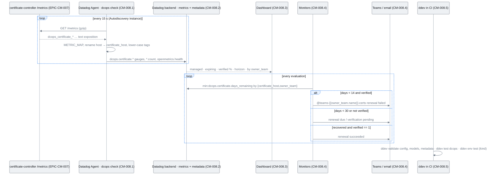
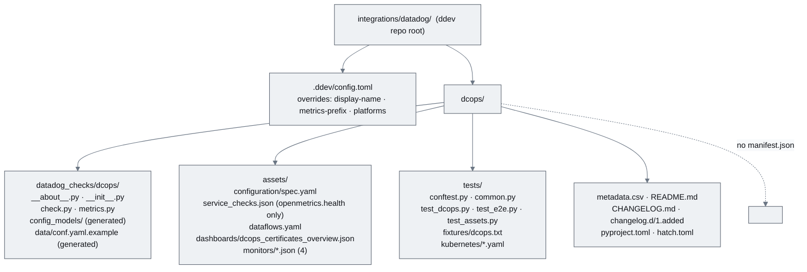
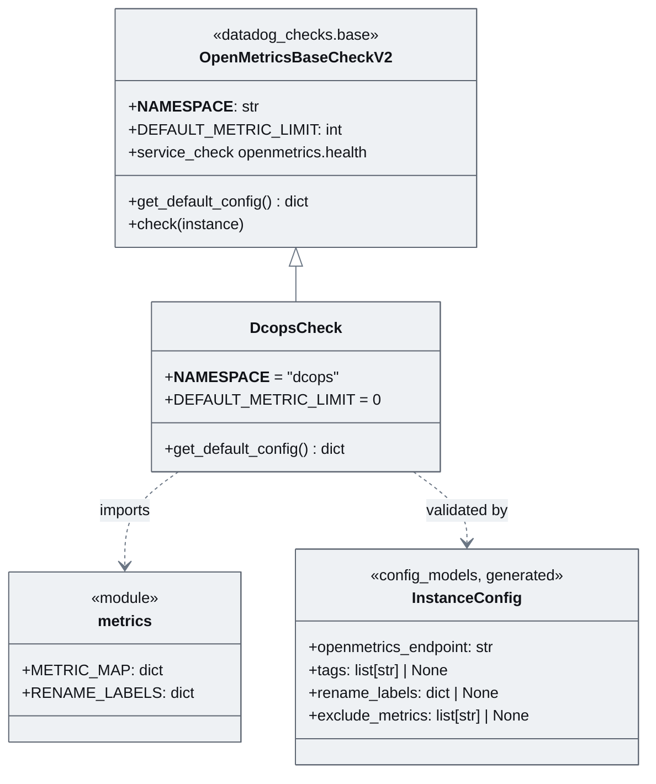
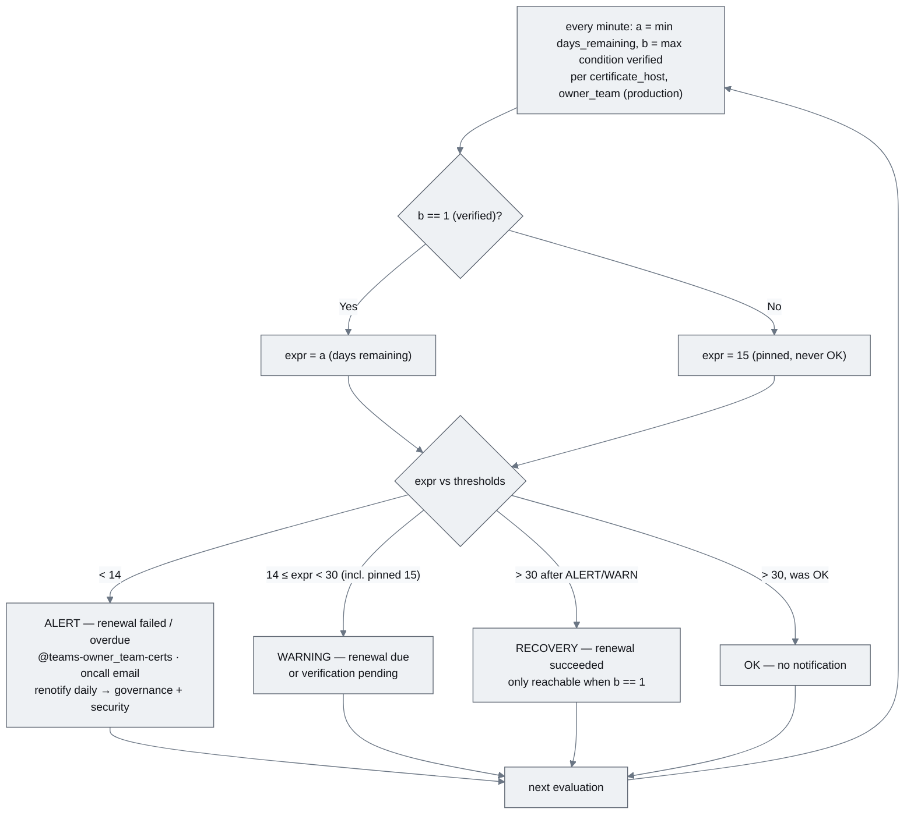
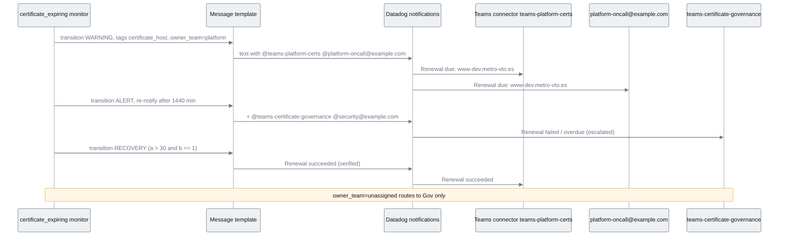
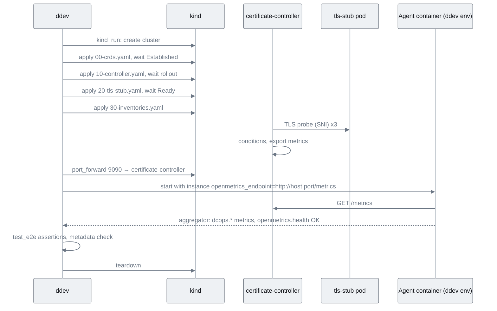

# EPIC-CM-008: Datadog integration (`dcops`)

> **Parent:** [Certificate Management Design](../../CERTIFICATE_MANAGEMENT_DESIGN.md) §8, §8.2, §8.3
> **Phase:** 2 — Verification
> **CMMI level advanced:** Level 4 · Quantitatively managed
> **Status:** Draft — awaiting implementation
> **Priority:** P1
> **Estimated effort:** 9–12 days
> **Depends on:** EPIC-CM-007 (the `/metrics` contract this check scrapes; its captured payload is this epic's test fixture)

---

## Overview

Design §8 delivers the proposal deck's Operations dashboard and the Teams/email escalation as a proper Datadog integration rather than ad-hoc custom metrics. The reference is `integrations-core/cert_manager`: an `OpenMetricsBaseCheckV2` subclass scraping a Prometheus endpoint, a curated metric map, `metadata.csv`, a configuration spec with generated config models, a dashboard, recommended monitors and pytest/e2e tests driven by `ddev`. This epic builds the `dcops` integration in that exact shape.

The source lives in the DCops repository at `integrations/datadog/dcops/`, laid out so the directory can be copied verbatim into a fork of `integrations-core` or into `integrations-extras` and validated there without edits (design §8.2 leaves the destination open — §12.5). `integrations/datadog/` is itself a `ddev` repo root (`ddev config set repos.extras <path>`), so every `ddev validate` and `ddev test` command in this epic runs unchanged in CI in the DCops repo. The rules in integrations-core's `AGENTS.md` for new integrations are binding: no `manifest.json` (display name, metrics prefix and platforms go under `[overrides.*]` in `.ddev/config.toml`), no bespoke service checks (the inherited `dcops.openmetrics.health` is the only one), Python 3.12 with modern type hints, config models generated with `ddev validate models -s dcops`.

Two Datadog-specific facts shape the stories. First, the controller labels every series with `host` (design §8.1), but `host` is a reserved tag in Datadog that would re-attribute the metric to a fake host; the check therefore renames it to `certificate_host` by default and the README explains why. Second, the Agent lower-cases tag values, so `condition="Verified"` on the wire is `condition:verified` in every query. Out of scope: metrics from `CertificateBinding` (EPIC-CM-011/012 add them to this directory), the `MaturityRegressed` monitor (EPIC-CM-009.3), and upstream submission itself — `CM-008.5` documents the procedure, the PR is a release activity.

## Epic-level diagram

End-to-end path from the controller to a Teams channel, and where each story sits (sequenceDiagram, because the value of the epic is the chain of hand-offs and the story boundaries are the participants).



## Stories

| ID | Story | Persona | Effort |
|----|-------|---------|--------|
| **CM-008.1** | As a Datadog administrator, I want a `dcops` Agent check scaffolded to integrations-core conventions so that the controller's metrics arrive under `dcops.*` with one Autodiscovery annotation | Datadog admin | 2 d |
| **CM-008.2** | As an Operations manager, I want every `dcops.*` metric described in `metadata.csv` and a README that gets me from zero to data so that the metrics explorer is self-explanatory | Operations manager | 1.5 d |
| **CM-008.3** | As an Operations manager, I want the deck's Operations dashboard shipped with the integration so that fleet health is one click away with filters by team, site, vendor and environment | Operations manager | 2 d |
| **CM-008.4** | As an accountable owner, I want four recommended monitors that route to my team's Teams channel and email with renewal due / succeeded / failed wording so that I act on my certificates and nobody else's | Owner | 2.5 d |
| **CM-008.5** | As a maintainer, I want unit, e2e and CI coverage plus a release procedure so that the integration can be validated in the DCops repo and shipped to an integrations fork without rework | Maintainer | 2 d |

## Definition of Done (epic)

- [ ] Every story's ACs pass
- [ ] `just verify` (fmt, clippy with workspace lints, nextest) is green — unchanged Rust; `just dd-verify` (new: `ddev validate config|models|metadata -s dcops` + `ddev --no-interactive test dcops`) is green
- [ ] docs updated: README capability list gains "Datadog integration (`integrations/datadog/dcops`)"; `docs/implementationChecklists/CertificateInventory.md` Datadog section ticked
- [ ] Dashboard and the four monitors imported into the team's Datadog org from the JSON on disk with no manual edits; screenshots attached
- [ ] `tests/fixtures/dcops.txt` is the payload captured in EPIC-CM-007's DoD, unedited
- [ ] `.github/workflows/datadog-integration.yml` runs on every PR touching `integrations/datadog/**`
- [ ] Open question Q1 answered or default recorded in the README's "Data collected" section

## Open questions

| ID | Question | Default if unresolved |
|----|----------|----------------------|
| **Q1** | ~17 series per certificate × 5,368 certificates ≈ 91k series; unless the integration is accepted into integrations-core these are billable custom metrics. Trim `dcops.certificate.condition` to a subset by default? | Ship the full map (§8.1 is the contract); README documents `exclude_metrics`/`exclude_labels` and an example instance keeping only `condition:verified|expiring|drifted`. Decision belongs to the Datadog admin, not the code. |
| **Q2** | Destination: `integrations-extras` upstream, a private fork of `integrations-core`, or a private check bundled with DCops manifests (design §12.5)? | Build and validate in a fork of integrations-core (fastest, keeps the option of upstreaming); `CM-008.5` procedure covers both. |
| **Q3** | `site` and `vendor` are dashboard filters on the deck but not §8.1 labels. | `vendor` = `issuance_mode` tag; `site` = Agent-level tag (`tags: ["site:<dc>"]` on the Autodiscovery instance, one controller per management cluster). No new labels. |
| **Q4** | Exact key names under `[overrides.*]` in `.ddev/config.toml` (display-name, metrics-prefix, platforms) as of the fork's ddev version. | Use the names in integrations-core's current `.ddev/config.toml`; `ddev validate` in `CM-008.5` is the arbiter. |

---

## CM-008.1 — Check scaffold: `DcopsCheck`, metric map, spec and config models

**As a** Datadog administrator, **I want** a `dcops` check package built on `OpenMetricsBaseCheckV2` with the §8.1 metrics mapped to `dcops.*` names **so that** one Autodiscovery annotation on the controller pod is enough to get data.

### Description

Creates `integrations/datadog/dcops/` with the package `datadog_checks/dcops/`: `__about__.py` (`__version__ = '1.0.0'`), `__init__.py` (re-exports `DcopsCheck` and `__version__`), `check.py`, `metrics.py`, `data/conf.yaml.example` (generated), and `config_models/` (generated by `ddev validate models -s dcops` — never hand-edited). The check is:

```python
class DcopsCheck(OpenMetricsBaseCheckV2):
    __NAMESPACE__ = 'dcops'
    DEFAULT_METRIC_LIMIT = 0

    def get_default_config(self) -> dict[str, Any]:
        return {'metrics': [METRIC_MAP], 'rename_labels': RENAME_LABELS}
```

`metrics.py` holds `METRIC_MAP: dict[str, str | dict[str, str]]` mapping raw names to Datadog names, prefix applied by the namespace: `dcops_certificate_expiration_timestamp_seconds → certificate.expiration_timestamp`, `dcops_certificate_days_remaining → certificate.days_remaining`, `…_probe_success → certificate.probe_success`, `…_chain_valid → certificate.chain_valid`, `…_drift → certificate.drift`, `…_condition → certificate.condition`, `…_maturity_level → certificate.maturity_level`, `…_owner_assigned → certificate.owner_assigned`, `dcops_certificate_escalations → certificate.escalations` (the base class strips `_total` and appends `.count`, giving `dcops.certificate.escalations.count`), `dcops_scan_import_rows → scan_import.rows` (→ `.count`), `dcops_scan_import_last_timestamp_seconds → {'name': 'scan_import.age', 'type': 'time_elapsed'}` (seconds since the last import, computed by the Agent — the value a staleness monitor needs), `dcops_controller_reconcile → controller.reconcile` (→ `.count`), `dcops_controller_reconcile_duration_seconds → controller.reconcile.duration` (histogram → `.bucket`, `.count`, `.sum`). `RENAME_LABELS = {'host': 'certificate_host'}` because a `host` tag would override Datadog's host attribution. `DEFAULT_METRIC_LIMIT = 0` removes the 2,000-metric default cap, which a 5k-certificate fleet exceeds on the first scrape.

Packaging mirrors `cert_manager`: `pyproject.toml` (`requires-python = ">=3.12"`, dependency on `datadog-checks-base` at the fork's current floor, `[project.optional-dependencies] deps = []`, hatch build config), `hatch.toml` (`[env.collectors.datadog-checks]`, matrix `python = ["3.12"]` → env `py3.12`), `assets/configuration/spec.yaml` (`init_config/openmetrics` and `instances/openmetrics` templates with `openmetrics_endpoint` example `http://%%host%%:9090/metrics`), `assets/service_checks.json` containing only the inherited `dcops.openmetrics.health`, `assets/dataflows.yaml` adapted from cert_manager (Agent pulls `/metrics` over HTTP), `CHANGELOG.md` stub and `changelog.d/1.added` ("Initial release"). At the ddev repo root `integrations/datadog/.ddev/config.toml` carries `[overrides.display-name] dcops = "DCops"`, `[overrides.metrics-prefix] dcops = "dcops"`, `[overrides.platforms] dcops = ["linux"]` (Q4); there is no `manifest.json`. A kustomize component `config/certificate-controller/components/datadog/` adds the Autodiscovery annotation `ad.datadoghq.com/certificate-controller.checks` to the controller pod template.

### Diagrams

Package layout as it must appear in an integrations fork (flowchart, because the deliverable is a directory tree and reviewers compare it against `cert_manager/`).



Class relationship to the base check (classDiagram, because the whole check is one override on one base class).



### Functional requirements

| ID | Requirement |
|----|-------------|
| **FR-008.1-01** | MUST create `integrations/datadog/dcops/datadog_checks/dcops/{__about__.py,__init__.py,check.py,metrics.py}` with `class DcopsCheck(OpenMetricsBaseCheckV2)`, `__NAMESPACE__ = 'dcops'`, `DEFAULT_METRIC_LIMIT = 0` |
| **FR-008.1-02** | MUST map every §8.1 family in `METRIC_MAP` to the Datadog names listed in the Description, with `dcops_scan_import_last_timestamp_seconds` as a `time_elapsed` transformer named `scan_import.age` |
| **FR-008.1-03** | MUST set `rename_labels: {'host': 'certificate_host'}` in `get_default_config()` so no `host` tag is emitted from the Prometheus label |
| **FR-008.1-04** | MUST ship `assets/configuration/spec.yaml` using the `init_config/openmetrics` and `instances/openmetrics` templates with `openmetrics_endpoint` example `http://%%host%%:9090/metrics`, and MUST generate `data/conf.yaml.example` and `config_models/` with `ddev validate config -s dcops` / `ddev validate models -s dcops` |
| **FR-008.1-05** | MUST NOT add `manifest.json`; MUST declare display name, metrics prefix and platforms under `[overrides.*]` in `integrations/datadog/.ddev/config.toml` |
| **FR-008.1-06** | MUST NOT define any service check; `assets/service_checks.json` lists only `dcops.openmetrics.health` |
| **FR-008.1-07** | MUST ship `pyproject.toml` (`requires-python >= 3.12`), `hatch.toml` (matrix `py3.12`), `CHANGELOG.md`, `changelog.d/1.added`, `assets/dataflows.yaml` |
| **FR-008.1-08** | MUST add kustomize component `config/certificate-controller/components/datadog/` setting `ad.datadoghq.com/certificate-controller.checks` with an instance `{"openmetrics_endpoint": "http://%%host%%:9090/metrics"}` |
| **FR-008.1-09** | SHOULD keep `METRIC_MAP` sorted and covered by a test that fails when a §8.1 family in the fixture is unmapped |

### Non-functional requirements

| ID | Category | Requirement |
|----|----------|-------------|
| **NFR-008.1-01** | Compatibility | Python 3.12 only; type hints use PEP 604/585 syntax (`str | None`, `list[str]`, `dict[str, Any]`); no `typing.Optional`/`List` |
| **NFR-008.1-02** | Compatibility | `ddev validate config -s dcops` and `ddev validate models -s dcops` exit 0 with no diff after sync (generated files committed) |
| **NFR-008.1-03** | Performance | One check run against the 5,368-certificate fixture completes in < 5 s on the CI runner and emits ≤ 100,000 metric contexts; the fixture-sized payload (≤ 25 MiB) is accepted without raising `MetricLimitExceeded` |
| **NFR-008.1-04** | Security | The check adds no tags beyond Prometheus labels and instance `tags`; no `ownership.contact`, escalation addresses or acknowledgement notes can reach Datadog because the controller never labels them (`NFR-007.1-03`) — asserted again here on the fixture |
| **NFR-008.1-05** | Security | Default instance uses `tls_verify: true`; the README shows `tls_ca_cert` for in-cluster HTTPS and never suggests `tls_verify: false` |

### Acceptance criteria

| ID | Given / When / Then |
|----|---------------------|
| **AC-008.1-01** | **Given** the check installed in an Agent with the example instance **When** it runs against a live controller **Then** `agent status` lists `dcops` with `Metric Samples > 0` and `dcops.openmetrics.health` OK |
| **AC-008.1-02** | **Given** the EPIC-CM-007 fixture payload **When** `dd_run_check` runs **Then** every metric in `METRIC_MAP` is submitted under its `dcops.` name with the seven §8.1 tags, `certificate_host:` present and no `host:` tag from the payload |
| **AC-008.1-03** | **Given** `dcops_certificate_escalations_total 3` in the payload **When** the check runs twice **Then** `dcops.certificate.escalations.count` is submitted as a monotonic count and `dcops.controller.reconcile.duration.bucket/.count/.sum` exist |
| **AC-008.1-04** | **Given** `dcops_scan_import_last_timestamp_seconds{source="bitsight"} <epoch 2 days ago>` **When** the check runs **Then** `dcops.scan_import.age` ≈ 172,800 with tag `source:bitsight` |
| **AC-008.1-05** | **Given** the repo root **When** `ddev validate config -s dcops && ddev validate models -s dcops` run **Then** exit 0 and `git status` is clean |
| **AC-008.1-06** | **Given** `find integrations/datadog/dcops -name manifest.json` **Then** no output; **Given** `assets/service_checks.json` **Then** exactly one entry, `dcops.openmetrics.health` |
| **AC-008.1-07** | **Given** the datadog kustomize component applied **When** the Agent's Autodiscovery runs **Then** `agent configcheck` shows a `dcops` instance resolved from the controller pod annotation |

### Unit test criteria

| ID | Test | Covers |
|----|------|--------|
| **UT-008.1-01** | `tests/test_dcops.py::test_check_submits_all_mapped_metrics` — `mock_http_response(file_path=fixture)`, `dd_run_check(check)`, `aggregator.assert_metric(name)` for every `EXPECTED_METRICS` entry in `common.py`, then `aggregator.assert_all_metrics_covered()` | FR-008.1-01/02, AC-008.1-02 |
| **UT-008.1-02** | `tests/test_dcops.py::test_tags_and_host_rename` — asserts `certificate_host:www-dev.metro-vto.es`, `owner_team:platform`, … and `assert_metric_has_tag_prefix(..., 'host:')` is false | FR-008.1-03, AC-008.1-02 |
| **UT-008.1-03** | `tests/test_dcops.py::test_counters_and_histogram` — two runs; `assert_metric('dcops.certificate.escalations.count', metric_type=aggregator.MONOTONIC_COUNT)`; histogram suffixes present | FR-008.1-02, AC-008.1-03 |
| **UT-008.1-04** | `tests/test_dcops.py::test_scan_import_age_time_elapsed` — freezes time with `freezegun`, asserts `dcops.scan_import.age` value and `source:` tag | FR-008.1-02, AC-008.1-04 |
| **UT-008.1-05** | `tests/test_dcops.py::test_health_ok_and_no_bespoke_service_checks` — `aggregator.assert_service_check('dcops.openmetrics.health', ServiceCheck.OK)` and `aggregator.assert_all_service_checks_covered()` after exactly one | FR-008.1-06, AC-008.1-06 |
| **UT-008.1-06** | `tests/test_dcops.py::test_endpoint_down_is_critical` — `mock_http_response(status_code=503)`; `dd_run_check` raises and `openmetrics.health` is CRITICAL | FR-008.1-01 |
| **UT-008.1-07** | `tests/test_dcops.py::test_metric_map_covers_fixture` — parses the fixture's `# TYPE` lines, strips `_total`, asserts each `dcops_` family is a `METRIC_MAP` key | FR-008.1-09 |
| **UT-008.1-08** | `tests/test_dcops.py::test_no_pii_tags` — every submitted tag value is checked against a deny-list derived from the fixture's known contact strings | NFR-008.1-04 |
| **UT-008.1-09** | `tests/test_dcops.py::test_full_fleet_fixture_within_limits` — 5,368-host synthetic payload generated in `common.py`; runtime < 5 s, no metric-limit warning in `caplog` | NFR-008.1-03 |
| **UT-008.1-10** | `tests/test_assets.py::test_no_manifest_and_overrides_present` — asserts no `manifest.json` under `dcops/`, and that `../.ddev/config.toml` (when present — skipped in a fork where the root file is merged) declares `dcops` under display-name, metrics-prefix and platforms overrides | FR-008.1-05, AC-008.1-06 |
| **UT-008.1-11** | `tests/test_assets.py::test_packaging_files` — `pyproject.toml` parses with `requires-python == ">=3.12"`, `hatch.toml` matrix contains only `3.12`, `CHANGELOG.md`, `changelog.d/1.added`, `assets/dataflows.yaml` and `assets/service_checks.json` (one entry) exist; `__about__.__version__` matches PEP 440 | FR-008.1-06/07 |

### Integration test criteria

| ID | Test | Environment | Covers |
|----|------|-------------|--------|
| **IT-008.1-01** | `ddev env start dcops py3.12` then `ddev env test dcops py3.12` — `tests/test_e2e.py::test_e2e` (defined fully in `CM-008.5`) against the controller in kind: `dd_agent_check(instance, rate=True)` asserts health OK and the gauge families | `ddev env` kind e2e | AC-008.1-01 |
| **IT-008.1-02** | Dev-cluster check: Datadog Agent DaemonSet with the check mounted (`just dd-agent-dev`), controller with the datadog component; `agent status` and `agent configcheck` captured; `kustomize build config/certificate-controller --enable-alpha-plugins` with the component asserted to contain the annotation | shared-k8s via Tilt | FR-008.1-08, AC-008.1-01/07 |

### QA process

1. In the Dev Container: `pip install ddev`; `ddev config set repos.extras "$PWD/integrations/datadog" && ddev config set repo extras`. Run `ddev validate config -s dcops`, `ddev validate models -s dcops`; confirm exit 0 and `git status` clean. Save output.
2. `ddev --no-interactive test dcops` — save the pytest summary.
3. `just dev-up`; `just dd-agent-dev` (deploys a Datadog Agent DaemonSet with the local check copied in via ConfigMap/initContainer and a dev API key from a Secret). `kubectl exec` into the Agent: `agent status | sed -n '/dcops/,/^$/p'` and `agent configcheck | grep -A8 dcops`. Screenshot both.
4. In the Datadog metrics explorer, query `dcops.certificate.days_remaining` grouped by `certificate_host`; confirm `www-dev.metro-vto.es` appears with `owner_team:platform` and that filtering by `host:www-dev.metro-vto.es` returns nothing.
5. Negative path — controller down: `kubectl scale deploy certificate-controller --replicas=0`; within two collection intervals `dcops.openmetrics.health` shows CRITICAL in the service-check explorer and `agent status` shows the connection error. Scale back; confirm OK.
6. Negative path — label explosion attempt: apply the 2,000-character `ownership.team` inventory from `CM-007.1` QA step 4 and confirm the Agent emits a 63-byte `owner_team` tag and no error; delete it.
7. Attach: `ddev validate` and `ddev test` output, Agent status/configcheck screenshots, metrics-explorer screenshot, service-check explorer screenshot from step 5.

---

## CM-008.2 — `metadata.csv`, README and Autodiscovery documentation

**As an** Operations manager, **I want** every `dcops.*` metric described with type, unit and a plain-language meaning, and a README that takes an Agent from zero to data, **so that** the metrics explorer explains itself and setup does not need an engineer.

### Description

`metadata.csv` follows integrations-core's header (`metric_name,metric_type,interval,unit_name,per_unit_name,description,orientation,integration,short_name,curated_metric,sample_tags`) with one row per submitted metric, including histogram and count suffixes: `dcops.certificate.expiration_timestamp` (gauge, `second`, orientation −1), `dcops.certificate.days_remaining` (gauge, `day`, orientation 1), `probe_success`, `chain_valid`, `owner_assigned` (gauge, unit blank, 0/1), `drift` (orientation −1), `condition` (gauge; description names the `condition` tag values), `maturity_level` (gauge, orientation 1, 1–5), `escalations.count` (count, `event`, orientation −1), `scan_import.rows.count` (count, `row`), `scan_import.age` (gauge, `second`, orientation −1), `controller.reconcile.count`, `controller.reconcile.duration.bucket/.count/.sum`. Descriptions are the §8.1 "Meaning" column in full sentences; `integration` is `dcops`; `curated_metric` marks `days_remaining`, `condition`, `drift`, `owner_assigned`, `maturity_level` and `scan_import.age` as the curated set. `ddev validate metadata -s dcops` must pass.

`README.md` has the four sections the templates expect — Overview, Setup (Installation for Agent v7 with the private-check path and the fork path; Configuration with the Autodiscovery annotation from `CM-008.1` and a host-based `conf.d/dcops.d/conf.yaml` example; Validation via `agent status`), Data Collected (Metrics pointing to `metadata.csv`, Events "none", Service Checks pointing to `service_checks.json`), Troubleshooting. Troubleshooting covers: why `host` is renamed and how to override `rename_labels` if a different tag name is wanted; `condition:` values are lower-case; trimming series with `exclude_metrics`/`exclude_labels` (Q1) with a worked example; `openmetrics.health` CRITICAL causes (controller not ready, wrong port, NetworkPolicy); `site`/`vendor` filters (Q3). Nothing in the README suggests disabling TLS verification.

### Diagrams

How a metric name and its documentation travel from controller to explorer (flowchart, because the naming transformations are where README readers get lost).

```mermaid
%%{init: {'theme':'base','themeVariables': {'fontFamily': 'Inter, Segoe UI, Helvetica, Arial, sans-serif', 'fontSize': '14px', 'primaryColor': '#EEF1F4', 'primaryTextColor': '#111318', 'primaryBorderColor': '#5E6672', 'secondaryColor': '#EAF3FF', 'secondaryTextColor': '#111318', 'secondaryBorderColor': '#2F80ED', 'tertiaryColor': '#EAF8F0', 'tertiaryTextColor': '#111318', 'tertiaryBorderColor': '#2FA36B', 'lineColor': '#6B7684', 'textColor': '#6B7684', 'nodeBorder': '#5E6672', 'nodeTextColor': '#111318', 'mainBkg': '#EEF1F4', 'clusterBkg': '#F7F9FB', 'clusterBorder': '#BAC1C9', 'titleColor': '#111318', 'edgeLabelBackground': '#F7F9FB', 'actorBkg': '#EEF1F4', 'actorBorder': '#5E6672', 'actorTextColor': '#111318', 'actorLineColor': '#BAC1C9', 'signalColor': '#6B7684', 'signalTextColor': '#6B7684', 'labelBoxBkgColor': '#EAF3FF', 'labelBoxBorderColor': '#2F80ED', 'labelTextColor': '#111318', 'loopTextColor': '#111318', 'noteBkgColor': '#FFF6E7', 'noteBorderColor': '#E6A23C', 'noteTextColor': '#111318', 'activationBkgColor': '#DCE6F7', 'activationBorderColor': '#2F80ED', 'sequenceNumberColor': '#FFFFFF', 'labelColor': '#111318', 'altBackground': '#F7F9FB', 'attributeBackgroundColorOdd': '#FFFFFF', 'attributeBackgroundColorEven': '#F7F9FB', 'classText': '#111318'}}}%%
flowchart LR
    raw["dcops_certificate_escalations_total<br/>(controller, §8.1)"] --> strip["base check strips _total"]
    strip --> map["METRIC_MAP<br/>certificate.escalations"]
    map --> ns["__NAMESPACE__ prefix<br/>dcops.certificate.escalations"]
    ns --> suffix["counter → .count<br/>dcops.certificate.escalations.count"]
    suffix --> csv["metadata.csv row<br/>type=count · unit=event · description"]
    csv --> explorer["Datadog metrics explorer<br/>shows description, unit, orientation"]
    readme["README.md<br/>Setup · Data collected · Troubleshooting"] -.-> explorer
    readme -.->|"links"| csv
```



### Functional requirements

| ID | Requirement |
|----|-------------|
| **FR-008.2-01** | MUST provide `metadata.csv` with one row for every metric name the check submits (every `METRIC_MAP` output plus `.count`, `.bucket`, `.sum` suffixes), using the integrations-core header verbatim |
| **FR-008.2-02** | MUST set `metric_type`, `unit_name`, `orientation` and a full-sentence `description` per the Description table; `integration` = `dcops`; `short_name` ≤ 30 characters |
| **FR-008.2-03** | MUST pass `ddev validate metadata -s dcops` with zero errors and zero warnings |
| **FR-008.2-04** | MUST provide `README.md` with Overview, Setup (Installation, Configuration, Validation), Data Collected (Metrics, Events, Service Checks), Troubleshooting sections |
| **FR-008.2-05** | MUST document the Autodiscovery annotation on the controller pod and a host-based `conf.yaml` alternative, both with `openmetrics_endpoint` on port 9090 |
| **FR-008.2-06** | MUST document the `host → certificate_host` rename, the lower-case `condition` tag values, and series trimming with `exclude_metrics`/`exclude_labels` |
| **FR-008.2-07** | MUST document `openmetrics.health` CRITICAL causes and the check with `agent status` |
| **FR-008.2-08** | SHOULD document `site`/`vendor` filter semantics (Q3) and link the design document §8 |

### Non-functional requirements

| ID | Category | Requirement |
|----|----------|-------------|
| **NFR-008.2-01** | Compatibility | `metadata.csv` is UTF-8 without BOM, LF line endings, no trailing whitespace — the format `ddev validate metadata` enforces |
| **NFR-008.2-02** | Accessibility | README readable by a non-engineer: every command is preceded by one sentence saying what it does; no step assumes `kubectl` beyond copying a YAML block |
| **NFR-008.2-03** | Security | README contains no real API keys, hostnames from the scan export, or contact addresses; examples use `example.com` |
| **NFR-008.2-04** | Maintainability | A test fails when `metadata.csv` and the metrics submitted from the fixture diverge in either direction |

### Acceptance criteria

| ID | Given / When / Then |
|----|---------------------|
| **AC-008.2-01** | **Given** the repo **When** `ddev validate metadata -s dcops` runs **Then** exit 0, no warnings |
| **AC-008.2-02** | **Given** the fixture check run **When** submitted metric names are compared with `metadata.csv` **Then** the sets are equal |
| **AC-008.2-03** | **Given** `dcops.certificate.days_remaining` in the metrics explorer **When** its metadata is opened **Then** unit `day`, type gauge and the §8.1 description are shown |
| **AC-008.2-04** | **Given** a Datadog admin following README Setup only **When** they annotate the controller pod **Then** data appears within 5 minutes without further help (walkthrough in QA) |
| **AC-008.2-05** | **Given** the README **When** searched for `tls_verify: false`, `@`-addresses or `metro-vto` **Then** no matches |
| **AC-008.2-06** | **Given** the README Troubleshooting section **When** read **Then** it explains the `host → certificate_host` rename with an override example, states that `condition` values are lower-case, shows an `exclude_metrics`/`exclude_labels` example, lists `openmetrics.health` CRITICAL causes with the `agent status` check, and defines the `site`/`vendor` filters; the Configuration section shows both the pod annotation and a `conf.yaml` on port 9090 |

### Unit test criteria

| ID | Test | Covers |
|----|------|--------|
| **UT-008.2-01** | `tests/test_dcops.py::test_metrics_using_metadata` — `aggregator.assert_metrics_using_metadata(get_metadata_metrics(), check_submission_type=True)` after the fixture run | FR-008.2-01/02, NFR-008.2-04, AC-008.2-02 |
| **UT-008.2-02** | `tests/test_dcops.py::test_metadata_covers_all_submitted` — inverse direction: every submitted name is in `metadata.csv` (`aggregator.assert_all_metrics_covered()` with the metadata set as expected) | NFR-008.2-04, AC-008.2-02 |
| **UT-008.2-03** | `tests/test_assets.py::test_readme_sections_and_hygiene` — asserts the mandatory headings exist and the deny-list strings (`tls_verify: false`, `metro-vto`, `@example.com` real-looking addresses outside `example.com`) are absent | FR-008.2-04, NFR-008.2-03, AC-008.2-05 |
| **UT-008.2-04** | `tests/test_assets.py::test_readme_required_content` — asserts the presence of: `ad.datadoghq.com/certificate-controller.checks` and a `conf.d/dcops.d/conf.yaml` block both containing `:9090/metrics`; the strings `rename_labels`, `certificate_host`, `condition:verified`, `exclude_metrics`, `exclude_labels`, `openmetrics.health`, `agent status`; a *Monitors* heading naming the `@teams-<owner_team>-certs` convention; a *Filters* paragraph defining `site` and `vendor` | FR-008.2-05/06/07/08, FR-008.4-10, AC-008.2-06 |
| **UT-008.2-05** | `ddev validate metadata -s dcops` in CI (`CM-008.5` workflow) | FR-008.2-03, AC-008.2-01 |

### Integration test criteria

| ID | Test | Environment | Covers |
|----|------|-------------|--------|
| **IT-008.2-01** | `tests/test_e2e.py::test_e2e_metadata` — after `dd_agent_check`, `assert_metrics_using_metadata` against the live payload from kind | `ddev env` kind e2e | AC-008.2-02 |

### QA process

1. `ddev validate metadata -s dcops`; save output. Open `metadata.csv` in the DCops UI's raw-file view or a spreadsheet and check each row's description reads as a sentence.
2. Hand the README to a colleague who has not seen the epic; they follow Setup on the dev cluster (`just dev-up` already running, Agent from `just dd-agent-dev`). Time to first data point in the explorer; expect < 5 minutes. Note every question they had to ask.
3. In the metrics explorer open `dcops.certificate.days_remaining` metadata; screenshot unit/type/description.
4. Negative path — divergence: temporarily add a bogus row to `metadata.csv`; `ddev --no-interactive test dcops` fails `UT-008.2-02`; revert. Temporarily remove the `escalations.count` row; `UT-008.2-01` fails; revert.
5. Negative path — troubleshooting accuracy: point the Autodiscovery annotation at port 9091; follow the README Troubleshooting section and confirm it leads to the fix (`openmetrics.health` CRITICAL → `agent status` shows connection refused → fix port).
6. Attach: `ddev validate metadata` output, colleague walkthrough notes and timing, explorer metadata screenshot, the two failing test outputs from step 4.

---

## CM-008.3 — Operations dashboard `dcops_certificates_overview.json`

**As an** Operations manager, **I want** the proposal deck's Operations dashboard shipped with the integration **so that** managed count, expiring certificates, verification rate, expiry horizon, top exceptions and maturity distribution are one click away and filterable by team, site, vendor and environment.

### Description

`assets/dashboards/dcops_certificates_overview.json` is an ordered-layout dashboard in the integrations-core export format (`title`, `description`, `layout_type: ordered`, `template_variables`, `widgets` as groups). Template variables: `$environment` (tag `environment`), `$owner_team`, `$bucket`, `$namespace`, `$vendor` (tag `issuance_mode`, per Q3), `$site` (tag `site`, per Q3), each defaulting to `*`, and every query carries all six. Groups and widgets:

1. **Headline** — query values: *Managed certificates* `count_not_null(dcops.certificate.days_remaining{$vars})`; *≤ 30 days* `sum:dcops.certificate.condition{condition:expiring,$vars}`; *Failed verification* `count_not_null(dcops.certificate.condition{condition:verified,$vars}) - sum:dcops.certificate.condition{condition:verified,$vars}`; *Verified %* `100 * sum:…{condition:verified} / count_not_null(…)`, conditional formatting green ≥ 99, amber ≥ 95, red below; *Unowned critical* `count_not_null(dcops.certificate.owner_assigned{severity:critical,$vars}) - sum:dcops.certificate.owner_assigned{severity:critical,$vars}`; *Inventory age* `max:dcops.scan_import.age{$vars}` in days, red > 7.
2. **Expiry horizon** — bar timeseries with one query per band using cut-offs on `dcops.certificate.days_remaining`: `count_not_null(cutoff_max(x, 7))` (≤ 7), `count_not_null(cutoff_max(cutoff_min(x, 8), 14))` (8–14), 15–30, 31–60, 61–90, `count_not_null(cutoff_min(x, 91))` (> 90); stacked, palette from red to green.
3. **Top exceptions** — toplists: *Soonest to expire* bottom-10 `min:dcops.certificate.days_remaining by {certificate_host,owner_team}`; *Drifted* `max:dcops.certificate.drift by {certificate_host,owner_team}` filtered to 1; *Probe failures* hosts where `max:dcops.certificate.probe_success` = 0; *Policy violations* `condition:policyviolation`; each toplist row links to the DCops UI record page through a `custom_links` URL `https://<dcops-ui>/certificates/{{certificate_host.value}}`.
4. **Maturity distribution** — bar chart with one query per level `count_not_null(cutoff_max(cutoff_min(dcops.certificate.maturity_level, N), N))` for N = 1…5, and a query value *Estate level* `min:dcops.certificate.maturity_level{severity:critical,environment:production}` (design §7: minimum across critical production records).
5. **Breakdowns** — timeseries and toplists of expiring count and verified % `by {owner_team}`, `by {site}`, `by {issuance_mode}` (labelled *Vendor*), `by {environment}`, `by {bucket}`.
6. **Controller health** — `dcops.openmetrics.health` check status, `dcops.controller.reconcile.count` by `result`, p95 of `dcops.controller.reconcile.duration`, `dcops.scan_import.rows.count` by `outcome`.

Because there is no `manifest.json` to register the dashboard, `tests/test_assets.py` validates the JSON structurally (parses, required keys, every widget query mentions a `dcops.` metric, every query includes the six template variables, no hard-coded team names) and QA imports it by hand.

### Diagrams

Dashboard structure and the query each widget group depends on (flowchart, because the mapping from deck tile to Datadog query is what reviewers verify).

```mermaid
%%{init: {'theme':'base','themeVariables': {'fontFamily': 'Inter, Segoe UI, Helvetica, Arial, sans-serif', 'fontSize': '14px', 'primaryColor': '#EEF1F4', 'primaryTextColor': '#111318', 'primaryBorderColor': '#5E6672', 'secondaryColor': '#EAF3FF', 'secondaryTextColor': '#111318', 'secondaryBorderColor': '#2F80ED', 'tertiaryColor': '#EAF8F0', 'tertiaryTextColor': '#111318', 'tertiaryBorderColor': '#2FA36B', 'lineColor': '#6B7684', 'textColor': '#6B7684', 'nodeBorder': '#5E6672', 'nodeTextColor': '#111318', 'mainBkg': '#EEF1F4', 'clusterBkg': '#F7F9FB', 'clusterBorder': '#BAC1C9', 'titleColor': '#111318', 'edgeLabelBackground': '#F7F9FB', 'actorBkg': '#EEF1F4', 'actorBorder': '#5E6672', 'actorTextColor': '#111318', 'actorLineColor': '#BAC1C9', 'signalColor': '#6B7684', 'signalTextColor': '#6B7684', 'labelBoxBkgColor': '#EAF3FF', 'labelBoxBorderColor': '#2F80ED', 'labelTextColor': '#111318', 'loopTextColor': '#111318', 'noteBkgColor': '#FFF6E7', 'noteBorderColor': '#E6A23C', 'noteTextColor': '#111318', 'activationBkgColor': '#DCE6F7', 'activationBorderColor': '#2F80ED', 'sequenceNumberColor': '#FFFFFF', 'labelColor': '#111318', 'altBackground': '#F7F9FB', 'attributeBackgroundColorOdd': '#FFFFFF', 'attributeBackgroundColorEven': '#F7F9FB', 'classText': '#111318'}}}%%
flowchart TB
    tv["Template variables<br/>$environment $owner_team $bucket $namespace $vendor=issuance_mode $site"]
    tv --> head["Headline: managed · ≤30 d · failed verification · verified % · unowned critical · inventory age"]
    tv --> hor["Expiry horizon: 6 bands via cutoff_min/cutoff_max on days_remaining"]
    tv --> top["Top exceptions: soonest expiry · drifted · probe failures · policy violations"]
    tv --> mat["Maturity distribution: count per level 1–5 · estate level = min over critical production"]
    tv --> brk["Breakdowns by owner_team · site · vendor · environment · bucket"]
    tv --> ctl["Controller health: openmetrics.health · reconcile count · p95 duration · import rows"]
    head --- m1["dcops.certificate.days_remaining<br/>dcops.certificate.condition<br/>dcops.certificate.owner_assigned<br/>dcops.scan_import.age"]
    hor --- m2["dcops.certificate.days_remaining"]
    top --- m3["days_remaining · drift · probe_success · condition"]
    mat --- m4["dcops.certificate.maturity_level"]
    ctl --- m5["dcops.controller.* · dcops.scan_import.rows.count"]
    top -.->|"custom_links"| ui["DCops UI record page"]
```



### Functional requirements

| ID | Requirement |
|----|-------------|
| **FR-008.3-01** | MUST ship `assets/dashboards/dcops_certificates_overview.json` in integrations-core export format with `layout_type: ordered` and the six widget groups above |
| **FR-008.3-02** | MUST define the six template variables and include all of them in every metric query |
| **FR-008.3-03** | MUST implement the headline tiles with the queries in the Description, including conditional formatting thresholds for *Verified %* and *Inventory age* |
| **FR-008.3-04** | MUST implement the expiry-horizon bands ≤ 7, 8–14, 15–30, 31–60, 61–90, > 90 days using `cutoff_min`/`cutoff_max` so that every certificate is counted in exactly one band |
| **FR-008.3-05** | MUST implement the four *top exceptions* toplists grouped by `certificate_host,owner_team` with `custom_links` to the DCops UI |
| **FR-008.3-06** | MUST implement the maturity distribution (one series per level 1–5) and the *Estate level* tile as `min` over `severity:critical,environment:production` |
| **FR-008.3-07** | MUST implement breakdowns by `owner_team`, `site`, `issuance_mode` (titled *Vendor*), `environment`, `bucket` |
| **FR-008.3-08** | MUST use only lower-case tag values in queries (`condition:verified`, not `condition:Verified`) |
| **FR-008.3-09** | SHOULD add a *Controller health* group and a markdown note widget linking the design document and the README |

### Non-functional requirements

| ID | Category | Requirement |
|----|----------|-------------|
| **NFR-008.3-01** | Performance | Every widget renders within Datadog's default query timeout at 100k series; no widget queries `by {certificate_host}` without a top-N limit ≤ 25 |
| **NFR-008.3-02** | Accessibility | Palette is colour-blind safe (Datadog `dog_classic` avoided for the horizon bands; use `warm`/`cool` with explicit ordering) and every widget has a title stating the unit |
| **NFR-008.3-03** | Security | No hard-coded org-specific values (team names, hostnames, DCops UI hostname is a template variable `$dcops_ui` with a placeholder default) |
| **NFR-008.3-04** | Compatibility | JSON imports into a Datadog org via the UI *Import dashboard JSON* and via `POST /api/v1/dashboard` with no edits |

### Acceptance criteria

| ID | Given / When / Then |
|----|---------------------|
| **AC-008.3-01** | **Given** the JSON **When** imported into the team's Datadog org **Then** the dashboard opens with all groups populated from the dev-cluster data and no "invalid query" widget |
| **AC-008.3-02** | **Given** the example inventories plus one patched to 10 days remaining **When** the dashboard loads **Then** *≤ 30 days* shows 1, the ≤ 7 band shows 0 and the 8–14 band shows 1, and the soonest-to-expire toplist lists that host first |
| **AC-008.3-03** | **Given** `$owner_team = platform` selected **When** widgets refresh **Then** every tile reflects only that team's records (managed count equals `kubectl get certificateinventories -l dcops.microscaler.io/owner-team=platform` count) |
| **AC-008.3-04** | **Given** 5,368 inventories from `just cert-load-fixture` **When** the six horizon bands are summed **Then** the sum equals the managed count |
| **AC-008.3-05** | **Given** a critical production record at Level 1 among Level-2 records **When** the *Estate level* tile renders **Then** it shows 1 |
| **AC-008.3-06** | **Given** a toplist row **When** clicked **Then** the DCops UI opens on that host's record page |

### Unit test criteria

| ID | Test | Covers |
|----|------|--------|
| **UT-008.3-01** | `tests/test_assets.py::test_dashboard_parses_and_has_groups` — loads JSON, asserts `layout_type`, six group titles, ≥ 1 widget each, and a `note` widget linking the design document and README | FR-008.3-01, FR-008.3-09 |
| **UT-008.3-06** | `tests/test_assets.py::test_dashboard_widget_contracts` — the *Top exceptions* group has four toplists grouped by `certificate_host,owner_team` each with a `custom_links` entry using `$dcops_ui` and `{{certificate_host.value}}`; the *Maturity* group has five level queries on `dcops.certificate.maturity_level` and an *Estate level* query using `min:` with `severity:critical` and `environment:production`; the *Breakdowns* group contains queries `by {owner_team}`, `by {site}`, `by {issuance_mode}`, `by {environment}`, `by {bucket}` and the `issuance_mode` widget is titled *Vendor* | FR-008.3-05/06/07, AC-008.3-03/05/06 |
| **UT-008.3-02** | `tests/test_assets.py::test_dashboard_queries_use_template_variables` — every `q`/`query` string contains `$environment`, `$owner_team`, `$bucket`, `$namespace`, `$vendor`, `$site` | FR-008.3-02 |
| **UT-008.3-03** | `tests/test_assets.py::test_dashboard_queries_reference_known_metrics` — every metric name in a query is in `metadata.csv`; every `condition:` value is lower-case and in the §5.2 set | FR-008.3-08, NFR-008.3-03 |
| **UT-008.3-04** | `tests/test_assets.py::test_horizon_bands_partition` — extracts the six band queries and asserts the cut-off boundaries are contiguous and non-overlapping (7/8, 14/15, 30/31, 60/61, 90/91) | FR-008.3-04, AC-008.3-04 |
| **UT-008.3-05** | `tests/test_assets.py::test_no_org_specific_values` — deny-list scan for real team names, `metro-vto`, and any `https://` not using `$dcops_ui` | NFR-008.3-03 |

### Integration test criteria

| ID | Test | Environment | Covers |
|----|------|-------------|--------|
| **IT-008.3-01** | Manual import into the Datadog org (QA steps 1–5); optionally scripted via `POST /api/v1/dashboard` in `scripts/dd_import_assets.sh` guarded by `DD_API_KEY`/`DD_APP_KEY` | Datadog org + shared-k8s data | AC-008.3-01..06 |

### QA process

1. With the Agent from `CM-008.1` reporting dev-cluster data, import `dcops_certificates_overview.json` via *Dashboards → New → Import*. Screenshot the whole dashboard.
2. Set `$owner_team = platform`; compare the managed count with `kubectl get certificateinventories -A -l dcops.microscaler.io/owner-team=platform --no-headers | wc -l`. Screenshot.
3. Patch one record to ~10 days remaining (as in `CM-007.3` QA step 3); after two collection intervals, verify AC-008.3-02 on the headline, horizon and toplist widgets. Click the toplist row; confirm the UI record page opens.
4. `just cert-load-fixture`; verify the six band values sum to the managed count and the maturity bars sum to it too. Note render time of the slowest widget. `just cert-unload-fixture`.
5. Negative path — controller down: scale the controller to 0; confirm the *Controller health* group turns CRITICAL and headline tiles show "No data" rather than zero (a zero would be a false "all clear"). Restore.
6. Negative path — filter with no matches: set `$owner_team = nonexistent`; every tile shows "No data", no widget errors.
7. Attach: four screenshots, the `kubectl` count vs tile value table, widget render-time note, JSON import confirmation.

---

## CM-008.4 — Recommended monitors with owner routing and verified-success notifications

**As an** accountable owner, **I want** four recommended monitors that route to my team's Teams channel and email, with *renewal due / renewal failed / renewal succeeded* wording, and that only announce success after live verification, **so that** I act on my certificates, escalations reach the right people, and nobody is told a renewal worked before the endpoint proved it.

### Description

Four files under `assets/monitors/`, in the recommended-monitor JSON format (`version`, `title`, `description`, `tags: ["integration:dcops"]`, `definition` with `type: query alert`, `query`, `message`, `options`):

**`certificate_expiring.json`** — the Level-4 SLO monitor. It is a formula over two queries grouped by `{certificate_host,owner_team}` on `environment:production`: `a = min:dcops.certificate.days_remaining`, `b = max:dcops.certificate.condition{condition:verified}`. Evaluation `min(last_1h): a * b + (1 - b) * 15 < 14`, warning at 30, `critical_recovery: 30`, `warning_recovery: 31`. The arithmetic encodes the §8.3 rule in the monitor itself: while the certificate is verified (`b = 1`) the expression is simply the days remaining; while it is not verified (`b = 0`) the expression is pinned at 15, which is WARNING (between 14 and 30) and can never be OK — so the monitor can only *recover* when both `days_remaining > 30` and `Verified == 1`, and the `{{#is_recovery}}` block, which carries the *renewal succeeded* wording, therefore fires only after live verification. A cert that has just been renewed but not yet re-probed moves from ALERT to WARNING ("renewal detected, awaiting verification"), not to OK. Message template:

```text
{{#is_warning}}Renewal due: {{certificate_host.name}} (owner {{owner_team.name}}) — {{value}} days remaining or the last probe did not verify. Acknowledge in DCops: $dcops_ui/certificates/{{certificate_host.name}}{{/is_warning}}
{{#is_alert}}Renewal failed / overdue: {{certificate_host.name}} has {{value}} days remaining (SLO: 30). Escalation chain applies.{{/is_alert}}
{{#is_recovery}}Renewal succeeded: {{certificate_host.name}} presents a verified certificate with {{value}} days remaining.{{/is_recovery}}
@teams-{{owner_team.name}}-certs @{{owner_team.name}}-oncall@example.com
{{#is_match "owner_team.name" "unassigned"}}@teams-certificate-governance{{/is_match}}
{{#is_alert}}{{#is_renotify}}@teams-certificate-governance @security@example.com{{/is_renotify}}{{/is_alert}}
```

Options: `notify_no_data: false`, `evaluation_delay: 60`, `renotify_interval: 1440`, `renotify_statuses: ["alert"]`, `include_tags: true`, `require_full_window: false`, `notify_audit: false`.

**`certificate_drift.json`** — `min(last_12h):max:dcops.certificate.drift{*} by {certificate_host,owner_team} >= 1` (the 12 h window is two default probe intervals, design §8.2 "> 1 probe interval"), critical 1, message "Drift: live endpoint ≠ expected certificate", same routing block.

**`certificate_unowned.json`** — `min(last_1h):max:dcops.certificate.owner_assigned{severity:critical} by {certificate_host,namespace} < 1`, critical 1, routed to `@teams-certificate-governance` only (there is no owner to route to), message names the DCops assign-owner page.

**`inventory_stale.json`** — `min(last_1h):min:dcops.scan_import.age{*} by {source} > 604800` (7 days), `notify_no_data: true, no_data_timeframe: 120` so a controller that stops reporting also alerts; routed to governance.

Handle names follow a documented convention (`@teams-<owner_team>-certs`, `@<owner_team>-oncall@example.com`) that Operations maps to real connectors in Datadog; the README lists the convention and the fallback. All four monitors carry `tags: ["integration:dcops", "service:dcops-certificates"]` and a `priority` (expiring 2, drift 2, unowned 3, stale 4). `tests/test_assets.py` validates structure, thresholds (`14`/`30` on expiring, `1` on drift/unowned, `604800` on stale), lower-case tag values and the presence of the three wording blocks.

### Diagrams

Notification decision logic in `certificate_expiring` (flowchart, because the "succeeded only when Verified" rule is implemented by arithmetic that must be checkable by eye).



Routing of a notification to people (sequenceDiagram, because the hand-off from tag to handle to channel is the part Operations edits without a deploy).



### Functional requirements

| ID | Requirement |
|----|-------------|
| **FR-008.4-01** | MUST ship `assets/monitors/{certificate_expiring,certificate_drift,certificate_unowned,inventory_stale}.json` in recommended-monitor format with `tags` including `integration:dcops` |
| **FR-008.4-02** | MUST define `certificate_expiring` as the two-query formula in the Description with warning 30, critical 14, grouped by `certificate_host,owner_team`, scoped to `environment:production` |
| **FR-008.4-03** | MUST make `certificate_expiring` recover only when `days_remaining > 30` AND `condition:verified == 1`, with the *renewal succeeded* wording exclusively inside `{{#is_recovery}}` |
| **FR-008.4-04** | MUST provide *renewal due* (`{{#is_warning}}`), *renewal failed / overdue* (`{{#is_alert}}`) and *renewal succeeded* (`{{#is_recovery}}`) blocks, each naming `{{certificate_host.name}}` and `{{owner_team.name}}` |
| **FR-008.4-05** | MUST route via `@teams-{{owner_team.name}}-certs` and `@{{owner_team.name}}-oncall@example.com`, with `owner_team:unassigned` and re-notified ALERTs additionally routed to `@teams-certificate-governance` |
| **FR-008.4-06** | MUST define `certificate_drift` on `max:dcops.certificate.drift ≥ 1` over `last_12h` grouped by `certificate_host,owner_team` |
| **FR-008.4-07** | MUST define `certificate_unowned` on `owner_assigned < 1` scoped to `severity:critical`, grouped by `certificate_host,namespace`, routed to governance |
| **FR-008.4-08** | MUST define `inventory_stale` on `dcops.scan_import.age > 604800` by `source` with `notify_no_data: true` |
| **FR-008.4-09** | MUST set `renotify_interval: 1440` with `renotify_statuses: ["alert"]` on `certificate_expiring` and `certificate_drift`; `evaluation_delay: 60` on all four |
| **FR-008.4-10** | SHOULD document the handle convention and the escalation semantics (which transition notifies whom) in the README under *Monitors* |

### Non-functional requirements

| ID | Category | Requirement |
|----|----------|-------------|
| **NFR-008.4-01** | Reliability | `certificate_expiring` does not flap: a single missing scrape does not change state (`require_full_window: false`, `min` over 1 h); a probe failure moves ALERT→WARNING, never to OK |
| **NFR-008.4-02** | Performance | Each monitor evaluates on ≤ 5,368 × 2 groups within Datadog's evaluation budget; no monitor groups by more than two tags |
| **NFR-008.4-03** | Security | Messages contain no secrets and no contact addresses other than handle templates; the DCops UI link uses the `$dcops_ui` placeholder |
| **NFR-008.4-04** | Compatibility | JSON imports via *Monitors → Import* and `POST /api/v1/monitor` unchanged; template functions used (`is_match`, `is_renotify`) are current Datadog syntax |
| **NFR-008.4-05** | Observability | Every monitor sets `notify_audit: false` and `include_tags: true` so the notification carries `certificate_host` and `owner_team` for ticket automation |

### Acceptance criteria

| ID | Given / When / Then |
|----|---------------------|
| **AC-008.4-01** | **Given** the four JSON files **When** imported into the Datadog org **Then** four monitors exist, each shows a valid query preview and no template error |
| **AC-008.4-02** | **Given** a production record at 20 days remaining and `Verified=True` **When** `certificate_expiring` evaluates **Then** it is WARNING and the *renewal due* text is sent to `@teams-platform-certs` (test notification) |
| **AC-008.4-03** | **Given** that record at 10 days **When** evaluated **Then** ALERT with *renewal failed / overdue*; **Given** 24 h pass unacknowledged **Then** the re-notification includes governance and security handles |
| **AC-008.4-04** | **Given** the record renewed to 300 days but `Verified=False` (probe failing) **When** evaluated **Then** state is WARNING, not OK, and no *renewal succeeded* message is sent |
| **AC-008.4-05** | **Given** the record renewed to 300 days and `Verified=True` **When** evaluated **Then** RECOVERY with *renewal succeeded* is sent to the owner handles |
| **AC-008.4-06** | **Given** a record with `owner_team=unassigned` **When** any transition occurs **Then** the notification goes to `@teams-certificate-governance` and no `@teams-unassigned-certs` handle is targeted (the `is_match` block adds governance; README instructs creating no connector for `unassigned`) |
| **AC-008.4-07** | **Given** `dcops.certificate.drift` = 1 for 12 h on a host **Then** `certificate_drift` is ALERT; **Given** it was 1 for 5 h then 0 **Then** it never alerted |
| **AC-008.4-08** | **Given** a critical record with `owner_assigned = 0` **Then** `certificate_unowned` is ALERT; **Given** the controller is scaled to 0 for 3 h **Then** `inventory_stale` reports NO DATA and `certificate_unowned` does not falsely resolve |
| **AC-008.4-09** | **Given** `dcops.scan_import.age` = 8 days **Then** `inventory_stale` is ALERT; **Given** a fresh import **Then** it recovers within one evaluation |
| **AC-008.4-10** | **Given** the README *Monitors* section **When** an Operations manager reads it **Then** it lists the four monitors, the handle convention (`@teams-<owner_team>-certs`, `@<owner_team>-oncall@example.com`, governance fallback) and a table of which transition notifies whom |

### Unit test criteria

| ID | Test | Covers |
|----|------|--------|
| **UT-008.4-01** | `tests/test_assets.py::test_monitors_parse_and_required_keys` — four files, `definition.type == 'query alert'`, `tags` include `integration:dcops`, `options` present | FR-008.4-01 |
| **UT-008.4-02** | `tests/test_assets.py::test_expiring_monitor_thresholds_and_formula` — asserts `thresholds == {critical: 14, warning: 30, critical_recovery: 30, warning_recovery: 31}`, query contains both `days_remaining` and `condition:verified`, the `(1 - b) * 15` pin term, `by {certificate_host,owner_team}` and `environment:production` | FR-008.4-02/03 |
| **UT-008.4-03** | `tests/test_assets.py::test_expiring_message_blocks` — *renewal succeeded* appears only inside `{{#is_recovery}}…{{/is_recovery}}`; `is_warning`/`is_alert` blocks present; both handle templates present; `is_match "owner_team.name" "unassigned"` present | FR-008.4-03/04/05 |
| **UT-008.4-04** | `tests/test_assets.py::test_expiring_formula_semantics` — evaluates the formula `a*b + (1-b)*15` in Python over a table (a ∈ {5, 20, 300}, b ∈ {0, 1}) and asserts the expected state (alert/warn/ok) per Datadog threshold rules | FR-008.4-03, AC-008.4-02/04/05 |
| **UT-008.4-05** | `tests/test_assets.py::test_other_monitor_queries` — drift `last_12h`/`>= 1`, unowned `severity:critical`/`< 1`, stale `> 604800` with `notify_no_data` true | FR-008.4-06/07/08 |
| **UT-008.4-06** | `tests/test_assets.py::test_monitor_options_and_hygiene` — `renotify_interval`, `evaluation_delay`, `include_tags`, lower-case tag values, no literal e-mail addresses outside `example.com`, no `$dcops_ui`-less URLs | FR-008.4-09, NFR-008.4-03 |
| **UT-008.4-07** | `tests/test_assets.py::test_readme_monitors_section` — README *Monitors* section names all four monitor files, both handle templates, the governance fallback and contains a transition table with rows for warning, alert, renotify and recovery | FR-008.4-10, AC-008.4-10 |

### Integration test criteria

| ID | Test | Environment | Covers |
|----|------|-------------|--------|
| **IT-008.4-01** | Manual monitor walkthrough in the Datadog org against the dev cluster with `Test notifications` for each state (QA steps 2–7); optionally scripted import via `scripts/dd_import_assets.sh` | Datadog org + shared-k8s data | AC-008.4-01..09 |

### QA process

1. Import the four monitors (*Monitors → New → Import*). Screenshot the list. In the Datadog org, create the test connectors `teams-platform-certs` and `teams-certificate-governance` pointing at a QA Teams channel.
2. Patch the example record to ~20 days (dev TLS stub certificate with a 20-day validity, or status patch). After the check reports, confirm `certificate_expiring` is WARNING for `www-dev.metro-vto.es`; use *Test notifications → Warn*; screenshot the Teams message showing "Renewal due" and the owner handle.
3. Patch to ~10 days; confirm ALERT; *Test notifications → Alert*; screenshot "Renewal failed / overdue". Use *Test notifications → Renotify* (or wait 24 h in a long-running QA) to confirm governance and security handles appear.
4. Negative path — false success: point the record at a stub presenting a fresh 300-day certificate but make verification fail (e.g. set `expectedIssuers` to a wrong issuer so `PolicyViolation=True` and `Verified=False`). Confirm the monitor moves to WARNING, not OK, and that *Test notifications → Recovery* is not what the real transition produced (monitor status history shows ALERT→WARN). Screenshot the history.
5. Fix `expectedIssuers`; after the next probe `Verified=True`; confirm the real RECOVERY transition and the Teams message "Renewal succeeded". Screenshot.
6. Negative path — monitor false positive: with a healthy 300-day verified record, scale the controller to 0 for 20 minutes. `certificate_expiring` must stay OK (no data is not an alert), `inventory_stale` must go NO DATA, `certificate_unowned` must not change. Restore; nothing flaps. Screenshot the status histories.
7. Negative path — unassigned owner: remove `ownership.team` from a critical record; confirm `certificate_unowned` ALERT routed to governance only, and that no notification attempted `@teams-unassigned-certs`.
8. Drift and stale: set drift via `CM-006.3` QA (mismatched Secret) for > 12 h or patch `status`; confirm `certificate_drift` ALERT. Set the dev clock or the fixture import timestamp 8 days back; confirm `inventory_stale` ALERT, run `just cert-import`, confirm recovery.
9. Attach: monitor list screenshot, one Teams screenshot per wording (due, failed, succeeded), monitor status-history screenshots for steps 4–6, `test_assets.py` output.

---

## CM-008.5 — Tests, e2e in kind, CI workflow and release procedure

**As a** maintainer, **I want** pytest unit tests on a captured fixture, an e2e test that deploys the controller into kind through `ddev env`, a CI workflow running `ddev validate` and `ddev test` in the DCops repo, and a written release procedure **so that** the integration is proven in place and can be shipped to an integrations fork without rework.

### Description

`tests/` mirrors `cert_manager/tests`: `common.py` (`HERE`, `get_fixture_path`, `INSTANCE = {'openmetrics_endpoint': 'http://localhost:9090/metrics'}`, `EXPECTED_METRICS` list, `EXPECTED_TAGS`), `conftest.py` (`instance` fixture; `dd_environment` session fixture using `datadog_checks.dev.kind.kind_run` with `conditions=[setup_dcops]` that applies `tests/kubernetes/` in order — `00-crds.yaml` (copied from `config/crd/all-crds.yaml` by `just dd-sync-fixtures`), `10-controller.yaml` (namespace, RBAC, Deployment referencing the `ghcr.io/<org>/certificate-controller:<git-sha>` image published by `CM-001.5`'s image-build job), `20-tls-stub.yaml` (a pod serving a self-signed certificate on 8443 so probes succeed inside kind), `30-inventories.yaml` (three records: verified, expiring, unowned critical) — then `port_forward(kubeconfig, 'dcops-system', 9090, 'deployment', 'certificate-controller')` and yields the instance), `fixtures/dcops.txt` (the EPIC-CM-007 DoD capture, unedited), `test_dcops.py` (the `UT-008.1-*`/`UT-008.2-*` tests), `test_assets.py` (dashboard/monitor/README structural tests from `CM-008.2/3/4`), `test_e2e.py` (`@pytest.mark.e2e`, `dd_agent_check(instance, rate=True)`, asserts health OK, the eight gauge families with the seven tags, `certificate_host:` present, `host:` from payload absent, `assert_metrics_using_metadata`).

`.github/workflows/datadog-integration.yml` triggers on `pull_request`/`push` for paths `integrations/datadog/**` and `config/crd/all-crds.yaml`: job `validate-and-test` (ubuntu, Python 3.12, `pip install ddev`, `ddev config set repos.extras "$GITHUB_WORKSPACE/integrations/datadog"`, `ddev config set repo extras`, `ddev validate config -s dcops`, `ddev validate models -s dcops`, `ddev validate metadata -s dcops`, `git diff --exit-code` to prove generated files are committed, `ddev --no-interactive test dcops`, junit upload); job `e2e` (needs docker + kind, runs on `push` to `main` and nightly, `ddev env start dcops py3.12`, `ddev env test dcops py3.12`, `ddev env stop dcops py3.12`, Agent logs uploaded on failure). `just dd-verify` runs the validate/test steps locally; `just dd-e2e` the e2e ones.

`integrations/datadog/RELEASE.md` documents the release procedure: bump `__about__.py`, add a `changelog.d/<pr>.<type>` fragment, run `just dd-verify`, then either (a) fork path — `git clone` the integrations-core (or integrations-extras) fork, `cp -r integrations/datadog/dcops <fork>/dcops`, merge the `.ddev/config.toml` overrides into the fork's file, run `ddev validate config|models|metadata -s dcops` and `ddev test dcops` inside the fork, open a PR with the AGENTS.md checklist (no manifest, no bespoke service checks, type hints), or (b) private path — `ddev release build dcops` to produce a wheel installed into the Agent image or via `agent integration install -w`. Both paths end with importing the dashboard and monitors and attaching the Datadog screenshots to the release notes.

### Diagrams

CI and release flow (flowchart, because the same `ddev` commands run in three places and the reviewer needs to see that nothing differs between them).

```mermaid
%%{init: {'theme':'base','themeVariables': {'fontFamily': 'Inter, Segoe UI, Helvetica, Arial, sans-serif', 'fontSize': '14px', 'primaryColor': '#EEF1F4', 'primaryTextColor': '#111318', 'primaryBorderColor': '#5E6672', 'secondaryColor': '#EAF3FF', 'secondaryTextColor': '#111318', 'secondaryBorderColor': '#2F80ED', 'tertiaryColor': '#EAF8F0', 'tertiaryTextColor': '#111318', 'tertiaryBorderColor': '#2FA36B', 'lineColor': '#6B7684', 'textColor': '#6B7684', 'nodeBorder': '#5E6672', 'nodeTextColor': '#111318', 'mainBkg': '#EEF1F4', 'clusterBkg': '#F7F9FB', 'clusterBorder': '#BAC1C9', 'titleColor': '#111318', 'edgeLabelBackground': '#F7F9FB', 'actorBkg': '#EEF1F4', 'actorBorder': '#5E6672', 'actorTextColor': '#111318', 'actorLineColor': '#BAC1C9', 'signalColor': '#6B7684', 'signalTextColor': '#6B7684', 'labelBoxBkgColor': '#EAF3FF', 'labelBoxBorderColor': '#2F80ED', 'labelTextColor': '#111318', 'loopTextColor': '#111318', 'noteBkgColor': '#FFF6E7', 'noteBorderColor': '#E6A23C', 'noteTextColor': '#111318', 'activationBkgColor': '#DCE6F7', 'activationBorderColor': '#2F80ED', 'sequenceNumberColor': '#FFFFFF', 'labelColor': '#111318', 'altBackground': '#F7F9FB', 'attributeBackgroundColorOdd': '#FFFFFF', 'attributeBackgroundColorEven': '#F7F9FB', 'classText': '#111318'}}}%%
flowchart LR
    pr["PR touching integrations/datadog/**"] --> val["ddev validate config -s dcops<br/>ddev validate models -s dcops<br/>ddev validate metadata -s dcops<br/>git diff --exit-code"]
    val --> ut["ddev --no-interactive test dcops<br/>test_dcops.py · test_assets.py"]
    ut --> gate{"green?"}
    gate -->|No| fix["fix and push"]
    gate -->|Yes| merge["merge to main"]
    merge --> e2e["nightly / main: ddev env start dcops py3.12<br/>kind: CRDs · controller · TLS stub · inventories<br/>ddev env test → test_e2e.py"]
    e2e --> rel["RELEASE.md"]
    rel --> fork["(a) copy into integrations fork<br/>same ddev commands · open PR"]
    rel --> priv["(b) ddev release build dcops<br/>wheel into Agent image"]
    fork --> dd["import dashboard + monitors"]
    priv --> dd
```



e2e environment in kind (sequenceDiagram, because the ordering of CRDs, controller readiness, stub and port-forward is what makes the test deterministic).



### Functional requirements

| ID | Requirement |
|----|-------------|
| **FR-008.5-01** | MUST provide `tests/common.py`, `tests/conftest.py`, `tests/fixtures/dcops.txt` (unedited EPIC-CM-007 capture) and `tests/test_dcops.py` using the `aggregator`, `dd_run_check` and `mock_http_response` fixtures |
| **FR-008.5-02** | MUST provide `tests/kubernetes/{00-crds,10-controller,20-tls-stub,30-inventories}.yaml` and a `dd_environment` fixture built on `kind_run` + `port_forward` that yields a working instance |
| **FR-008.5-03** | MUST provide `tests/test_e2e.py` marked `e2e`, asserting `openmetrics.health` OK, every gauge family with the seven tags, `certificate_host` present and `host` absent, and `assert_metrics_using_metadata` |
| **FR-008.5-04** | MUST provide `tests/test_assets.py` with the structural tests listed in `CM-008.2/3/4` |
| **FR-008.5-05** | MUST add `.github/workflows/datadog-integration.yml` running the three `ddev validate` commands, `git diff --exit-code`, and `ddev --no-interactive test dcops` on PRs touching `integrations/datadog/**`; e2e job on `main` and nightly |
| **FR-008.5-06** | MUST add `just dd-verify`, `just dd-e2e`, `just dd-sync-fixtures` (copies `all-crds.yaml` into `tests/kubernetes/00-crds.yaml` and fails CI if out of date) and `just dd-agent-dev` |
| **FR-008.5-07** | MUST provide `integrations/datadog/RELEASE.md` covering version bump, changelog fragment, fork path (copy, merge overrides, validate, PR) and private path (`ddev release build`) |
| **FR-008.5-08** | MUST pin the controller image in `10-controller.yaml` by git SHA via a placeholder substituted by `just dd-sync-fixtures`/CI, never `latest` |
| **FR-008.5-09** | SHOULD upload junit results and, on e2e failure, Agent and controller logs as workflow artefacts |

### Non-functional requirements

| ID | Category | Requirement |
|----|----------|-------------|
| **NFR-008.5-01** | Performance | `validate-and-test` job completes in < 6 minutes; e2e job in < 20 minutes including kind creation |
| **NFR-008.5-02** | Reliability | e2e is deterministic: inventories point only at the in-cluster TLS stub (no internet egress), waits use `kubectl wait` with timeouts, no `sleep`-only synchronisation |
| **NFR-008.5-03** | Compatibility | Tests run identically from `integrations/datadog/` in the DCops repo and after copying `dcops/` into an integrations-core or integrations-extras fork (no imports from outside the package, no repo-relative paths beyond `HERE`) |
| **NFR-008.5-04** | Security | CI uses no Datadog API key; e2e runs the Agent with a dummy key; the dev `just dd-agent-dev` reads the key from a Secret, never from the justfile |
| **NFR-008.5-05** | Maintainability | Python 3.12, modern type hints, `ruff`/`black` per the fork's `pyproject.toml`; `ddev validate` passes without `# noqa` |

### Acceptance criteria

| ID | Given / When / Then |
|----|---------------------|
| **AC-008.5-01** | **Given** a PR touching `integrations/datadog/dcops/metrics.py` **When** CI runs **Then** `validate-and-test` executes the three validations and the unit tests and reports junit results |
| **AC-008.5-02** | **Given** a change that edits `config_models/` by hand **When** CI runs **Then** `git diff --exit-code` after `ddev validate models -s dcops` fails the job |
| **AC-008.5-03** | **Given** `ddev env start dcops py3.12` on a machine with docker **When** it completes **Then** kind runs the controller, the stub and three inventories, and `ddev env test dcops py3.12` passes `test_e2e.py` |
| **AC-008.5-04** | **Given** the `dcops/` directory copied into a fresh clone of an integrations-core fork **When** `ddev validate config -s dcops`, `ddev validate models -s dcops`, `ddev validate metadata -s dcops` and `ddev test dcops` run there **Then** all pass with no edits other than merging `.ddev/config.toml` overrides |
| **AC-008.5-05** | **Given** `config/crd/all-crds.yaml` changed without `just dd-sync-fixtures` **When** CI runs **Then** the job fails naming the stale `00-crds.yaml` |
| **AC-008.5-06** | **Given** `RELEASE.md` **When** a maintainer follows path (b) **Then** `ddev release build dcops` yields a wheel that installs into an Agent 7 container and `agent status` shows `dcops` |

### Unit test criteria

| ID | Test | Covers |
|----|------|--------|
| **UT-008.5-01** | `tests/test_dcops.py::*` as enumerated in `UT-008.1-01..09` and `UT-008.2-01/02`, run by `ddev --no-interactive test dcops` | FR-008.5-01 |
| **UT-008.5-02** | `tests/test_assets.py::*` as enumerated in `UT-008.2-03`, `UT-008.3-01..05`, `UT-008.4-01..06` | FR-008.5-04 |
| **UT-008.5-03** | `tests/test_assets.py::test_kubernetes_manifests_parse_and_pin_image` — parses the four manifests, asserts the controller image tag is a 40-hex SHA placeholder or value, never `latest` | FR-008.5-02/08 |
| **UT-008.5-04** | `scripts/check_crd_fixture_sync.sh` (run by `just dd-sync-fixtures --check` and CI) — byte-compares `00-crds.yaml` with `config/crd/all-crds.yaml` | FR-008.5-06, AC-008.5-05 |
| **UT-008.5-05** | `scripts/check_docs.py::test_datadog_release_and_workflow` — asserts `integrations/datadog/RELEASE.md` has the version-bump, changelog, fork-path and private-path sections, and that `.github/workflows/datadog-integration.yml` parses with the three `ddev validate` commands, `git diff --exit-code`, `ddev --no-interactive test dcops`, an `e2e` job gated to `main`/schedule, and `actions/upload-artifact` steps for junit and logs | FR-008.5-05/07/09, AC-008.5-01 |

### Integration test criteria

| ID | Test | Environment | Covers |
|----|------|-------------|--------|
| **IT-008.5-01** | `tests/test_e2e.py::test_e2e` via `ddev env start dcops py3.12 && ddev env test dcops py3.12` | `ddev env` kind e2e (CI nightly + `main`) | FR-008.5-02/03, AC-008.5-03 |
| **IT-008.5-02** | CI workflow run on a PR (this epic's own PR is the first); junit and log artefacts present on the run | GitHub Actions | FR-008.5-05/09, AC-008.5-01/02/05 |
| **IT-008.5-03** | Fork dry-run: `scripts/dd_fork_dryrun.sh` follows `RELEASE.md` path (a) — clones the configured fork into a temp dir, copies `dcops/`, merges overrides, runs the validations and tests | Local / CI manual dispatch | FR-008.5-07, AC-008.5-04 |

### QA process

1. Open the epic's PR; confirm the `datadog-integration` workflow ran `validate-and-test` and passed; download the junit artefact.
2. Locally: `just dd-verify` — save output. `just dd-e2e` (needs docker) — save `ddev env test` output and note duration against `NFR-008.5-01`.
3. Negative path — hand-edited generated code: edit `config_models/instance.py`, push to a scratch branch; confirm CI fails at `git diff --exit-code`. Revert.
4. Negative path — stale CRD fixture: change a printer column in `crates/crds`, regenerate `all-crds.yaml`, do not run `just dd-sync-fixtures`; confirm CI fails naming `00-crds.yaml`. Run the sync; confirm green.
5. Negative path — controller down in e2e: temporarily set the Deployment replicas to 0 in `10-controller.yaml`; `ddev env start` must fail at the rollout wait with a clear message rather than the test failing on health. Revert.
6. Fork dry-run: `scripts/dd_fork_dryrun.sh <fork-url>`; save its output showing the three validations and `ddev test dcops` passing inside the fork.
7. Release rehearsal (path b): follow `RELEASE.md` to build a wheel, install into an Agent 7 container (`agent integration install -w dcops-1.0.0-py3-none-any.whl`), run `agent check dcops` against the dev cluster port-forward; screenshot.
8. Attach: CI run links (pass and the two induced failures), `just dd-verify`/`dd-e2e` outputs with timings, fork dry-run output, `agent check dcops` screenshot.
