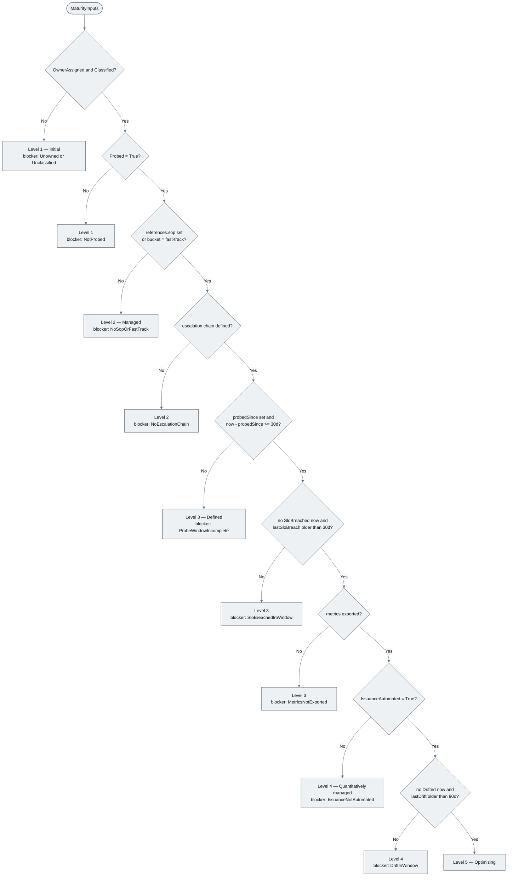
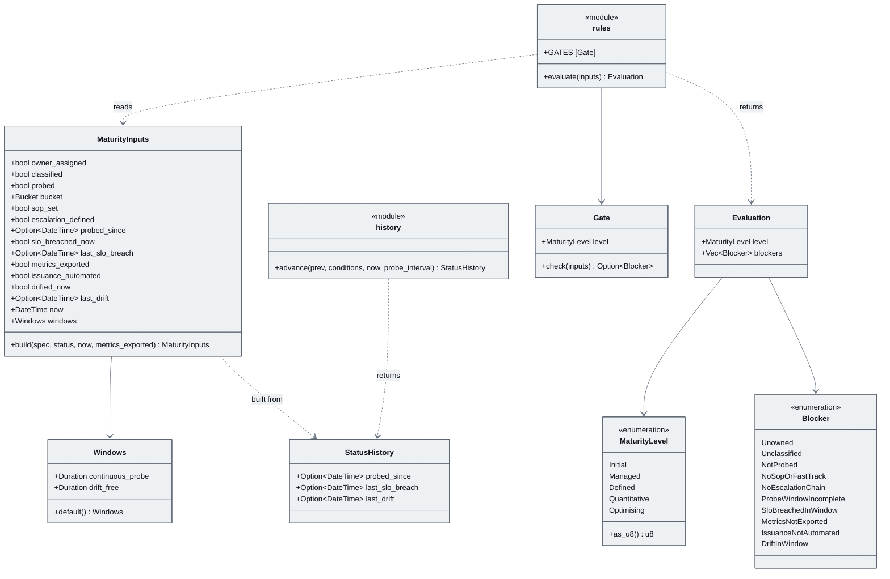
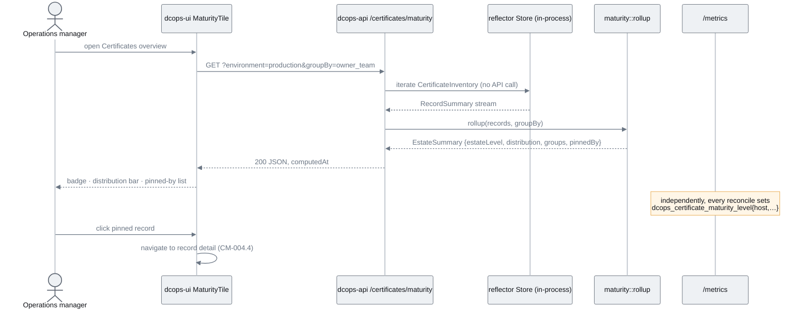
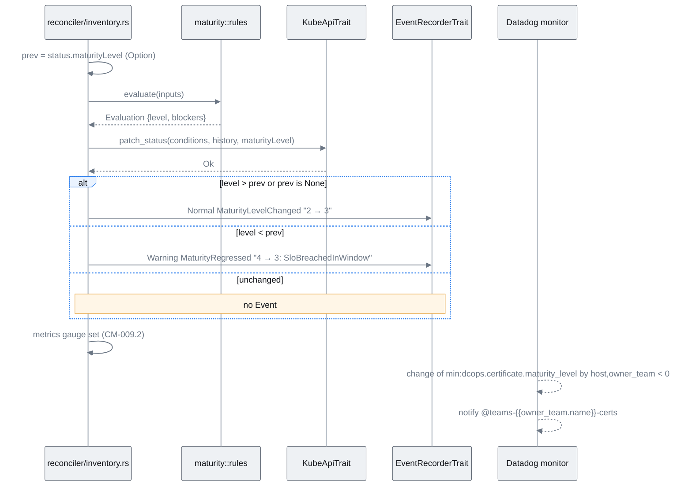

# EPIC-CM-009: Maturity level computation & rollup

> **Parent:** [Certificate Management Design](../../CERTIFICATE_MANAGEMENT_DESIGN.md) §7, §5.2, §8.1
> **Phase:** 3 — Automation
> **CMMI level advanced:** — (measures Levels 1–5; the level is the deliverable, not a step up it)
> **Status:** Draft — awaiting implementation
> **Priority:** P1
> **Estimated effort:** 5–7 days
> **Depends on:** EPIC-CM-005 (`Probed`, `SloBreached` conditions), EPIC-CM-006 (`Drifted`, `IssuanceAutomated` conditions), EPIC-CM-007 (`dcops_certificate_maturity_level` placeholder gauge and per-record label set), EPIC-CM-004 (certificates UI section for the tile), EPIC-CM-008 (assets directory for the monitor JSON)

---

## Overview

Design §7 is explicit that the CMMI level is *derived, never set by hand*. Until this epic, `status.maturityLevel` exists in the CRD (`CM-001.2`) and the `dcops_certificate_maturity_level` gauge is exported as a placeholder (`CM-007.1`), but nothing computes either. This epic replaces the placeholder with a rule engine that evaluates the five-row table in §7 against the conditions the earlier epics already set, stores the result on every record, and rolls it up to the estate-wide figure that the source document says should be the headline metric.

Two of the five rules have a time dimension — "continuously probed for ≥ 30 days with no `SloBreached`" and "no `Drifted` in the last 90 days" — and conditions alone cannot answer them because a condition only records its current state and last transition. The epic therefore adds a small `status.history` block (`probedSince`, `lastSloBreach`, `lastDrift`) that the reconciler advances on every probe, so the level function itself remains a pure function of spec + status + a clock and is exhaustively table-testable with fixed timestamps.

The rollup follows §7 literally: the estate level is the *minimum* across production records, weighted by severity so that a Critical record at Level 1 pins the whole estate at Level 1 while a Routine record at Level 1 does not. The distribution is exposed three ways — the per-record gauge (aggregated by `owner_team`/`bucket` in Prometheus or Datadog), a `GET /api/v1/certificates/maturity` summary that can also group by business unit (which is deliberately *not* a metric label, §8.1), and a tile in the certificates UI section. Level transitions emit Events, regressions emit a `MaturityRegressed` Warning, and a recommended monitor for that regression is added to the Datadog assets from EPIC-CM-008.

Out of scope: any action that *raises* a level (Certificate generation and remediation are EPIC-CM-010; adapters are EPIC-CM-011/012), per-record configurable windows (open question Q1), and changes to the four monitors already defined in `CM-008.4`.

## Epic-level diagram

Data flow from the conditions the earlier epics set to the four outputs of this epic (flowchart, because the point is that one pure function feeds everything downstream).

```mermaid
%%{init: {'theme':'base','themeVariables': {'fontFamily': 'Inter, Segoe UI, Helvetica, Arial, sans-serif', 'fontSize': '14px', 'primaryColor': '#EEF1F4', 'primaryTextColor': '#111318', 'primaryBorderColor': '#5E6672', 'secondaryColor': '#EAF3FF', 'secondaryTextColor': '#111318', 'secondaryBorderColor': '#2F80ED', 'tertiaryColor': '#EAF8F0', 'tertiaryTextColor': '#111318', 'tertiaryBorderColor': '#2FA36B', 'lineColor': '#6B7684', 'textColor': '#6B7684', 'nodeBorder': '#5E6672', 'nodeTextColor': '#111318', 'mainBkg': '#EEF1F4', 'clusterBkg': '#F7F9FB', 'clusterBorder': '#BAC1C9', 'titleColor': '#111318', 'edgeLabelBackground': '#F7F9FB', 'actorBkg': '#EEF1F4', 'actorBorder': '#5E6672', 'actorTextColor': '#111318', 'actorLineColor': '#BAC1C9', 'signalColor': '#6B7684', 'signalTextColor': '#6B7684', 'labelBoxBkgColor': '#EAF3FF', 'labelBoxBorderColor': '#2F80ED', 'labelTextColor': '#111318', 'loopTextColor': '#111318', 'noteBkgColor': '#FFF6E7', 'noteBorderColor': '#E6A23C', 'noteTextColor': '#111318', 'activationBkgColor': '#DCE6F7', 'activationBorderColor': '#2F80ED', 'sequenceNumberColor': '#FFFFFF', 'labelColor': '#111318', 'altBackground': '#F7F9FB', 'attributeBackgroundColorOdd': '#FFFFFF', 'attributeBackgroundColorEven': '#F7F9FB', 'classText': '#111318'}}}%%
flowchart LR
    subgraph inputs["Set by earlier epics"]
        c3["OwnerAssigned · Classified<br/>(EPIC-CM-003)"]
        c5["Probed · SloBreached<br/>(EPIC-CM-005)"]
        c6["Drifted · IssuanceAutomated<br/>(EPIC-CM-006)"]
        spec["spec.ownership.escalation<br/>spec.references.sop · spec.bucket"]
    end
    subgraph engine["CM-009.1 — maturity module"]
        hist["history::advance<br/>probedSince · lastSloBreach · lastDrift"]
        inp["MaturityInputs::build(spec, status, now)"]
        eval["rules::evaluate → level + blockers"]
    end
    c5 --> hist
    c6 --> hist
    hist --> inp
    c3 --> inp
    spec --> inp
    inp --> eval
    eval --> st["status.maturityLevel<br/>status.history"]
    st --> gauge["dcops_certificate_maturity_level<br/>(CM-009.2, replaces CM-007.1 placeholder)"]
    st --> api["GET /api/v1/certificates/maturity<br/>(CM-009.2)"]
    api --> tile["UI maturity tile (CM-009.2)"]
    st --> ev["MaturityLevelChanged · MaturityRegressed Events<br/>(CM-009.3)"]
    gauge --> mon["assets/monitors/certificate_maturity_regressed.json<br/>(CM-009.3)"]
    style inputs fill:transparent,stroke:#8A94A6,stroke-width:1.5px,stroke-dasharray:4 3
    style engine fill:transparent,stroke:#8A94A6,stroke-width:1.5px,stroke-dasharray:4 3
```

## Stories

| ID | Story | Persona | Effort |
|----|-------|---------|--------|
| **CM-009.1** | As an Operations manager, I want every inventory record to carry a computed CMMI level derived from observed facts so that progress up the scale is measured, not asserted | Operations manager | 2.5 d |
| **CM-009.2** | As an Operations manager, I want the estate-wide level and the distribution by owner, business unit and bucket on the dashboard and in the UI so that I can see which team or bucket is holding the estate back | Operations manager | 2 d |
| **CM-009.3** | As a certificate owner, I want an Event when my record changes level and a Warning plus a Datadog monitor when it regresses so that a lost level is noticed before an audit notices it | Certificate owner | 1 d |

## Definition of Done (epic)

- [ ] Every story's ACs pass
- [ ] `just verify` (fmt, clippy with workspace lints, nextest) is green
- [ ] `config/crd/all-crds.yaml` regenerated with `status.history` and applied cleanly to the shared cluster
- [ ] `README.md` capability list gains "Certificate management (maturity level)"; `docs/implementationChecklists/CertificateInventory.md` updated
- [ ] Design §5.2 status example amended with the `history` block; §7 gains the weighting table from `CM-009.2`
- [ ] `integrations/datadog/dcops/assets/monitors/certificate_maturity_regressed.json` passes the same `ddev validate` set as `CM-008.4`
- [ ] Five example inventories (one per level) exist under `config/examples/certificates/maturity/` and are used by QA

## Open questions

| ID | Question | Default if unresolved |
|----|----------|----------------------|
| **Q1** | Should the 30-day and 90-day windows be per-record policy fields (`policy.maturityWindows`)? | No. They are constants in `maturity::rules::Windows::default()` — the CMMI document fixes them and per-record tuning would make levels incomparable across the estate. |
| **Q2** | Should `StaleInScan=True` cap a record at Level 2? | No effect on the level; stale records are excluded from the estate minimum in `CM-009.2` but counted in the distribution with a `stale` flag. |
| **Q3** | Does a single transient `Probed=False` reset the 30-day window? | No. `probedSince` is cleared only when `Probed=False` has persisted for longer than `policy.probeInterval`. |
| **Q4** | Should the estate level be exported as its own gauge? | No new metric name; §8.1 is the metric contract. Datadog computes it with `min:dcops.certificate.maturity_level{environment:production}` and the API returns it. Revisit if a monitor needs it. |

---

## CM-009.1 — Per-record maturity level rule engine

**As an** Operations manager, **I want** `status.maturityLevel` on every `CertificateInventory` to be computed from the design §7 table on every reconcile **so that** the level reflects observed facts and cannot be set by hand.

### Description

Adds `controllers/certificate/src/maturity/{mod.rs, inputs.rs, history.rs, rules.rs}` with sibling `*_test.rs` files, and extends `crates/crds/src/certificates/certificate_inventory.rs` with `CertificateInventoryStatus.history: Option<StatusHistory>` carrying `probedSince`, `lastSloBreach` and `lastDrift` (all RFC 3339 timestamps, all optional). The three history fields are the only addition to the §5.2 status shape; `maturityLevel` already exists.

Two pure functions do all the work. `history::advance(prev: &StatusHistory, conditions: &[Condition], now, probe_interval) -> StatusHistory` sets `probedSince` when `Probed` becomes `True` (keeping the existing value if already set), clears it when `Probed=False` has persisted longer than one `probeInterval` (Q3), and stamps `lastSloBreach` / `lastDrift` with `now` whenever the respective condition is `True`. `rules::evaluate(&MaturityInputs) -> Evaluation` walks the §7 table as a fixed array of `Gate { level, check: fn(&MaturityInputs) -> Option<Blocker> }`; the result is the highest level whose gates 2..N all pass, with Level 1 as the floor, plus the list of `Blocker`s for the first failing gate (used by `CM-009.3` Event messages and the `CM-009.2` API). A record that is owned and classified but not yet `Probed` therefore stays at Level 1, because the levels are cumulative and Level 2 requires alerting to be active.

`MaturityInputs::build(spec, status, now, metrics_exported)` in `inputs.rs` is the only place that knows about the CRD; it reads conditions by type, `ownership.escalation` (non-empty with valid `after`/`to` = "escalation chain defined"), `references.sop`, `bucket`, and the history block. `metrics_exported` is supplied by the reconciler from the `CM-007.1` exporter (`true` once the per-inventory gauge set has been written for this record). `reconciler/inventory.rs` calls `advance` then `evaluate` after the evaluation step of design §5.3 and includes `maturityLevel` and `history` in the same status patch as the conditions, so there is one status write per reconcile. The reconciler never writes `maturityLevel` from any other path; a hand-edited value is overwritten on the next reconcile.

Reuses `KubeApiTrait` (status patch) and `EventRecorderTrait` from `crates/controller-common`; no new Kubernetes API calls. Not done here: rollup, metrics, API, UI, Events (`CM-009.2`, `CM-009.3`).

### Diagrams

The §7 decision table as the reconciler applies it (flowchart, because the gates are strictly cumulative and the first failing gate determines both the level and the blocker).

The types that make the function pure (classDiagram, because the deliverable is a Rust module with a fixed input surface that tests construct directly).

### Functional requirements

| ID | Requirement |
|----|-------------|
| **FR-009.1-01** | MUST add `status.history{probedSince, lastSloBreach, lastDrift}` (optional RFC 3339 timestamps) to `CertificateInventoryStatus` and regenerate `config/crd/all-crds.yaml` |
| **FR-009.1-02** | MUST implement `history::advance` as a pure function: sets `probedSince` on the first `Probed=True` and preserves it thereafter; clears it only when `Probed=False` has persisted longer than `policy.probeInterval`; sets `lastSloBreach`/`lastDrift` to `now` while the respective condition is `True` |
| **FR-009.1-03** | MUST implement `rules::evaluate` as a table-driven pure function over `MaturityInputs` returning the highest level whose gates 2..N all pass, Level 1 as floor, and the blockers of the first failing gate |
| **FR-009.1-04** | MUST implement the five §7 rules exactly: L2 = `OwnerAssigned` ∧ `Classified` ∧ `Probed`; L3 = L2 ∧ (`references.sop` set ∨ `bucket=fast-track`) ∧ escalation chain non-empty; L4 = L3 ∧ `probedSince ≤ now−30d` ∧ ¬`SloBreached` ∧ (`lastSloBreach` unset ∨ `≤ now−30d`) ∧ `metrics_exported`; L5 = L4 ∧ `IssuanceAutomated` ∧ ¬`Drifted` ∧ (`lastDrift` unset ∨ `≤ now−90d`) |
| **FR-009.1-05** | MUST build `MaturityInputs` only in `inputs.rs` from spec, status, an injected `now` and an injected `metrics_exported`; no other module reads conditions for maturity purposes |
| **FR-009.1-06** | MUST write `status.maturityLevel` and `status.history` in the same status patch as the conditions on every reconcile, and overwrite any externally set `maturityLevel` |
| **FR-009.1-07** | MUST treat a missing `Probed` condition, missing history block or unparseable timestamp as "gate fails" (never panic; `unwrap_used = deny`) |
| **FR-009.1-08** | SHOULD expose `Evaluation::blockers` through a `Display` impl producing one short phrase per blocker for use by `CM-009.2` and `CM-009.3` |

### Non-functional requirements

| ID | Category | Requirement |
|----|----------|-------------|
| **NFR-009.1-01** | Idempotency | Evaluating the same `MaturityInputs` twice yields identical output; reconciling an unchanged record at the same `now` produces a status patch with no field changes |
| **NFR-009.1-02** | Performance | `evaluate` completes in < 5 µs; `advance` + `build` + `evaluate` add < 1 ms to reconcile duration at p99 (measured via `dcops_controller_reconcile_duration_seconds`) |
| **NFR-009.1-03** | Reliability | The level function has no I/O, no clock access and no `unsafe`; the injected `now` is the only time source |
| **NFR-009.1-04** | Compatibility | Records without `status.history` (created before this epic) start their 30-day window at the first reconcile after upgrade; no migration job |
| **NFR-009.1-05** | Security | No key material is involved; the module reads only condition metadata and timestamps |

### Acceptance criteria

| ID | Given / When / Then |
|----|---------------------|
| **AC-009.1-01** | **Given** a record with `OwnerAssigned=False` **When** reconciled **Then** `status.maturityLevel=1` regardless of every other condition |
| **AC-009.1-02** | **Given** an owned, classified record with `Probed=True`, no `references.sop`, `bucket=legacy` **When** reconciled **Then** `maturityLevel=2` |
| **AC-009.1-03** | **Given** a Level 2 record with `bucket=fast-track` and two escalation entries **When** reconciled **Then** `maturityLevel=3` and `status.history.probedSince` is set |
| **AC-009.1-04** | **Given** a Level 3 record whose `probedSince` is 31 days old, no `lastSloBreach`, `SloBreached=False`, metrics exported **When** reconciled **Then** `maturityLevel=4` |
| **AC-009.1-05** | **Given** a Level 4 record **When** `SloBreached` transitions to `True` for one probe **Then** `lastSloBreach` is stamped and `maturityLevel` drops to 3 on that reconcile and stays 3 for the following 30 days of fixed-clock reconciles |
| **AC-009.1-06** | **Given** a Level 4 record with `IssuanceAutomated=True`, `Drifted=False`, `lastDrift` 91 days old **When** reconciled **Then** `maturityLevel=5`; **Given** `lastDrift` 89 days old **Then** `maturityLevel=4` |
| **AC-009.1-07** | **Given** a Level 4 record **When** one probe fails (`Probed=False`) and the next succeeds within `probeInterval` **Then** `probedSince` is unchanged and the level does not drop |
| **AC-009.1-08** | **Given** a Level 4 record **When** `Probed=False` persists for more than one `probeInterval` **Then** `probedSince` is cleared and the level drops to 1 (Level 2 gate fails) |
| **AC-009.1-09** | **Given** `kubectl patch --subresource=status` sets `maturityLevel: 5` on a Level 2 record **When** the next reconcile runs **Then** the value is 2 again |
| **AC-009.1-10** | **Given** the regenerated CRD **When** applied **Then** existing records without `history` are accepted and gain `history.probedSince` on first reconcile |
| **AC-009.1-11** | **Given** a record held at Level 3 because `probedSince` is 10 days old **When** the evaluation is formatted **Then** the blocker reads `ProbeWindowIncomplete` and nothing else |

### Unit test criteria

| ID | Test | Covers |
|----|------|--------|
| **UT-009.1-01** | `maturity::rules_test::table_every_level` — a `#[rstest]`-style table of `MaturityInputs` fixtures (fixed `now = 2026-09-08T00:00:00Z`) asserting level and blockers for each of the five levels and for each single failing gate | FR-009.1-03/04, AC-009.1-01..04, AC-009.1-06 |
| **UT-009.1-02** | `maturity::rules_test::window_boundaries` — `probedSince` at exactly 30d, 30d−1s, 30d+1s; `lastDrift` at 90d boundaries | FR-009.1-04, AC-009.1-06 |
| **UT-009.1-03** | `maturity::rules_test::levels_are_cumulative` — property test: for every fixture, removing any lower gate's input lowers the level below that gate | FR-009.1-03 |
| **UT-009.1-04** | `maturity::history_test::probed_since_set_once_and_kept` — `advance` across `Probed` True→True→False(short)→True keeps the original timestamp | FR-009.1-02, AC-009.1-07 |
| **UT-009.1-05** | `maturity::history_test::probed_since_cleared_after_interval` — `Probed=False` lasting `probeInterval + 1s` clears the field | FR-009.1-02, AC-009.1-08 |
| **UT-009.1-06** | `maturity::history_test::breach_and_drift_stamped` — `lastSloBreach`/`lastDrift` equal `now` while the condition is True and are preserved afterwards | FR-009.1-02, AC-009.1-05 |
| **UT-009.1-07** | `maturity::inputs_test::build_from_design_example` — the §5.2 status example plus a fixed `now` builds the expected `MaturityInputs`; missing history and malformed timestamps map to `None` | FR-009.1-05/07, NFR-009.1-04, AC-009.1-10 |
| **UT-009.1-08** | `reconciler::inventory_test::status_patch_includes_level_and_history` — `MockKubeApi` captures the status patch body; asserts `maturityLevel` and `history` present alongside conditions, and a second reconcile at the same `now` produces an identical body | FR-009.1-06, NFR-009.1-01, AC-009.1-09 |
| **UT-009.1-09** | `certificates::inventory_test::roundtrip_history_block` — CRD serde round-trip for `status.history` | FR-009.1-01, AC-009.1-10 |
| **UT-009.1-10** | `maturity::rules_test::blocker_display_phrases` — every `Blocker` variant formats to its documented phrase; an `Evaluation` with one blocker formats to exactly that phrase | FR-009.1-08, AC-009.1-11 |

### Integration test criteria

| ID | Test | Environment | Covers |
|----|------|-------------|--------|
| **IT-009.1-01** | `tests/maturity_levels.rs` (feature `integration`) — applies the five `config/examples/certificates/maturity/level-{1..5}.yaml` records with pre-seeded `status.history` via the status subresource, waits for reconcile, asserts each `maturityLevel`; then patches `maturityLevel` by hand and asserts it is restored | kind/k3s via Tilt | AC-009.1-01..04, AC-009.1-09/10 |

### QA process

1. `just dev-up`; apply the regenerated CRDs; confirm `kubectl explain certificateinventory.status.history` lists the three fields.
2. `just cert-examples`; apply `config/examples/certificates/maturity/`. Each example carries a comment stating its expected level and a pre-seeded `status.history` (applied with `kubectl patch --subresource=status`).
3. `kubectl get certificateinventories -n certificates -o custom-columns=NAME:.metadata.name,LEVEL:.status.maturityLevel,SINCE:.status.history.probedSince` — expect levels 1–5 matching the comments.
4. On the Level 4 example, patch `status.conditions` to `SloBreached=True` (or point its endpoint at a short-lived cert in the Tilt fixture); observe `lastSloBreach` stamped and level 3 on the next reconcile.
5. Negative path: `kubectl patch … --subresource=status -p '{"status":{"maturityLevel":5}}'` on the Level 2 example; trigger a reconcile (`kubectl annotate … reconcile=now`); confirm the value returns to 2. Second negative path: patch `history.probedSince` to `"not-a-date"`; confirm the controller logs a warning, does not crash, and the record evaluates as Level 3 or below.
6. Exit criteria: all ten ACs observed; attach the `custom-columns` output before/after, the negative-path outputs, and the nextest report for `controllers/certificate`.

---

## CM-009.2 — Estate rollup, distribution metric, summary endpoint and UI tile

**As an** Operations manager, **I want** the estate-wide maturity level and the distribution of records across levels by owner team, business unit and bucket **so that** I can see which part of the estate is holding the level down and target it.

### Description

Adds `controllers/certificate/src/maturity/rollup.rs` with `rollup(records: impl Iterator<Item = RecordSummary>) -> EstateSummary`, another pure function. `RecordSummary` is built from the controller's existing `kube_runtime` reflector store (no extra list calls): name, namespace, level, severity (from the `dcops.microscaler.io/severity` label), environment, owner team, business units, bucket, and whether `StaleInScan=True`. Severity weighting is made concrete so it is testable: each record contributes `min(5, level + offset)` with offset 0 for Critical and High, 1 for Medium, 2 for Routine; the estate level is the minimum contribution across records with `environment=production` that are not stale (Q2). A Critical record at Level 1 therefore pins the estate at 1, a Routine record at Level 1 contributes 3. Records with no severity label are treated as High. `EstateSummary` carries the estate level, total, a `distribution[1..5]` histogram, the same per group when `groupBy` is requested, and `pinnedBy` — up to 20 records whose contribution equals the estate level, ordered by severity then name.

The metric side is small: `metrics.rs` (from `CM-007.1`) stops writing the placeholder and sets `dcops_certificate_maturity_level` from `status.maturityLevel` with the exact §8.1 label set; the series is removed with the record as `CM-007.2` already guarantees. Per-owner and per-bucket distributions are therefore Prometheus queries (`count by (owner_team) (dcops_certificate_maturity_level == 3)`), and the `CM-007.3` recording rules gain `dcops:certificate_maturity_distribution:count` by level and bucket. Business units are multi-valued and are not a label (§8.1), so the business-unit distribution exists only in the API.

`api/maturity.rs` adds `GET /api/v1/certificates/maturity?namespace=&environment=&groupBy=owner_team|business_unit|bucket` as an operation in `openapi/dcops/certificates/openapi.yaml` served by the BRRTRouter service (`CM-002.2`), returning `EstateSummary` as JSON with a `computedAt` timestamp. The UI adds `ui/src/components/certificates/MaturityTile.tsx` to the certificates section overview from `CM-004.1`: estate level badge, a five-segment distribution bar, a group-by selector, and the `pinnedBy` list linking to record detail pages (`CM-004.4`). The tile uses the `dcops-api` client, not the read-only Kubernetes client.

Not done here: new metric names (Q4), a `ui-dashboard/` variant (follows the existing pattern in a later UI pass), Events (`CM-009.3`).

### Diagrams

Request path for the summary and the tile (sequenceDiagram, because the design constraint is that the API reads the reflector store rather than listing 5k objects per request).

### Functional requirements

| ID | Requirement |
|----|-------------|
| **FR-009.2-01** | MUST implement `rollup` as a pure function producing estate level = minimum of `min(5, level + severityOffset)` over non-stale production records, with offsets Critical 0, High 0, Medium 1, Routine 2, unlabelled treated as High |
| **FR-009.2-02** | MUST return an estate level of `null` (not 1, not 5) when no production records exist, with `total=0` |
| **FR-009.2-03** | MUST produce `distribution` (count per level 1–5, all records matching the filter including stale ones flagged `stale=true`) and, when `groupBy` is given, `groups[]` each with key, count, distribution and weighted minimum |
| **FR-009.2-04** | MUST produce `pinnedBy[]` of at most 20 records whose contribution equals the estate level, ordered by severity (Critical first) then name |
| **FR-009.2-05** | MUST set `dcops_certificate_maturity_level` from `status.maturityLevel` with the §8.1 label set on every reconcile and remove the placeholder logic from `CM-007.1` |
| **FR-009.2-06** | MUST serve `GET /api/v1/certificates/maturity` with optional `namespace`, `environment`, `groupBy ∈ {owner_team, business_unit, bucket}`; unknown `groupBy` returns 400 |
| **FR-009.2-07** | MUST count a record once per business unit when `groupBy=business_unit` (a record in two units appears in both groups; `total` remains the record count) |
| **FR-009.2-08** | MUST render `MaturityTile.tsx` with estate level, distribution bar, group-by selector and pinned-by links, and show an explicit "no production records" state for FR-009.2-02 |
| **FR-009.2-09** | SHOULD add recording rules `dcops:certificate_maturity_distribution:count{level,bucket}` to the `CM-007.3` Prometheus dev wiring |

### Non-functional requirements

| ID | Category | Requirement |
|----|----------|-------------|
| **NFR-009.2-01** | Performance | `GET /maturity` responds in < 200 ms p95 with 5,000 records in the store; `rollup` allocates O(groups), not O(records) |
| **NFR-009.2-02** | Observability | Metric cardinality is unchanged from `CM-007.1` — no new label is added to `dcops_certificate_maturity_level` |
| **NFR-009.2-03** | Accessibility | The tile meets WCAG 2.1 AA: level is conveyed by text as well as colour, the distribution bar has an accessible table equivalent, keyboard focus reaches every pinned-by link |
| **NFR-009.2-04** | Reliability | The endpoint reads only the reflector store; if the store has not completed its initial list, it returns 503 with `Retry-After: 5` rather than a partial estate level |
| **NFR-009.2-05** | Security | The endpoint is read-only and needs no additional RBAC; identity headers are ignored |

### Acceptance criteria

| ID | Given / When / Then |
|----|---------------------|
| **AC-009.2-01** | **Given** ten production records at Level 4 and one Critical production record at Level 1 **When** `GET /maturity` runs **Then** `estateLevel=1` and `pinnedBy` contains only the Critical record |
| **AC-009.2-02** | **Given** the same ten records and one Routine production record at Level 1 **When** queried **Then** `estateLevel=3` (1 + offset 2) and `pinnedBy` contains the Routine record |
| **AC-009.2-03** | **Given** a Critical record at Level 1 with `environment=staging` **When** queried with `environment=production` **Then** it affects neither `estateLevel` nor `pinnedBy` |
| **AC-009.2-04** | **Given** a Critical production record at Level 1 with `StaleInScan=True` **When** queried **Then** it is excluded from `estateLevel` but appears in `distribution` with `stale=true` |
| **AC-009.2-05** | **Given** `groupBy=business_unit` and a record in "METRO France" and "METRO digital" **When** queried **Then** both groups count it and `total` counts it once |
| **AC-009.2-06** | **Given** `groupBy=site` **When** queried **Then** 400 with a JSON error naming the allowed values |
| **AC-009.2-07** | **Given** a reconciled record at Level 3 **When** `/metrics` is scraped **Then** `dcops_certificate_maturity_level{host="…",bucket="…",owner_team="…",…} 3` is present and no placeholder value remains |
| **AC-009.2-08** | **Given** the certificates overview in the UI **When** the tile loads **Then** it shows the same `estateLevel` and distribution as the API and each pinned record links to its detail page |
| **AC-009.2-09** | **Given** the controller has not finished its initial list **When** the tile calls the API **Then** the API returns 503 and the tile shows a "loading inventory" state, retrying after 5 s |
| **AC-009.2-10** | **Given** `just cert-metrics` is running **When** `dcops:certificate_maturity_distribution:count` is queried **Then** one series per `(level, bucket)` present in the inventory is returned and the sums match `distribution` from the API |

### Unit test criteria

| ID | Test | Covers |
|----|------|--------|
| **UT-009.2-01** | `maturity::rollup_test::critical_pins_estate` and `routine_is_offset` — fixture sets asserting estate level and `pinnedBy` | FR-009.2-01/04, AC-009.2-01/02 |
| **UT-009.2-02** | `maturity::rollup_test::filters_environment_and_stale` | FR-009.2-01/03, AC-009.2-03/04 |
| **UT-009.2-03** | `maturity::rollup_test::empty_estate_is_null` | FR-009.2-02 |
| **UT-009.2-04** | `maturity::rollup_test::group_by_business_unit_counts_each_unit` | FR-009.2-07, AC-009.2-05 |
| **UT-009.2-05** | `maturity::rollup_test::pinned_by_capped_and_ordered` — 25 pinning records, assert 20 returned, Critical before High, then by name | FR-009.2-04 |
| **UT-009.2-06** | `api::maturity_test::endpoint_shapes_and_errors` — axum `oneshot` against a seeded in-memory store: 200 shape, 400 on bad `groupBy`, 503 before store ready | FR-009.2-06, NFR-009.2-04, AC-009.2-06/09 |
| **UT-009.2-07** | `metrics_test::maturity_gauge_from_status` — scrape the in-process registry after a reconcile via `MockKubeApi`; assert value and label set | FR-009.2-05, AC-009.2-07, NFR-009.2-02 |
| **UT-009.2-08** | `ui/src/components/certificates/MaturityTile.test.tsx` — renders fixture summaries (normal, empty estate, 503) and asserts text, links and the accessible table | FR-009.2-08, NFR-009.2-03, AC-009.2-08/09 |

### Integration test criteria

| ID | Test | Environment | Covers |
|----|------|-------------|--------|
| **IT-009.2-01** | `tests/maturity_rollup.rs` (feature `integration`) — applies the `maturity/` examples plus a Critical Level 1 production record, calls the API through the HTTPRoute, asserts `estateLevel=1`; deletes that record, asserts the estate level rises and its gauge series disappears; queries the recording rule and compares with `distribution` | kind/k3s via Tilt | FR-009.2-09, AC-009.2-01/07/10 |
| **IT-009.2-02** | Playwright smoke in `ui/` CI: load the overview against the Tilt API, assert the tile renders the API's `estateLevel` | kind/k3s via Tilt + Vite | AC-009.2-08 |

### QA process

1. `just dev-up`; apply `config/examples/certificates/maturity/` (all five levels, `environment=production`, severity labels as commented).
2. `curl "$API/api/v1/certificates/maturity?environment=production&groupBy=bucket" | jq` — expect `estateLevel=1`, `pinnedBy` naming the Level 1 example (Critical). Save the output.
3. Relabel the Level 1 example `severity=routine`; re-query — expect `estateLevel=3` from the offset (`pinnedBy` now the Routine record or a Level 3 record, whichever is lower after weighting).
4. `just cert-metrics`; in Prometheus run `count by (bucket) (dcops_certificate_maturity_level)` and `min(dcops_certificate_maturity_level{environment="production"})`; compare with the API.
5. Open the certificates overview in the UI; screenshot the tile; switch group-by to business unit; click a pinned record and confirm navigation.
6. Negative path: `groupBy=site` → 400 in the browser network tab; scale the controller to 0 and reload — the tile shows the loading/unavailable state, not a stale level; scale back up.
7. Exit criteria: all nine ACs observed; attach the `curl` outputs, Prometheus screenshots, UI screenshots (including the empty and error states) and the nextest/Vitest reports.

---

## CM-009.3 — Level transition Events, `MaturityRegressed` Warning and Datadog monitor

**As a** certificate owner, **I want** a Kubernetes Event whenever my record changes maturity level and a Warning plus a Datadog monitor when it regresses **so that** a lost level is acted on by the owner instead of being discovered at the next audit.

### Description

Extends `reconciler/inventory.rs` so that after the status patch from `CM-009.1` succeeds, the reconciler compares the previous `status.maturityLevel` with the new one and publishes through `EventRecorderTrait`: `Normal/MaturityLevelChanged` with message `Maturity level 2 → 3` on any upward change, `Warning/MaturityRegressed` with message `Maturity level 4 → 3: SloBreachedInWindow` on any downward change (blockers from `Evaluation::blockers` via the `Display` from FR-009.1-08). The comparison is against the level read at the start of the reconcile, so exactly one Event is emitted per transition and none on a steady state — the same idempotency rule `CM-005.3` applies to escalations. A record reconciled for the first time (no previous level) emits `MaturityLevelChanged` with `— → N` so the initial classification is visible in `kubectl describe`.

The Datadog side adds `integrations/datadog/dcops/assets/monitors/certificate_maturity_regressed.json` next to the four monitors from `CM-008.4`: a metric monitor on `dcops.certificate.maturity_level` grouped by `host,owner_team` that alerts when the level over the last day drops below its level over the prior day, with the same `owner_team` routing and message template conventions as `certificate_drift.json`. Because Q4 rules out a new metric, the estate-level view remains a dashboard query; the regression monitor is per record, which is what routes to the accountable owner. The dashboard's "maturity distribution" widget from `CM-008.3` needs no change — it was already bound to the gauge this epic makes real.

Not done here: Teams/email transport (Datadog channels, design §8.3), a transitions counter metric (Q4).

### Diagrams

Event emission relative to the status write (sequenceDiagram, because at-most-once emission depends on the ordering).

### Functional requirements

| ID | Requirement |
|----|-------------|
| **FR-009.3-01** | MUST emit `Normal/MaturityLevelChanged` when the new level is higher than the previous or the previous is absent, with message `Maturity level <prev|—> → <new>` |
| **FR-009.3-02** | MUST emit `Warning/MaturityRegressed` when the new level is lower than the previous, with the blockers of the first failing gate appended |
| **FR-009.3-03** | MUST emit at most one Event per transition and none when the level is unchanged; Events are published only after the status patch succeeds |
| **FR-009.3-04** | MUST add `assets/monitors/certificate_maturity_regressed.json` (query on `dcops.certificate.maturity_level` by `host,owner_team`, alert when the level decreases day over day, `owner_team` tag routing, renewal-style message template) alongside the `CM-008.4` monitors |
| **FR-009.3-05** | MUST reference the new monitor from the integration README "Monitors" list |
| **FR-009.3-06** | SHOULD log the transition at `info` with fields `name`, `namespace`, `from`, `to`, `blockers` |

### Non-functional requirements

| ID | Category | Requirement |
|----|----------|-------------|
| **NFR-009.3-01** | Idempotency | 1,000 steady-state reconciles of a record produce zero maturity Events |
| **NFR-009.3-02** | Reliability | A failed Event publish is logged and not retried; it never causes the reconcile to be retried (the status is already written) |
| **NFR-009.3-03** | Observability | Event messages are ≤ 200 characters and contain no timestamps (the Event carries its own), so identical transitions aggregate in `kubectl get events` |
| **NFR-009.3-04** | Compatibility | The monitor JSON passes the same `ddev validate` set as `CM-008.4` and uses only tags present in `metadata.csv` |

### Acceptance criteria

| ID | Given / When / Then |
|----|---------------------|
| **AC-009.3-01** | **Given** a record at Level 2 **When** an escalation chain is added and `bucket=fast-track` **Then** exactly one `MaturityLevelChanged` Event `Maturity level 2 → 3` exists after reconcile |
| **AC-009.3-02** | **Given** a record at Level 4 **When** `SloBreached=True` is observed **Then** exactly one `MaturityRegressed` Warning Event with message `Maturity level 4 → 3: SloBreachedInWindow` exists |
| **AC-009.3-03** | **Given** a record at a stable level **When** it is reconciled ten more times **Then** no additional maturity Events exist |
| **AC-009.3-04** | **Given** a record created for the first time **When** reconciled **Then** a `MaturityLevelChanged` Event `Maturity level — → 1` (or the computed level) exists |
| **AC-009.3-05** | **Given** the Datadog monitor JSON imported into a Datadog org **When** a record's `maturity_level` drops from 4 to 3 **Then** the monitor alerts with the record's `host` and routes to the `owner_team` handle |
| **AC-009.3-06** | **Given** the status patch fails **When** the reconcile errors **Then** no Event is emitted and the reconcile is retried by `BackoffCalculator` |
| **AC-009.3-07** | **Given** any maturity transition **When** the controller log is read **Then** one `info` line carries `name`, `namespace`, `from`, `to`, `blockers` |
| **AC-009.3-08** | **Given** the integration README **When** a reader opens "Monitors" **Then** all five monitor files, including `certificate_maturity_regressed.json`, are listed with their thresholds |

### Unit test criteria

| ID | Test | Covers |
|----|------|--------|
| **UT-009.3-01** | `reconciler::inventory_test::maturity_up_emits_changed` — `MockEventRecorder` captures one Normal Event with the exact message; a `tracing_test` subscriber captures the `info` line with `from`/`to`/`blockers` | FR-009.3-01/06, AC-009.3-01/07 |
| **UT-009.3-02** | `reconciler::inventory_test::maturity_down_emits_regressed_with_blockers` | FR-009.3-02, AC-009.3-02 |
| **UT-009.3-03** | `reconciler::inventory_test::maturity_steady_emits_nothing` — loop of 1,000 reconciles at a fixed clock | FR-009.3-03, NFR-009.3-01, AC-009.3-03 |
| **UT-009.3-04** | `reconciler::inventory_test::maturity_first_reconcile_emits_initial` | FR-009.3-01, AC-009.3-04 |
| **UT-009.3-05** | `reconciler::inventory_test::maturity_no_event_when_patch_fails` — `MockKubeApi` returns `Err` on `patch_status`; assert zero Events and a `Transient` error | FR-009.3-03, AC-009.3-06, NFR-009.3-02 |
| **UT-009.3-06** | `integrations/datadog/dcops/tests/test_assets.py::test_monitor_files_valid` — every `assets/monitors/*.json` parses, has `name`, `type`, `query`, `message` and references only metrics in `metadata.csv` | FR-009.3-04, NFR-009.3-04, AC-009.3-05 |
| **UT-009.3-07** | `integrations/datadog/dcops/tests/test_assets.py::test_readme_lists_every_monitor` — every file in `assets/monitors/` is named in the README "Monitors" section | FR-009.3-05, AC-009.3-08 |

### Integration test criteria

| ID | Test | Environment | Covers |
|----|------|-------------|--------|
| **IT-009.3-01** | `tests/maturity_events.rs` (feature `integration`) — promotes a `maturity/level-2.yaml` record to Level 3 via `PATCH /ownership`, asserts one `MaturityLevelChanged` Event; seeds `lastSloBreach=now` on a Level 4 record, asserts one `MaturityRegressed` Event; reconciles ten more times, asserts the Event count is unchanged | kind/k3s via Tilt | AC-009.3-01..03 |
| **IT-009.3-02** | Manual import of the monitor JSON into the Datadog sandbox org during release QA (documented in the integration README) | Datadog sandbox | AC-009.3-05 |

### QA process

1. `just dev-up`; apply `config/examples/certificates/maturity/level-2.yaml`. In the UI record detail (or via `PATCH /ownership`) set an escalation chain and `bucket=fast-track`.
2. `kubectl describe certificateinventory <name>` — confirm exactly one `MaturityLevelChanged` Event reading `Maturity level 2 → 3`.
3. Apply `level-4.yaml`; `kubectl patch … --subresource=status` to set `history.lastSloBreach` to now; trigger a reconcile; confirm one `MaturityRegressed` Warning with the `SloBreachedInWindow` blocker.
4. Trigger ten further reconciles (annotate the record); `kubectl get events --field-selector reason=MaturityRegressed` — count unchanged.
5. Negative path: block the controller's Event creation (temporarily remove `create events` from the ClusterRole); trigger a transition; confirm the status still updates, the log shows the publish failure, and the controller does not enter a retry loop. Restore RBAC.
6. Datadog: import `certificate_maturity_regressed.json` into the sandbox org; with the Agent scraping the Tilt controller, repeat step 3 and observe the monitor alert with the `owner_team` handle in the notification.
7. Exit criteria: all six ACs observed; attach `kubectl describe` and `get events` outputs, the RBAC negative-path log excerpt, a screenshot of the Datadog monitor alert, and the nextest and `ddev test dcops` reports.
