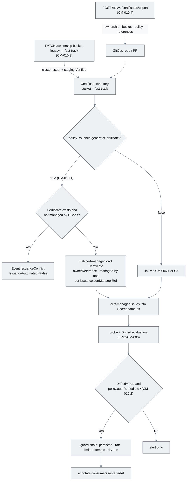
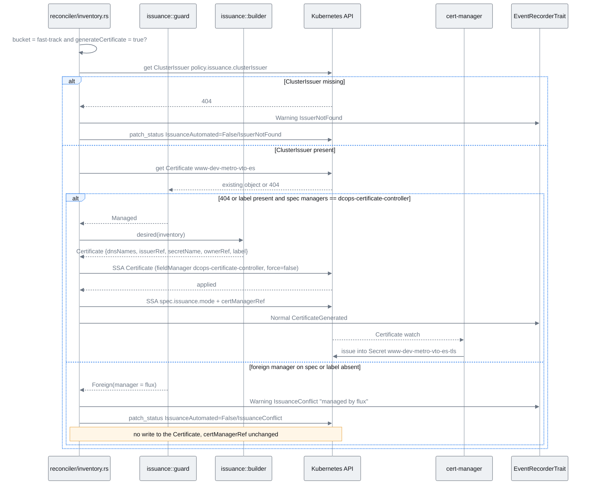
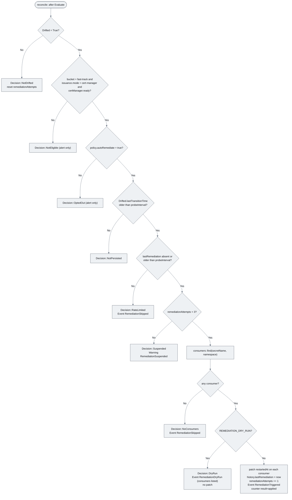
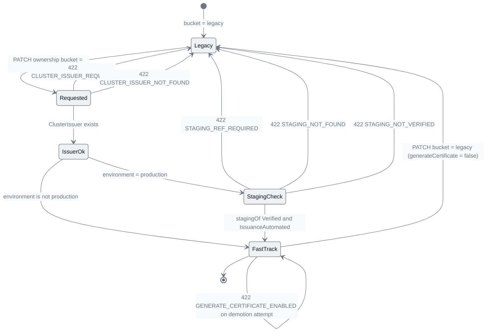
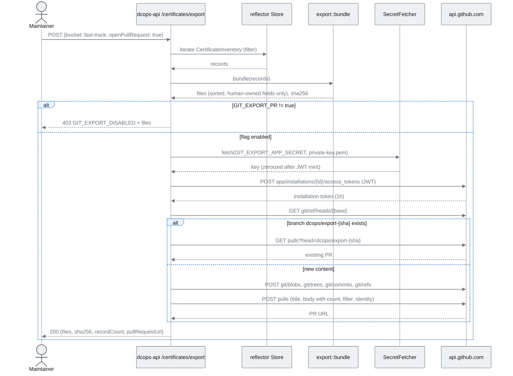

# EPIC-CM-010: cert-manager hand-off & opt-in remediation

> **Parent:** [Certificate Management Design](../../CERTIFICATE_MANAGEMENT_DESIGN.md) §3, §5.3 (step 5), §7, §12.1
> **Phase:** 3 — Automation
> **CMMI level advanced:** Level 5 · Optimising (fast-track bucket)
> **Status:** Draft — awaiting implementation
> **Priority:** P1
> **Estimated effort:** 10–13 days
> **Depends on:** EPIC-CM-006 (`certManagerRef` read-through, `Drifted`, `IssuanceAutomated`), EPIC-CM-009 (maturity level reflects the outcome), EPIC-CM-003 (`PATCH /ownership` endpoint extended here), EPIC-CM-004 (record detail panel extended here), EPIC-CM-001 (ADR-002 amended here)

---

## Overview

This epic is the "Level 5 leap" from design §3: the point where DCops stops only observing the fast-track bucket and starts handing work to cert-manager. The hard rule is unchanged and is restated in every story — **DCops never issues, signs or renews a certificate and never holds a private key**. What it may do, when an Operations manager opts in per record, is *declare* a cert-manager `Certificate` derived from the inventory record (hostnames, chosen `ClusterIssuer`, Secret name convention), *restart* the workloads that consume the resulting Secret when the live endpoint is found to be serving something else, and *export* the human-owned inventory fields as YAML so that Git can become the source of truth for ownership (design §12.1 option b).

Every one of those actions is guarded. Certificate generation is off by default (`policy.issuance.generateCertificate=false`) and the controller refuses to touch any `Certificate` it did not create — detected by the `dcops.microscaler.io/managed-by` label and by `metadata.managedFields` — surfacing an `IssuanceConflict` Event instead of fighting Git. Remediation is off by default (`policy.autoRemediate=false`), only applies to fast-track records whose drift has persisted for a probe interval, is rate-limited to one restart per record per probe interval, suspends itself if drift does not clear, and has a dry-run mode that only emits the Event. Promotion of a record from `legacy` to `fast-track` requires a `ClusterIssuer` and — for production records — a staging counterpart that is already `Verified`, which is the CMMI Level 3 "rotate in staging first" rule made mechanical.

Out of scope: delivery to devices that cannot consume a Secret (`CertificateBinding`, EPIC-CM-011/012), any Issuer/ClusterIssuer creation, ACME configuration, key rotation policy, and generation of `Certificate` resources in a namespace other than the inventory's (an owner reference cannot cross namespaces; such Certificates are declared in Git and linked via `CM-006.4`).

## Epic-level diagram

Where each story acts on the fast-track path from design §4 (flowchart, because the point is that each story is a guarded side effect hanging off the existing reconcile loop).

## Stories

| ID | Story | Persona | Effort |
|----|-------|---------|--------|
| **CM-010.1** | As an Operations manager, I want a fast-track record with `generateCertificate=true` to declare a cert-manager `Certificate` for me so that automating a legacy hostname is a UI toggle rather than a YAML request to engineering | Operations manager | 3 d |
| **CM-010.2** | As a platform operator, I want workloads consuming a renewed Secret restarted automatically when the live endpoint drifts, only where I opted in, so that renewals actually reach the edge without a 3 a.m. page | Platform operator | 3 d |
| **CM-010.3** | As an Operations manager, I want promotion from legacy to fast-track to be refused until a `ClusterIssuer` is chosen and the staging counterpart is verified so that the first automated rotation never happens in production | Operations manager | 2.5 d |
| **CM-010.4** | As the DCops maintainer, I want the human-owned inventory fields exportable as a kustomize bundle, optionally as a pull request, so that Git can become the source of truth for ownership without blocking Operations | Maintainer | 2.5 d |

## Definition of Done (epic)

- [ ] Every story's ACs pass
- [ ] `just verify` (fmt, clippy with workspace lints, nextest) is green
- [ ] `config/certificate-controller/` ClusterRole gains exactly `create,patch` on `certificates.cert-manager.io`, `get` on `clusterissuers.cert-manager.io`, `get,list,watch,patch` on `deployments,statefulsets,daemonsets` — and still no `delete` anywhere
- [ ] `ADRs/ADR-002` gains an addendum recording the controller's single spec write (`issuance.mode`/`certManagerRef`), the staging-first promotion rule and the §12.1(b) export decision
- [ ] Design §8.1 and `integrations/datadog/dcops/metadata.csv` amended with `dcops_certificate_remediations_total`
- [ ] `config/dev/cert-manager/` (cert-manager + self-signed `ClusterIssuer`) and `config/examples/certificates/consumer-nginx.yaml` are part of `just dev-up`
- [ ] `README.md` capability list gains "Certificate management (cert-manager hand-off, opt-in remediation, Git export)"

## Open questions

| ID | Question | Default if unresolved |
|----|----------|----------------------|
| **Q1** | When `generateCertificate` is turned back to `false`, should the controller strip the ownerReference so the Certificate survives inventory deletion? | Keep the ownerReference; emit `IssuanceGenerationDisabled` and stop managing. Deleting an inventory is an explicit UI/Git act (design §6.3) and cascade is the documented consequence. |
| **Q2** | Should dry-run be per record (`policy.remediation.dryRun`) as well as controller-wide? | Controller-wide `REMEDIATION_DRY_RUN` only; the dev overlay sets it `true`. A per-record flag is a one-line addition later. |
| **Q3** | Is an emergency override for the staging check needed (e.g. staging environment does not exist)? | No API override. Git can set `bucket: fast-track` directly; the API path is for Operations managers and stays strict. |
| **Q4** | Export target: GitHub only? | GitHub App via REST is the only PR opener in this epic; the bundle itself is Git-host agnostic. |

---

## CM-010.1 — Generate a cert-manager `Certificate` for opted-in fast-track records

**As an** Operations manager, **I want** the controller to create and keep up to date a cert-manager `Certificate` for a fast-track record when I set `policy.issuance.generateCertificate=true` **so that** cert-manager takes over issuance and renewal without engineering writing YAML, and without DCops ever issuing anything itself.

### Description

Adds `controllers/certificate/src/issuance/{mod.rs, builder.rs, guard.rs}` and wires it into `reconciler/inventory.rs` as a step between *Resolve* and *Probe* of design §5.3, executed only when `spec.bucket=fast-track` and `spec.policy.issuance.generateCertificate=true`. `builder.rs` derives the desired `cert-manager.io/v1 Certificate` from the inventory (reusing the typed `cert_manager::Certificate` model introduced by `CM-006.1`): `metadata.name` = inventory name with dots replaced by dashes (the design §5.1 example `www-dev-metro-vto-es`), same namespace as the inventory (an ownerReference cannot cross namespaces), `spec.dnsNames` = deduplicated `spec.endpoints[].host` in input order, `spec.issuerRef = {name: policy.issuance.clusterIssuer, kind: ClusterIssuer, group: cert-manager.io}`, `spec.secretName = <name>-tls`, label `dcops.microscaler.io/managed-by=certificate-controller`, and an ownerReference to the inventory (`controller=true`, `blockOwnerDeletion=false`). Nothing else is set: duration, key algorithm, usages and renewal timing remain cert-manager defaults, because restating them would cross the §3 line.

`guard.rs` decides whether the controller may write. Before the first write it fetches any existing `Certificate` of that name. The object is *managed by DCops* only if it carries the label **and** every `metadata.managedFields` entry that owns a `spec` field has manager `dcops-certificate-controller` (cert-manager's own managers on `status` are ignored). Anything else — no label, a `kubectl`/`flux`/`argocd`/`helm` manager on `spec`, or a different ownerReference controller — is a conflict: the controller does not write, publishes `Warning/IssuanceConflict` naming the foreign manager, sets `IssuanceAutomated=False` with reason `IssuanceConflict`, and leaves `certManagerRef` untouched. When the guard passes, the desired object is applied with Server-Side Apply, fieldManager `dcops-certificate-controller`, `force=false`; an SSA conflict from the API server is treated identically to a guard failure. The `ClusterIssuer` is read (`get`) before the first apply and a missing one yields `Warning/IssuerNotFound` and `IssuanceAutomated=False/IssuerNotFound`.

After a successful apply the controller writes `spec.issuance.mode=cert-manager` and `spec.issuance.certManagerRef={name, namespace}` — the one deliberate exception to "the reconciler never mutates spec" (§5.3), made with SSA on exactly those two fields under its own fieldManager, so that a Git-owned `issuance` block produces an `IssuanceConflict` instead of being overwritten. From then on `CM-006.1` read-through and `CM-006.3` `IssuanceAutomated` behave as for any linked record. Reuses `KubeApiTrait<Certificate>`, `KubeApiTrait<ClusterIssuer>` (get only), `EventRecorderTrait` and `BackoffCalculator` from `crates/controller-common`. Never deletes a `Certificate`, never reads or writes a Secret, never touches a record whose bucket is not `fast-track`.

### Diagrams

Generation with the ownership guard and the conflict refusal (sequenceDiagram, because the guard's read-before-write is the whole safety argument).

### Functional requirements

| ID | Requirement |
|----|-------------|
| **FR-010.1-01** | MUST act only when `spec.bucket=fast-track` and `spec.policy.issuance.generateCertificate=true`; the default for the flag is `false` and any other bucket is ignored with no Event |
| **FR-010.1-02** | MUST build the `Certificate` with name = inventory name with `.` → `-`, same namespace, `dnsNames` = deduplicated `spec.endpoints[].host`, `issuerRef{name=clusterIssuer, kind=ClusterIssuer, group=cert-manager.io}`, `secretName=<name>-tls`, label `dcops.microscaler.io/managed-by=certificate-controller`, ownerReference to the inventory with `controller=true`, and no other spec fields |
| **FR-010.1-03** | MUST refuse to write when an existing `Certificate` lacks the managed-by label or has any `managedFields` entry owning `spec` fields with a manager other than `dcops-certificate-controller`, publishing `Warning/IssuanceConflict` with the foreign manager name and setting `IssuanceAutomated=False` reason `IssuanceConflict` |
| **FR-010.1-04** | MUST apply with Server-Side Apply, fieldManager `dcops-certificate-controller`, `force=false`, and treat an API-server SSA conflict exactly as FR-010.1-03 |
| **FR-010.1-05** | MUST verify the `ClusterIssuer` exists before the first apply and, if absent, publish `Warning/IssuerNotFound` and set `IssuanceAutomated=False` reason `IssuerNotFound` without creating the `Certificate` |
| **FR-010.1-06** | MUST, after a successful apply, SSA `spec.issuance.mode=cert-manager` and `spec.issuance.certManagerRef{name,namespace}` under fieldManager `dcops-certificate-controller` with `force=false`, and surface a conflict on those fields as `IssuanceConflict` |
| **FR-010.1-07** | MUST re-apply when `spec.endpoints[].host` or `policy.issuance.clusterIssuer` change (desired object differs) and produce no write when they do not |
| **FR-010.1-08** | MUST NOT delete, or issue any `delete`-verb call for, a `Certificate` under any circumstance; when the flag is turned off, publish `Normal/IssuanceGenerationDisabled` and stop managing (Q1) |
| **FR-010.1-09** | MUST extend the ClusterRole with `create,patch` on `certificates.cert-manager.io` and `get` on `clusterissuers.cert-manager.io` only |
| **FR-010.1-10** | SHOULD publish `Normal/CertificateGenerated` on first create and `Normal/CertificateUpdated` on subsequent changed applies, each carrying the Certificate name |

### Non-functional requirements

| ID | Category | Requirement |
|----|----------|-------------|
| **NFR-010.1-01** | Security | The controller never reads `tls.key` or writes any Secret in this story; the generated `Certificate` carries no key material; ClusterRole has no `delete` on any resource and no `secrets` verbs beyond the `get` from `CM-001.4`/`CM-006.2` |
| **NFR-010.1-02** | Security | Key material never appears in status, Events, logs or metrics (tracing redaction layer from `CM-001.4` applies) |
| **NFR-010.1-03** | Idempotency | Reconciling an unchanged opted-in record performs zero writes to the `Certificate` and zero spec writes; 100 consecutive reconciles leave `metadata.generation` of the `Certificate` unchanged |
| **NFR-010.1-04** | Safety | A conflict is sticky for the record until the foreign object changes or the flag is disabled; the controller retries the guard read at `probeInterval`, never faster, and never with `force=true` |
| **NFR-010.1-05** | Reliability | Transient API errors on the guard read or apply are retried through `BackoffCalculator`; the probe step still runs so observed state stays fresh |
| **NFR-010.1-06** | Compatibility | Works with cert-manager ≥ 1.12 (`cert-manager.io/v1`); the typed model tolerates unknown fields |

### Acceptance criteria

| ID | Given / When / Then |
|----|---------------------|
| **AC-010.1-01** | **Given** a fast-track record `nginx-consumer.certificates.svc` with `generateCertificate=true`, `clusterIssuer=selfsigned` and no existing Certificate **When** reconciled **Then** `Certificate/nginx-consumer-certificates-svc` exists in the same namespace with the FR-010.1-02 shape, cert-manager issues `nginx-consumer-certificates-svc-tls`, `spec.issuance.certManagerRef` names it, and `IssuanceAutomated=True` follows on the next reconcile |
| **AC-010.1-02** | **Given** the same record with `generateCertificate=false` (default) **When** reconciled **Then** no `Certificate` exists and no issuance Event is published |
| **AC-010.1-03** | **Given** a `Certificate` of the same name applied with `kubectl apply --server-side --field-manager=flux` and no managed-by label **When** the record is reconciled with `generateCertificate=true` **Then** the Certificate is byte-for-byte unchanged, one `IssuanceConflict` Warning names `flux`, `IssuanceAutomated=False/IssuanceConflict`, and `certManagerRef` is unset |
| **AC-010.1-04** | **Given** a controller-generated Certificate **When** an engineer adds a `dnsNames` entry with `kubectl edit` **Then** the next reconcile refuses to overwrite (manager `kubectl-edit` on `spec`), publishes `IssuanceConflict`, and leaves the edit in place |
| **AC-010.1-05** | **Given** `clusterIssuer=does-not-exist` **When** reconciled **Then** no Certificate is created, `IssuerNotFound` Warning is published and `IssuanceAutomated=False/IssuerNotFound` |
| **AC-010.1-06** | **Given** a generated Certificate **When** a second endpoint host is added to the record **Then** `dnsNames` gains the host on the next reconcile and `CertificateUpdated` is published once |
| **AC-010.1-07** | **Given** a generated Certificate **When** the record is reconciled 100 times unchanged **Then** the Certificate's `metadata.generation` and `resourceVersion` are unchanged |
| **AC-010.1-08** | **Given** the ServiceAccount **When** `kubectl auth can-i delete certificates.cert-manager.io --as=system:serviceaccount:dcops-system:certificate-controller` runs **Then** `no`; `can-i create certificates.cert-manager.io` **Then** `yes` |
| **AC-010.1-09** | **Given** a legacy-bucket record with `generateCertificate=true` **When** reconciled **Then** nothing is generated and no Event is published |
| **AC-010.1-10** | **Given** a generated Certificate **When** `generateCertificate` is set back to `false` **Then** the Certificate and its Secret still exist, one `IssuanceGenerationDisabled` Event is published, and the audit log shows no `delete` verb from the controller's ServiceAccount |

### Unit test criteria

| ID | Test | Covers |
|----|------|--------|
| **UT-010.1-01** | `issuance::builder_test::desired_certificate_shape` — from the §5.1 example with `bucket=fast-track`; asserts name, namespace, `dnsNames`, `issuerRef`, `secretName`, label, ownerReference and that `duration`/`privateKey` are `None` | FR-010.1-02, AC-010.1-01 |
| **UT-010.1-02** | `issuance::builder_test::dns_names_deduplicated_ordered` | FR-010.1-02 |
| **UT-010.1-03** | `issuance::guard_test::managed_when_label_and_own_manager` / `foreign_when_label_missing` / `foreign_when_flux_owns_spec` / `ignores_cert_manager_status_managers` — fixtures with hand-built `managedFields` | FR-010.1-03, AC-010.1-03/04 |
| **UT-010.1-04** | `reconciler::inventory_test::generate_creates_certificate_via_ssa` — `MockKubeApi<Certificate>` returns 404 then captures the SSA body; asserts fieldManager, `force=false`, body equals builder output; asserts the follow-up spec SSA contains only `issuance.mode` and `issuance.certManagerRef`; asserts one `CertificateGenerated` Event, and `CertificateUpdated` on a changed re-apply | FR-010.1-04/06/10, AC-010.1-01/06 |
| **UT-010.1-05** | `reconciler::inventory_test::generate_refuses_foreign_certificate` — `MockKubeApi` returns a flux-managed object; asserts zero patch calls on `Certificate`, one `IssuanceConflict` Event in `MockEventRecorder`, status patch with `IssuanceAutomated=False/IssuanceConflict` | FR-010.1-03, AC-010.1-03 |
| **UT-010.1-06** | `reconciler::inventory_test::generate_handles_ssa_conflict_409` — `MockKubeApi` returns a 409 conflict from `patch`; same assertions as UT-010.1-05 | FR-010.1-04 |
| **UT-010.1-07** | `reconciler::inventory_test::generate_requires_cluster_issuer` — `MockKubeApi<ClusterIssuer>` returns 404 | FR-010.1-05, AC-010.1-05 |
| **UT-010.1-08** | `reconciler::inventory_test::generate_idempotent_no_diff_no_write` — existing managed object equals desired; asserts zero patch calls | FR-010.1-07, NFR-010.1-03, AC-010.1-07 |
| **UT-010.1-09** | `reconciler::inventory_test::generate_skipped_for_legacy_and_default_flag` | FR-010.1-01, AC-010.1-02/09 |
| **UT-010.1-10** | `reconciler::inventory_test::disable_flag_emits_event_no_delete` — asserts no `delete` call exists on the mock at all (the mock has no delete method; compile-time guarantee noted) | FR-010.1-08, AC-010.1-10 |

### Integration test criteria

| ID | Test | Environment | Covers |
|----|------|-------------|--------|
| **IT-010.1-01** | `tests/certificate_generation.rs` (feature `integration`) — with cert-manager and the `selfsigned` ClusterIssuer from `config/dev/cert-manager/`, applies the opted-in record, waits for `Certificate` Ready and the Secret, asserts `certManagerRef` and `IssuanceAutomated=True`; adds a host, asserts `dnsNames` updated | kind/k3s via Tilt + cert-manager | AC-010.1-01/06 |
| **IT-010.1-02** | `tests/certificate_conflict.rs` — pre-creates the Certificate with `--server-side --field-manager=flux`, applies the record, asserts the object is unchanged (compare `resourceVersion`) and the `IssuanceConflict` Event exists | kind/k3s via Tilt + cert-manager | AC-010.1-03 |
| **IT-010.1-03** | `tests/rbac.rs` extended with the cert-manager verbs matrix | kind/k3s via Tilt | FR-010.1-09, AC-010.1-08 |

### QA process

1. `just dev-up` (now installs cert-manager and the `selfsigned` ClusterIssuer); `kubectl get clusterissuer selfsigned` shows `Ready`.
2. Apply `config/examples/certificates/consumer-nginx.yaml` (Deployment + Service in `certificates`) and `inventory-fast-track-generate.yaml` (`generateCertificate=true`, `clusterIssuer=selfsigned`).
3. `kubectl -n certificates get certificate,secret` — expect `nginx-consumer-certificates-svc` Ready and `nginx-consumer-certificates-svc-tls`. `kubectl get certificateinventory … -o yaml` — `spec.issuance.certManagerRef` set, `IssuanceAutomated=True`, Events `CertificateGenerated`. Save outputs.
4. Add a second host to `spec.endpoints`; confirm `dnsNames` updated and one `CertificateUpdated` Event.
5. Negative path (Git-managed conflict): delete the record, `kubectl apply --server-side --field-manager=flux -f fixtures/flux-certificate.yaml` (same name, no label), re-apply the record; confirm the Certificate `resourceVersion` is unchanged, `IssuanceConflict` names `flux`, `certManagerRef` absent. Second negative path: `kubectl edit` a generated Certificate's `dnsNames`; confirm refusal and Event. Third: set `clusterIssuer=nope`; confirm `IssuerNotFound`.
6. Run the `auth can-i` matrix from AC-010.1-08.
7. Exit criteria: all nine ACs observed; attach `kubectl get -o yaml` outputs for Certificate and inventory, Event listings for each negative path, the `auth can-i` matrix and the nextest report.

---

## CM-010.2 — Opt-in remediation: restart Secret consumers on persisted drift

**As a** platform operator, **I want** the controller to restart the Deployments, StatefulSets and DaemonSets that consume a fast-track record's Secret when the live endpoint keeps serving a certificate that differs from the Secret **so that** cert-manager renewals reach the edge without manual intervention, but only where I have opted in and never in a loop.

### Description

Adds `controllers/certificate/src/remediation/{mod.rs, consumers.rs, restart.rs, guard.rs}` implementing step 5 of design §5.3 for fast-track records. `consumers.rs` lists `apps/v1` Deployments, StatefulSets and DaemonSets in the Secret's namespace (the reflector-backed list from `KubeApiTrait`, one call per kind) and matches those whose pod template references the Secret by name through `volumes[].secret.secretName`, `volumes[].projected.sources[].secret.name`, `containers[].env[].valueFrom.secretKeyRef.name` or `containers[].envFrom[].secretRef.name` (init containers included). `restart.rs` patches `spec.template.metadata.annotations["kubectl.kubernetes.io/restartedAt"]` with the current RFC 3339 time using a merge patch under fieldManager `dcops-certificate-controller` — the exact mechanism of `kubectl rollout restart`, so it is visible to and reversible by humans.

`guard.rs` is a pure function `decide(&RemediationInputs) -> Decision` evaluated in order: `Drifted=True`? → bucket is `fast-track` with `issuance.mode=cert-manager` and `status.certManager.ready=true`? → `policy.autoRemediate=true`? → drift persisted (the `Drifted` condition's `lastTransitionTime` is at least one `probeInterval` old — `CM-006.3` already applies one interval of grace, this is a second)? → rate limit (`status.history.lastRemediation` absent or older than `probeInterval`)? → attempt cap (`status.history.remediationAttempts < 3` since drift began; reset when `Drifted` clears)? → dry-run (`REMEDIATION_DRY_RUN` env)? Each failing guard yields a distinct `Decision` and, where useful, an Event: `RemediationSkipped/RateLimited`, `RemediationSkipped/NoConsumers`, `RemediationSuspended` (attempt cap, Warning), `RemediationDryRun` (Normal, lists the consumers that *would* be restarted), `RemediationTriggered` (Normal, lists the consumers restarted). `status.history` from `CM-009.1` gains `lastRemediation` and `remediationAttempts`. The counter `dcops_certificate_remediations_total{namespace, kind, result}` (`result ∈ applied|dry_run|rate_limited|suspended|no_consumers|error`) is added to `metrics.rs`; it is the one new metric of this epic and design §8.1 plus `metadata.csv` are amended in the same PR.

Legacy records with a `CertificateBinding` are handed to the binding reconciler in EPIC-CM-011 and are out of scope here; a legacy record with `autoRemediate=true` is alert-only and logs once at `info`. The controller never deletes pods, never scales, never touches Services or Ingresses, and never reads the Secret in this story. RBAC adds `get,list,watch,patch` on the three `apps` kinds and nothing else.

### Diagrams

The guard chain in evaluation order (flowchart, because remediation safety is entirely the ordering and every exit is a distinct, testable `Decision`).

### Functional requirements

| ID | Requirement |
|----|-------------|
| **FR-010.2-01** | MUST evaluate the guard chain in the order shown, as a pure function of spec, status, the `Drifted` condition, an injected `now` and the dry-run flag, returning one `Decision` variant per exit |
| **FR-010.2-02** | MUST act only when `Drifted=True`, `bucket=fast-track`, `issuance.mode=cert-manager`, `status.certManager.ready=true` and `policy.autoRemediate=true` (default `false`); every other record is alert-only |
| **FR-010.2-03** | MUST require the `Drifted` condition to have been `True` for at least one `probeInterval` before the first restart |
| **FR-010.2-04** | MUST discover consumers by matching the Secret name in `volumes[].secret`, `volumes[].projected.sources[].secret`, `env[].valueFrom.secretKeyRef` and `envFrom[].secretRef` across containers and init containers of Deployments, StatefulSets and DaemonSets in the Secret's namespace |
| **FR-010.2-05** | MUST restart by merge-patching `spec.template.metadata.annotations["kubectl.kubernetes.io/restartedAt"]` to the current RFC 3339 time, and by no other mechanism |
| **FR-010.2-06** | MUST rate-limit to one restart per record per `probeInterval`, persisting `status.history.lastRemediation`, and publish `RemediationSkipped/RateLimited` when suppressed |
| **FR-010.2-07** | MUST cap consecutive attempts at 3 per drift episode via `status.history.remediationAttempts`, publish `Warning/RemediationSuspended` when reached, and reset the counter when `Drifted` returns to `False` |
| **FR-010.2-08** | MUST support `REMEDIATION_DRY_RUN=true` (controller env, default `false`, dev overlay `true`) that runs the full chain and consumer discovery, publishes `RemediationDryRun` naming the consumers, and issues no patch |
| **FR-010.2-09** | MUST publish `Normal/RemediationTriggered` listing the patched consumers (`kind/name`) on success and increment `dcops_certificate_remediations_total{namespace,kind,result}` for every `Decision` that reaches consumer discovery |
| **FR-010.2-10** | MUST extend the ClusterRole with `get,list,watch,patch` on `deployments`, `statefulsets`, `daemonsets` in `apps` and nothing else (no `pods`, no `delete`, no `update`) |
| **FR-010.2-11** | SHOULD publish `RemediationSkipped/NoConsumers` at most once per drift episode |

### Non-functional requirements

| ID | Category | Requirement |
|----|----------|-------------|
| **NFR-010.2-01** | Safety | Remediation is off by default at two levels: `policy.autoRemediate=false` per record and no controller-wide switch that enables it for all records; the dev overlay additionally ships `REMEDIATION_DRY_RUN=true` |
| **NFR-010.2-02** | Safety | With a `probeInterval` of 6h a single record can cause at most 4 restarts per day and at most 3 per drift episode; a restart is never issued while cert-manager reports `ready=false` |
| **NFR-010.2-03** | Security | The controller never reads Secret data in this path; Events and logs name Secrets and workloads only; key material never appears in status, Events, logs or metrics |
| **NFR-010.2-04** | Security | ClusterRole grants no `delete`, no `pods` access and no verbs on `apps` beyond FR-010.2-10 |
| **NFR-010.2-05** | Idempotency | The same `RemediationInputs` yield the same `Decision`; two reconciles inside one `probeInterval` produce exactly one patch per consumer |
| **NFR-010.2-06** | Performance | Consumer discovery for a namespace with 500 workloads completes in < 50 ms from the reflector store; no per-workload API calls |
| **NFR-010.2-07** | Observability | Every `Decision` is logged at `info` with `name`, `namespace`, `decision`, `consumers` |

### Acceptance criteria

| ID | Given / When / Then |
|----|---------------------|
| **AC-010.2-01** | **Given** the `nginx-consumer` Deployment mounting `nginx-consumer-certificates-svc-tls`, the record with `autoRemediate=true`, `probeInterval=2m` and dry-run off **When** the Secret is re-issued (delete it; cert-manager recreates it) and nginx keeps serving the old leaf **Then** `Drifted=True` appears, and after one further interval the Deployment's pod template carries a fresh `restartedAt`, a `RemediationTriggered` Event names `Deployment/nginx-consumer`, and on the next probe `Drifted=False` |
| **AC-010.2-02** | **Given** the same setup with `autoRemediate` unset (default) **When** drift occurs **Then** `Drifted=True` persists, no `restartedAt` is written and no remediation Event exists |
| **AC-010.2-03** | **Given** `REMEDIATION_DRY_RUN=true` **When** drift persists **Then** a `RemediationDryRun` Event names `Deployment/nginx-consumer`, no patch is made, and `dcops_certificate_remediations_total{result="dry_run"}` increments |
| **AC-010.2-04** | **Given** a restart was applied 1 minute ago with `probeInterval=2m` **When** the record is reconciled again **Then** no patch is made and `RemediationSkipped/RateLimited` is published |
| **AC-010.2-05** | **Given** the consumer is a decoy whose restart cannot clear the drift (the probed endpoint is served by a different Deployment not mounting the Secret) **When** drift persists across three intervals **Then** exactly three restarts occur, `RemediationSuspended` is published, and no further patch is made until `Drifted` clears |
| **AC-010.2-06** | **Given** a StatefulSet referencing the Secret via `envFrom.secretRef` and an init container referencing it via `secretKeyRef` **When** remediation fires **Then** both workloads are patched |
| **AC-010.2-07** | **Given** no workload references the Secret **When** remediation fires **Then** `RemediationSkipped/NoConsumers` is published once and `result="no_consumers"` increments |
| **AC-010.2-08** | **Given** a legacy-bucket record with `autoRemediate=true` and `Drifted=True` **When** reconciled **Then** nothing is patched and no remediation Event exists |
| **AC-010.2-09** | **Given** the ServiceAccount **When** `kubectl auth can-i delete pods --as=…` and `can-i patch deployments.apps --as=…` run **Then** `no` and `yes` respectively |

### Unit test criteria

| ID | Test | Covers |
|----|------|--------|
| **UT-010.2-01** | `remediation::guard_test::decision_table` — fixed-clock table over every exit of the flowchart, one row per `Decision` variant, including boundary rows at exactly `probeInterval` for persistence and rate limit | FR-010.2-01/02/03/06/07/08, AC-010.2-02/04/08 |
| **UT-010.2-02** | `remediation::guard_test::attempts_reset_when_drift_clears` | FR-010.2-07, AC-010.2-05 |
| **UT-010.2-03** | `remediation::consumers_test::matches_all_reference_shapes` — fixtures for each of the four reference paths, init containers, and a non-matching Secret name | FR-010.2-04, AC-010.2-06 |
| **UT-010.2-04** | `remediation::restart_test::patch_body_is_restarted_at_only` — `MockKubeApi<Deployment>` captures the merge-patch body; asserts only the annotation path is present, value parses as RFC 3339, fieldManager set | FR-010.2-05, NFR-010.2-05, AC-010.2-01 |
| **UT-010.2-05** | `reconciler::inventory_test::remediation_applies_once_per_interval` — two reconciles 1 min apart with `probeInterval=2m`; asserts one patch, one `RemediationTriggered`, one `RemediationSkipped/RateLimited`, `history.lastRemediation` set | FR-010.2-06/09, AC-010.2-01/04 |
| **UT-010.2-06** | `reconciler::inventory_test::remediation_dry_run_no_patch` | FR-010.2-08, AC-010.2-03 |
| **UT-010.2-07** | `reconciler::inventory_test::remediation_suspends_after_three` — drift held True across four intervals; asserts three patches, one `RemediationSuspended`, counter `result="suspended"` | FR-010.2-07, AC-010.2-05 |
| **UT-010.2-08** | `reconciler::inventory_test::remediation_no_consumers_event_once` | FR-010.2-11, AC-010.2-07 |
| **UT-010.2-09** | `metrics_test::remediations_counter_labels` | FR-010.2-09 |
| **UT-010.2-10** | `certificates::inventory_test::roundtrip_history_remediation_fields` | FR-010.2-06/07 |

### Integration test criteria

| ID | Test | Environment | Covers |
|----|------|-------------|--------|
| **IT-010.2-01** | `tests/remediation_nginx.rs` (feature `integration`) — deploys `consumer-nginx.yaml`, the generated Certificate from `CM-010.1`, record with `autoRemediate=true`, `probeInterval=2m`; deletes the Secret to force re-issuance; asserts `Drifted=True`, then `restartedAt` patched, then `Drifted=False`; asserts `remediations_total{result="applied"}=1` | kind/k3s via Tilt + cert-manager + nginx consumer | AC-010.2-01 |
| **IT-010.2-02** | `tests/remediation_loop.rs` — same, with the probed Service pointed at a decoy Deployment not mounting the Secret; asserts exactly three `restartedAt` changes then `RemediationSuspended` and no fourth patch over two further intervals | kind/k3s via Tilt | AC-010.2-05 |
| **IT-010.2-03** | `tests/remediation_dry_run.rs` — controller started with `REMEDIATION_DRY_RUN=true`; asserts Event and no patch | kind/k3s via Tilt | AC-010.2-03 |
| **IT-010.2-04** | `tests/rbac.rs` extended with the `apps` verbs matrix | kind/k3s via Tilt | FR-010.2-10, AC-010.2-09 |

### QA process

1. `just dev-up`; confirm the dev overlay sets `REMEDIATION_DRY_RUN=true` (`kubectl -n dcops-system get deploy certificate-controller -o yaml | grep -A1 REMEDIATION`).
2. Apply `consumer-nginx.yaml` and `inventory-fast-track-generate.yaml` with `autoRemediate=true`, `probeInterval=2m`; wait for `Verified=True`.
3. `kubectl -n certificates delete secret nginx-consumer-certificates-svc-tls`; cert-manager re-issues with a new key. Within ~2 min `Drifted=True` (nginx still serves the old leaf). After another interval, `kubectl describe certificateinventory …` shows `RemediationDryRun` naming `Deployment/nginx-consumer`; `kubectl -n certificates get deploy nginx-consumer -o jsonpath='{.spec.template.metadata.annotations}'` shows no `restartedAt`.
4. Set `REMEDIATION_DRY_RUN=false` (Tilt override), repeat step 3: observe `RemediationTriggered`, the `restartedAt` annotation, a new nginx pod, and `Drifted=False` on the next probe. `curl /metrics | grep remediations_total`.
5. Negative path (remediation loop attempt): apply `config/examples/certificates/decoy-consumer.yaml` (Service selector moved to a Deployment that does not mount the Secret); repeat step 3; watch `restartedAt` change exactly three times over three intervals, then `RemediationSuspended`; wait two more intervals and confirm no fourth change. Restore the Service selector; confirm `Drifted=False` and `remediationAttempts` reset.
6. Negative path (default off): repeat step 3 on a record without `autoRemediate`; confirm `Drifted=True` remains and no remediation Event or patch.
7. Run the `auth can-i` matrix from AC-010.2-09.
8. Exit criteria: all nine ACs observed; attach Event listings, `restartedAt` values with timestamps, the metrics excerpt, the `auth can-i` matrix and the nextest report.

---

## CM-010.3 — Bucket promotion legacy → fast-track with staging-first gate

**As an** Operations manager, **I want** the UI to walk me through promoting a record from legacy to fast-track and to refuse the promotion until a `ClusterIssuer` is chosen and the staging counterpart is verified **so that** the first automated rotation of a production hostname has already succeeded in staging.

### Description

Extends the `PATCH /api/v1/certificates/{name}/ownership` handler from `CM-003.2` (`controllers/certificate/src/api/ownership.rs`) with a promotion validator in `api/promotion.rs`. When the request changes `bucket` from `legacy` to `fast-track`, the handler requires `policy.issuance.clusterIssuer` — either already on the record or supplied in the same request, which is why the request body gains an optional `policy.issuance.clusterIssuer` field — and checks it exists (`get ClusterIssuer`). For records with `ownership.environment=production` it additionally requires `references.stagingOf` to name a `CertificateInventory` in the same namespace with `environment` ≠ `production`, `bucket=fast-track`, `Verified=True` and `IssuanceAutomated=True`. Non-production records are promoted with only the issuer check, which is what lets the staging record go first. Failures return `422` with a stable `code` (`CLUSTER_ISSUER_REQUIRED`, `CLUSTER_ISSUER_NOT_FOUND`, `STAGING_REF_REQUIRED`, `STAGING_NOT_FOUND`, `STAGING_NOT_VERIFIED`) and a human message; nothing is written on failure. Success writes via SSA under fieldManager `dcops-ui` as `CM-003.2` does, stamps `dcops.microscaler.io/promoted-by` and `promoted-at` annotations from the identity header, and publishes `Normal/BucketPromoted`. Demotion `fast-track → legacy` is allowed without checks but refused (`422 GENERATE_CERTIFICATE_ENABLED`) while `policy.issuance.generateCertificate=true`, so a generated Certificate is never orphaned by a bucket change. `references.stagingOf` is added to the CRD spec in `crates/crds`.

The UI (`ui/src/components/certificates/PromotionPanel.tsx`) replaces the plain bucket dropdown in the record detail "Change bucket" panel from `CM-004.4` for the legacy→fast-track direction with a three-step checklist: choose a ClusterIssuer (from a new read-only `GET /api/v1/certificates/cluster-issuers` that lists names and Ready state, because the SPA's own ClusterRole cannot read cert-manager kinds), pick the staging record (filtered list from `GET /api/v1/certificates?bucket=fast-track&environment=staging`), and a pre-flight that shows each check as pass/fail before the Promote button enables. `ADRs/ADR-002` gains an addendum "Decision 5 — staging-first promotion" so the rule is governance, not just code. The `CM-009.1` level does not change on promotion by itself; it changes once the record is probed and automated.

Reuses `KubeApiTrait<CertificateInventory>`, `KubeApiTrait<ClusterIssuer>` and the identity extraction from `CM-003.2`. Not done here: automatic creation of the staging record, or any change to Git-driven bucket edits (Q3).

### Diagrams

Promotion lifecycle as the API enforces it (stateDiagram-v2, because the gate is a set of transitions with named refusals).

### Functional requirements

| ID | Requirement |
|----|-------------|
| **FR-010.3-01** | MUST add `spec.references.stagingOf` (optional inventory name, same namespace) to the CRD and regenerate `all-crds.yaml` |
| **FR-010.3-02** | MUST, on a `PATCH /ownership` that changes `bucket` from `legacy` to `fast-track`, require `policy.issuance.clusterIssuer` (existing or in the request) and verify the `ClusterIssuer` exists; otherwise return 422 `CLUSTER_ISSUER_REQUIRED` / `CLUSTER_ISSUER_NOT_FOUND` |
| **FR-010.3-03** | MUST, when the record's `ownership.environment=production`, require `references.stagingOf` naming a record in the same namespace with non-production environment, `bucket=fast-track`, `Verified=True` and `IssuanceAutomated=True`; otherwise return 422 `STAGING_REF_REQUIRED` / `STAGING_NOT_FOUND` / `STAGING_NOT_VERIFIED` |
| **FR-010.3-04** | MUST write nothing on any 422 and MUST evaluate all checks before responding so the response lists every failing code |
| **FR-010.3-05** | MUST, on success, SSA `bucket` and (if supplied) `clusterIssuer` under fieldManager `dcops-ui`, set `dcops.microscaler.io/promoted-by` and `promoted-at` annotations from the identity header, and publish `Normal/BucketPromoted` |
| **FR-010.3-06** | MUST refuse demotion `fast-track → legacy` with 422 `GENERATE_CERTIFICATE_ENABLED` while `policy.issuance.generateCertificate=true`, and allow it otherwise without further checks |
| **FR-010.3-07** | MUST serve `GET /api/v1/certificates/cluster-issuers` returning `[{name, ready}]` for the UI |
| **FR-010.3-08** | MUST render `PromotionPanel.tsx` with issuer selection, staging record selection and a pre-flight that mirrors the server checks; the Promote button is disabled until pre-flight passes, and a server 422 is shown per code |
| **FR-010.3-09** | MUST add the ADR-002 addendum "Decision 5 — staging-first promotion" |
| **FR-010.3-10** | SHOULD accept `bucket` changes from `unclassified` to `fast-track` under the same rules as from `legacy` |

### Non-functional requirements

| ID | Category | Requirement |
|----|----------|-------------|
| **NFR-010.3-01** | Security | The staging check reads only `status.conditions` of the referenced record; identity comes from the `X-Forwarded-User`/OIDC header as in `CM-003.2`, never from the body |
| **NFR-010.3-02** | Security | `GET /cluster-issuers` exposes names and Ready state only — no issuer spec, no ACME account details |
| **NFR-010.3-03** | Idempotency | Re-sending a successful promotion request is a no-op returning 200 with the unchanged record and no second `BucketPromoted` Event |
| **NFR-010.3-04** | Performance | The promotion request completes in < 500 ms p95 (two extra `get` calls at most) |
| **NFR-010.3-05** | Accessibility | The pre-flight checklist is announced by screen readers as each check resolves; WCAG 2.1 AA as in `CM-004.5` |
| **NFR-010.3-06** | Compatibility | Git-side edits of `bucket` bypass the API and remain valid; the controller does not undo them (Q3) |

### Acceptance criteria

| ID | Given / When / Then |
|----|---------------------|
| **AC-010.3-01** | **Given** a legacy production record with no `clusterIssuer` **When** `PATCH /ownership {bucket: fast-track}` is sent **Then** 422 with codes `CLUSTER_ISSUER_REQUIRED` and `STAGING_REF_REQUIRED`, and the record is unchanged |
| **AC-010.3-02** | **Given** the same record **When** the request includes `clusterIssuer=selfsigned` and `references.stagingOf` names a staging record that is `Verified=False` **Then** 422 `STAGING_NOT_VERIFIED` and no write |
| **AC-010.3-03** | **Given** a legacy staging record (`environment=staging`) **When** promoted with `clusterIssuer=selfsigned` **Then** 200, `bucket=fast-track`, `BucketPromoted` Event, `promoted-by` equals the identity header |
| **AC-010.3-04** | **Given** that staging record has become `Verified=True` and `IssuanceAutomated=True` **When** the production record is promoted with `stagingOf` pointing at it **Then** 200 and `bucket=fast-track` |
| **AC-010.3-05** | **Given** `clusterIssuer=nope` **When** promoted **Then** 422 `CLUSTER_ISSUER_NOT_FOUND` |
| **AC-010.3-06** | **Given** a fast-track record with `generateCertificate=true` **When** `PATCH {bucket: legacy}` is sent **Then** 422 `GENERATE_CERTIFICATE_ENABLED`; **Given** the flag is `false` **Then** 200 |
| **AC-010.3-07** | **Given** the record detail page of a legacy production record **When** the user opens "Change bucket" → fast-track **Then** the panel shows issuer and staging pickers and the Promote button is disabled until the pre-flight shows all checks green |
| **AC-010.3-08** | **Given** a successful promotion **When** the same request is replayed **Then** 200 and no second `BucketPromoted` Event |
| **AC-010.3-09** | **Given** `ADRs/ADR-002` after this story **When** a reviewer reads it **Then** an addendum "Decision 5 — staging-first promotion" states the FR-010.3-02/03 rules and the Q3 no-override decision |

### Unit test criteria

| ID | Test | Covers |
|----|------|--------|
| **UT-010.3-01** | `api::promotion_test::validation_matrix` — table over environment × issuer present × issuer exists × stagingOf present × staging state, asserting the full set of codes returned; `MockKubeApi<ClusterIssuer>` and `MockKubeApi<CertificateInventory>` supply fixtures | FR-010.3-02/03/04/10, AC-010.3-01/02/05 |
| **UT-010.3-02** | `api::promotion_test::success_writes_ssa_and_annotations` — `MockKubeApi` captures the SSA body: only `bucket`, `policy.issuance.clusterIssuer`, and the two annotations; fieldManager `dcops-ui`; one `BucketPromoted` in `MockEventRecorder` | FR-010.3-05, AC-010.3-03/04 |
| **UT-010.3-03** | `api::promotion_test::no_write_on_422` — asserts zero patch calls on every failing row of UT-010.3-01 | FR-010.3-04 |
| **UT-010.3-04** | `api::promotion_test::demotion_refused_while_generating` | FR-010.3-06, AC-010.3-06 |
| **UT-010.3-05** | `api::promotion_test::replay_is_noop` | NFR-010.3-03, AC-010.3-08 |
| **UT-010.3-06** | `api::cluster_issuers_test::lists_name_and_ready_only` | FR-010.3-07, NFR-010.3-02, AC-010.3-07 |
| **UT-010.3-07** | `certificates::inventory_test::roundtrip_staging_of` | FR-010.3-01, AC-010.3-04 |
| **UT-010.3-09** | `scripts/check_docs.py::test_adr_002_has_decision_5` — extends the `CM-001.1` docs check to assert the addendum heading and its rule list | FR-010.3-09, AC-010.3-09 |
| **UT-010.3-08** | `ui/src/components/certificates/PromotionPanel.test.tsx` — pre-flight states, disabled button, per-code error rendering, keyboard flow | FR-010.3-08, NFR-010.3-05, AC-010.3-07 |

### Integration test criteria

| ID | Test | Environment | Covers |
|----|------|-------------|--------|
| **IT-010.3-01** | `tests/promotion_flow.rs` (feature `integration`) — creates `shop-staging` and `shop` legacy records; attempts production promotion (expects 422); promotes staging; waits for `Verified` and `IssuanceAutomated` via `CM-010.1`; promotes production (expects 200); asserts annotations and Event | kind/k3s via Tilt + cert-manager | AC-010.3-01..04 |
| **IT-010.3-02** | Playwright flow in `ui/` CI through the PromotionPanel against the Tilt API | kind/k3s via Tilt + Vite | AC-010.3-07 |

### QA process

1. `just dev-up`; apply `config/examples/certificates/promotion/{shop-staging,shop}.yaml` (both `bucket=legacy`, `shop` has `environment=production` and `references.stagingOf: shop-staging`).
2. In the UI open `shop` → Change bucket → fast-track. Observe the pre-flight: issuer missing, staging not verified; Promote disabled. Screenshot. Via `curl` send the raw PATCH and save the 422 body with both codes.
3. Open `shop-staging`; choose `selfsigned`; Promote. Confirm `bucket=fast-track`, `BucketPromoted` Event, `promoted-by` annotation. Enable `generateCertificate` (CM-010.1) and wait for `Verified=True`, `IssuanceAutomated=True`.
4. Back on `shop`: pre-flight now green; Promote; confirm 200 and the annotations.
5. Negative path (staging not Verified): on a fresh pair, break the staging record (point its endpoint at a closed port so `Verified=False`) and attempt the production promotion — expect `STAGING_NOT_VERIFIED`, record unchanged. Second negative path: `clusterIssuer=nope` → `CLUSTER_ISSUER_NOT_FOUND`. Third: attempt demotion of `shop-staging` while `generateCertificate=true` → `GENERATE_CERTIFICATE_ENABLED`.
6. Replay the successful PATCH for `shop`; confirm 200 and still one `BucketPromoted` Event.
7. Exit criteria: all eight ACs observed; attach UI screenshots of each pre-flight state, the 422 bodies, `kubectl get -o yaml` for both records after promotion, and the nextest/Vitest reports.

---

## CM-010.4 — Git export of human-owned fields and optional PR opener

**As the** DCops maintainer, **I want** `POST /api/v1/certificates/export` to produce a kustomize-ready bundle of the human-owned inventory fields, and optionally open a pull request with it, **so that** ownership and policy can be committed to the GitOps repository (design §12.1 option b) without making every UI edit wait for review.

### Description

Adds `controllers/certificate/src/api/export.rs` and `export/{bundle.rs, github.rs}`. `bundle.rs` is a pure function `bundle(records: &[CertificateInventory], filter) -> Bundle` producing, per record, a `CertificateInventory` manifest containing only `apiVersion`, `kind`, `metadata.{name, namespace, labels[dcops.microscaler.io/bucket|owner-team|severity]}` and `spec.{ownership, bucket, policy, references}` — the fields owned by humans per design §6.3. It deliberately omits `spec.endpoints` and `spec.issuance.expectedIssuers` (importer-owned), `spec.acknowledgement` (transient operational state), `status`, and every `scan-*` annotation. The bundle is designed for Server-Side Apply consumers (Flux, `kubectl apply --server-side`): applying it takes ownership of exactly those fields under the Git manager and leaves importer- and controller-owned fields alone. Files are `certificates/<namespace>/<name>.yaml` plus one `kustomization.yaml` per namespace listing them, and a top-level `kustomization.yaml` with `resources` per namespace. Ordering is deterministic (namespaces then names, byte-wise; map keys sorted by serialising through `BTreeMap`) and no timestamp appears in any file, so two exports of an unchanged inventory are byte-identical and the bundle SHA-256 is a stable identity. The endpoint reads the reflector store, accepts `{namespace?, bucket?, owner?, names?[]}` and returns `{files: [{path, content}], sha256, recordCount}`; with `Accept: application/x-tar` it streams a tarball instead.

`github.rs` is enabled only when `GIT_EXPORT_PR=true`. Configuration comes from env (`GIT_EXPORT_REPO=owner/name`, `GIT_EXPORT_BASE_BRANCH`, `GIT_EXPORT_PATH` = directory inside the repo, `GIT_EXPORT_APP_SECRET` = name of a Secret in the controller namespace holding `app-id`, `installation-id`, `private-key.pem`). The private key is read through `SecretFetcher` into a zeroize-on-drop buffer, used to mint a short-lived App JWT (RS256, `jsonwebtoken`), exchanged for an installation token, and never logged or cached beyond the token's lifetime. With `{"openPullRequest": true}` in the body the handler creates branch `dcops/export-<sha256[..12]>` from the base branch, writes the bundle under `GIT_EXPORT_PATH` via the Git Data API (blobs → tree → commit → ref), and opens a PR titled `dcops: certificate ownership export <sha256[..12]>` whose body lists record count, filter and requesting identity. If a branch with that name already exists the existing PR URL is returned (the content hash makes this safe). All calls go through `reqwest` (rustls-only, per workspace policy) to `api.github.com` with the App token. When the flag is off, `openPullRequest: true` returns 403 `GIT_EXPORT_DISABLED` while the bundle itself is still returned.

Reuses `SecretFetcher` and the identity extraction of `CM-003.2`. Not done here: applying the bundle (Git does that), bidirectional sync, GitLab/Gitea (Q4), or exporting `CertificateScanImport` records.

### Diagrams

Export and optional PR (sequenceDiagram, because the interesting properties are what is read, what is never read, and where the feature flag cuts the flow).

### Functional requirements

| ID | Requirement |
|----|-------------|
| **FR-010.4-01** | MUST serve `POST /api/v1/certificates/export` accepting `{namespace?, bucket?, owner?, names?[], openPullRequest?}` and returning `{files[{path,content}], sha256, recordCount}`; `Accept: application/x-tar` returns the same files as a tarball |
| **FR-010.4-02** | MUST include per record only `apiVersion`, `kind`, `metadata.name`, `metadata.namespace`, the three `dcops.microscaler.io/{bucket,owner-team,severity}` labels, and `spec.{ownership, bucket, policy, references}`; MUST exclude `spec.endpoints`, `spec.issuance`, `spec.acknowledgement`, `status`, and all annotations |
| **FR-010.4-03** | MUST emit `certificates/<namespace>/<name>.yaml`, a `kustomization.yaml` per namespace and a root `kustomization.yaml`, with deterministic ordering and sorted keys, and no timestamps or volatile fields in any file |
| **FR-010.4-04** | MUST compute `sha256` over the concatenated `path\n<content>\n` entries in order, so unchanged inventories produce identical hashes across calls and restarts |
| **FR-010.4-05** | MUST return 403 `GIT_EXPORT_DISABLED` (with the bundle still in the body) when `openPullRequest=true` and `GIT_EXPORT_PR` is not `true` |
| **FR-010.4-06** | MUST, when enabled, authenticate as a GitHub App using `app-id`, `installation-id` and `private-key.pem` from the Secret named by `GIT_EXPORT_APP_SECRET`, fetched via `SecretFetcher` at request time |
| **FR-010.4-07** | MUST create branch `dcops/export-<sha256[..12]>` from `GIT_EXPORT_BASE_BRANCH`, commit the bundle under `GIT_EXPORT_PATH` (replacing that directory's contents), and open a PR whose body includes record count, filter and the requesting identity |
| **FR-010.4-08** | MUST return the existing PR when the branch for that hash already exists, without creating a second branch or PR |
| **FR-010.4-09** | MUST fail closed on any GitHub error with 502 `GIT_EXPORT_UPSTREAM` and the GitHub status code, never a partial branch left with an open PR (branch creation is the last step before the PR) |
| **FR-010.4-10** | SHOULD add `just cert-export [--bucket …] > bundle.tar` for engineers, calling the same endpoint |

### Non-functional requirements

| ID | Category | Requirement |
|----|----------|-------------|
| **NFR-010.4-01** | Security | The GitHub App private key is held in a zeroize-on-drop buffer, used only to sign the JWT, and never appears in status, Events, logs, metrics or the exported bundle; installation tokens are not persisted |
| **NFR-010.4-02** | Security | The export contains no TLS key material by construction (FR-010.4-02 excludes status and all non-human fields); an assertion test scans every emitted file for `BEGIN` PEM markers |
| **NFR-010.4-03** | Security | `GIT_EXPORT_PR` defaults to unset; the App needs only `contents:write` and `pull_requests:write` on the target repository and this is documented in the README |
| **NFR-010.4-04** | Idempotency | Identical inventory → identical files, identical `sha256`, at most one branch and PR per hash |
| **NFR-010.4-05** | Performance | Exporting 5,000 records completes in < 2 s and the JSON response is < 6 MB; the tar variant is streamed |
| **NFR-010.4-06** | Reliability | GitHub calls use `reqwest` with a 30 s timeout and one retry on 5xx; the export itself never fails because GitHub is unreachable when `openPullRequest` is false |
| **NFR-010.4-07** | Compatibility | The bundle applies with `kubectl apply --server-side -k` and with Flux `Kustomization` without changing importer- or controller-owned fields (verified in IT-010.4-01) |

### Acceptance criteria

| ID | Given / When / Then |
|----|---------------------|
| **AC-010.4-01** | **Given** three records in two namespaces **When** `POST /export` with no filter **Then** the response contains five YAML files plus three `kustomization.yaml`, each record file has exactly the FR-010.4-02 fields, and `recordCount=3` |
| **AC-010.4-02** | **Given** an unchanged inventory **When** `POST /export` is called twice, the second after a controller restart **Then** both `sha256` values and all file contents are identical |
| **AC-010.4-03** | **Given** `bucket=fast-track` filter **When** exported **Then** only fast-track records appear |
| **AC-010.4-04** | **Given** the bundle applied with `kubectl apply --server-side -k --field-manager=flux` to a cluster whose records carry importer-owned `endpoints` and controller-owned status **When** applied **Then** ownership fields now list `flux` as manager, `endpoints` and `status` are unchanged, and a subsequent scan import still succeeds |
| **AC-010.4-05** | **Given** `GIT_EXPORT_PR` unset **When** `openPullRequest=true` **Then** 403 `GIT_EXPORT_DISABLED` and the body still contains `files` |
| **AC-010.4-06** | **Given** `GIT_EXPORT_PR=true` with a valid App Secret **When** `openPullRequest=true` **Then** a PR is opened on branch `dcops/export-<hash>` containing the bundle under `GIT_EXPORT_PATH`, and the response carries `pullRequestUrl` |
| **AC-010.4-07** | **Given** the same request repeated **When** the branch already exists **Then** the same `pullRequestUrl` is returned and no second PR exists |
| **AC-010.4-08** | **Given** the App Secret's `private-key.pem` is invalid **When** `openPullRequest=true` **Then** 502 `GIT_EXPORT_UPSTREAM`, no branch is created, and the controller log contains no key bytes |
| **AC-010.4-09** | **Given** a record whose status carries a fingerprint and whose Secret holds a key **When** exported **Then** no file contains `fingerprint`, `tls.`, or a PEM marker |
| **AC-010.4-10** | **Given** `just cert-export --bucket fast-track > bundle.tar` **When** extracted **Then** the files equal those returned by the API for the same filter |

### Unit test criteria

| ID | Test | Covers |
|----|------|--------|
| **UT-010.4-01** | `export::bundle_test::human_owned_fields_only` — from the §5.1 example with status populated; asserts the exact key set of the emitted YAML and the absence of `endpoints`, `issuance`, `acknowledgement`, `status`, annotations | FR-010.4-02, AC-010.4-01/09 |
| **UT-010.4-02** | `export::bundle_test::deterministic_ordering_and_hash` — shuffled input yields identical files and `sha256` | FR-010.4-03/04, NFR-010.4-04, AC-010.4-02 |
| **UT-010.4-03** | `export::bundle_test::kustomization_files_list_all_resources` | FR-010.4-03 |
| **UT-010.4-04** | `export::bundle_test::no_pem_markers` — scans every emitted file for `-----BEGIN` | NFR-010.4-02, AC-010.4-09 |
| **UT-010.4-05** | `api::export_test::filters_and_content_types` — axum `oneshot`: filter by bucket/owner/names, JSON vs tar `Accept` | FR-010.4-01, AC-010.4-03 |
| **UT-010.4-06** | `api::export_test::pr_disabled_returns_403_with_bundle` | FR-010.4-05, AC-010.4-05 |
| **UT-010.4-07** | `export::github_test::jwt_minted_from_secret_and_zeroized` — `MockSecretFetcher` supplies a test RSA key; asserts JWT claims (`iss`, `exp ≤ 10 min`) and that the key buffer is zeroed after mint | FR-010.4-06, NFR-010.4-01, AC-010.4-06 |
| **UT-010.4-08** | `export::github_test::branch_tree_commit_pr_sequence` — `wiremock` server records the call sequence; asserts branch name, path prefix, PR title/body, and that the PR call is last | FR-010.4-07/09, AC-010.4-06 |
| **UT-010.4-09** | `export::github_test::existing_branch_returns_existing_pr` | FR-010.4-08, AC-010.4-07 |
| **UT-010.4-10** | `export::github_test::upstream_error_maps_to_502_without_branch` — `wiremock` returns 500 on tree creation; asserts 502 and no `refs` POST | FR-010.4-09, AC-010.4-08 |

### Integration test criteria

| ID | Test | Environment | Covers |
|----|------|-------------|--------|
| **IT-010.4-01** | `tests/export_apply.rs` (feature `integration`) — exports the Tilt inventory via `just cert-export` and via the API (asserts identical files), applies the tarball with `kubectl apply --server-side -k --field-manager=flux`, asserts `managedFields` show `flux` on ownership fields only and `endpoints`/`status` unchanged; runs `just cert-import` afterwards and asserts zero conflicts | kind/k3s via Tilt | FR-010.4-10, AC-010.4-01/04/10 |
| **IT-010.4-02** | `tests/export_determinism.rs` — export, restart the controller pod, export again, compare `sha256` | kind/k3s via Tilt | AC-010.4-02 |
| **IT-010.4-03** | `tests/export_pr.rs` (feature `integration-github`, opt-in, needs a sandbox repo and App Secret in CI secrets) — opens a PR, repeats, asserts one PR; closes it in teardown | GitHub sandbox repository | AC-010.4-06/07 |

### QA process

1. `just dev-up`; `just cert-examples`; `curl -X POST "$API/api/v1/certificates/export" -H 'Content-Type: application/json' -d '{}' | jq '.recordCount, .sha256, [.files[].path]'` — save the output; confirm one file per record plus kustomizations.
2. `jq -r '.files[0].content'` — confirm only ownership/bucket/policy/references and the three labels appear; no `endpoints`, `status`, `acknowledgement`, annotations.
3. `kubectl rollout restart deploy/certificate-controller -n dcops-system`; repeat step 1; diff the two outputs — expect no differences.
4. `curl … -H 'Accept: application/x-tar' -o bundle.tar && mkdir out && tar -xf bundle.tar -C out && kubectl apply --server-side -k out --field-manager=flux`; `kubectl get certificateinventory <name> -o yaml --show-managed-fields` — `flux` owns `ownership`/`bucket`/`policy`/`references`, `dcops-scan-import` still owns `endpoints`. Run `just cert-import certificates.csv`; confirm zero conflicts.
5. Negative path (flag off): `-d '{"openPullRequest": true}'` → 403 `GIT_EXPORT_DISABLED` with `files` present.
6. Enable `GIT_EXPORT_PR=true` in the Tilt override with the sandbox App Secret; repeat with `openPullRequest: true`; open the returned PR in the browser; screenshot the diff. Repeat the request; confirm the same URL and one PR.
7. Negative path (bad key): replace `private-key.pem` in the Secret with garbage; repeat → 502 `GIT_EXPORT_UPSTREAM`; `kubectl logs` contains no `BEGIN` marker and no branch was created in the sandbox repo. Restore the Secret.
8. Exit criteria: all nine ACs observed; attach the `jq` outputs, the pre/post-restart diff, `--show-managed-fields` excerpt, PR screenshot, the negative-path responses and log excerpt, and the nextest report.
