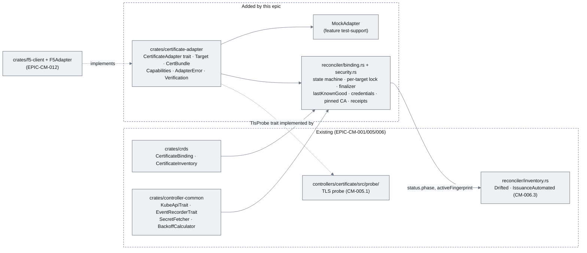
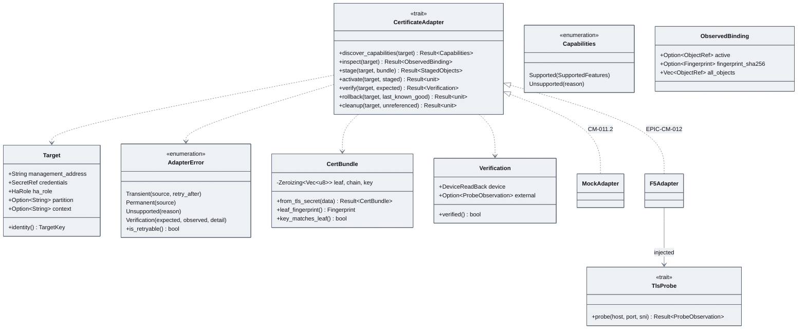
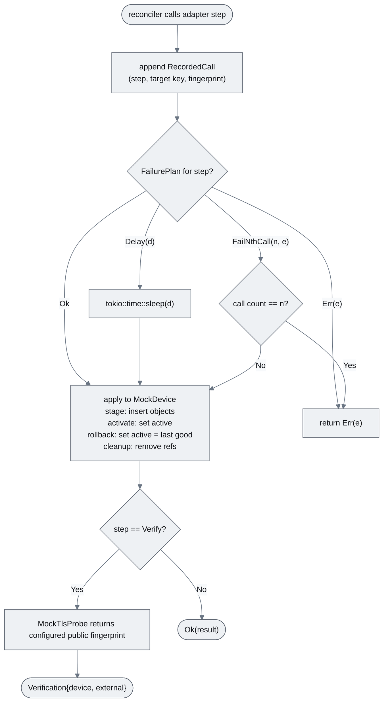
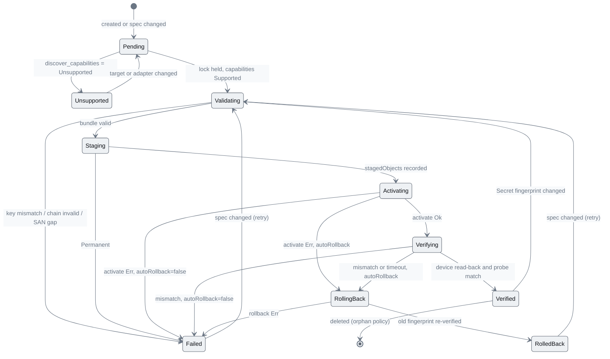
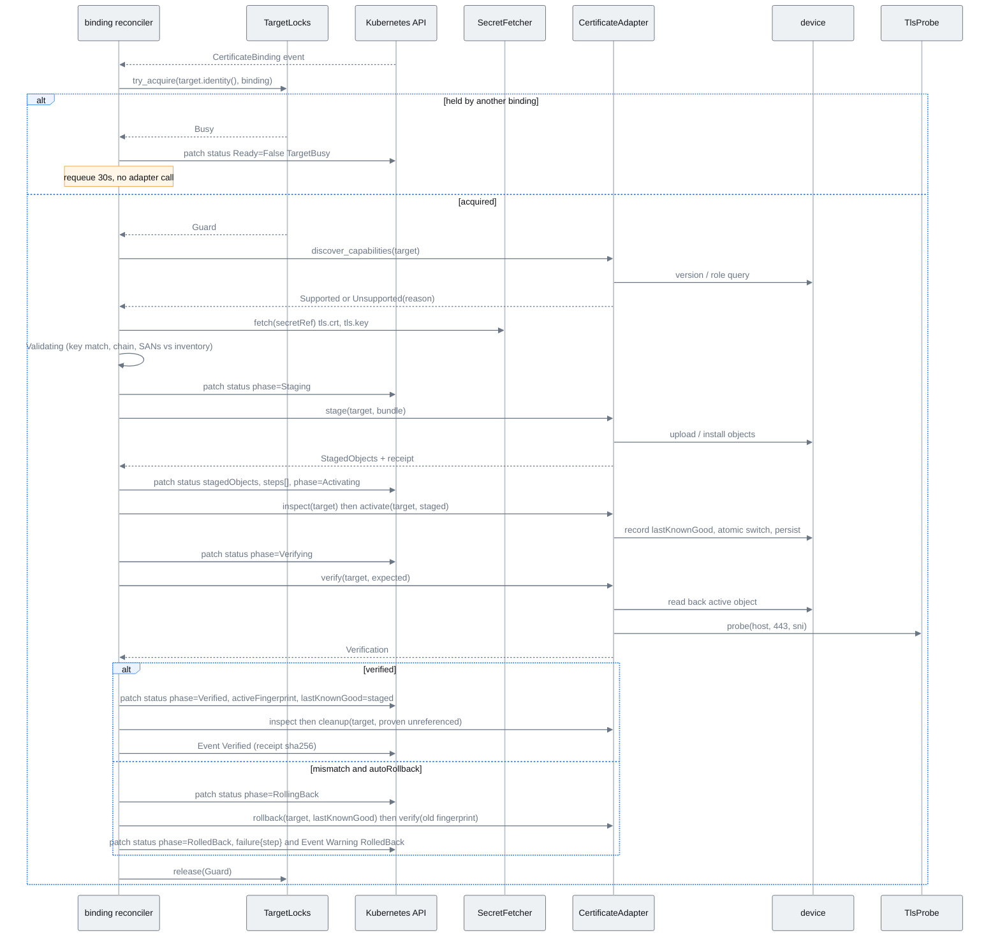
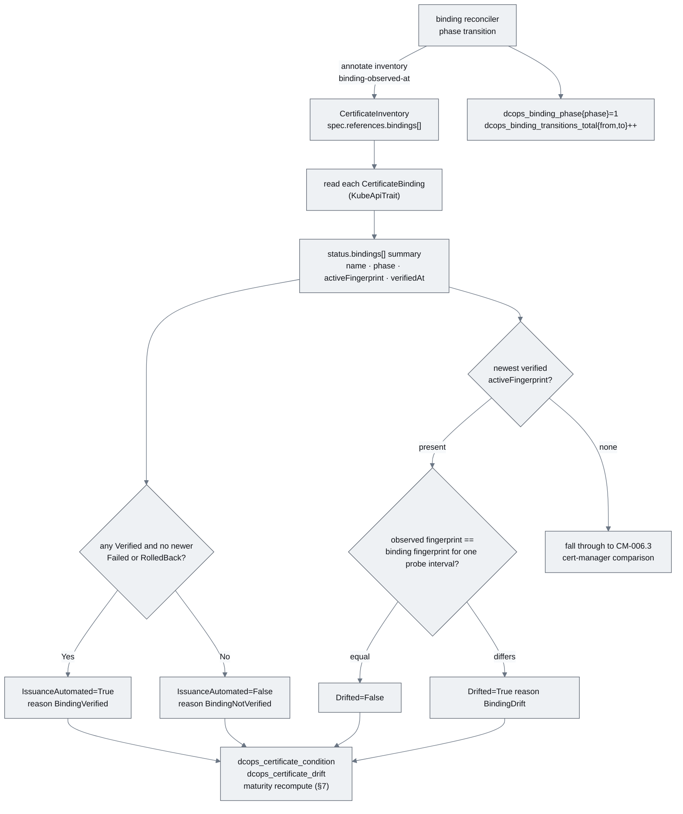
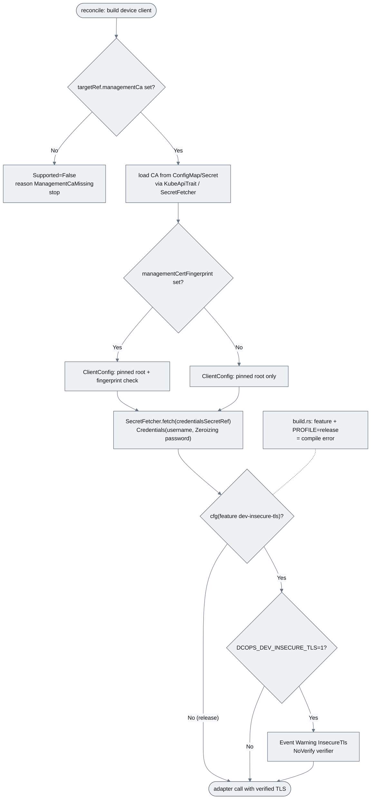

# EPIC-CM-011: CertificateBinding & adapter contract

> **Parent:** [Certificate Management Design](../../CERTIFICATE_MANAGEMENT_DESIGN.md) §9, §5.3 step 5, §11 Phase 4
> **Phase:** 4 — Delivery
> **CMMI level advanced:** Level 5 · Optimising (legacy bucket begins its Level 5 path)
> **Status:** Draft — awaiting implementation
> **Priority:** P1
> **Estimated effort:** 13–17 days
> **Depends on:** EPIC-CM-001 (CRDs incl. `CertificateBinding`, `controller-common` traits, controller binary), EPIC-CM-006 (`Drifted` / `IssuanceAutomated` evaluation that this epic extends; transitively EPIC-CM-005 for the `probe` module reused in verification)

---

## Overview

Everything before this epic observes and alerts. This epic delivers the contract by which DCops *changes* a device: the `CertificateAdapter` trait from design §9, the value types it exchanges, a mock implementation good enough to drive every reconciler path in CI, and the `CertificateBinding` reconciler that walks the README lifecycle — detect → validate → stage → activate → verify → retain → cleanup — as an explicit state machine with rollback. The design's rule is binding here: *unsupported is a valid result, silent fallback is not.* An adapter that cannot do a step says so through `Capabilities::Unsupported(reason)` or `AdapterError::Unsupported`, the reconciler surfaces it as a condition, and no SSH, expect-script or "best effort" path exists anywhere in the controller.

The epic is deliberately vendor-free. `crates/certificate-adapter` has no dependency on any device client; the only implementation shipped here is `MockAdapter`. The F5 iControl REST pilot (EPIC-CM-012) is the first real implementor and is the reason the trait, the error taxonomy and the reconciler's retry/rollback semantics are fixed now, against the mock, rather than discovered against a BIG-IP. The reconciler also closes the loop with the inventory: a `CertificateInventory` that lists a binding in `spec.references.bindings[]` gets `IssuanceAutomated=True` when the binding is `Verified` and has its `Drifted` condition evaluated against the fingerprint the binding actually verified on the device.

Out of scope: any concrete device client (EPIC-CM-012 and later Cisco adapters), UI screens for bindings (a later UI epic; `kubectl get certificatebindings` printer columns from `CM-001.2` are the interface here), Datadog assets for binding failures (`CM-012.5`), and any form of certificate issuance — the binding consumes a cert-manager Secret and nothing else.

## Epic-level diagram

Where the new crate, the reconciler and the mock sit, and which direction dependencies point (flowchart, because the point is that vendor code depends on the contract and never the reverse).

## Stories

| ID | Story | Persona | Effort |
|----|-------|---------|--------|
| **CM-011.1** | As an adapter author, I want the `CertificateAdapter` trait and its value types in a standalone crate so that a vendor adapter can be written and tested without the controller | Developer | 3 d |
| **CM-011.2** | As a controller developer, I want a `MockAdapter` with per-step failure injection and call recording so that every reconciler path, including rollback, is covered in unit tests | Developer | 2 d |
| **CM-011.3** | As a platform operator, I want a `CertificateBinding` reconciler that stages, activates, verifies and, on failure, rolls back a certificate on a device, one binding per target at a time, so that a device is never left in a half-changed state | Operator | 5 d |
| **CM-011.4** | As an Operations manager, I want a verified binding reflected on the inventory record (`IssuanceAutomated`, `Drifted` against the delivered fingerprint) and on the metrics so that the legacy bucket's Level 5 progress is visible where the rest of the estate is | Operations manager | 2 d |
| **CM-011.5** | As a security reviewer, I want device credentials, management-plane trust and audit evidence handled so that no key or password can leak and every device change is attributable to an API receipt | Security reviewer | 2.5 d |

## Definition of Done (epic)

- [ ] Every story's ACs pass
- [ ] `just verify` (fmt, clippy with workspace lints, nextest) is green, including `crates/certificate-adapter` with and without `test-support`
- [ ] `config/crd/all-crds.yaml` regenerated for the additive `CertificateBinding` schema changes (phases, `targetRef` sub-fields, `status.steps[]`) and applied cleanly
- [ ] `README.md` "Certificate management beyond Kubernetes" lifecycle paragraph links to this epic and to the adapter crate README
- [ ] `docs/implementationChecklists/CertificateBinding.md` created from `TEMPLATE.md`
- [ ] `config/examples/certificates/binding-mock.yaml` reaches `phase=Verified` on the shared cluster with the mock adapter; `binding-mock-failing.yaml` reaches `RolledBack`

## Open questions

| ID | Question | Default if unresolved |
|----|----------|----------------------|
| **Q1** | Should the `CertBundle` be handed to the adapter as PEM bytes or as parsed `rustls-pki-types` structs? | PEM bytes in `Zeroizing<Vec<u8>>`; adapters upload PEM verbatim and parsing for validation happens once in the reconciler. |
| **Q2** | Is the per-target lock process-local (one controller replica) or cluster-wide (Lease)? | Process-local. The controller runs one replica (`CM-001.4`); a `Lease` per target is noted as the follow-up if replicas ever exceed one. |
| **Q3** | Does deleting a `CertificateBinding` ever clean up device objects? | No for anything ever activated (orphan policy). Objects staged but never activated MAY be removed on deletion when `spec.policy.cleanupStagedOnDelete=true` (default false). |

---

## CM-011.1 — `crates/certificate-adapter`: trait and value types

**As an** adapter author, **I want** the `CertificateAdapter` trait, its inputs and outputs, and its error taxonomy in a crate with no controller or vendor dependencies **so that** an adapter can be implemented and tested in isolation and the reconciler can treat every vendor identically.

### Description

Adds `crates/certificate-adapter` as a workspace member with `src/{lib.rs, adapter.rs, types.rs, error.rs, bundle.rs, probe.rs}`. `adapter.rs` holds the `CertificateAdapter` trait exactly as design §9 (`#[async_trait]`, `Send + Sync`, seven methods: `discover_capabilities`, `inspect`, `stage`, `activate`, `verify`, `rollback`, `cleanup`). `types.rs` defines `Target` (management address as `host:port`, `credentials: SecretRef{namespace,name}`, `ha_role: HaRole{Active|Standby|Standalone|Unknown}`, `partition: Option<String>`, `context: Option<String>` — the F5 partition or a Cisco VRF/context — and `identity() -> TargetKey`, the normalised key the reconciler locks on), `Capabilities` (`Supported(SupportedFeatures{stage, atomic_activate, persist, ha_sync, read_back, cleanup})` | `Unsupported(reason: String)`), `StagedObjects` (`Vec<ObjectRef{kind, name, partition}>` plus an opaque `receipt_sha256`), `ObservedBinding` (what the device currently references: `active: Option<ObjectRef>`, `fingerprint_sha256: Option<Fingerprint>`, `all_objects: Vec<ObjectRef>`, `ha_role`), `Fingerprint` (32-byte SHA-256 with `Display` as `AB:CD:…`), and `Verification` (`device: DeviceReadBack{references_expected: bool, fingerprint: Option<Fingerprint>}`, `external: Option<ProbeObservation>`, `fn verified(&self) -> bool` = device read-back matches AND, when an external probe was run, the presented leaf fingerprint equals `expected`).

`bundle.rs` defines `CertBundle { leaf: Zeroizing<Vec<u8>>, chain: Vec<Zeroizing<Vec<u8>>>, key: Zeroizing<Vec<u8>> }` with `zeroize` on drop, `Clone` but no `Debug`, `Serialize` or `Display` implementation (a `#[derive(Debug)]` on any type containing a `CertBundle` fails to compile — this is the mechanism that keeps keys out of logs). It also exposes `CertBundle::from_tls_secret(data: &BTreeMap<String, ByteString>)` reading `tls.crt`/`tls.key`/optional `ca.crt` from a cert-manager Secret, `leaf_fingerprint()`, `key_matches_leaf()` and `sans()` using `x509-parser` (already a workspace dependency from `CM-005.1`).

`error.rs` defines `AdapterError { Transient{source, retry_after: Option<Duration>}, Permanent{source}, Unsupported{reason}, Verification{expected, observed: Option<Fingerprint>, detail} }` with `is_retryable()`. `probe.rs` defines the `TlsProbe` trait (`async fn probe(&self, host, port, sni) -> Result<ProbeObservation, ProbeError>`) that adapters receive at construction so that `verify` can run the external check; the controller implements it over its `CM-005.1` `probe` module in `controllers/certificate/src/probe/adapter_probe.rs` (a thin impl, no code move). The crate has a README documenting each method's contract: idempotency (calling `stage` twice with the same bundle yields the same `StagedObjects`), atomicity of `activate`, and the rule that `cleanup` is only ever passed objects the caller has proven unreferenced.

Non-goals: no HTTP client, no vendor types, no Kubernetes types beyond `k8s_openapi::ByteString` for Secret data.

### Diagrams

Trait surface and value types (classDiagram, because the deliverable is a set of Rust traits, structs and enums).

### Functional requirements

| ID | Requirement |
|----|-------------|
| **FR-011.1-01** | MUST add `crates/certificate-adapter` to the workspace with the `CertificateAdapter` trait whose seven method signatures match design §9 verbatim (names, argument order, return types) |
| **FR-011.1-02** | MUST define `Capabilities` as an enum with `Supported(SupportedFeatures)` and `Unsupported(reason: String)`; `SupportedFeatures` MUST carry booleans `stage`, `atomic_activate`, `persist`, `ha_sync`, `read_back`, `cleanup` |
| **FR-011.1-03** | MUST define `AdapterError` with exactly the variants `Transient`, `Permanent`, `Unsupported`, `Verification` and an `is_retryable()` returning true only for `Transient` |
| **FR-011.1-04** | MUST define `Target` with management address, credentials `SecretRef`, `HaRole`, optional partition and optional context, and `identity()` returning a normalised `TargetKey` (lower-cased host, explicit port, partition) that is equal for two `Target`s naming the same device and partition |
| **FR-011.1-05** | MUST define `CertBundle` holding leaf, chain and key in `Zeroizing` buffers, implementing `Drop` via `zeroize`, and MUST NOT implement `Debug`, `Display`, `Serialize` or `Deserialize` |
| **FR-011.1-06** | MUST provide `CertBundle::from_tls_secret` accepting cert-manager's `tls.crt`/`tls.key`/`ca.crt` layout, `leaf_fingerprint()`, `key_matches_leaf()` (RSA and ECDSA public-key comparison) and `sans()` |
| **FR-011.1-07** | MUST define `StagedObjects`, `ObjectRef`, `ObservedBinding`, `Fingerprint` and `Verification` as `Clone + Debug + PartialEq + Serialize + Deserialize` so they can be persisted in `CertificateBinding.status` |
| **FR-011.1-08** | MUST define `Verification::verified()` as device read-back references the expected objects AND (when `external` is present) the probed leaf fingerprint equals the expected fingerprint |
| **FR-011.1-09** | MUST define the `TlsProbe` trait in the crate and implement it in `controllers/certificate/src/probe/adapter_probe.rs` over the `CM-005.1` probe function |

### Non-functional requirements

| ID | Category | Requirement |
|----|----------|-------------|
| **NFR-011.1-01** | Security | Key material never appears in status, Events, logs or metrics: `CertBundle` cannot be formatted or serialised; `Fingerprint` and `ObjectRef` are the only certificate-derived values that cross into status |
| **NFR-011.1-02** | Security | `CertBundle` buffers are zeroed on drop (verified by a test reading the freed allocation through a custom allocator shim in `bundle_test`) |
| **NFR-011.1-03** | Compatibility | The crate compiles under workspace lints (`unwrap_used = deny`, `missing_docs = warn`, `unsafe_code = forbid`) with edition 2024 and depends only on `async-trait`, `zeroize`, `x509-parser`, `sha2`, `serde`, `thiserror`, `k8s-openapi` |
| **NFR-011.1-04** | Compatibility | `cargo tree -p certificate-adapter` contains neither `kube` nor `reqwest` |

### Acceptance criteria

| ID | Given / When / Then |
|----|---------------------|
| **AC-011.1-01** | **Given** the crate **When** a reviewer diffs `adapter.rs` against design §9 **Then** the seven signatures are identical apart from doc comments, `Capabilities` has exactly the two variants, and every status-bound type derives `Serialize`/`Deserialize` |
| **AC-011.1-02** | **Given** a struct `struct Holder(CertBundle)` annotated `#[derive(Debug)]` in a `trybuild` compile-fail test **When** compiled **Then** compilation fails |
| **AC-011.1-03** | **Given** a cert-manager Secret with matching `tls.crt`/`tls.key` **When** `from_tls_secret` then `key_matches_leaf` run **Then** the result is `true`; **Given** a key from a different pair **Then** `false` |
| **AC-011.1-04** | **Given** two `Target`s `F5.Example.COM:443/Common` and `f5.example.com:443/Common` **When** `identity()` is compared **Then** they are equal |
| **AC-011.1-05** | **Given** `Verification{device.references_expected=true, external=Some(probe with different fingerprint)}` **When** `verified()` is called **Then** it returns `false` |
| **AC-011.1-06** | **Given** `AdapterError::Unsupported` **When** `is_retryable()` is called **Then** `false`; **Given** `Transient` **Then** `true` |

### Unit test criteria

| ID | Test | Covers |
|----|------|--------|
| **UT-011.1-01** | `adapter_test::trait_is_object_safe_and_send_sync` — `Box<dyn CertificateAdapter>` compiles and is `Send + Sync` | FR-011.1-01 |
| **UT-011.1-02** | `bundle_test::from_tls_secret_and_key_match` — RSA and ECDSA fixtures from `tests/fixtures/` (generated by `rcgen` at test time, never committed keys) | FR-011.1-06, AC-011.1-03 |
| **UT-011.1-03** | `bundle_test::zeroized_on_drop` — allocator shim asserts the key buffer is all zeros after drop | NFR-011.1-02 |
| **UT-011.1-04** | `tests/compile_fail/bundle_debug.rs` via `trybuild` — deriving `Debug` on a holder fails | FR-011.1-05, AC-011.1-02, NFR-011.1-01 |
| **UT-011.1-05** | `types_test::target_identity_normalises` | FR-011.1-04, AC-011.1-04 |
| **UT-011.1-06** | `types_test::verification_requires_both_checks` | FR-011.1-08, AC-011.1-05 |
| **UT-011.1-07** | `error_test::retryable_matrix` | FR-011.1-03, AC-011.1-06 |
| **UT-011.1-08** | `types_test::status_types_roundtrip_json` — `StagedObjects`, `ObservedBinding`, `Verification` serde round-trip | FR-011.1-07, AC-011.1-01 |
| **UT-011.1-09** | `types_test::capabilities_unsupported_carries_reason` | FR-011.1-02, AC-011.1-01 |
| **UT-011.1-10** | `controllers/certificate` `probe::adapter_probe_test::implements_tls_probe` — wraps the CM-005.1 probe against an in-process rustls listener | FR-011.1-09, AC-011.3-01 |

### Integration test criteria

| ID | Test | Environment | Covers |
|----|------|-------------|--------|
| **IT-011.1-01** | None. (Pure library; exercised end-to-end by IT-011.3-01.) | — | — |

### QA process

1. `cargo nextest run -p certificate-adapter` and `cargo nextest run -p certificate-adapter --features test-support`; both green. `cargo tree -p certificate-adapter | grep -cE "^.*(kube|reqwest) "` — expect `0`.
2. Open `src/adapter.rs` next to design §9; tick each signature.
3. Run `cargo doc -p certificate-adapter --no-deps` and confirm no `missing_docs` warnings; open the README and confirm the three contracts are stated.
4. Negative path: add `#[derive(Debug)]` to a scratch struct wrapping `CertBundle`; confirm the compile error names the missing `Debug` impl; revert. Corrupt `tls.key` in a fixture; confirm `key_matches_leaf` is false, not a panic.
5. Attach: nextest summary, `cargo tree` output, compile-fail test output.

---

## CM-011.2 — `MockAdapter` with failure injection and call recording

**As a** controller developer, **I want** a `MockAdapter` behind a `test-support` feature that can be told to fail, hang or report `Unsupported` at any single step and that records every call **so that** the reconciler's happy path, every rollback path and its idempotency after restart can be asserted without a device.

### Description

Adds `crates/certificate-adapter/src/mock.rs` (feature `test-support`) with `MockAdapter::builder()` accepting a `MockDevice` (an in-memory model: a map of `ObjectRef → fingerprint`, an `active: Option<ObjectRef>`, an `ha_role`, a `persisted: bool` flag) and a `FailurePlan` — per step (`DiscoverCapabilities | Inspect | Stage | Activate | Verify | Rollback | Cleanup`) one of `Ok`, `Err(AdapterError)`, `Delay(Duration)` or `FailNthCall(n, AdapterError)`. Every call is appended to `calls: Arc<Mutex<Vec<RecordedCall>>>` (step, target identity, argument summary — fingerprints and object names only, never bundle bytes) so tests can assert order and count. `activate` on the mock flips `active` atomically; `verify` reads `active` back and, through an injected `MockTlsProbe`, returns whichever fingerprint the test configured the "public endpoint" to present, which is how verify-mismatch scenarios are built. `stage` is idempotent: staging the same fingerprint twice returns the same `StagedObjects` and records both calls.

`MockAdapter` is also usable at runtime: `spec.adapter: mock` in a `CertificateBinding` selects it (feature `test-support` is enabled in the dev image only, `CM-001.5` `.dev` Dockerfile), which is what makes the in-cluster integration tests and the QA process on the shared cluster possible without hardware. The mock device state lives in the controller process; a `MockDevice` seeded from `spec.targetRef.context` (e.g. `context: "scenario=verify-fails"`) drives the negative examples in `config/examples/certificates/`.

Non-goals: no HTTP surface, no persistence across controller restarts (restart scenarios use the reconciler's status, exactly as with a real device whose state is re-read via `inspect`).

### Diagrams

How a failure plan steers one adapter call (flowchart, because the mock is decision logic).

### Functional requirements

| ID | Requirement |
|----|-------------|
| **FR-011.2-01** | MUST provide `MockAdapter` implementing `CertificateAdapter`, compiled only with feature `test-support` |
| **FR-011.2-02** | MUST accept a `FailurePlan` mapping each of the seven steps to `Ok`, `Err(AdapterError)`, `Delay(Duration)` or `FailNthCall(n, AdapterError)` |
| **FR-011.2-03** | MUST record every call (step, `TargetKey`, argument summary) in order and expose `calls()` and `calls_for(step)` |
| **FR-011.2-04** | MUST model device state (`objects`, `active`, `ha_role`, `persisted`) so that `inspect` and `verify` read back what `stage`, `activate`, `rollback` and `cleanup` changed |
| **FR-011.2-05** | MUST make `stage` idempotent by fingerprint and `activate` atomic (state is either the previous or the new active object, never neither) |
| **FR-011.2-06** | MUST accept an injected `MockTlsProbe` whose presented fingerprint is independently configurable, so device read-back and external probe can disagree |
| **FR-011.2-07** | MUST be selectable at runtime by `spec.adapter: mock` when the controller is built with `test-support`, seeded by a scenario string in `spec.targetRef.context`; in a build without `test-support` the registry MUST return `AdapterError::Unsupported("mock adapter not compiled in")` |

### Non-functional requirements

| ID | Category | Requirement |
|----|----------|-------------|
| **NFR-011.2-01** | Security | Recorded calls store fingerprints and object names only; the `RecordedCall` type has no field capable of holding bundle bytes |
| **NFR-011.2-02** | Reliability | All mock state is behind `Arc<Mutex<_>>` with no `await` while locked, so concurrent reconciles in tests cannot deadlock |
| **NFR-011.2-03** | Performance | A full seven-step happy path against the mock completes in < 5 ms without `Delay` |
| **NFR-011.2-04** | Compatibility | The release image (`Dockerfile.certificate-controller`) is built without `test-support`; CI asserts the release binary does not contain the string `mock adapter` scenario table |

### Acceptance criteria

| ID | Given / When / Then |
|----|---------------------|
| **AC-011.2-01** | **Given** a `FailurePlan` with `Activate → Err(Transient)` **When** the reconciler runs a binding **Then** `calls()` shows `Stage` once, `Activate` once, `Rollback` once, and the mock's `active` equals the pre-existing object |
| **AC-011.2-02** | **Given** `FailNthCall(2, Permanent)` on `Stage` **When** `stage` is called twice with the same bundle **Then** the first returns `StagedObjects`, the second returns `Err(Permanent)`, and both calls are recorded |
| **AC-011.2-03** | **Given** `MockTlsProbe` configured to present fingerprint X while the device active object has fingerprint Y **When** `verify(expected=Y)` runs **Then** `Verification.verified()` is `false` and `device.references_expected` is `true` |
| **AC-011.2-04** | **Given** the release image **When** a binding with `spec.adapter: mock` is applied **Then** the binding gets condition `Supported=False` reason `Unsupported` with message `mock adapter not compiled in` and no other step runs |
| **AC-011.2-05** | **Given** the dev image and `config/examples/certificates/binding-mock.yaml` **When** applied **Then** the binding reaches `phase=Verified` |

### Unit test criteria

| ID | Test | Covers |
|----|------|--------|
| **UT-011.2-01** | `mock_test::records_calls_in_order` — builder behind `test-support` | FR-011.2-01/03, AC-011.2-01 |
| **UT-011.2-02** | `mock_test::failure_plan_variants` — each of `Ok`, `Err`, `Delay`, `FailNthCall` for each step (table-driven) | FR-011.2-02, AC-011.2-02 |
| **UT-011.2-03** | `mock_test::activate_is_atomic_rollback_restores_stage_idempotent` | FR-011.2-04/05, AC-011.2-01 |
| **UT-011.2-04** | `mock_test::probe_and_device_can_disagree` using `MockTlsProbe` | FR-011.2-06, AC-011.2-03 |
| **UT-011.2-05** | `controllers/certificate` `adapter_registry_test::mock_selected_only_with_feature` — compiled twice via `cfg` (with/without `test-support`) | FR-011.2-07, AC-011.2-04 |
| **UT-011.2-06** | `mock_test::recorded_call_cannot_hold_bundle` — compile-time: `RecordedCall` fields are `String`/`Fingerprint`/`ObjectRef` only (asserted with a `static_assertions` type check) | NFR-011.2-01 |

### Integration test criteria

| ID | Test | Environment | Covers |
|----|------|-------------|--------|
| **IT-011.2-01** | `tests/binding_mock_scenarios.rs` (feature `integration`) — applies the `binding-mock*.yaml` examples to the Tilt cluster running the dev image and asserts the terminal phase per scenario | kind/k3s via Tilt | FR-011.2-07, AC-011.2-05 |

### QA process

1. `just dev-up`; confirm the Tilt image is the `.dev` build (`kubectl -n dcops-system get deploy certificate-controller -o jsonpath='{.spec.template.spec.containers[0].image}'`).
2. `just cert-examples`; `kubectl get certificatebindings -A -w` until `binding-mock` shows `Phase=Verified`.
3. Apply `binding-mock-verify-fails.yaml` (`context: "scenario=verify-fails"`); observe `Phase=RolledBack` and the `RolledBack` Warning Event.
4. Apply `binding-mock-standby.yaml` (`scenario=standby`); observe `Supported=False` reason `Unsupported`, phase stays `Pending`.
5. Negative path: build the release image locally (`just cert-controller-build`), deploy it, re-apply `binding-mock.yaml`; observe `Supported=False` with `mock adapter not compiled in`; redeploy the dev image.
6. Attach: `kubectl get certificatebindings -o yaml` for each scenario, `kubectl get events --field-selector involvedObject.kind=CertificateBinding`, nextest report for the crate with `--features test-support`.

---

## CM-011.3 — Binding reconciler state machine

**As a** platform operator, **I want** `reconciler/binding.rs` to take a `CertificateBinding` from `Pending` through validation, staging, activation and verification to `Verified`, rolling back to the last known good configuration when any step after activation fails, holding exactly one in-flight binding per target and never deleting live device references **so that** a device never ends up in a half-changed state and every change is either verified or undone.

### Description

Replaces the `CM-001.4` stub in `controllers/certificate/src/reconciler/binding.rs`. On each reconcile the reconciler (1) acquires the per-target lock from `reconciler/target_lock.rs` (`TargetLocks: Arc<Mutex<HashMap<TargetKey, BindingRef>>>`; if another binding holds the key it sets condition `Ready=False` reason `TargetBusy` and requeues in 30 s without any adapter call); (2) resolves the adapter from `spec.adapter` via `adapter_registry.rs`; (3) calls `discover_capabilities` and, on `Unsupported`, sets `Supported=False` and stops — no fallback; (4) fetches the cert-manager Secret named by `spec.secretRef` in memory, builds a `CertBundle`, and in **Validating** checks key/cert match, chain order and validity, and that the leaf SANs cover every `spec.endpoints[].host` of the linked `CertificateInventory` (`spec.targetRef.inventoryRef`); (5) **Staging** calls `stage` and persists `status.stagedObjects` and the receipt hash; (6) **Activating** calls `inspect` to capture the current active object as `status.lastKnownGood` (only if not already set for this target) then `activate`; (7) **Verifying** calls `verify(expected = leaf fingerprint)`, whose adapter implementation runs both the device read-back and the external probe via `TlsProbe`, with `spec.policy.verifyTimeout` as the deadline; (8) on success **Verified**: `status.activeFingerprint` is set, `lastKnownGood` is replaced by the new objects (retain), and the previous objects are passed to `cleanup` only after a fresh `inspect` proves nothing references them; (9) on failure in Activating or Verifying with `spec.policy.autoRollback=true` (default) the reconciler enters **RollingBack**, calls `rollback(lastKnownGood)`, re-verifies the *old* fingerprint, and lands in **RolledBack**; if rollback itself fails, or `autoRollback=false`, the phase is **Failed** with the failing step in `status.failure{step, error, at}` and the device left as observed. Transient errors before activation retry with `BackoffCalculator` (1 min → 30 min) without changing phase.

Every phase entry writes `status.phase`, `status.observedGeneration` and appends `status.steps[]{step, at, receiptSha256, outcome}` before the next adapter call, so a controller restart mid-phase resumes from status: the reconciler always begins with `inspect`, compares the device's active object with `stagedObjects`/`lastKnownGood`, and skips steps already reflected on the device. A finalizer `dcops.microscaler.io/binding` implements the orphan policy: on deletion the reconciler removes the finalizer after emitting an `Orphaned` Event listing the device objects it leaves behind; it never calls `rollback` or `cleanup` on a binding that has ever reached Activating. Spec changes (a renewed Secret produces a new leaf fingerprint) re-enter the machine at Validating; a binding whose Secret fingerprint equals `status.activeFingerprint` is a no-op that re-verifies at `spec.policy.reverifyInterval` (default 6h).

Non-goals: no device client; no parallelism across bindings to the same target; no UI.

### Diagrams

Binding phases including rollback (stateDiagram-v2, because the phase field is the contract EPIC-CM-012 and the UI inherit; self-loops for `TargetBusy` requeue, transient backoff and periodic re-verify are omitted).

One full reconcile with the per-target lock and rollback branch (sequenceDiagram, because call ordering across lock, Secret, adapter and status is where bugs live).

### Functional requirements

| ID | Requirement |
|----|-------------|
| **FR-011.3-01** | MUST implement phases `Pending`, `Validating`, `Staging`, `Activating`, `Verifying`, `RollingBack`, `Verified`, `RolledBack`, `Failed`, `Unsupported` in `status.phase`, transitioning only along the edges in the state diagram |
| **FR-011.3-02** | MUST acquire a per-target lock keyed by `Target::identity()` before any adapter call and release it at the end of the reconcile; a second binding for the same key MUST get `Ready=False` reason `TargetBusy` and a 30 s requeue |
| **FR-011.3-03** | MUST call `discover_capabilities` first on every reconcile and, on `Unsupported(reason)`, set condition `Supported=False` reason `Unsupported` message `reason`, phase `Unsupported`, and perform no other adapter call |
| **FR-011.3-04** | MUST validate in `Validating`: private key matches leaf public key; chain is ordered leaf→intermediates and every certificate is within validity; leaf SANs cover every host of every `spec.endpoints[]` on the inventory named by `spec.targetRef.inventoryRef`; failure sets `Validated=False` with a reason from `{KeyMismatch, ChainInvalid, SanMismatch, SecretMissing}` and phase `Failed` |
| **FR-011.3-05** | MUST persist `status.stagedObjects` and append `status.steps[]` before entering `Activating` |
| **FR-011.3-06** | MUST capture `status.lastKnownGood` from `inspect` immediately before the first `activate` for a target and MUST NOT overwrite it until a new fingerprint is `Verified` |
| **FR-011.3-07** | MUST call `verify` with the leaf fingerprint and a deadline of `spec.policy.verifyTimeout` (default 60 s); `Verified` requires `Verification::verified() == true` |
| **FR-011.3-08** | MUST, when `spec.policy.autoRollback` is true (default) and `Activating` or `Verifying` fails, call `rollback(lastKnownGood)`, re-verify the last-known-good fingerprint, and set phase `RolledBack` with `status.failure{step, error, at}`; when rollback fails, phase `Failed` reason `RollbackFailed` |
| **FR-011.3-09** | MUST call `cleanup` only with objects that a fresh `inspect` (after `Verified`) shows are not the active object and are not in `lastKnownGood`; `spec.policy.retainPrevious` (default true) MUST additionally keep the previous chain |
| **FR-011.3-10** | MUST resume after restart: on every reconcile compare `inspect` with `status.stagedObjects` / `status.lastKnownGood` / `status.activeFingerprint` and skip steps already reflected on the device; `stage` and `activate` MUST be safe to repeat |
| **FR-011.3-11** | MUST add finalizer `dcops.microscaler.io/binding` and, on deletion, emit a `Normal` Event `Orphaned` naming the device objects left in place, then remove the finalizer; MUST NOT call `rollback` or `cleanup` on deletion of a binding that reached `Activating` |
| **FR-011.3-12** | MUST retry `AdapterError::Transient` with `BackoffCalculator` (min 1 min, max 30 min) without changing phase; `Permanent` before `Activating` MUST set `Failed` |
| **FR-011.3-13** | MUST re-enter `Validating` when the Secret's leaf fingerprint differs from `status.activeFingerprint`, and MUST re-verify a `Verified` binding every `spec.policy.reverifyInterval` (default 6h) |
| **FR-011.3-14** | MUST emit Events on every phase transition (`Normal` for Verified/Orphaned/Staged, `Warning` for RolledBack/Failed/Unsupported/TargetBusy after 10 consecutive requeues) |

### Non-functional requirements

| ID | Category | Requirement |
|----|----------|-------------|
| **NFR-011.3-01** | Security | Key material never appears in status, Events, logs or metrics; the `CertBundle` lives only in the reconcile future's stack and is dropped before any status patch |
| **NFR-011.3-02** | Reliability / Idempotency | Every step is idempotent and the machine is resumable: killing the controller at any point between `Staging` and `Verified` and restarting converges to `Verified` or `RolledBack` with no duplicate device objects; a `Verified` binding with an unchanged Secret never calls `stage` or `activate` again |
| **NFR-011.3-03** | Reliability | The lock is released on every exit path, including panic in the reconcile future (guard `Drop`) |
| **NFR-011.3-04** | Performance | One binding from `Pending` to `Verified` against `MockAdapter` completes in < 2 s; against a device the budget is < 2 min end-to-end (measured in EPIC-CM-012 on the VE lab) |
| **NFR-011.3-05** | Observability | Every adapter call is a tracing span with `binding`, `target`, `step`, `attempt` fields and its outcome; receipts hashes are logged, receipt bodies are not |

### Acceptance criteria

| ID | Given / When / Then |
|----|---------------------|
| **AC-011.3-01** | **Given** a valid binding and a `MockAdapter` with an all-`Ok` plan **When** reconciled **Then** the phase sequence recorded in `status.steps[]` is Validating, Staging, Activating, Verifying, Verified and `status.activeFingerprint` equals the Secret leaf fingerprint |
| **AC-011.3-02** | **Given** the mock returns `Verification` with a probe mismatch **When** reconciled **Then** phase is `RolledBack`, `status.failure.step` is `Verifying`, the mock's active object equals the pre-binding object, and a `Warning` Event `RolledBack` exists |
| **AC-011.3-03** | **Given** two bindings naming the same management address and partition **When** both are reconciled concurrently **Then** exactly one performs adapter calls and the other carries `Ready=False` reason `TargetBusy` until the first releases |
| **AC-011.3-04** | **Given** the mock returns `Unsupported("standby")` from `discover_capabilities` **When** reconciled **Then** phase is `Unsupported`, condition `Supported=False` message `standby`, and `calls()` contains only `DiscoverCapabilities` |
| **AC-011.3-05** | **Given** a Secret whose `tls.key` does not match `tls.crt` **When** reconciled **Then** phase `Failed`, `Validated=False` reason `KeyMismatch`, and no `stage` call |
| **AC-011.3-06** | **Given** a binding killed after `activate` returned but before the `Verifying` status patch **When** the controller restarts **Then** `inspect` shows the new object active, the reconciler resumes at `Verifying` without a second `activate`, and reaches `Verified` |
| **AC-011.3-07** | **Given** a `Verified` binding **When** it is deleted **Then** an `Orphaned` Event names the active object, the finalizer is removed, and the mock's device state is unchanged |
| **AC-011.3-08** | **Given** a `Verified` binding with `retainPrevious=true` and three generations of objects on the device **When** reconciled **Then** `cleanup` is called only with the oldest generation |
| **AC-011.3-09** | **Given** `autoRollback=false` and a verify mismatch **When** reconciled **Then** phase `Failed`, no `rollback` call, and the Event message states the device was left with the new object active |
| **AC-011.3-10** | **Given** `stage` returns `Transient` twice then `Ok` **When** reconciled across three attempts **Then** phase stays `Staging` during retries and the requeue delays follow `BackoffCalculator` |

### Unit test criteria

| ID | Test | Covers |
|----|------|--------|
| **UT-011.3-01** | `reconciler::binding_test::happy_path_reaches_verified` — `MockKubeApi`, `MockEventRecorder`, `MockSecretFetcher`, `MockAdapter`; asserts status patches in order | FR-011.3-01/05/06/07, AC-011.3-01 |
| **UT-011.3-02** | `reconciler::binding_test::verify_mismatch_rolls_back` and `rollback_failure_is_failed_rollbackfailed` | FR-011.3-08, AC-011.3-02 |
| **UT-011.3-03** | `reconciler::target_lock_test::second_binding_is_busy` — two reconciles on a `tokio::join!` | FR-011.3-02, AC-011.3-03, NFR-011.3-03 |
| **UT-011.3-04** | `reconciler::binding_test::unsupported_stops_before_any_step` | FR-011.3-03, AC-011.3-04 |
| **UT-011.3-05** | `reconciler::binding_test::validation_matrix` — KeyMismatch, ChainInvalid, SanMismatch, SecretMissing via `MockSecretFetcher` | FR-011.3-04, AC-011.3-05 |
| **UT-011.3-06** | `reconciler::binding_test::resume_after_restart_mid_activating` — pre-seeded status + mock device with new object active; asserts no second `activate` | FR-011.3-10, AC-011.3-06, NFR-011.3-02 |
| **UT-011.3-07** | `reconciler::binding_test::delete_orphans_device_objects` | FR-011.3-11, AC-011.3-07 |
| **UT-011.3-08** | `reconciler::binding_test::cleanup_only_unreferenced` | FR-011.3-09, AC-011.3-08 |
| **UT-011.3-09** | `reconciler::binding_test::auto_rollback_false_leaves_failed` | FR-011.3-08, AC-011.3-09 |
| **UT-011.3-10** | `reconciler::binding_test::transient_retries_with_backoff` | FR-011.3-12, AC-011.3-10 |
| **UT-011.3-11** | `reconciler::binding_test::verified_noop_and_reverify_interval` | FR-011.3-13, NFR-011.3-02 |
| **UT-011.3-12** | `reconciler::binding_test::events_per_transition` — `MockEventRecorder` asserts type and reason per edge | FR-011.3-14, AC-011.3-02 |
| **UT-011.3-13** | `reconciler::binding_test::no_key_material_in_patches_or_events` — greps every `MockKubeApi` patch body and `MockEventRecorder` message for the fixture key bytes | NFR-011.3-01 |

### Integration test criteria

| ID | Test | Environment | Covers |
|----|------|-------------|--------|
| **IT-011.3-01** | `tests/binding_lifecycle.rs` (feature `integration`) — creates a cert-manager-shaped Secret with `rcgen`, applies `binding-mock.yaml`, waits for `Verified`, rotates the Secret, waits for a second `Verified` with the new fingerprint | kind/k3s via Tilt (dev image) | FR-011.3-01/13, AC-011.3-01 |
| **IT-011.3-02** | `tests/binding_restart.rs` — applies `binding-mock-slow-activate.yaml` (`Delay` on activate), `kubectl delete pod` during Activating, asserts convergence to `Verified` and exactly one `Activated` step in `status.steps[]` | kind/k3s via Tilt | FR-011.3-10, AC-011.3-06 |
| **IT-011.3-03** | `tests/binding_lock.rs` — two bindings, same target; asserts `TargetBusy` on one then both `Verified` | kind/k3s via Tilt | FR-011.3-02, AC-011.3-03 |

### QA process

1. `just dev-up && just cert-examples` (`inventory-legacy.yaml` lists `references.bindings: [binding-mock]`, `binding-mock.yaml` references it back via `targetRef.inventoryRef`). `kubectl get certificatebindings -w`; capture the phase progression to `Verified`; `kubectl get certificatebinding binding-mock -o yaml` — confirm `status.steps[]` has five entries with `receiptSha256` values and `status.lastKnownGood` is set.
2. Rotate the Secret (`kubectl create secret tls … --dry-run=client -o yaml | kubectl apply -f -` with a fresh `rcgen` pair); watch the binding re-enter `Validating` and reach `Verified` with a new `activeFingerprint`; confirm the previous objects appear in `lastKnownGood` and only the generation before that was cleaned up.
3. Negative path — verification fails: apply `binding-mock-verify-fails.yaml`; observe `RolledBack`, `status.failure.step=Verifying`, and the `Warning` Event `RolledBack` with a receipt hash.
4. Negative path — standby device: apply `binding-mock-standby.yaml`; observe `Unsupported` and `Supported=False`; confirm no `Staged` Event was emitted.
5. Negative path — controller restart mid-Activating: apply `binding-mock-slow-activate.yaml`, `kubectl -n dcops-system delete pod -l app=certificate-controller` while `Phase=Activating`; after restart confirm `Verified` and exactly one `Activated` step.
6. Negative path — lock: apply `binding-mock-second.yaml` targeting the same address; observe `TargetBusy` on one, then both `Verified`.
7. Delete `binding-mock`; confirm the `Orphaned` Event and that the binding is gone within 10 s.
8. Attach: watch output, full `-o yaml` per scenario, Events listing, controller log excerpt showing the span fields (and no PEM), nextest report.

---

## CM-011.4 — Binding ↔ Inventory linkage and metrics

**As an** Operations manager, **I want** a verified binding to flip the inventory record's `IssuanceAutomated` condition, have `Drifted` compare the live endpoint against the fingerprint the binding actually verified, and see binding phases on the metrics **so that** a legacy device delivered by DCops is measured on the same maturity scale as a cert-manager workload.

### Description

Extends the inventory reconciler from `CM-006.3` (`reconciler/inventory.rs`, evaluation step) with a `bindings` resolution step: for each name in `spec.references.bindings[]` (human-owned, set by Git or the UI — the reconciler never writes spec) it reads the `CertificateBinding` via `KubeApiTrait` and summarises it into `status.bindings[]{name, phase, activeFingerprint, verifiedAt}`. `IssuanceAutomated=True` reason `BindingVerified` when at least one binding is `Verified` and none is `Failed`/`RolledBack` newer than the last `Verified`; `Drifted` for a record with bindings compares `status.observed.fingerprintSha256` against the newest verified binding's `activeFingerprint` (instead of a cert-manager Secret fingerprint) after one probe interval, mirroring the `CM-006.3` rule. A binding referencing an inventory that does not list it back gets condition `Linked=False` reason `NotReferenced` (still reconciles — the link is advisory for maturity, not a gate). The binding reconciler triggers an inventory reconcile on every phase transition by touching the annotation `dcops.microscaler.io/binding-observed-at` — a status-only relationship would otherwise wait a full probe interval.

`metrics.rs` gains `dcops_binding_phase{name, namespace, adapter, target, phase}` (gauge 0/1, one series per phase, exactly one is 1) and `dcops_binding_transitions_total{name, namespace, adapter, from, to}` (counter). Series are removed when the binding is deleted (`CM-007.2` lifecycle helper). `dcops_certificate_condition{condition="IssuanceAutomated"}` and `dcops_certificate_drift` from `CM-007.1` reflect the new sources automatically.

Non-goals: no UI; no rollup of binding health into maturity beyond what §7 already derives from `IssuanceAutomated` and `Drifted`.

### Diagrams

How binding status flows into inventory conditions and metrics (flowchart, because it is evaluation logic layered on `CM-006.3`).

### Functional requirements

| ID | Requirement |
|----|-------------|
| **FR-011.4-01** | MUST resolve every name in `spec.references.bindings[]` and write `status.bindings[]{name, phase, activeFingerprint, verifiedAt}` on the inventory; a missing binding yields an entry with `phase: Missing` |
| **FR-011.4-02** | MUST set `IssuanceAutomated=True` reason `BindingVerified` when at least one binding is `Verified` and no binding has a `Failed`/`RolledBack` transition newer than that `verifiedAt`; otherwise `False` reason `BindingNotVerified` (cert-manager-derived `True` from `CM-006.3` still applies for fast-track records) |
| **FR-011.4-03** | MUST evaluate `Drifted` for records with a verified binding by comparing `status.observed.fingerprintSha256` to the newest verified binding's `activeFingerprint`, applying the same one-probe-interval grace as `CM-006.3`, reason `BindingDrift` |
| **FR-011.4-04** | MUST set `Linked=False` reason `NotReferenced` on a binding whose inventory does not list it in `references.bindings[]`, without blocking the binding's own state machine |
| **FR-011.4-05** | MUST trigger an inventory reconcile on every binding phase transition by patching annotation `dcops.microscaler.io/binding-observed-at` (metadata only; spec untouched) |
| **FR-011.4-06** | MUST export `dcops_binding_phase{name,namespace,adapter,target,phase}` with exactly one series at 1 per binding and `dcops_binding_transitions_total{name,namespace,adapter,from,to}`; MUST remove all series on binding deletion |
| **FR-011.4-07** | MUST emit inventory Events `IssuanceAutomated` (Normal) and `Drifted` reason `BindingDrift` (Warning) on transition, using the existing `CM-005.2` transition semantics |

### Non-functional requirements

| ID | Category | Requirement |
|----|----------|-------------|
| **NFR-011.4-01** | Security | Only fingerprints, names and phases cross from binding to inventory; no receipt bodies, credentials or key material appear in `status.bindings[]`, Events, logs or metrics |
| **NFR-011.4-02** | Observability | The `target` label is the management host (no port, no credentials); cardinality is bounded by binding count (expected < 200 in the pilot) |
| **NFR-011.4-03** | Performance | Resolving up to 5 bindings per inventory adds < 50 ms to the inventory reconcile (cached list from the `kube_runtime` reflector, no per-binding GET) |
| **NFR-011.4-04** | Idempotency | Reconciling an inventory twice with unchanged bindings produces no status patch and no Event |

### Acceptance criteria

| ID | Given / When / Then |
|----|---------------------|
| **AC-011.4-01** | **Given** an inventory listing `binding-mock` **When** the binding reaches `Verified` **Then** within one reconcile the inventory shows `IssuanceAutomated=True` reason `BindingVerified` and `status.bindings[0].phase=Verified` |
| **AC-011.4-02** | **Given** the same inventory **When** the probe observes a fingerprint different from the binding's `activeFingerprint` for longer than `policy.probeInterval` **Then** `Drifted=True` reason `BindingDrift` and a Warning Event |
| **AC-011.4-03** | **Given** the binding later lands in `RolledBack` **When** the inventory reconciles **Then** `IssuanceAutomated=False` reason `BindingNotVerified` |
| **AC-011.4-04** | **Given** `/metrics` **When** scraped after a happy path **Then** `dcops_binding_phase{…,phase="Verified"} 1`, every other phase series for that binding is `0`, and `dcops_binding_transitions_total{from="Verifying",to="Verified"} 1` |
| **AC-011.4-05** | **Given** the binding is deleted **When** `/metrics` is scraped **Then** no `dcops_binding_*` series for it remain |
| **AC-011.4-06** | **Given** a binding whose inventory does not reference it **When** reconciled **Then** the binding still reaches `Verified` and carries `Linked=False` reason `NotReferenced` |

### Unit test criteria

| ID | Test | Covers |
|----|------|--------|
| **UT-011.4-01** | `reconciler::inventory_test::binding_summary_and_issuance_automated` — `MockKubeApi` returning a `Verified` binding and a missing one (`phase: Missing`) | FR-011.4-01/02, AC-011.4-01 |
| **UT-011.4-02** | `reconciler::inventory_test::binding_drift_after_grace` — observed ≠ binding fingerprint, before and after one probe interval | FR-011.4-03, AC-011.4-02 |
| **UT-011.4-03** | `reconciler::inventory_test::rolled_back_clears_issuance_automated` | FR-011.4-02, AC-011.4-03 |
| **UT-011.4-04** | `reconciler::binding_test::not_referenced_sets_linked_false` | FR-011.4-04, AC-011.4-06 |
| **UT-011.4-05** | `reconciler::binding_test::transition_annotates_inventory` — asserts the metadata-only patch body | FR-011.4-05, AC-011.4-01 |
| **UT-011.4-06** | `metrics_test::binding_phase_one_hot_and_transitions` — scrape in-process registry across a happy path and a rollback | FR-011.4-06, AC-011.4-04 |
| **UT-011.4-07** | `metrics_test::binding_series_removed_on_delete` | FR-011.4-06, AC-011.4-05 |
| **UT-011.4-08** | `reconciler::inventory_test::binding_events_on_transition_only` — `MockEventRecorder`; second reconcile emits nothing | FR-011.4-07, AC-011.4-02, NFR-011.4-04 |

### Integration test criteria

| ID | Test | Environment | Covers |
|----|------|-------------|--------|
| **IT-011.4-01** | `tests/binding_inventory_link.rs` (feature `integration`) — inventory + mock binding; asserts `IssuanceAutomated` flips on `Verified`, then scrapes `/metrics` for the phase gauge | kind/k3s via Tilt | AC-011.4-01/04 |
| **IT-011.4-02** | Extend `IT-011.3-01` — after Secret rotation, point the mock's public endpoint at the old fingerprint and assert `Drifted=True reason BindingDrift` after one probe interval | kind/k3s via Tilt | AC-011.4-02 |

### QA process

1. From the `CM-011.3` QA state (`binding-mock` Verified): `kubectl get certificateinventory www-dev.metro-vto.es -o yaml` — confirm `status.bindings[]` and `IssuanceAutomated=True` reason `BindingVerified`; `kubectl get certificateinventories` printer column `Verified` unchanged.
2. Port-forward 9090; `curl /metrics | grep dcops_binding_` — save; confirm one-hot phase series and the transition counters.
3. Apply `binding-mock-drift.yaml` (mock probe presents the old fingerprint); after `probeInterval` (set to `1m` in the example inventory) observe `Drifted=True` reason `BindingDrift` and the Warning Event.
4. Negative path: apply `binding-mock-verify-fails.yaml` for the same inventory; observe `IssuanceAutomated=False` reason `BindingNotVerified` after `RolledBack`. Remove `binding-mock` from `references.bindings[]` in the inventory; observe `Linked=False` on the binding and `status.bindings[]` emptied.
5. Delete the binding; re-scrape `/metrics`; confirm no series remain.
6. Attach: inventory `-o yaml` before/after, metrics excerpts, Events listing, nextest report.

---

## CM-011.5 — Security: credentials, management-plane trust and audit receipts

**As a** security reviewer, **I want** device credentials read only through `SecretFetcher`, the device management CA pinned from a ConfigMap or Secret, no possibility of disabling TLS verification in a release build, and every device change recorded as an Event carrying the SHA-256 of the device's API receipt **so that** no password or key can leak and every change to a device is attributable and tamper-evident.

### Description

Adds `controllers/certificate/src/reconciler/binding/security.rs` and `crates/certificate-adapter/src/tls.rs`. Credentials: `spec.targetRef.credentialsSecretRef{name, usernameKey="username", passwordKey="password"}` is resolved with `SecretFetcher::fetch` at the start of each reconcile into a `Credentials{username: String, password: Zeroizing<String>}` value handed to the adapter through `Target`; it is never cached across reconciles and never written anywhere. RBAC from `CM-001.4` already limits Secrets to `get`; this story adds `resourceNames` for the credential Secrets named in the example kustomization and documents the pattern.

Management-plane trust: `spec.targetRef.managementCa{configMapRef|secretRef, key="ca.crt"}` names the CA that signed the device's management certificate; `tls.rs` builds a `rustls::ClientConfig` with **only** that root (no webpki roots) and optional `spec.targetRef.managementCertFingerprint` pinning. The bypass path (`dangerous().with_custom_certificate_verifier(NoVerify)`) exists solely under cargo feature `dev-insecure-tls`, is additionally gated at runtime on env `DCOPS_DEV_INSECURE_TLS=1`, logs a `Warning` Event `InsecureTls` on every reconcile that uses it, and is excluded from the release Dockerfile; a `build.rs` in the adapter crate fails compilation when `dev-insecure-tls` is enabled together with `PROFILE=release`, and CI greps the release image build args. Without a `managementCa`, `discover_capabilities` is never reached: the binding gets `Supported=False` reason `ManagementCaMissing`.

Audit: every adapter step returns the raw device response body (or the concatenation of bodies for multi-call steps) to the reconciler as bytes; the reconciler hashes it (`sha2`), stores `receiptSha256` in `status.steps[]` and includes `receipt=sha256:<hex>` in the Event message for `Staged`, `Activated`, `Verified`, `RolledBack`, `CleanedUp`. The body itself is retained only when `DCOPS_RECEIPT_DIR` is set (dev only, an `emptyDir`), enabling QA to recompute the hash. The `CM-001.4` tracing redaction layer is extended with field names `password`, `token`, `authorization`, `x-f5-auth-token`.

Non-goals: no secrets manager integration (Vault etc.); no mutual TLS to devices; no signing of Events (hash only).

### Diagrams

How the management-plane TLS configuration is chosen (flowchart, because the point is that the insecure branch is unreachable in release).

### Functional requirements

| ID | Requirement |
|----|-------------|
| **FR-011.5-01** | MUST resolve device credentials from `spec.targetRef.credentialsSecretRef` via `SecretFetcher` on every reconcile into `Credentials{username, password: Zeroizing<String>}` and MUST NOT cache them across reconciles |
| **FR-011.5-02** | MUST build the device TLS client with only the CA from `spec.targetRef.managementCa` (ConfigMap or Secret, key default `ca.crt`) as trust root, plus optional `spec.targetRef.managementCertFingerprint` (SHA-256) pinning rejecting mismatches with `AdapterError::Permanent`; MUST set `Supported=False` reason `ManagementCaMissing` when the CA is absent |
| **FR-011.5-03** | MUST compile the certificate-verification bypass only under cargo feature `dev-insecure-tls`, additionally require `DCOPS_DEV_INSECURE_TLS=1` at runtime, and emit a `Warning` Event `InsecureTls` on every reconcile that uses it |
| **FR-011.5-04** | MUST fail the build (`build.rs`) when `dev-insecure-tls` is enabled with `PROFILE=release`, and MUST build the release Dockerfile without the feature |
| **FR-011.5-05** | MUST record `receiptSha256` (SHA-256 of the raw device API response bodies for the step) in `status.steps[]` and in the Event message for `Staged`, `Activated`, `Verified`, `RolledBack`, `CleanedUp` |
| **FR-011.5-06** | MUST extend the tracing redaction layer with `password`, `token`, `authorization`, `x-f5-auth-token` field names and MUST redact `Authorization`/`X-F5-Auth-Token` headers from any logged request |
| **FR-011.5-07** | SHOULD add `resourceNames` to the controller ClusterRole for the credential and CA Secrets named in `config/examples/certificates/` and document the pattern in `config/certificate-controller/README.md` |

### Non-functional requirements

| ID | Category | Requirement |
|----|----------|-------------|
| **NFR-011.5-01** | Security | Key material, passwords and session tokens never appear in status, Events, logs or metrics; verified by UT-011.5-05 scanning every mock output for the fixture password and key bytes |
| **NFR-011.5-02** | Security | `Credentials` and `CertBundle` are dropped before the reconcile function returns; no `'static` storage of either type exists in the crate (reviewed via `grep -n "static" ` in CI for the two type names) |
| **NFR-011.5-03** | Security | `cargo audit` and `cargo deny` pass for `certificate-adapter`; only `rustls` (no `native-tls`, no `openssl`) is in the dependency graph |
| **NFR-011.5-04** | Observability | Every `InsecureTls` use is countable: `dcops_binding_insecure_tls_total{name,namespace}` increments (present only in `dev-insecure-tls` builds) |
| **NFR-011.5-05** | Compatibility | Receipt hashing is deterministic across adapter implementations: bodies are hashed byte-for-byte in call order with no re-serialisation |

### Acceptance criteria

| ID | Given / When / Then |
|----|---------------------|
| **AC-011.5-01** | **Given** a binding whose `credentialsSecretRef` Secret is missing **When** reconciled **Then** `Supported=False` reason `CredentialsMissing`, no adapter call, and the Event message names the Secret but not its keys; **Given** the ClusterRole **When** `kubectl auth can-i get secrets/unrelated --as=…` runs **Then** `no` |
| **AC-011.5-02** | **Given** a device presenting a certificate not signed by the pinned CA, or one whose fingerprint differs from `managementCertFingerprint` **When** the adapter connects **Then** `AdapterError::Permanent` with reason `TlsVerification`, phase `Failed`, no retries, and the Event message shows expected and presented fingerprints |
| **AC-011.5-03** | **Given** the release image **When** `DCOPS_DEV_INSECURE_TLS=1` is set on the pod **Then** TLS verification still occurs (the env is ignored) and no `InsecureTls` Event is emitted |
| **AC-011.5-04** | **Given** `cargo build --release --features dev-insecure-tls -p certificate-adapter` **When** run **Then** the build fails with the message `dev-insecure-tls is forbidden in release builds` |
| **AC-011.5-05** | **Given** a happy-path binding **When** Events are listed **Then** `Staged`, `Activated`, `Verified` each carry `receipt=sha256:<64 hex>` equal to the matching `status.steps[].receiptSha256` |
| **AC-011.5-06** | **Given** `LOG_FORMAT=json` and a reconcile against the mock **When** logs are searched for the fixture password, the `tls.key` PEM header or a token value **Then** there are zero matches |

### Unit test criteria

| ID | Test | Covers |
|----|------|--------|
| **UT-011.5-01** | `security_test::credentials_via_secret_fetcher_not_cached_and_missing_sets_supported_false` — `MockSecretFetcher` call count equals reconcile count; missing Secret yields `CredentialsMissing` | FR-011.5-01, AC-011.5-01 |
| **UT-011.5-02** | `tls_test::only_pinned_root_trusted` — in-process rustls server with a different CA is rejected; with the pinned CA accepted | FR-011.5-02, AC-011.5-02 |
| **UT-011.5-03** | `tls_test::fingerprint_pin_mismatch_is_permanent` | FR-011.5-02, AC-011.5-02 |
| **UT-011.5-04** | `tls_test::insecure_requires_feature_and_env` — compiled under `cfg(feature)`, asserts env gating and the `InsecureTls` Event via `MockEventRecorder` | FR-011.5-03, AC-011.5-03 |
| **UT-011.5-05** | `security_test::no_secrets_in_any_output` — runs a full mock binding and scans `MockKubeApi` patches, `MockEventRecorder` messages, a captured tracing buffer (incl. redacted `Authorization`/`X-F5-Auth-Token` headers) and the metrics registry for password, key and token fixtures | FR-011.5-06, NFR-011.5-01, AC-011.5-06 |
| **UT-011.5-06** | `security_test::receipt_hash_matches_bodies` — mock returns known bodies; assert `status.steps[].receiptSha256` and Event text | FR-011.5-05, AC-011.5-05, NFR-011.5-05 |
| **UT-011.5-07** | `tests/build_rs.rs` — invokes `cargo build --release --features dev-insecure-tls` in a subprocess and asserts the failure message | FR-011.5-04, AC-011.5-04 |

### Integration test criteria

| ID | Test | Environment | Covers |
|----|------|-------------|--------|
| **IT-011.5-01** | `tests/binding_security.rs` (feature `integration`) — deploys a TLS echo server with a lab CA into the Tilt cluster, binds with the correct and a wrong `managementCa`, asserts `Verified` vs `Failed/TlsVerification` | kind/k3s via Tilt | FR-011.5-02, AC-011.5-02 |
| **IT-011.5-02** | CI job `release-image-no-insecure-tls` — builds the prod image and asserts `strings` finds no `InsecureTls` symbol and the build log contains no `dev-insecure-tls` | GitHub Actions | FR-011.5-04, AC-011.5-03 |
| **IT-011.5-03** | `tests/rbac.rs` extension — `kubectl auth can-i get secrets/<name>` matrix for the example credential Secret and an unrelated Secret | kind/k3s via Tilt | FR-011.5-07, AC-011.5-01 |

### QA process

1. `just dev-up && just cert-examples`. Confirm `config/examples/certificates/` contains `device-credentials` Secret and `f5-management-ca` ConfigMap manifests and that `binding-mock.yaml` references both.
2. With `binding-mock` at `Verified`: `kubectl get events --field-selector involvedObject.name=binding-mock -o custom-columns=REASON:.reason,MSG:.message` — save; for each step confirm `receipt=sha256:` matches `status.steps[]`. With `DCOPS_RECEIPT_DIR` set on the dev pod, `kubectl exec … sha256sum /receipts/*` and match one hash by hand.
3. `kubectl logs -l app=certificate-controller | grep -ciE "BEGIN (RSA |EC )?PRIVATE KEY|password|X-F5-Auth-Token: [A-Za-z0-9]"` — expect `0`.
4. Negative path — missing credentials: delete the `device-credentials` Secret, touch the binding; observe `Supported=False` reason `CredentialsMissing`; restore.
5. Negative path — wrong CA: swap `f5-management-ca` for an unrelated CA; observe `Failed` with `TlsVerification` and no retry loop (`dcops_controller_reconcile_total{result="error"}` stops growing after one); restore.
6. Negative path — insecure flag on release: deploy the release image with `DCOPS_DEV_INSECURE_TLS=1`; confirm TLS is still enforced (same `TlsVerification` failure against the wrong CA) and no `InsecureTls` Event; redeploy the dev image.
7. Run `cargo build --release --features dev-insecure-tls -p certificate-adapter` locally; capture the failure message.
8. Attach: Events listing with receipt hashes, `sha256sum` cross-check, log grep output (zero), `auth can-i` matrix, CI job link for `release-image-no-insecure-tls`, nextest report.
