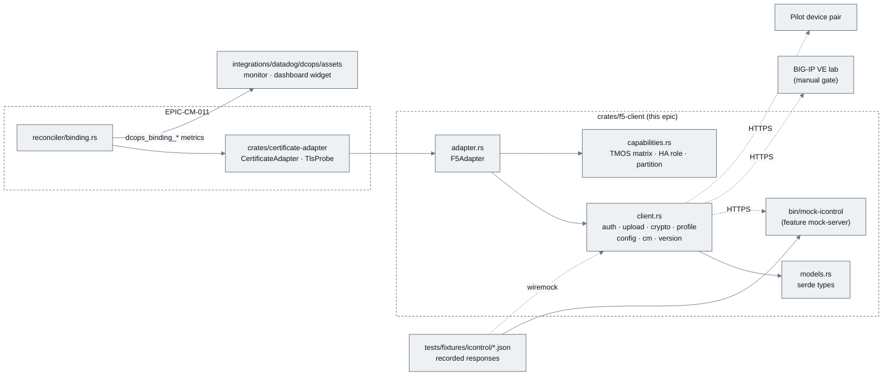
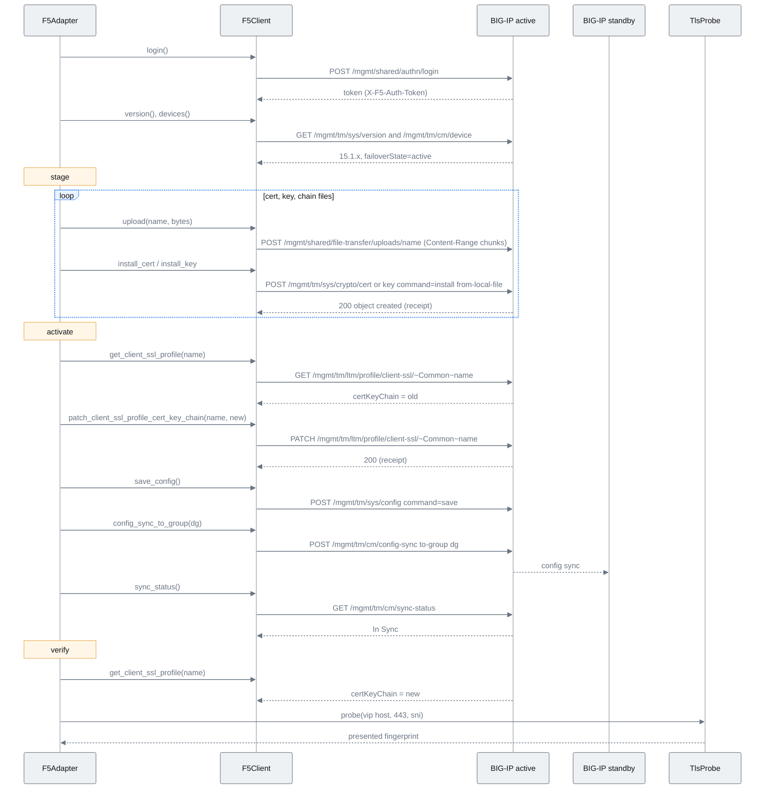
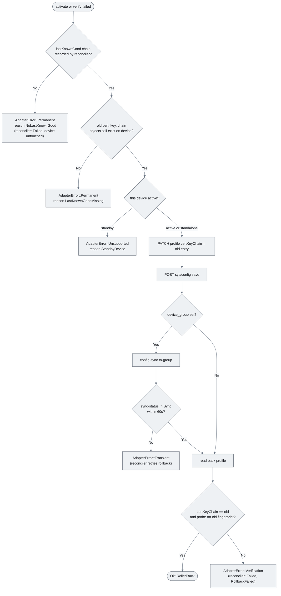
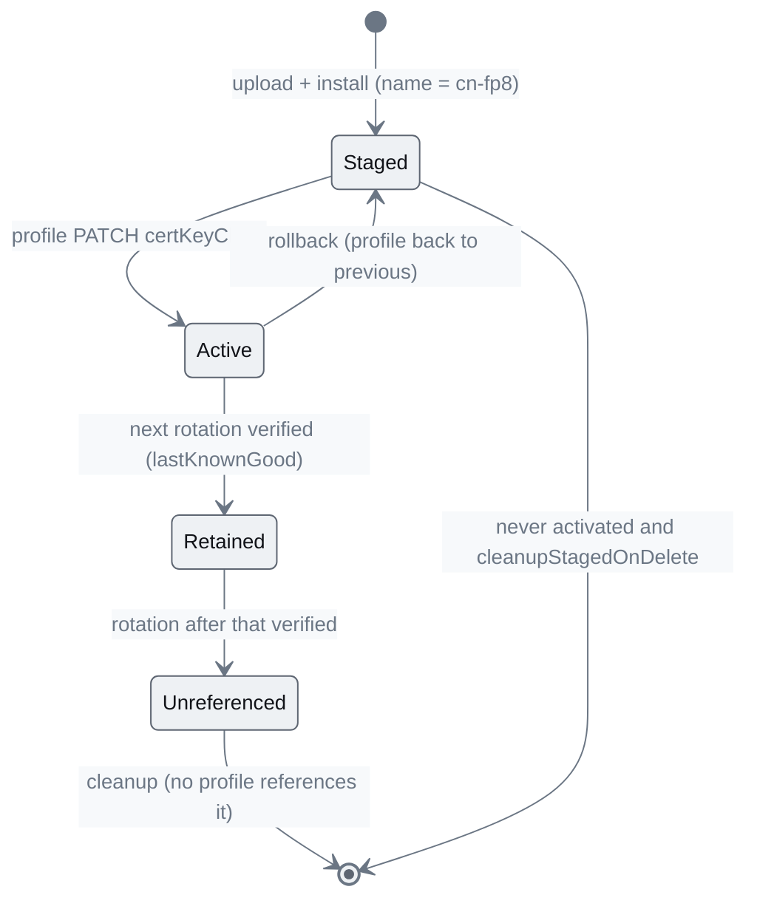
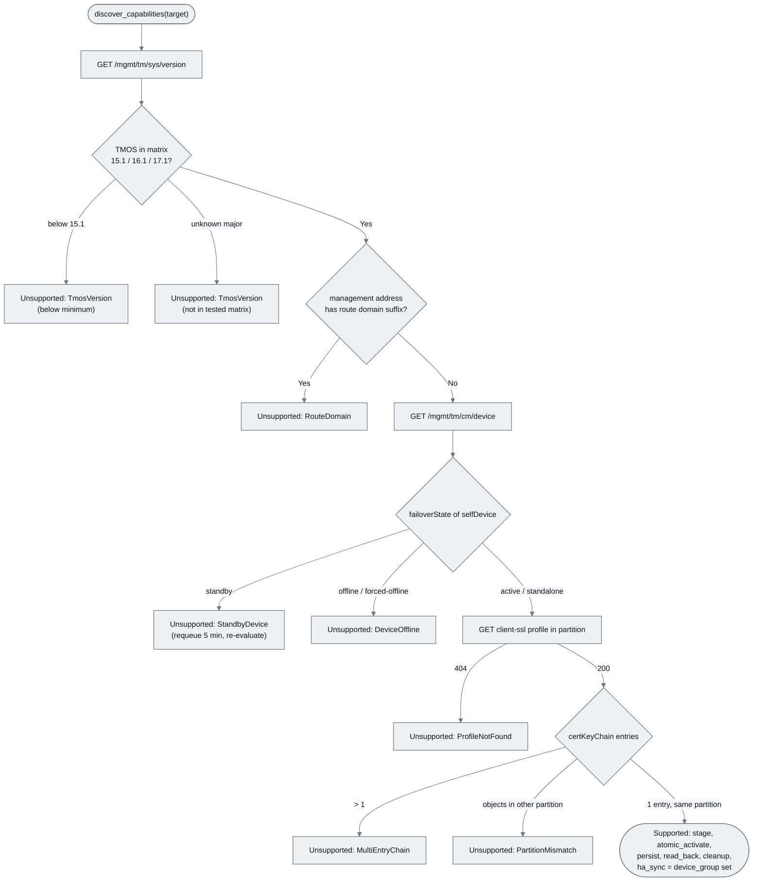
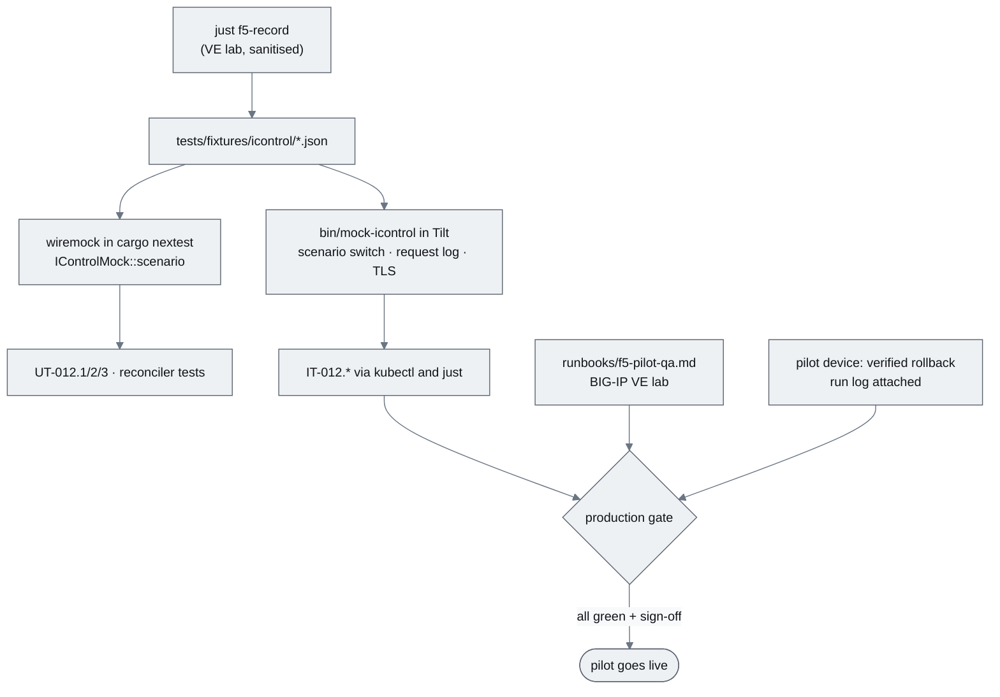

# EPIC-CM-012: F5 BIG-IP adapter pilot

> **Parent:** [Certificate Management Design](../../CERTIFICATE_MANAGEMENT_DESIGN.md) §9, §11 Phase 4
> **Phase:** 4 — Delivery
> **CMMI level advanced:** Level 5 · Optimising (legacy bucket, F5-fronted endpoints)
> **Status:** Draft — awaiting implementation
> **Priority:** P1
> **Estimated effort:** 15–19 days
> **Depends on:** EPIC-CM-011 (adapter contract, binding reconciler, security plumbing), EPIC-CM-008 (Datadog `dcops` integration directory that receives the binding assets)

---

## Overview

This epic is the first real implementor of the `CertificateAdapter` contract fixed in EPIC-CM-011: an F5 BIG-IP adapter over iControl REST. It is a *pilot* in the proposal deck's sense — one device pair, one client-ssl profile family, and a production gate that is not "it installed a certificate" but "we watched it roll back on the pilot device and the endpoint kept serving the old certificate throughout". The README lifecycle applies unchanged: detect (`inspect`, TMOS version, HA role) → validate (reconciler) → stage (upload + install immutable, fingerprint-named cert/key/chain objects) → activate (one `PATCH` on the profile's `certKeyChain`, which is the only atomic switch iControl offers) → verify (profile read-back *and* the external TLS probe) → retain (previous chain objects stay until the next verified rotation) → cleanup (delete only objects no profile references).

The epic delivers two crates' worth of code and two artefacts around them. `crates/f5-client` is a typed, retrying, rate-limited iControl REST client with no knowledge of certificates as a concept — it speaks endpoints and serde models. `F5Adapter` (in the same crate, module `adapter`) maps the trait onto that client and owns the naming, partition, save and config-sync rules. Capability discovery is explicit: TMOS versions outside the supported matrix, standby devices, unsupported partition/route-domain combinations and profiles the controller cannot see all produce `Capabilities::Unsupported(reason)` and stop, surfaced as `Supported=False` on the binding — never an attempt "just to see". The test harness is a recorded-HTTP mock of iControl (wiremock in unit tests, the same fixtures served by an in-cluster `mock-icontrol` binary under Tilt) plus a manual runbook against a BIG-IP Virtual Edition lab. Operations gets a runbook, a Datadog monitor and dashboard widget for binding failures, and a Teams "renewal failed" message that says which stage failed and what state the device was left in.

Out of scope: Cisco adapters (a later epic reuses the harness pattern), AS3/Declarative Onboarding (the pilot uses imperative iControl REST because the target devices are not AS3-managed), certificate issuance of any kind, LTM object creation beyond cert/key/chain (virtual servers and profiles must pre-exist), and UI screens for bindings.

## Epic-level diagram

Components and the two test surfaces (flowchart, because the point is that the adapter is exercised identically by the mock server, the VE lab and production).

## Stories

| ID | Story | Persona | Effort |
|----|-------|---------|--------|
| **CM-012.1** | As an adapter developer, I want a typed iControl REST client with token auth, chunked upload, retries and a per-device rate limit so that the adapter never hand-rolls HTTP | Developer | 4 d |
| **CM-012.2** | As a platform operator, I want `F5Adapter` to stage immutable objects, switch the profile atomically, persist, sync HA and verify by read-back plus probe, with rollback and safe cleanup so that a BIG-IP rotation is verified or undone | Operator | 4 d |
| **CM-012.3** | As a platform operator, I want the adapter to detect what a device can do — TMOS version, HA role, partition constraints — and report `Unsupported` explicitly so that the controller never guesses on a device it does not understand | Operator | 2 d |
| **CM-012.4** | As a QA engineer, I want a recorded-HTTP mock of iControl and a VE lab runbook so that every failure path is reproducible in CI and the production gate (verified rollback on the pilot device) is a documented, repeatable procedure | QA engineer | 4 d |
| **CM-012.5** | As an Operations manager, I want a binding-failure runbook, a Datadog monitor and dashboard widget, and a Teams message that names the failed stage and the device's safe state so that a failed rotation is actionable without reading controller logs | Operations manager | 2 d |

## Definition of Done (epic)

- [ ] Every story's ACs pass
- [ ] `just verify` (fmt, clippy with workspace lints, nextest) is green for `crates/f5-client` with and without `mock-server`
- [ ] `docs/implementationChecklists/CertificateBinding.md` gains the F5 section; README capability list gains "F5 BIG-IP delivery (pilot)"
- [ ] `docs/02_certificate_management/runbooks/{f5-pilot-qa,binding-failure}.md` merged and linked from the README
- [ ] `ddev validate config|models|metadata -s dcops` and `ddev test dcops` green after the asset additions
- [ ] Production gate recorded: signed-off `f5-pilot-qa.md` run log showing a verified rollback on the pilot device with no probe failure during the rollback window

## Open questions

| ID | Question | Default if unresolved |
|----|----------|----------------------|
| **Q1** | Does the pilot device pair use a sync-only or sync-failover device group, and is auto-sync on? | Assume `sync-failover` with manual sync; the adapter always issues `config-sync to-group` from the active device and treats auto-sync as a no-op success. |
| **Q2** | Do the pilot profiles live in `/Common` or a tenant partition, and is a non-default route domain in use for management? | `/Common`, route domain 0. Any other combination is `Unsupported` until confirmed on the VE lab (`CM-012.3`). |
| **Q3** | Token lifetime: rely on the default 1200 s or extend via `PATCH /mgmt/shared/authz/tokens/<token>`? | Do not extend; re-login on 401 once per request (`CM-012.1`). A binding takes < 2 min. |

---

## CM-012.1 — `crates/f5-client`: iControl REST client

**As an** adapter developer, **I want** a typed iControl REST client covering authentication, file upload, certificate/key install, client-ssl profiles, config save, config-sync and version discovery, with retries, backoff and a per-device rate limit **so that** `F5Adapter` composes calls instead of composing HTTP.

### Description

Adds `crates/f5-client` (workspace member) with `src/{lib.rs, client.rs, auth.rs, upload.rs, models.rs, error.rs, rate_limit.rs}`. `F5Client::new(base_url, credentials, tls: rustls::ClientConfig, opts)` wraps a `reqwest` client built with `use_rustls_tls()` and `tls_built_with(config)` — the config comes from `CM-011.5` (pinned management CA); the crate has no bypass path of its own. `auth.rs` implements `POST /mgmt/shared/authn/login` (`{username, password, loginProviderName: "tmos"}`) and stores the token in `Zeroizing<String>`; every request carries `X-F5-Auth-Token`; a `401` triggers exactly one re-login and replay. `upload.rs` implements `POST /mgmt/shared/file-transfer/uploads/<name>` with `Content-Type: application/octet-stream` and `Content-Range: <start>-<end>/<total>` in chunks of at most 1 MiB, resumable by re-sending from the first unacknowledged chunk; the server-side path is `/var/config/rest/downloads/<name>`. `client.rs` exposes typed methods: `install_cert(name, partition, from_local_file)` and `install_key(...)` (`POST /mgmt/tm/sys/crypto/cert` / `.../key` with `{"command":"install", ...}`), `get_cert`, `list_certs`, `delete_cert`, `delete_key` (`/mgmt/tm/sys/crypto/{cert,key}/~<partition>~<name>`), `get_client_ssl_profile` / `patch_client_ssl_profile_cert_key_chain` (`/mgmt/tm/ltm/profile/client-ssl/~<partition>~<name>`), `list_client_ssl_profiles`, `save_config` (`POST /mgmt/tm/sys/config` `{"command":"save"}`), `config_sync_to_group(group)` (`POST /mgmt/tm/cm/config-sync` `{"command":"run","utilCmdArgs":"to-group <group>"}`), `sync_status` (`GET /mgmt/tm/cm/sync-status`), `devices` (`GET /mgmt/tm/cm/device` → `failoverState`, `selfDevice`), and `version` (`GET /mgmt/tm/sys/version`). Every method returns the parsed model *and* the raw response bytes (`Receipt`) so `CM-011.5` receipt hashing needs no re-serialisation.

`models.rs` holds serde structs for each response (`Token`, `SysVersion`, `CmDevice`, `SyncStatus`, `CryptoCert`, `CryptoKey`, `ClientSslProfile`, `CertKeyChain`, `IControlError{code, message, errorStack}`) with `#[serde(rename_all = "camelCase")]` and `deny_unknown_fields` off (TMOS adds fields between releases). `error.rs` maps HTTP outcomes to `F5Error{Auth, RateLimited, Transient(status), Permanent(status, IControlError), NotFound(path), Io}` with `retryable()`; `client.rs` retries `Transient`/`RateLimited`/connection errors with `BackoffCalculator`-style exponential backoff (200 ms → 5 s, max 5 attempts, jitter), never retries `Permanent`, and never retries a non-idempotent install without first checking whether the object now exists. `rate_limit.rs` is a per-`base_url` token bucket (default 5 req/s, burst 10) shared across adapter instances for the same device.

Non-goals: AS3, DO, iControl LX, SOAP, transactions (`/mgmt/tm/transaction` is noted as a future option but the profile `PATCH` is already atomic for one profile).

### Diagrams

iControl call sequence for one rotation as the adapter drives it (sequenceDiagram, because the endpoint order and the active-device rule are the contract).

### Functional requirements

| ID | Requirement |
|----|-------------|
| **FR-012.1-01** | MUST authenticate via `POST /mgmt/shared/authn/login` with `loginProviderName: "tmos"`, send `X-F5-Auth-Token` on every subsequent request, hold the token in `Zeroizing<String>`, and on `401` re-login exactly once and replay the request |
| **FR-012.1-02** | MUST upload files via `POST /mgmt/shared/file-transfer/uploads/<name>` in `Content-Range` chunks of at most 1 MiB and resume from the first unacknowledged chunk on a transient failure |
| **FR-012.1-03** | MUST expose typed `install_cert`/`install_key` issuing the `install` command with `from-local-file` under `/var/config/rest/downloads/`, plus `get`/`list`/`delete` for `sys/crypto/cert` and `sys/crypto/key` with partition-qualified names (`~<partition>~<name>`) |
| **FR-012.1-04** | MUST expose `get_client_ssl_profile`, `list_client_ssl_profiles` and `patch_client_ssl_profile_cert_key_chain` that sends only the `certKeyChain` field in the `PATCH` body |
| **FR-012.1-05** | MUST expose `save_config` (`{"command":"save"}`), `config_sync_to_group` (`{"command":"run","utilCmdArgs":"to-group <group>"}`), `sync_status`, `devices` (with `failoverState` and `selfDevice`) and `version` |
| **FR-012.1-06** | MUST return `(Model, Receipt)` from every call, where `Receipt` is the raw response body bytes |
| **FR-012.1-07** | MUST classify errors as `Auth`, `RateLimited` (429/503 with Retry-After), `Transient` (5xx, connect/timeout), `Permanent` (4xx with parsed `IControlError`), `NotFound`; MUST retry only retryable classes with exponential backoff (200 ms → 5 s, max 5 attempts, jitter) |
| **FR-012.1-08** | MUST NOT blindly retry `install` after a transient failure: it MUST first `get` the object and treat an existing object with the expected name as success |
| **FR-012.1-09** | MUST apply a per-device token-bucket rate limit (default 5 req/s, burst 10, configurable) shared by all clients for the same `base_url` |
| **FR-012.1-10** | MUST build `reqwest` with rustls only and accept the `rustls::ClientConfig` from the caller (`CM-011.5`); the crate MUST NOT expose any option to disable certificate verification |

### Non-functional requirements

| ID | Category | Requirement |
|----|----------|-------------|
| **NFR-012.1-01** | Security | Passwords, tokens and key material never appear in status, Events, logs or metrics: `Credentials` and `Token` are `Zeroizing`, `Debug` for the client redacts them, request logging at `trace` omits `Authorization`/`X-F5-Auth-Token` headers and upload bodies |
| **NFR-012.1-02** | Reliability | A 5 MiB upload with one injected chunk failure completes without re-sending acknowledged chunks |
| **NFR-012.1-03** | Performance | Client overhead per call < 2 ms; a full rotation's ~14 calls fit within the 2-minute binding budget with 30 s to spare at 5 req/s |
| **NFR-012.1-04** | Compatibility | Models deserialise responses from TMOS 15.1, 16.1 and 17.1 fixtures without `deny_unknown_fields`; `cargo tree` shows no `openssl`/`native-tls` |
| **NFR-012.1-05** | Observability | Every call is a tracing span `f5.call{method, path, status, attempt, device}`; 429/5xx counts exported as `dcops_f5_client_retries_total{device, class}` |

### Acceptance criteria

| ID | Given / When / Then |
|----|---------------------|
| **AC-012.1-01** | **Given** a wiremock server returning `login_ok` then `401` on the first authenticated call **When** `version()` is called **Then** the client logs in again once, replays, and returns the version; a second consecutive `401` returns `F5Error::Auth` |
| **AC-012.1-02** | **Given** a 3 MiB file and a mock that fails chunk 2 once with `500` **When** `upload` runs **Then** the mock records chunks 1, 2, 2, 3 with correct `Content-Range` headers and the call succeeds |
| **AC-012.1-03** | **Given** `install_cert` receives a connection reset after the request was sent **When** the retry logic runs **Then** the client issues `GET .../cert/~Common~<name>` and returns success without a second `install` |
| **AC-012.1-04** | **Given** a `400` with an `IControlError` body **When** any call receives it **Then** `F5Error::Permanent` carries `code` and `message` and no retry occurs |
| **AC-012.1-05** | **Given** 20 concurrent calls to one device **When** issued **Then** no more than 10 reach the mock in the first 100 ms and the rest are spread at ≤ 5/s |
| **AC-012.1-06** | **Given** `patch_client_ssl_profile_cert_key_chain` **When** the mock inspects the body **Then** it contains only `certKeyChain` |
| **AC-012.1-07** | **Given** `LOG_FORMAT=json` at `trace` level **When** a login and an upload run **Then** the password, token and upload bytes do not appear in the log |

### Unit test criteria

| ID | Test | Covers |
|----|------|--------|
| **UT-012.1-01** | `auth_test::relogin_once_on_401` — wiremock fixtures `login_ok`, `version_15_1`, `auth_expired_401` | FR-012.1-01, AC-012.1-01 |
| **UT-012.1-02** | `upload_test::chunked_with_resume` — fixtures `upload_ok`, `upload_interrupted_500`; asserts `Content-Range` sequence | FR-012.1-02, AC-012.1-02, NFR-012.1-02 |
| **UT-012.1-03** | `client_test::install_after_reset_checks_existence` — fixtures `install_cert_reset`, `cert_get_ok` | FR-012.1-03/08, AC-012.1-03 |
| **UT-012.1-04** | `error_test::classification_matrix` — 400 `install_cert_error`, 404 `profile_not_found_404`, 429, 503, connect refused | FR-012.1-07, AC-012.1-04 |
| **UT-012.1-05** | `client_test::profile_patch_body_is_cert_key_chain_only` — fixtures `profile_get_ok`, `profile_patch_ok` | FR-012.1-04, AC-012.1-06 |
| **UT-012.1-06** | `client_test::config_sync_and_version_and_devices` — fixtures `save_ok`, `config_sync_ok`, `sync_status_in_sync`, `device_active`, `version_15_1` | FR-012.1-05, AC-012.2-01 |
| **UT-012.1-07** | `client_test::receipt_bytes_returned_verbatim` | FR-012.1-06, AC-011.5-05 |
| **UT-012.1-08** | `rate_limit_test::token_bucket_per_device` — `tokio::time::pause` | FR-012.1-09, AC-012.1-05 |
| **UT-012.1-09** | `tls_test::client_config_is_callers_and_no_bypass_api` — compile-time: no method name matching `danger|insecure|accept_invalid` (grep test) and a wrong-CA wiremock is rejected | FR-012.1-10, AC-011.5-02 |
| **UT-012.1-10** | `logging_test::no_secrets_at_trace` — captured tracing buffer scanned for fixture password/token/body | NFR-012.1-01, AC-012.1-07 |
| **UT-012.1-11** | `models_test::fixtures_deserialise_for_15_16_17` | NFR-012.1-04 |

### Integration test criteria

| ID | Test | Environment | Covers |
|----|------|-------------|--------|
| **IT-012.1-01** | `tests/client_against_mock_icontrol.rs` (feature `integration`) — runs the full call sequence in the diagram against the in-cluster `mock-icontrol` (`CM-012.4`) | kind/k3s via Tilt | FR-012.1-01..06 |

### QA process

1. `cargo nextest run -p f5-client`; save the summary. `cargo tree -p f5-client | grep -cE "openssl|native-tls"` — expect `0`.
2. `just dev-up`; confirm `mock-icontrol` is green in Tilt; `just f5-client-smoke` (a `bin` that logs in, reads version and lists profiles against the mock) — save output.
3. Negative path — expired token: `just mock-icontrol-scenario auth-expired`; rerun the smoke; confirm one re-login in the mock's request log and success. Then `scenario auth-always-401`; confirm `F5Error::Auth` and no loop.
4. Negative path — interrupted upload: `scenario upload-interrupted`; run `just f5-client-upload sample.pem`; confirm the mock's log shows the resumed chunk only.
5. `kubectl logs` for the smoke pod at `trace`; grep for the password and token — expect none.
6. Attach: nextest summary, `cargo tree` output, mock request logs for steps 3–4, log grep output.

---

## CM-012.2 — `F5Adapter`: stage, activate, verify, rollback, cleanup

**As a** platform operator, **I want** `F5Adapter` to implement the `CertificateAdapter` contract on top of `F5Client` — immutable fingerprint-named objects, an atomic profile switch, persisted and HA-synced configuration, verification by read-back and probe, rollback to the last known good chain and cleanup of only unreferenced objects **so that** a BIG-IP rotation is either verified end-to-end or undone.

### Description

Adds `crates/f5-client/src/adapter.rs` with `F5Adapter::new(client_factory, probe: Arc<dyn TlsProbe>, config: F5AdapterConfig{partition: "Common", device_group: Option<String>, profile_name, object_name_prefix: Option<String>})`. Object naming is `<cn>-<fingerprint8>` where `cn` is the leaf subject CN sanitised to `[a-z0-9.-]` (wildcard `*` → `wildcard`) and `fingerprint8` is the first eight hex characters of the leaf SHA-256; objects are `<name>.crt`, `<name>.key`, `<name>-chain.crt`. Because the name is derived from content, `stage` is idempotent: if all three objects exist with the expected fingerprint (`sys/crypto/cert` exposes `fingerprint`/`checksum`), no upload happens and the same `StagedObjects` is returned. `activate` is one `PATCH` replacing `certKeyChain` with a single entry `{name: <name>, cert, key, chain}` — the only step that changes traffic — followed by `save_config` and, when `device_group` is set and this device is active, `config_sync_to_group` and a poll of `sync_status` until `In Sync` (bounded by 60 s; not-in-sync is an `AdapterError::Transient` so the reconciler retries activation idempotently rather than rolling back a working device). `inspect` returns the profile's current `certKeyChain` entry as `ObservedBinding.active`, the referenced cert's fingerprint, every cert/key object in the partition, and the HA role. `verify(expected)` succeeds only when the profile's `certKeyChain` names the staged objects **and** the referenced cert's fingerprint equals `expected` **and** the injected `TlsProbe` against the inventory endpoint presents `expected`. `rollback(last_known_good)` is the same `PATCH` with the previous `certKeyChain` entry, then `save_config` and sync. `cleanup(unreferenced)` deletes only the objects passed in, and re-checks before each delete that no client-ssl profile in the partition (`list_client_ssl_profiles`) references the object — a second guard on top of the reconciler's.

All steps return the concatenated `Receipt` bytes so `CM-011.5` hashes them. `F5Adapter` never logs bundle bytes; the `CertBundle` is read for upload and dropped.

Non-goals: no profile creation, no virtual server changes, no multi-profile fan-out (one binding ↔ one profile; multiple profiles are multiple bindings sharing the target lock), no OCSP stapling configuration.

### Diagrams

Rollback path (flowchart, because the safety rule — never leave the profile pointing at an object that failed verification — is decision logic).

Object lifecycle on the device across two rotations (stateDiagram-v2, because retain-then-cleanup is easier to see than to read).

### Functional requirements

| ID | Requirement |
|----|-------------|
| **FR-012.2-01** | MUST name objects `<cn>-<fingerprint8>{.crt,.key,-chain.crt}` in `config.partition`, with `cn` sanitised to `[a-z0-9.-]` and `*` → `wildcard` |
| **FR-012.2-02** | MUST make `stage` idempotent: when all three objects exist and the cert object's fingerprint equals the bundle's leaf fingerprint, perform no upload or install and return the same `StagedObjects` |
| **FR-012.2-03** | MUST implement `activate` as a single `PATCH` of the profile's `certKeyChain` to one entry naming the staged objects, followed by `save_config` |
| **FR-012.2-04** | MUST, when `device_group` is set, run `config_sync_to_group` only from a device whose `failoverState` is `active` and poll `sync_status` until `In Sync` (≤ 60 s); a timeout MUST be `AdapterError::Transient` |
| **FR-012.2-05** | MUST implement `inspect` returning the profile's current `certKeyChain` entry, its cert fingerprint, all cert/key objects in the partition and the HA role |
| **FR-012.2-06** | MUST implement `verify` as: profile `certKeyChain` names the staged objects AND referenced cert fingerprint equals `expected` AND `TlsProbe` presents `expected`; any other outcome is `Verification{verified: false}` with `device`/`external` populated |
| **FR-012.2-07** | MUST implement `rollback` as the profile `PATCH` back to the `last_known_good` entry plus `save_config` and sync, after confirming the old objects still exist; missing objects MUST be `AdapterError::Permanent` reason `LastKnownGoodMissing` |
| **FR-012.2-08** | MUST implement `cleanup` to delete only the objects passed in, and MUST re-check via `list_client_ssl_profiles` that no profile references each object immediately before deleting it |
| **FR-012.2-09** | MUST return concatenated `Receipt` bytes from every step for receipt hashing |
| **FR-012.2-10** | MUST leave the profile unchanged when any pre-activation call fails (no partial `certKeyChain` edit is possible; the `PATCH` is the first mutating call after staging) |

### Non-functional requirements

| ID | Category | Requirement |
|----|----------|-------------|
| **NFR-012.2-01** | Security | Key material never appears in status, Events, logs or metrics; the `.key` upload body is the only place key bytes leave process memory and it is sent over the pinned-CA TLS session only |
| **NFR-012.2-02** | Reliability | Every step is idempotent and resumable after controller restart: repeating `stage`, `activate`, `rollback` or `cleanup` with the same inputs on a device already in the target state performs no mutating call |
| **NFR-012.2-03** | Performance | One binding end-to-end (`Pending` → `Verified`) completes in < 2 min on the BIG-IP VE lab with a 3-certificate chain and config-sync enabled |
| **NFR-012.2-04** | Observability | Each step emits a span `f5.adapter{step, device, partition, profile, object}` and increments `dcops_f5_adapter_step_total{step, result}` |
| **NFR-012.2-05** | Idempotency | Object names are a pure function of bundle content, so two controllers (or a retry) can never create duplicate objects for one certificate |

### Acceptance criteria

| ID | Given / When / Then |
|----|---------------------|
| **AC-012.2-01** | **Given** a mock BIG-IP with profile `www-dev` referencing `old-aaaa1111` **When** the binding runs the happy path **Then** the mock's request log shows uploads and installs for `www-dev.metro-vto.es-<fp8>` (three objects), one profile `PATCH`, one `save`, one `config-sync`, sync-status polling, one profile `GET`, and the binding is `Verified` |
| **AC-012.2-02** | **Given** the three objects already exist with matching fingerprint **When** `stage` runs again **Then** no upload or install request reaches the mock and `StagedObjects` is identical |
| **AC-012.2-03** | **Given** the profile `PATCH` succeeds but the `TlsProbe` presents the old fingerprint **When** `verify` runs **Then** `verified()` is `false`, `rollback` issues one `PATCH` back to `old-aaaa1111` plus `save` and `sync`, and the binding is `RolledBack` |
| **AC-012.2-04** | **Given** `sync_status` never reports `In Sync` **When** `activate` runs **Then** the adapter returns `Transient` after 60 s, the reconciler retries, and the profile is not rolled back |
| **AC-012.2-05** | **Given** the old cert object was deleted out-of-band **When** `rollback` runs **Then** `Permanent` reason `LastKnownGoodMissing` and the binding is `Failed` reason `RollbackFailed` with the Event naming the missing object |
| **AC-012.2-06** | **Given** `cleanup` is passed an object that a second profile references **When** it runs **Then** that object is skipped, the others are deleted, and the skip is reported in the Event |
| **AC-012.2-07** | **Given** a leaf with CN `*.metro-vto.es` **When** staged **Then** objects are named `wildcard.metro-vto.es-<fp8>…` |
| **AC-012.2-08** | **Given** the VE lab **When** the happy path runs with `time` recorded from `Pending` to `Verified` **Then** the duration is < 120 s |

### Unit test criteria

| ID | Test | Covers |
|----|------|--------|
| **UT-012.2-01** | `adapter_test::happy_path_call_sequence` — wiremock fixtures `login_ok`, `version_15_1`, `device_active`, `cert_get_404`, `upload_ok`, `install_cert_ok`, `install_key_ok`, `profile_get_ok`, `profile_patch_ok`, `save_ok`, `config_sync_ok`, `sync_status_in_sync`; `MockTlsProbe` presents new fingerprint; asserts exact request order | FR-012.2-01/03/04/05/06/09, AC-012.2-01 |
| **UT-012.2-02** | `adapter_test::stage_idempotent_when_objects_exist` — fixture `cert_get_ok_matching_fp` | FR-012.2-02, AC-012.2-02, NFR-012.2-02 |
| **UT-012.2-03** | `adapter_test::verify_probe_mismatch_then_rollback` — `MockTlsProbe` presents old fingerprint; asserts rollback `PATCH` body | FR-012.2-06/07, AC-012.2-03 |
| **UT-012.2-04** | `adapter_test::sync_timeout_is_transient` — fixture `sync_status_not_in_sync`, `tokio::time::pause` | FR-012.2-04, AC-012.2-04 |
| **UT-012.2-05** | `adapter_test::rollback_missing_lkg_is_permanent` — fixture `cert_get_404` for the old object | FR-012.2-07, AC-012.2-05 |
| **UT-012.2-06** | `adapter_test::cleanup_skips_referenced` — fixture `profiles_list_two_referencing` | FR-012.2-08, AC-012.2-06 |
| **UT-012.2-07** | `adapter_test::object_naming` — CN sanitisation table incl. wildcard, uppercase, underscore | FR-012.2-01, AC-012.2-07 |
| **UT-012.2-08** | `adapter_test::pre_activation_failure_leaves_profile` — `install_cert_error` fixture; asserts no `PATCH` | FR-012.2-10, AC-012.2-01 |
| **UT-012.2-09** | `adapter_test::no_key_bytes_in_logs_or_receipts_hashing_input_only` — tracing buffer scan; receipts contain response bodies only | NFR-012.2-01 |
| **UT-012.2-10** | `controllers/certificate` `reconciler::binding_test::f5_adapter_end_to_end_with_wiremock` — real reconciler + `F5Adapter` + `MockKubeApi`/`MockSecretFetcher`/`MockEventRecorder` | FR-012.2-03..08, AC-012.2-01/03 |

### Integration test criteria

| ID | Test | Environment | Covers |
|----|------|-------------|--------|
| **IT-012.2-01** | `tests/f5_binding_mock_icontrol.rs` (feature `integration`) — `binding-f5-mock.yaml` against in-cluster `mock-icontrol` scenarios `happy`, `verify-fails`, `sync-stuck` | kind/k3s via Tilt | AC-012.2-01/03/04 |
| **IT-012.2-02** | Manual: `runbooks/f5-pilot-qa.md` §"Happy path" and §"Rollback" on the BIG-IP VE lab (`CM-012.4`) | BIG-IP VE lab (manual gate) | AC-012.2-08, NFR-012.2-03 |

### QA process

1. `just dev-up && just cert-examples-f5` (applies `binding-f5-mock.yaml`, its credentials Secret and management-CA ConfigMap pointing at `mock-icontrol`). Watch the binding to `Verified`; save `-o yaml` and the mock's request log (`just mock-icontrol-log`); tick the endpoint order against the sequence diagram.
2. Re-touch the binding (annotation change); confirm the request log shows no upload/install/PATCH — only version, device, profile `GET`, sync-status.
3. Negative path — verification fails: `just mock-icontrol-scenario verify-fails` (probe presents old fingerprint); re-apply; observe `RolledBack`, the rollback `PATCH` in the log, and the Warning Event with receipt hash.
4. Negative path — standby: `scenario standby`; observe `Unsupported` reason `StandbyDevice` and no mutating request.
5. Negative path — expired token mid-flow: `scenario token-expires-after-upload`; observe one re-login in the log between upload and install and a `Verified` outcome.
6. Negative path — controller restart mid-Activating: `scenario slow-sync`; `kubectl delete pod` during `Activating`; after restart observe exactly one profile `PATCH` in the log and `Verified`.
7. VE lab (manual, `runbooks/f5-pilot-qa.md`): run happy path with `time`; run rollback; record durations and `tmsh list ltm profile client-ssl <name> cert-key-chain` before/after.
8. Attach: `-o yaml` per scenario, mock request logs, Events listing, VE runbook log with tmsh output and timings, nextest report.

---

## CM-012.3 — Capability discovery and `Unsupported` handling

**As a** platform operator, **I want** the adapter to determine, before touching anything, whether this device, partition and role are ones it knows how to change — and to say `Unsupported(reason)` otherwise **so that** the controller never guesses on a device it does not understand and the reason is visible on the binding.

### Description

Adds `crates/f5-client/src/capabilities.rs` implementing `discover_capabilities`. It calls `version()`, `devices()` and `get_client_ssl_profile(config.profile_name)` and applies a table-driven matrix: TMOS `15.1.x`, `16.1.x`, `17.1.x` → supported (`atomic_activate`, `persist`, `read_back`, `cleanup` true; `ha_sync` true only when `device_group` is set); `13.x`/`14.x` → `Unsupported("TMOS <v> below minimum 15.1")`; unknown/newer major → `Unsupported("TMOS <v> not in tested matrix")` (adding a version is a one-line table change plus fixtures). HA: `failoverState` `active` or `standalone` → supported; `standby` → `Unsupported("standby device — bind to the active peer or wait for failover")`; `forced-offline`/`offline` → `Unsupported`. Partition: the profile MUST exist in `config.partition`; a profile whose cert/key objects live in a different partition than the profile → `Unsupported("cross-partition certKeyChain")`; a management address in a non-zero route domain (`%<rd>` suffix) → `Unsupported("route domain <rd> not supported by pilot")`. A profile with more than one `certKeyChain` entry (SNI multi-cert) → `Unsupported("multi-entry certKeyChain")`. Every `Unsupported` reason is a fixed string from an enum (`UnsupportedReason`) so monitors and the runbook can match on it.

The reconciler (`CM-011.3`) already maps `Unsupported` to phase `Unsupported`/`Supported=False`; this story adds the reason enum to `status.conditions[Supported].reason` (`TmosVersion`, `StandbyDevice`, `DeviceOffline`, `PartitionMismatch`, `RouteDomain`, `MultiEntryChain`, `ProfileNotFound`) and re-evaluates capabilities on every reconcile so a standby that becomes active after failover proceeds automatically at the next requeue (5 min while `Unsupported`).

Non-goals: no automatic "bind to the other peer" — the binding's target is the operator's decision; no version-specific code paths beyond the matrix.

### Diagrams

Capability decision (flowchart, because it is a decision table with explicit `Unsupported` exits).

### Functional requirements

| ID | Requirement |
|----|-------------|
| **FR-012.3-01** | MUST implement `discover_capabilities` from `version()`, `devices()` and the profile `GET`, returning `Supported(features)` only when every check in the diagram passes |
| **FR-012.3-02** | MUST hold the TMOS matrix as a table (`15.1`, `16.1`, `17.1` supported) and return `Unsupported` with reason `TmosVersion` for anything else, distinguishing "below minimum" from "not in tested matrix" in the message |
| **FR-012.3-03** | MUST return `Unsupported` reason `StandbyDevice` when `selfDevice.failoverState` is `standby`, and `DeviceOffline` for `offline`/`forced-offline` |
| **FR-012.3-04** | MUST return `Unsupported` reason `RouteDomain` for a management address carrying a `%<rd>` suffix with `rd != 0`, `PartitionMismatch` when profile and its objects are in different partitions, `ProfileNotFound` on 404, `MultiEntryChain` for more than one `certKeyChain` entry |
| **FR-012.3-05** | MUST set `ha_sync = true` in `SupportedFeatures` only when `config.device_group` is set and the device is `active` |
| **FR-012.3-06** | MUST expose `UnsupportedReason` as an enum whose `Display` strings are the condition reasons used in `status.conditions[Supported].reason` |
| **FR-012.3-07** | MUST re-run discovery on every reconcile and requeue an `Unsupported` binding every 5 min so a role change or upgrade is picked up without operator action |
| **FR-012.3-08** | MUST NOT perform any mutating call before `discover_capabilities` returns `Supported` (enforced by the reconciler ordering in `CM-011.3` and asserted here against the mock) |

### Non-functional requirements

| ID | Category | Requirement |
|----|----------|-------------|
| **NFR-012.3-01** | Security | Discovery uses read-only endpoints only; no credentials, tokens or key material appear in status, Events, logs or metrics |
| **NFR-012.3-02** | Reliability | Discovery is three calls and completes in < 5 s on the VE lab; a transient failure in discovery is `Transient` and retried with backoff, never treated as `Unsupported` |
| **NFR-012.3-03** | Compatibility | Adding a TMOS version requires only a table entry plus a `version_<v>.json` fixture; CI fails if a matrix entry has no fixture |
| **NFR-012.3-04** | Observability | `dcops_binding_phase{phase="Unsupported"}` plus condition reason let the `CM-012.5` monitor group unsupported bindings by reason |

### Acceptance criteria

| ID | Given / When / Then |
|----|---------------------|
| **AC-012.3-01** | **Given** fixture `version_13_1` **When** a binding reconciles **Then** phase `Unsupported`, `Supported=False` reason `TmosVersion` message contains `below minimum 15.1`, and the mock log shows only the version request |
| **AC-012.3-02** | **Given** fixture `device_standby` **When** reconciled **Then** reason `StandbyDevice`, requeue after 5 min; **When** the mock scenario switches to `device_active` **Then** the next reconcile proceeds to `Validating` |
| **AC-012.3-03** | **Given** `profile_not_found_404` **Then** reason `ProfileNotFound`; **Given** `profile_get_multi_chain` **Then** `MultiEntryChain`; **Given** `profile_get_cross_partition` **Then** `PartitionMismatch` |
| **AC-012.3-04** | **Given** management address `10.0.0.5%3:443` **When** reconciled **Then** reason `RouteDomain` and no HTTP request is made |
| **AC-012.3-05** | **Given** `version_17_1`, `device_active`, `device_group` set **When** discovery runs **Then** `Supported` with `ha_sync=true`; **Given** no `device_group` **Then** `ha_sync=false` |
| **AC-012.3-06** | **Given** `version()` returns a connection timeout **When** discovery runs **Then** `AdapterError::Transient`, phase unchanged, backoff requeue |

### Unit test criteria

| ID | Test | Covers |
|----|------|--------|
| **UT-012.3-01** | `capabilities_test::tmos_matrix` — fixtures `version_13_1`, `version_15_1`, `version_16_1`, `version_17_1`, `version_99_0` | FR-012.3-01/02, AC-012.3-01 |
| **UT-012.3-02** | `capabilities_test::ha_roles` — `device_active`, `device_standby`, `device_offline`, `device_standalone` | FR-012.3-03/05, AC-012.3-02/05 |
| **UT-012.3-03** | `capabilities_test::profile_and_partition_rules` — `profile_not_found_404`, `profile_get_multi_chain`, `profile_get_cross_partition` | FR-012.3-04, AC-012.3-03 |
| **UT-012.3-04** | `capabilities_test::route_domain_rejected_before_any_call` — wiremock asserts zero requests | FR-012.3-04, AC-012.3-04 |
| **UT-012.3-05** | `capabilities_test::reason_enum_display_strings` | FR-012.3-06, AC-012.3-03 |
| **UT-012.3-06** | `capabilities_test::transient_not_unsupported` — wiremock delay beyond timeout | NFR-012.3-02, AC-012.3-06 |
| **UT-012.3-07** | `controllers/certificate` `reconciler::binding_test::unsupported_requeues_and_recovers` — `MockKubeApi`; scenario flips standby→active | FR-012.3-07/08, AC-012.3-02 |
| **UT-012.3-08** | `capabilities_test::every_matrix_entry_has_fixture` | NFR-012.3-03 |

### Integration test criteria

| ID | Test | Environment | Covers |
|----|------|-------------|--------|
| **IT-012.3-01** | `tests/f5_capabilities_scenarios.rs` (feature `integration`) — cycles `mock-icontrol` scenarios `tmos-13`, `standby`, `profile-missing`, `multi-chain` and asserts the `Supported` reason on the binding | kind/k3s via Tilt | AC-012.3-01..03 |
| **IT-012.3-02** | Manual: `runbooks/f5-pilot-qa.md` §"Standby" — force a failover on the VE pair, observe `StandbyDevice` then automatic recovery | BIG-IP VE lab (manual gate) | FR-012.3-07, AC-012.3-02 |

### QA process

1. From the `CM-012.2` state (`binding-f5-mock` Verified): `just mock-icontrol-scenario tmos-13`; touch the binding; `kubectl get certificatebinding binding-f5-mock -o yaml` — `Supported=False` reason `TmosVersion`; mock log shows one request.
2. `scenario standby`; observe `StandbyDevice`; `scenario happy`; wait ≤ 5 min (or touch the binding); observe progression to `Verified`.
3. `scenario profile-missing`, `multi-chain`, `cross-partition`; record the reason for each.
4. Negative path — route domain: edit the binding's management address to `…%3:443`; observe `RouteDomain` and zero new requests in the mock log; revert.
5. Negative path — discovery timeout: `scenario version-timeout`; observe the phase unchanged, `dcops_controller_reconcile_total{result="error"}` growing with backoff, no `Unsupported`.
6. VE lab: `tmsh run sys failover standby` on the active peer; observe `StandbyDevice` on the binding targeting it, then recovery after `tmsh run sys failover online`.
7. Attach: `-o yaml` per scenario, mock request logs, VE `tmsh show cm failover-status` before/after, nextest report.

---

## CM-012.4 — Test harness: recorded-HTTP mock iControl and VE lab runbook

**As a** QA engineer, **I want** a mock iControl server driven by recorded fixtures for every happy and failure path, usable both in `cargo nextest` and in-cluster under Tilt, plus a manual runbook for the BIG-IP VE lab **so that** every code path is reproducible in CI and the production gate — a verified rollback on the pilot device — is a repeatable procedure.

### Description

Fixtures live in `crates/f5-client/tests/fixtures/icontrol/` as JSON files named by endpoint and outcome: `login_ok`, `auth_expired_401`, `version_13_1`, `version_15_1`, `version_16_1`, `version_17_1`, `device_active`, `device_standby`, `device_offline`, `device_standalone`, `upload_ok`, `upload_interrupted_500`, `cert_get_404`, `cert_get_ok_matching_fp`, `install_cert_ok`, `install_cert_error`, `install_cert_reset`, `install_key_ok`, `profile_get_ok`, `profile_get_multi_chain`, `profile_get_cross_partition`, `profile_not_found_404`, `profile_patch_ok`, `profiles_list_two_referencing`, `save_ok`, `config_sync_ok`, `config_sync_failed`, `sync_status_in_sync`, `sync_status_not_in_sync`. Each is recorded from the VE lab with `just f5-record <name>` (a `bin` that performs the call and writes the sanitised response — hostnames, serials and tokens replaced) so fixtures are real TMOS output, not hand-typed. Unit tests use the `wiremock` crate with `tests/support/icontrol.rs` providing `IControlMock::scenario("happy")` builders that mount the fixture set for a named scenario.

For in-cluster use, `crates/f5-client/src/bin/mock_icontrol.rs` (feature `mock-server`, axum) serves the same fixtures over TLS (a lab CA generated at startup and published to a ConfigMap the Tilt resource wires into the binding's `managementCa`), keeps a request log (`GET /_mock/log`), and switches scenario via `POST /_mock/scenario/<name>` (`happy`, `verify-fails`, `standby`, `tmos-13`, `profile-missing`, `multi-chain`, `cross-partition`, `auth-expired`, `auth-always-401`, `upload-interrupted`, `install-error`, `sync-stuck`, `sync-failed`, `slow-sync`, `token-expires-after-upload`, `version-timeout`). It is stateful enough to be honest: uploads, installs and profile `PATCH`es mutate an in-memory device so `inspect`/`verify` read back what was written, and the mock's "public endpoint" (a second TLS listener the `TlsProbe` targets) presents whichever certificate the active profile references — or, in `verify-fails`, the old one. `just` recipes: `mock-icontrol-scenario`, `mock-icontrol-log`, `cert-examples-f5`.

`docs/02_certificate_management/runbooks/f5-pilot-qa.md` is the manual runbook for the VE lab and the pilot device: prerequisites (VE pair, device group, a client-ssl profile on a test virtual server, a cert-manager `Certificate` in the dev cluster, credentials Secret, management CA), sections *Happy path*, *Rollback* (induce a verify failure by pointing the inventory endpoint at a virtual server that still serves the old certificate), *Standby*, *Restart mid-Activating*, *Token expiry* (`tmsh modify auth password-policy` not required — shorten the token timeout via `PATCH /mgmt/shared/authz/tokens`), each with tmsh commands to observe (`tmsh list ltm profile client-ssl`, `tmsh list sys crypto cert`, `tmsh show cm sync-status`) and a sign-off table. The **production gate** section states the deck's rule: the pilot device goes live only after a rollback has been executed and verified on it, with the run log attached to the release.

Non-goals: no emulation of TMOS behaviour beyond what the fixtures encode; the mock is not a BIG-IP simulator.

### Diagrams

Test layering (flowchart, because the point is that one fixture set feeds three surfaces and the manual gate sits above them).

### Functional requirements

| ID | Requirement |
|----|-------------|
| **FR-012.4-01** | MUST provide the named fixture set in `tests/fixtures/icontrol/`, each recorded via `just f5-record` and sanitised (no real hostnames, serials, tokens) |
| **FR-012.4-02** | MUST provide `tests/support/icontrol.rs` with `IControlMock::scenario(name)` mounting wiremock responders for at least `happy`, `verify-fails`, `standby`, `tmos-13`, `profile-missing`, `auth-expired`, `upload-interrupted`, `install-error`, `sync-failed` |
| **FR-012.4-03** | MUST provide `bin/mock_icontrol` (feature `mock-server`) serving the same fixtures over TLS with a generated lab CA, a request log at `GET /_mock/log`, and scenario switching at `POST /_mock/scenario/<name>` |
| **FR-012.4-04** | MUST make the mock stateful for uploads, installs, profile `PATCH` and deletes so that read-back reflects prior writes, and MUST expose a second TLS listener presenting the certificate the active profile references (or the old one under `verify-fails`) |
| **FR-012.4-05** | MUST add the Tilt resource `mock-icontrol`, the ConfigMap wiring for its CA, and `just` recipes `mock-icontrol-scenario`, `mock-icontrol-log`, `cert-examples-f5` |
| **FR-012.4-06** | MUST add `runbooks/f5-pilot-qa.md` with the sections listed in the description, tmsh observation commands, a sign-off table and the production-gate rule |
| **FR-012.4-07** | MUST fail CI when a scenario named in `mock_icontrol` has no wiremock equivalent or vice versa (scenario list is one shared table) |

### Non-functional requirements

| ID | Category | Requirement |
|----|----------|-------------|
| **NFR-012.4-01** | Security | Fixtures and mock contain no real credentials or key material; the mock's lab CA and key are generated at startup and never committed; recorded responses are diffed against a denylist in CI |
| **NFR-012.4-02** | Reliability | The mock serves each scenario deterministically; `sync-stuck` and `slow-sync` use fixed delays, not randomness |
| **NFR-012.4-03** | Performance | The full wiremock suite for `f5-client` runs in < 30 s; the in-cluster happy path completes in < 60 s |
| **NFR-012.4-04** | Compatibility | The mock is a `mock-server`-feature binary in the existing crate — no new workspace member, image built from `Dockerfile.base.controller` |

### Acceptance criteria

| ID | Given / When / Then |
|----|---------------------|
| **AC-012.4-01** | **Given** `cargo nextest run -p f5-client` **When** it runs **Then** every scenario in FR-012.4-02 is exercised by at least one test and the suite passes offline |
| **AC-012.4-02** | **Given** Tilt **When** `just dev-up` completes **Then** `mock-icontrol` is `Running`, `curl -k https://mock-icontrol/_mock/log` returns `[]`, and the lab CA ConfigMap exists |
| **AC-012.4-03** | **Given** `just mock-icontrol-scenario verify-fails` **When** `binding-f5-mock` is re-applied **Then** it reaches `RolledBack` and the log shows the rollback `PATCH` |
| **AC-012.4-04** | **Given** a fixture containing a string from the sanitisation denylist **When** CI runs **Then** the `fixtures-sanitised` job fails |
| **AC-012.4-05** | **Given** the VE lab and `f5-pilot-qa.md` **When** a QA engineer follows *Rollback* **Then** the endpoint serves the old certificate continuously (probe every 2 s never fails) and the sign-off table is complete |
| **AC-012.4-06** | **Given** the pilot device **When** the *Production gate* section is executed **Then** a run log with tmsh output, timestamps and a verified rollback is attached to the release PR |

### Unit test criteria

| ID | Test | Covers |
|----|------|--------|
| **UT-012.4-01** | `support_test::every_scenario_mounts_and_serves` — iterates the shared scenario table | FR-012.4-02/07, AC-012.4-01 |
| **UT-012.4-02** | `mock_icontrol_test::stateful_device_readback` — upload/install/PATCH then GET reflects writes; `verify-fails` listener presents old cert | FR-012.4-03/04, AC-012.4-03 |
| **UT-012.4-03** | `mock_icontrol_test::scenario_switch_and_log` — axum `oneshot` on `/_mock/*` | FR-012.4-03 |
| **UT-012.4-04** | `fixtures_test::sanitised` — denylist scan of every fixture | FR-012.4-01, NFR-012.4-01, AC-012.4-04 |
| **UT-012.4-05** | `scripts/check_docs.py::test_runbook_sections` — `f5-pilot-qa.md` has the mandatory sections and sign-off table | FR-012.4-06, AC-012.4-05 |

### Integration test criteria

| ID | Test | Environment | Covers |
|----|------|-------------|--------|
| **IT-012.4-01** | `tests/mock_icontrol_boot.rs` (feature `integration`) — Tilt resource up, `/_mock/log` empty, CA ConfigMap present, scenario switch round-trip | kind/k3s via Tilt | FR-012.4-03/05, AC-012.4-02 |
| **IT-012.4-02** | Manual: full `f5-pilot-qa.md` on the VE lab, then *Production gate* on the pilot device | BIG-IP VE lab, pilot device (manual gate) | FR-012.4-06, AC-012.4-05/06 |

### QA process

1. `cargo nextest run -p f5-client --features mock-server`; save the summary; confirm the scenario table test lists every scenario.
2. `just dev-up`; Tilt shows `mock-icontrol` green; `just mock-icontrol-log` returns `[]`.
3. `just cert-examples-f5`; walk the scenarios `happy`, `verify-fails`, `standby`, `auth-expired`, `upload-interrupted`, `install-error`, `sync-failed`, `slow-sync` (with pod delete), `token-expires-after-upload`; for each record binding phase, `Supported`/`failure` fields and the mock log.
4. Negative path — sanitisation: add a fixture containing `bigip-prod-01.corp` and push to a scratch branch; confirm CI `fixtures-sanitised` fails; remove.
5. VE lab: follow `f5-pilot-qa.md` end to end with a probe loop (`while true; do openssl s_client … | openssl x509 -fingerprint; sleep 2; done`) running during *Rollback*; record that the fingerprint never changed to anything but old/new/old.
6. Pilot device: execute *Production gate*; complete the sign-off table with two signatures (engineer + Operations).
7. Attach: nextest summary, per-scenario table, mock logs, CI failure link, VE run log with probe loop output, pilot gate sign-off.

---

## CM-012.5 — Runbook, Datadog assets and Teams "renewal failed" message

**As an** Operations manager, **I want** a binding-failure runbook, a Datadog monitor and dashboard widget for binding phases, and a Teams "renewal failed" message that names the failed stage and the device's safe state **so that** a failed rotation on an F5 is actionable by the on-call owner without reading controller logs.

### Description

Adds to the EPIC-CM-008 integration directory `integrations/datadog/dcops/`: `metrics.py` entries and `metadata.csv` rows for `dcops.binding.phase` (gauge, tags `name`, `namespace`, `adapter`, `target`, `phase`), `dcops.binding.transitions_total` (count, tags `from`, `to`) and the new info gauge introduced here, `dcops_binding_last_failure_info{name, namespace, adapter, step, safe_state}` (`dcops.binding.last_failure_info`, value 1, `safe_state ∈ rolled_back | new_active | unknown`, set by the reconciler on `RolledBack`/`Failed` and cleared on the next `Verified`); `assets/monitors/binding_failed.json` — a metric monitor on `max:dcops.binding.phase{phase IN (rolledback,failed,unsupported)} by {name,namespace,owner_team,step,safe_state}` (owner_team joined from the inventory's `dcops_certificate_*` series via the `name`→`host` link the reconciler labels), critical on ≥ 1 for 5 min, with the message template *"Renewal failed for {{name.name}} at stage **{{step.name}}** — device left in state **{{safe_state.name}}** (rolled_back = old certificate still served, new_active = new certificate active but unverified, unknown = inspect the device). Runbook: …/binding-failure.md. @teams-{{owner_team.name}}-certs"*; `assets/dashboards/dcops_certificates_overview.json` gains a *Delivery (F5 pilot)* group with a phase distribution (toplist by `phase`), a failures-by-stage timeseries and a table of `Unsupported` reasons; `tests/fixtures/dcops.txt` extended with binding series and `test_dcops.py` asserting them. `changelog.d/2.added` documents the additions.

`docs/02_certificate_management/runbooks/binding-failure.md` is the on-call runbook keyed by `step` and `safe_state`: what each combination means, the `kubectl` commands to confirm (`kubectl get certificatebinding <name> -o yaml`, Events with receipt hashes), the tmsh commands to inspect the device, when to re-trigger (touch the binding) versus escalate to the F5 team, and the explicit rule that a `new_active` state with `Verified=False` is a P1 because the served certificate is unverified. The Teams routing reuses the `owner_team` handle convention from `CM-008.4`; the "renewal succeeded" message remains gated on `Verified` as design §8.3 requires.

Non-goals: no notification code in the controller (design §8.3); no UI.

### Diagrams

From a failed binding to a Teams message (flowchart, because the routing depends on two labels and one join).

```mermaid
%%{init: {'theme':'base','themeVariables': {'fontFamily': 'Inter, Segoe UI, Helvetica, Arial, sans-serif', 'fontSize': '14px', 'primaryColor': '#EEF1F4', 'primaryTextColor': '#111318', 'primaryBorderColor': '#5E6672', 'secondaryColor': '#EAF3FF', 'secondaryTextColor': '#111318', 'secondaryBorderColor': '#2F80ED', 'tertiaryColor': '#EAF8F0', 'tertiaryTextColor': '#111318', 'tertiaryBorderColor': '#2FA36B', 'lineColor': '#6B7684', 'textColor': '#6B7684', 'nodeBorder': '#5E6672', 'nodeTextColor': '#111318', 'mainBkg': '#EEF1F4', 'clusterBkg': '#F7F9FB', 'clusterBorder': '#BAC1C9', 'titleColor': '#111318', 'edgeLabelBackground': '#F7F9FB', 'actorBkg': '#EEF1F4', 'actorBorder': '#5E6672', 'actorTextColor': '#111318', 'actorLineColor': '#BAC1C9', 'signalColor': '#6B7684', 'signalTextColor': '#6B7684', 'labelBoxBkgColor': '#EAF3FF', 'labelBoxBorderColor': '#2F80ED', 'labelTextColor': '#111318', 'loopTextColor': '#111318', 'noteBkgColor': '#FFF6E7', 'noteBorderColor': '#E6A23C', 'noteTextColor': '#111318', 'activationBkgColor': '#DCE6F7', 'activationBorderColor': '#2F80ED', 'sequenceNumberColor': '#FFFFFF', 'labelColor': '#111318', 'altBackground': '#F7F9FB', 'attributeBackgroundColorOdd': '#FFFFFF', 'attributeBackgroundColorEven': '#F7F9FB', 'classText': '#111318'}}}%%
flowchart LR
    rec["binding reconciler<br/>phase RolledBack or Failed"] --> m1["dcops_binding_phase{phase}=1"]
    rec --> m2["dcops_binding_last_failure_info<br/>{step, safe_state}=1"]
    m1 --> agent["Datadog Agent dcops check<br/>(OpenMetricsBaseCheckV2)"]
    m2 --> agent
    agent --> mon["monitor binding_failed.json<br/>by name, namespace, owner_team, step, safe_state"]
    inv["dcops_certificate_* series<br/>owner_team tag"] -. join on name/host .-> mon
    mon --> teams["@teams-owner-certs<br/>Renewal failed at stage X, device state Y<br/>runbook link"]
    mon --> dash["dashboard group Delivery (F5 pilot)<br/>phase toplist · failures by stage · Unsupported reasons"]
    teams --> rb["runbooks/binding-failure.md<br/>kubectl + tmsh steps per (step, safe_state)"]
```

### Functional requirements

| ID | Requirement |
|----|-------------|
| **FR-012.5-01** | MUST add `dcops_binding_last_failure_info{name,namespace,adapter,step,safe_state}` to the controller (`metrics.rs`), set on `RolledBack`/`Failed` with `safe_state` = `rolled_back` when rollback verified, `new_active` when the new object is active and unverified, `unknown` otherwise; cleared on `Verified` and on deletion |
| **FR-012.5-02** | MUST map `dcops_binding_phase`, `dcops_binding_transitions_total` and `dcops_binding_last_failure_info` in `metrics.py` and document them in `metadata.csv` with types, units and descriptions passing `ddev validate metadata` |
| **FR-012.5-03** | MUST add `assets/monitors/binding_failed.json` alerting when any binding is in `rolledback`, `failed` or `unsupported` for ≥ 5 min, grouped by `name`, `namespace`, `owner_team`, `step`, `safe_state`, with the message template carrying stage, safe state, runbook link and `@teams-{{owner_team.name}}-certs` |
| **FR-012.5-04** | MUST add a *Delivery (F5 pilot)* group to `dcops_certificates_overview.json` with phase toplist, failures-by-stage timeseries and an `Unsupported`-reasons table, using the dashboard's existing template variables |
| **FR-012.5-05** | MUST extend `tests/fixtures/dcops.txt` and `test_dcops.py` with the binding series and pass `ddev test dcops` |
| **FR-012.5-06** | MUST add `runbooks/binding-failure.md` with a section per `(step, safe_state)` combination, `kubectl` and tmsh commands, re-trigger vs escalate guidance, and the `new_active` P1 rule |
| **FR-012.5-07** | MUST keep the "renewal succeeded" notification (`CM-008.4`) gated on `dcops_certificate_condition{condition="Verified"} == 1` and extend its message to mention the binding when `IssuanceAutomated` reason is `BindingVerified` |

### Non-functional requirements

| ID | Category | Requirement |
|----|----------|-------------|
| **NFR-012.5-01** | Security | Metric labels and monitor messages carry names, phases, steps and states only — never receipts, credentials, addresses with credentials, or key material |
| **NFR-012.5-02** | Observability | The monitor evaluates within one Agent collection interval (15 s default) plus the 5-min window; no notification for transient `Staging` retries |
| **NFR-012.5-03** | Compatibility | Assets pass `ddev validate config|models|metadata -s dcops`; no `manifest.json`, no bespoke service checks (integrations-core AGENTS.md rules from EPIC-CM-008) |
| **NFR-012.5-04** | Accessibility | Runbook and monitor message use plain language for the Operations audience: every state name is followed by its one-line meaning |

### Acceptance criteria

| ID | Given / When / Then |
|----|---------------------|
| **AC-012.5-01** | **Given** a binding that rolled back **When** `/metrics` is scraped **Then** `dcops_binding_last_failure_info{step="Verifying",safe_state="rolled_back"} 1` exists; **When** it later reaches `Verified` **Then** the series is gone |
| **AC-012.5-02** | **Given** the fixture `dcops.txt` **When** `ddev test dcops` runs **Then** `dcops.binding.phase`, `dcops.binding.transitions_total` and `dcops.binding.last_failure_info` are asserted with their tags |
| **AC-012.5-03** | **Given** the monitor JSON imported into a Datadog sandbox and a binding in `RolledBack` for 5 min **When** it evaluates **Then** a Teams message arrives at `@teams-platform-certs` containing `stage Verifying` and `state rolled_back` and the runbook link |
| **AC-012.5-04** | **Given** the dashboard JSON imported **When** the `Delivery (F5 pilot)` group is opened **Then** the three widgets render with the `$namespace` and `$owner_team` template variables applied |
| **AC-012.5-05** | **Given** `ddev validate config|models|metadata -s dcops` **When** run **Then** it passes with the new metrics |
| **AC-012.5-06** | **Given** the runbook **When** a reader has `step=Activating`, `safe_state=new_active` **Then** the matching section marks it P1 and lists the tmsh command to inspect the profile |
| **AC-012.5-07** | **Given** a binding in `Staging` retrying on `Transient` for 10 min **When** the monitor evaluates **Then** no alert fires |

### Unit test criteria

| ID | Test | Covers |
|----|------|--------|
| **UT-012.5-01** | `controllers/certificate` `metrics_test::last_failure_info_set_and_cleared` — in-process registry across rollback then verified, using `MockAdapter` | FR-012.5-01, AC-012.5-01 |
| **UT-012.5-02** | `tests/test_dcops.py::test_binding_metrics` — `dd_run_check` on the extended fixture, `aggregator.assert_metric` with tags | FR-012.5-02/05, AC-012.5-02 |
| **UT-012.5-03** | `tests/test_assets.py::test_binding_monitor_query_and_message` — parses `binding_failed.json`, asserts query groups, threshold, and that the message contains `{{step.name}}`, `{{safe_state.name}}`, runbook URL and the Teams handle | FR-012.5-03, AC-012.5-03/07 |
| **UT-012.5-04** | `tests/test_assets.py::test_dashboard_delivery_group` — the group exists with three widgets referencing the template variables | FR-012.5-04, AC-012.5-04 |
| **UT-012.5-05** | `scripts/check_docs.py::test_binding_failure_runbook_matrix` — every `(step, safe_state)` pair has a section; `new_active` sections contain `P1` | FR-012.5-06, AC-012.5-06 |
| **UT-012.5-06** | `tests/test_assets.py::test_renewal_succeeded_gated_on_verified` — extends the `CM-008.4` assertion and checks the binding mention | FR-012.5-07, AC-012.5-03 |
| **UT-012.5-07** | `metrics_test::binding_labels_contain_no_addresses_or_receipts` | NFR-012.5-01 |

### Integration test criteria

| ID | Test | Environment | Covers |
|----|------|-------------|--------|
| **IT-012.5-01** | CI job `ddev-dcops` (from `CM-008.5`) — `ddev validate config|models|metadata -s dcops` and `ddev test dcops` incl. `test_e2e.py` with the controller and `mock-icontrol` in kind, asserting the binding metrics are collected | GitHub Actions (kind, ddev) | FR-012.5-02/05, AC-012.5-02/05 |
| **IT-012.5-02** | Manual: import monitor and dashboard into the Datadog sandbox org, drive `verify-fails` on the shared cluster, confirm the Teams message and widgets | shared-k8s + Datadog sandbox | AC-012.5-03/04 |

### QA process

1. `just dev-up && just cert-examples-f5`; `just mock-icontrol-scenario verify-fails`; re-apply the binding; `curl :9090/metrics | grep dcops_binding_` — confirm `last_failure_info{step="Verifying",safe_state="rolled_back"} 1`.
2. `scenario happy`; touch the binding; re-scrape; confirm the series is gone and `phase="Verified"` is 1.
3. In `integrations/datadog/dcops/`: `ddev validate config -s dcops && ddev validate models -s dcops && ddev validate metadata -s dcops && ddev test dcops`; save output.
4. Import `binding_failed.json` and the dashboard into the Datadog sandbox (`just dd-import` from `CM-008.5`); with the Agent scraping the shared cluster, re-run step 1 and wait 5 min; screenshot the Teams message and the *Delivery (F5 pilot)* widgets.
5. Negative path — no alert on transient: `scenario install-error-transient` (5xx on install for 10 min); confirm the binding stays `Staging`, no `last_failure_info` series, no Teams message.
6. Negative path — unverified new_active: `scenario verify-fails` with `autoRollback=false` on the binding; confirm `safe_state="new_active"`, the Teams message says `state new_active`, and the runbook section reached from the link is marked P1.
7. Attach: metrics excerpts, `ddev` output, Teams screenshots, dashboard screenshot, runbook section link, nextest and pytest reports.
