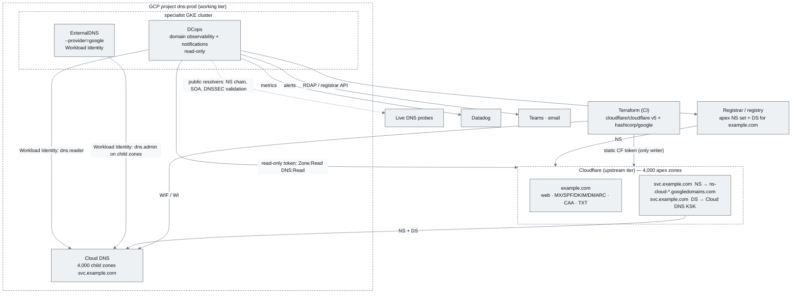

# Domain estate: Cloudflare vs Akamai as the upstream tier, Cloud DNS as the working tier, DCops as the observer

> **Type:** Analysis and design note  
> **Status:** Draft v1 — 16 Sep 2026  
> **Scope:** ~4,000 domains for one organisation; authoritative records to be managed in a single GCP project (Cloud DNS, one zone per domain) by Terraform and/or ExternalDNS in a small specialist GKE cluster; an upstream provider (Cloudflare or Akamai) holds the domains and delegates to Cloud DNS.  
> **DCops role:** observability and notifications only — DCops never writes to the registrar, Cloudflare/Akamai or Cloud DNS. Terraform and ExternalDNS are the controllers of record.  
> **Leaning:** Cloudflare + Cloud DNS + ExternalDNS (per the discussion), confirmed below with the caveats that matter. **Update 16 Sep:** with Openprovider/Squarespace as registrars, registrar → Cloud DNS directly (topology A, §0.1) is viable and removes the static Cloudflare credential from the write path.

---

## 0. The one thing to settle first: what "delegation to GCP" means

The earlier analysis treats the upstream provider as a "parent delegation point (NS records pointing to GCP)". That only works for **subdomains**. A Cloudflare (or Akamai) zone for `example.com` cannot delegate its own apex to Cloud DNS — the apex NS set lives at the **registry**, set through the **registrar**, and Cloudflare's own documentation is explicit that only subdomains can be delegated out of a Cloudflare zone ([Cloudflare: subdomains outside Cloudflare](https://developers.cloudflare.com/dns/manage-dns-records/how-to/subdomains-outside-cloudflare/)). So there are really three topologies, and they have different consequences for everything else in this note:

| Topology | Where the 4,000 apex NS sets point | What Cloudflare/Akamai holds | What Cloud DNS holds | When it makes sense |
|---|---|---|---|---|
| **A — direct** | Registrar → Cloud DNS name servers | nothing (or only the registrar function) | 4,000 apex zones, all records | You want one authoritative tier and Workload Identity end to end; you accept Cloud DNS's DDoS posture and no CDN/WAF at the apex |
| **B — split apex / delegated subzones** | Registrar → Cloudflare/Akamai | 4,000 apex zones: web/CDN, MX/SPF/DKIM/DMARC, CAA, verification TXTs, **NS + DS records delegating `<sub>.example.com`** | 4,000 child zones (`svc.example.com`, `k8s.example.com`, …) written by ExternalDNS/Terraform | You want Cloudflare's edge in front of the public web presence and email records, and the machine-managed records (services, clusters, ACME) in GCP under Workload Identity |
| **C — upstream is authoritative** | Registrar → Cloudflare/Akamai | everything; ExternalDNS writes here | nothing | Simplest, but every controller then needs a static provider credential (see §2) |

### 0.1 Topology A with the actual registrars (Openprovider, Squarespace)

Any registrar allows custom name servers, so registrar → Cloud DNS directly is available; what differs is whether it can be automated and how DNSSEC is handled:

| | Openprovider | Squarespace Domains (ex Google Domains) |
|---|---|---|
| **Set name servers** | API: `PUT /v1beta/domains/{id}` with `name_servers[]` or an `ns_group`; bearer token obtained from the auth endpoint ([Openprovider — update domain attributes](https://support.openprovider.eu/hc/en-us/articles/360025249113-21-Domains-API-How-to-update-domain-s-attributes)) | **UI only**, re-authentication with 2FA per change; no public API ([Squarespace — change nameservers](https://support.squarespace.com/hc/en-us/articles/4404183898125-Change-or-reset-your-domain-s-nameservers)) |
| **DNSSEC at the registry** | API: `is_dnssec_enabled` / `dnssec_keys[]` on the same call; the help centre also describes submitting **DNSKEY** (not DS) for third-party-hosted zones, which Openprovider converts for the registry ([Openprovider — DNSSEC with third-party DNS](https://support.openprovider.eu/hc/en-us/articles/360010899380-How-to-manage-DNSSEC-for-domains-that-are-pointed-to-third-party-DNS)) | Switching to custom name servers prompts you to **disable** DNSSEC; DS/DNSKEY for the external zone is then re-added by hand |
| **Limits / cadence** | Immediate at the registrar, registry-dependent propagation | 2–13 custom name servers; "up to 48 hours" to take effect |
| **Terraform** | No official provider — drive the API from the pipeline (a thin client, or a `null_resource`/`http` step) with the bearer token from Secret Manager | Not automatable |
| **Locks / autorenew / expiry** | API: `is_locked`, `autorenew`, expiry readable | RDAP only from outside |

Consequence: with ~4,000 domains, topology A is only operable if the registrar is **Openprovider** (or another registrar with an API). Squarespace-held domains would need 4,000 manual, 2FA-gated NS changes plus manual DS entry, so consolidate them to Openprovider (or another API registrar) as part of the migration. Cloudflare then drops out of the write path entirely, ExternalDNS and Terraform write the apex zones in Cloud DNS under Workload Identity, and the only static credential in the whole system is the Openprovider bearer token used by the onboarding pipeline.

For DCops (§5) this changes the `RegistrarAdapter` only: an `OpenproviderAdapter` (read-only: expiry, `name_servers`, `dnssec_keys`, `is_locked`, `autorenew`) plus RDAP as the fallback for anything else; the `UpstreamDnsAdapter` becomes optional (only present if some estate stays behind Cloudflare/Akamai), and `DelegationConsistent` reduces to *registry NS set == Cloud DNS zone NS set* and *registry DS == Cloud DNS KSK DS*.

The rest of this note assumes **B** unless stated otherwise (A is the simpler special case: drop the Cloudflare column and the delegation hop), because it is the only topology in which "upstream provider holds the domains *and* delegates to Cloud DNS" is literally true. If the intent is really A, most of the Cloudflare/Akamai comparison becomes moot and the decision is about the registrar and DDoS posture instead.

## 1. Provider comparison

Three columns, because Cloud DNS's authentication model is the reason the GKE controller wants to write there and not upstream.

| Capability | Cloudflare DNS | Akamai Edge DNS | Google Cloud DNS (working tier) |
|---|---|---|---|
| **API style** | REST v4, JSON, OpenAPI-published; bearer `Authorization: Bearer <api token>` | REST "Edge DNS API v2", JSON; every request signed with **EdgeGrid** (client token + client secret + access token → HMAC header) | REST v1, JSON; Google OAuth2 access tokens |
| **Credential type available to a GKE workload** | Static API token (user- or account-owned; scoped by permission group + zone/account resource; optional client-IP filter and TTL) | Static 4-part EdgeGrid credential (`.edgerc` or four env vars); optional IP ACL and expiry | **No static credential**: GKE Workload Identity → KSA bound to a GSA/principal → short-lived token minted by the metadata server |
| **OIDC / workload identity federation for the DNS API** | **No.** Cloudflare's OIDC surface is for Cloudflare One/Access (protecting apps and users), not for minting API tokens from an external IdP; the 2026 "Outbound Workers" credential-injection feature applies to code running *inside* Cloudflare sandboxes only ([Cloudflare blog, Apr 2026](https://blog.cloudflare.com/sandbox-auth/); [Cloudflare One IdPs](https://developers.cloudflare.com/cloudflare-one/integrations/identity-providers/)) | **No.** OIDC exists for EAA/ETP, not for EdgeGrid-signed infrastructure APIs ([EdgeGrid](https://techdocs.akamai.com/developer/docs/edgegrid); [Edge DNS API](https://techdocs.akamai.com/edge-dns/reference/edge-dns-api)) | **Yes** — this is the native case (Workload Identity; `roles/dns.admin` on the project or per-zone IAM) |
| **Consequence** | One long-lived secret per writer (Terraform CI, any ExternalDNS instance writing to Cloudflare, DCops read-only). Mitigate with account-owned tokens, `DNS:Edit` scoped to the zones the writer owns, client-IP filtering to the cluster's egress NAT, TTL + rotation by Terraform | Same, plus the EdgeGrid signing library in every client; fewer scoping knobs (per-API-client group/role) | None — rotate nothing, store nothing |
| **Rate limits** | 1,200 requests / 5 min per user or account token, 200 req/s per IP; 50 user tokens, **500 account tokens** ([Cloudflare limits](https://developers.cloudflare.com/fundamentals/api/reference/limits/)) | Per-contract; not published in the API reference | Read requests per minute and DNS writes per region per minute are project quotas (raiseable); ≤ 1,000 RRset additions and ≤ 1,000 deletions per `Changes.create` ([Cloud DNS quotas](https://docs.cloud.google.com/dns/quotas)) |
| **Change model** | Immediate: each API call is live within seconds | **Change list → submit → activation** per zone; the API exposes create/submit/list change list operations, and *bulk zone create* is an asynchronous request with a status/results poll ([Edge DNS API](https://techdocs.akamai.com/edge-dns/reference/edge-dns-api)) | Immediate, atomic per `Changes.create`; a change is `pending` for seconds then `done` |
| **Scale for 4,000 zones** | Zone count is a plan/contract matter (Enterprise); the API paginates zones at 50/page by default so a full zone list is ~80 calls | Designed for very large estates; bulk zone create exists precisely for this | **10,000 managed zones per project** quota; 10,000 RRsets per zone; ≤ 8 name servers per NS delegation ([Cloud DNS quotas](https://docs.cloud.google.com/dns/quotas)) — 4,000 zones fit one project with headroom, but note it is a *quota*, ask for it up front |
| **Terraform provider** | `cloudflare/cloudflare` v5 — generated from the OpenAPI spec; `cloudflare_zone` + `cloudflare_dns_record` (renamed from `cloudflare_record` in v5, migration friction is real: [issue #7072](https://github.com/cloudflare/terraform-provider-cloudflare/issues/7072), [v5 upgrade guide](https://registry.terraform.io/providers/cloudflare/cloudflare/latest/docs/guides/version-5-upgrade)); parallel applies hit the 1,200/5 min token limit → `-parallelism` and per-BU state | `akamai/akamai` — mature; `akamai_dns_zone` + `akamai_dns_record`; applies are slower because each zone change rides the activation queue | `hashicorp/google` — `google_dns_managed_zone` (with `dnssec_config`) + `google_dns_record_set`; authenticates with the same Workload Identity / WIF as everything else |
| **ExternalDNS support (v0.22, Aug 2026)** | **In-tree**, `--provider=cloudflare`, token via `CF_API_TOKEN` (or `CF_API_KEY`+`CF_API_EMAIL`), `--zone-id-filter`, `--cloudflare-proxied` ([release v0.22.0](https://github.com/kubernetes-sigs/external-dns/releases/tag/v0.22.0)) | **Removed from tree in v0.22.0**; use the community **webhook** sidecar (`PixiBixi/external-dns-akamai-webhook`) with EdgeGrid env vars — small project, one maintainer ([release notes](https://github.com/kubernetes-sigs/external-dns/releases/tag/v0.22.0); [webhook repo](https://github.com/PixiBixi/external-dns-akamai-webhook)) | **In-tree**, `--provider=google --google-project=<dns project>`; Workload Identity, no secret ([ExternalDNS GKE tutorial](https://github.com/kubernetes-sigs/external-dns/blob/master/docs/tutorials/gke.md)) |
| **Delegating a subdomain to Cloud DNS** | `NS` records at `<sub>.example.com` (max 10 per name, ≤ 7 recommended) plus `DS` if the child is signed; Cloudflare features do not apply to the delegated subtree ([subdomains outside Cloudflare](https://developers.cloudflare.com/dns/manage-dns-records/how-to/subdomains-outside-cloudflare/)) | Standard `NS` + `DS` records in the parent zone | n/a (it is the child) |
| **DNSSEC** | One-click signing per zone; DS to the registrar is automatic for Cloudflare Registrar TLDs, manual otherwise; supports multi-signer and DS records for child delegations ([DNSSEC docs](https://developers.cloudflare.com/dns/dnssec/)) | Signing supported; DS handling manual/registrar-dependent | Per-zone `dnssec_config`; Cloud DNS publishes the DS for you to place in the parent ([advanced DNSSEC](https://docs.cloud.google.com/dns/docs/dnssec-advanced)) |
| **Registrar** | Cloudflare Registrar covers a subset of TLDs; the API exposes expiry/auto-renew for domains it holds. Enterprise estates usually stay on a corporate registrar (MarkMonitor/CSC) — then registrar data comes from that registrar's API or RDAP | Not a registrar | Cloud Domains exists but is not the registrar of record here |
| **Read-only observer access (what DCops needs)** | Account-owned token with `Zone:Read`, `DNS:Read`, `DNS Settings:Read` — still a static secret | EdgeGrid credential with read-only group | Workload Identity + `roles/dns.reader` |

### 1.1 Bottom line for the choice

Cloudflare remains the better upstream tier for this design, but for narrower reasons than the earlier analysis gave: the API is immediate rather than activation-queued, ExternalDNS support is in-tree rather than a one-maintainer webhook, the Terraform provider is current (v5, with a real but one-off migration cost), and token scoping (account-owned tokens, per-zone `DNS:Edit`, client-IP filter, TTL) is good enough to make the static credential tolerable.

What is **not** true of either provider: neither Cloudflare nor Akamai will accept a GCP/GKE-federated OIDC token for its DNS API. The only place Workload Identity applies is Cloud DNS. That is the strongest argument for topology **B**: keep everything that machines write (ExternalDNS, ACME, service records) in Cloud DNS under Workload Identity, and confine the static Cloudflare credential to a single Terraform pipeline that changes rarely (zone creation, NS/DS delegation, apex records) plus DCops's read-only token.

## 2. Reference topology (B)



Who writes what — this table is the contract DCops observes against:

| Layer | Writer | Credential | Change cadence |
|---|---|---|---|
| Registry NS set + apex DS | Registrar (manual or registrar API from Terraform) | registrar credential, human-gated | rare |
| Cloudflare zones, apex records, `<sub>` NS + DS delegation | Terraform in CI | account-owned API token, `Zone:Edit`/`DNS:Edit`, IP-filtered to CI egress | rare; per-domain onboarding |
| Cloud DNS child zones + `dnssec_config` | Terraform in CI | WIF from CI → GSA | rare |
| Records inside child zones | ExternalDNS (`--provider=google`), cert-manager DNS-01 | Workload Identity | continuous |
| Everything above | **DCops — read only** | CF read-only token; WI `dns.reader`; anonymous RDAP | polling + probes |

## 3. Controller configuration

### 3.1 ExternalDNS → Cloud DNS (the normal path, no secret)

```yaml
# KSA bound to GSA dns-writer@dns-prod.iam.gserviceaccount.com (roles/dns.admin, or per-zone IAM on the child zones)
apiVersion: v1
kind: ServiceAccount
metadata:
  name: external-dns
  namespace: dns-system
  annotations:
    iam.gke.io/gcp-service-account: dns-writer@dns-prod.iam.gserviceaccount.com
---
# Deployment args (excerpt)
args:
  - --source=service
  - --source=ingress
  - --source=gateway-httproute
  - --provider=google
  - --google-project=dns-prod
  - --google-zone-visibility=public
  - --domain-filter=svc.example.com      # one per delegated child zone, or --zone-id-filter
  - --registry=txt
  - --txt-owner-id=gke-dns-01            # required: ExternalDNS only touches records it owns
  - --txt-prefix=_ed.
  - --policy=upsert-only                 # v0.22 requires an explicit policy; sync deletes on drift
  - --google-batch-change-size=1000      # matches the Cloud DNS 1,000 RRsets per change quota
  - --google-batch-change-interval=1s
  - --interval=1m
```

For 4,000 child zones one ExternalDNS instance does not need 4,000 `--domain-filter` flags: use `--zone-id-filter` per BU shard or run one instance per BU with a regex `--regex-domain-filter`. Each instance lists every zone it can see at start-up, so shard so that a single instance sees a few hundred zones, not all 4,000 (zone list + record list per zone is the dominant API cost).

### 3.2 ExternalDNS → Cloudflare (only if some records must be written upstream)

```yaml
args:
  - --provider=cloudflare
  - --zone-id-filter=<zone id>            # never account-wide for a writer
  - --cloudflare-dns-records-per-page=5000
  - --cloudflare-proxied=false            # plain records; CDN proxying is a Terraform decision
env:
  - name: CF_API_TOKEN
    valueFrom: { secretKeyRef: { name: cloudflare-dns-writer, key: token } }
```

The Secret is the static credential the design otherwise avoids. If this path exists at all, source the Secret from an external secret store (GCP Secret Manager via External Secrets Operator, itself on Workload Identity) so the token is never in Git and rotation is a Terraform `cloudflare_api_token` resource with a TTL.

### 3.3 ExternalDNS → Akamai (for completeness)

In-tree support ended with v0.22.0; the path is the community webhook sidecar, configured with `AKAMAI_SERVICECONSUMERDOMAIN`, `AKAMAI_CLIENT_TOKEN`, `AKAMAI_CLIENT_SECRET`, `AKAMAI_ACCESS_TOKEN` and `--provider=webhook` on the ExternalDNS container. Same static-secret problem as Cloudflare, plus a dependency on a single-maintainer project and the Akamai activation queue between "record written" and "record served".

### 3.4 Terraform at 4,000 zones

Model the estate as data, not as 4,000 hand-written resources: one YAML/CSV manifest per business unit (`domain, bu, owner, child_zones[], dnssec, cf_plan`), `for_each` over it. Split state by BU (or by ~200 domains) so a plan stays under a minute and a bad apply is bounded; keep the Cloud DNS child zones and the Cloudflare delegation records for the same domain **in the same state** so `NS`/`DS` values are references (`google_dns_managed_zone.child[each.key].name_servers`, `dnssec_config` DS from the `google_dns_keys` data source), not copied strings — that is the single biggest source of delegation drift. Throttle Cloudflare applies to the 1,200/5 min token budget (`-parallelism=4` is a safe start; one token per pipeline shard if you need more).

## 4. DNSSEC chain (if enabled)

Registry ⟵ DS ⟵ Cloudflare signs `example.com` ⟵ DS record at `svc.example.com` in Cloudflare ⟵ Cloud DNS signs `svc.example.com`. Three places to break, all silently from the user's perspective until validating resolvers start returning SERVFAIL. Enable in this order per domain: Cloud DNS child zone `dnssec_config.state=on` → publish its DS into Cloudflare → Cloudflare zone DNSSEC on → DS at registrar. Cloud DNS DS values are stable per KSK; Cloudflare's DS to the registrar is automatic only for Cloudflare Registrar TLDs. DCops's job here is to *verify the chain end to end*, not to manage it (§5).

## 5. DCops: domain observability and notifications

This is the same shape as the certificate work and should reuse it deliberately. DCops does not own the domains — Terraform and ExternalDNS do — so, exactly as `CertificateInventory` sits beside cert-manager without duplicating it (design principle from `CERTIFICATE_MANAGEMENT_DESIGN.md`), a `DomainInventory` sits beside Cloud DNS/Cloudflare/ExternalDNS and records **operational facts and accountability**, never desired records.

### 5.1 CRDs

`DomainInventory` (namespaced, one per apex domain; name = apex domain). `spec` is what an Operations manager owns: `ownership{team, contact, escalation[], businessUnits[]}`, `classification{tier: critical|high|medium|routine, environment}`, `expected{registrar, upstreamProvider: cloudflare|akamai, upstreamAccountId, childZones[{name, gcpProject, writers[]}], dnssec: bool}`, `policy{expiryReminders[], probeInterval}`, `acknowledgement`. `status` is what the controller observed: `registrar{expiresAt, autoRenew, registryNameServers[], registryDs[], lockStatus}`, `upstream{zoneId, status, planNameServers[], dnssecState, delegations[{name, ns[], ds[]}], recordCount}`, `cloudDns[{zone, nameServers[], dnssecState, dsRecords[], rrsetCount, externalDnsOwnerIds[]}]`, `probe{nsChainConsistent, soaSerialByServer, dnssecValidates, lastProbe}`, and conditions.

Conditions (mirroring §5.2 of the certificate design so the UI's plain-language state labels reuse the same machinery): `OwnerAssigned`, `Classified`, `Registered` (RDAP resolves, not expired), `Expiring` (within `policy.expiryReminders`), `DelegationConsistent` (registry NS == upstream plan NS; upstream `<sub>` NS/DS == Cloud DNS zone NS/DS; every child zone in `spec.expected.childZones` exists), `DnssecChainValid` (probe validates with `ad` bit from ≥ 2 public validating resolvers, or DNSSEC intentionally off), `ControllerHealthy` (ExternalDNS ownership TXT present and its `external_dns_registry_errors_total` not rising for the zone's owner id), `Drifted` (any of the above compared to the last good observation), `Probed`, `StaleInScan`.

`DomainScanImport` — the registrar export (4,000 rows: domain, expiry, name servers, registrant contact) is the seed inventory, exactly as `certificates.csv` was. Rather than a new CRD, generalise the existing `CertificateScanImport` pipeline (EPIC-CM-002) with a `spec.target: certificates|domains` and a second `ScanFormat` in `crates/certificate-scan` (rename to `crates/dcops-scan`). Same signed-URL upload, same preview/confirm Jobs, same SSA field manager `dcops-scan-import` with `force=false`, so a manager-set owner is never overwritten by a re-import. One import pipeline, two record kinds.

`DomainProviderBinding` is **not** needed: unlike certificates there is no issuance to bind. Provider access is controller configuration (§5.3).

### 5.2 Adapters (read-only), following the `CertificateAdapter` trait pattern

| Adapter | Source | Auth | Reads |
|---|---|---|---|
| `RegistrarAdapter` | RDAP (registry, anonymous) with a registrar-API implementation behind the trait when the corporate registrar exposes one; Cloudflare Registrar API for domains it holds | none / registrar credential (read-only) | expiry, status codes (`clientTransferProhibited` etc.), registry NS set, registry DS |
| `UpstreamDnsAdapter` (`CloudflareAdapter`, `AkamaiAdapter`) | Cloudflare API v4 (`GET /zones`, `/zones/{id}/dns_records?type=NS,DS`, `/zones/{id}/dnssec`); Akamai Edge DNS v2 equivalents | account-owned token `Zone:Read`, `DNS:Read`, `DNS Settings:Read`, client-IP filtered to the cluster's NAT; EdgeGrid read-only client | zone status/plan/name servers, delegation NS/DS, DNSSEC state, record count |
| `CloudDnsAdapter` | Cloud DNS API (`managedZones.list/get`, `dnsKeys.list`, `resourceRecordSets.list` filtered to `NS`, `DS`, `TXT _ed.*`) | Workload Identity, `roles/dns.reader` | zone presence, NS set, DS, ExternalDNS owner TXTs |
| `Prober` | UDP/TCP DNS from the pod to public validating resolvers and directly to each authoritative server | none | NS chain from root → registry → upstream → child; SOA serial per server; `ad` bit; latency |
| `ExternalDnsMetrics` | scrape `external-dns` `/metrics` in-cluster | none | `external_dns_registry_errors_total`, `..._source_errors_total`, last sync per owner id |

Rate budget: 4,000 zones × (zone GET + records GET + dnssec GET) every probe interval is 12,000 Cloudflare calls — against a 1,200/5 min token that means one full sweep ≈ 50 min. So: sweep upstream on a **6-hourly** cadence with a dedicated read-only token, poll Cloud DNS (project quota, raiseable) hourly, and run the cheap live probes every 15 min. Drift detection compares probe results to the last sweep, so a broken delegation is noticed within a probe interval, not a sweep interval.

### 5.3 Credentials — the honest list

DCops needs exactly one static secret in this design: the Cloudflare read-only account token (Akamai: one read-only EdgeGrid credential). Everything GCP-side is Workload Identity, RDAP is anonymous, ExternalDNS metrics are in-cluster. Source the token from Secret Manager via External Secrets Operator, give it a TTL and rotate it from the same Terraform that creates it; `scripts/check_no_sa_keys.py` already forbids key files, extend it to flag any `CF_API_KEY`/`CF_API_EMAIL` (global key) usage — only scoped tokens are allowed.

### 5.4 What gets alerted, and where

Same notifier and the same Datadog integration as certificates (EPIC-CM-007/008), new metric families under the existing `dcops` OpenMetrics check: `dcops.domain.count{state,tier,bu}`, `dcops.domain.days_to_expiry{domain,tier}`, `dcops.domain.delegation_consistent{domain}`, `dcops.domain.dnssec_valid{domain}`, `dcops.domain.probe_latency_ms{domain,server}`, `dcops.domain.drift_total{domain,kind}`. Notification rules, in priority order: expiry inside the reminder window with no acknowledgement → owner then escalation; `DelegationConsistent=False` or `DnssecChainValid=False` on a `critical`/`high` domain → immediate to owner and platform team (this is an outage-in-progress or imminent); `ControllerHealthy=False` → platform team; unowned critical domain → weekly digest to the Operations manager until assigned. All alerts link to the DCops record detail page, none contain raw DNS or Kubernetes output.

### 5.5 UI and BFF

A `domains` service joins the `dcops` OpenAPI suite (`openapi/dcops/domains/openapi.yaml`, generated by the same `build_specs.py`), mirroring `certificates`: `GET /summary`, `GET /inventory` (filters `state, tier, bu, owner, expiringWithinDays, provider, search`), `GET /inventory/{ns}/{name}` with an `observedVsExpected[]` table (registry NS vs upstream NS; upstream delegation vs Cloud DNS; DS chain per hop; probe per server), `PATCH …/ownership`, `POST …/acknowledge`, `POST /bulk/ownership`, and the shared import operations. Four new artboards (DomainsInventory, DomainDetail, DomainDelegationChain, DomainsImport) derive from the certificate ones. Writes are limited to ownership/acknowledgement/classification — the UI never offers "fix the delegation": the fix is a Terraform pull request, and the detail page links to the repository path that declares the domain, exactly as the NetBox detail pages link to Git (ADR-001).

### 5.6 Where this lands in the epic plan

Add `EPIC-DM-001` (DomainInventory CRD, RDAP + Cloudflare + Cloud DNS adapters, prober, conditions) and `EPIC-DM-002` (domains service + UI + import generalisation + Datadog/notification rules) after `EPIC-CM-005` (probing) and `EPIC-CM-007/008`, because they reuse the prober scaffolding, the notifier and the Datadog check. Estimated 12–15 days for both; most of the work is adapter clients and the delegation-consistency logic, not new infrastructure. Record the "DCops observes, Terraform/ExternalDNS own" rule as ADR-003 alongside ADR-002.

## 6. Answers to the two open questions from the earlier analysis, and three new ones

**Single state or split?** Split by business unit (or ~200-domain shard), with the Cloudflare zone, its delegation records and the Cloud DNS child zones for one domain always in the same state so NS/DS are references. A monolithic 4,000-domain state makes every `plan` a 10-minute API sweep and turns the 1,200/5 min token limit into the critical path.

**DNSSEC?** Yes for `critical`/`high` tiers at least, in the enable order given in §4, with DCops validating the chain. Decide per domain in the manifest (`dnssec: true|false`) so Terraform and DCops read the same intent.

**New questions for the client.** (1) Is the intent B (Cloudflare holds the apex, GCP holds delegated subzones) or A (registrar straight to Cloud DNS)? With Openprovider as registrar A is fully automatable (§0.1); how many of the 4,000 sit at Squarespace, and can they be consolidated? (2) Who is the registrar of record for the 4,000 domains, and does it have an API — that decides whether `RegistrarAdapter` is RDAP-only (expiry and NS set, no writes, no lock status detail) or richer. (3) Does the client policy that forbids service-account key files also object to a long-lived Cloudflare API token in Secret Manager? If it does, the only fully compliant topology is **A**, with Cloudflare out of the write path entirely.

---

Sources: [Cloudflare — subdomains outside Cloudflare](https://developers.cloudflare.com/dns/manage-dns-records/how-to/subdomains-outside-cloudflare/) · [Cloudflare — API limits](https://developers.cloudflare.com/fundamentals/api/reference/limits/) · [Cloudflare — DNSSEC](https://developers.cloudflare.com/dns/dnssec/) · [Cloudflare blog — sandbox auth / Outbound Workers](https://blog.cloudflare.com/sandbox-auth/) · [Cloudflare One — identity providers](https://developers.cloudflare.com/cloudflare-one/integrations/identity-providers/) · [Cloudflare Terraform v5 upgrade guide](https://registry.terraform.io/providers/cloudflare/cloudflare/latest/docs/guides/version-5-upgrade) · [terraform-provider-cloudflare issue #7072](https://github.com/cloudflare/terraform-provider-cloudflare/issues/7072) · [Akamai — EdgeGrid](https://techdocs.akamai.com/developer/docs/edgegrid) · [Akamai — Edge DNS API v2](https://techdocs.akamai.com/edge-dns/reference/edge-dns-api) · [ExternalDNS v0.22.0 release](https://github.com/kubernetes-sigs/external-dns/releases/tag/v0.22.0) · [external-dns-akamai-webhook](https://github.com/PixiBixi/external-dns-akamai-webhook) · [ExternalDNS GKE tutorial](https://github.com/kubernetes-sigs/external-dns/blob/master/docs/tutorials/gke.md) · [Cloud DNS quotas](https://docs.cloud.google.com/dns/quotas) · [Cloud DNS advanced DNSSEC](https://docs.cloud.google.com/dns/docs/dnssec-advanced)
