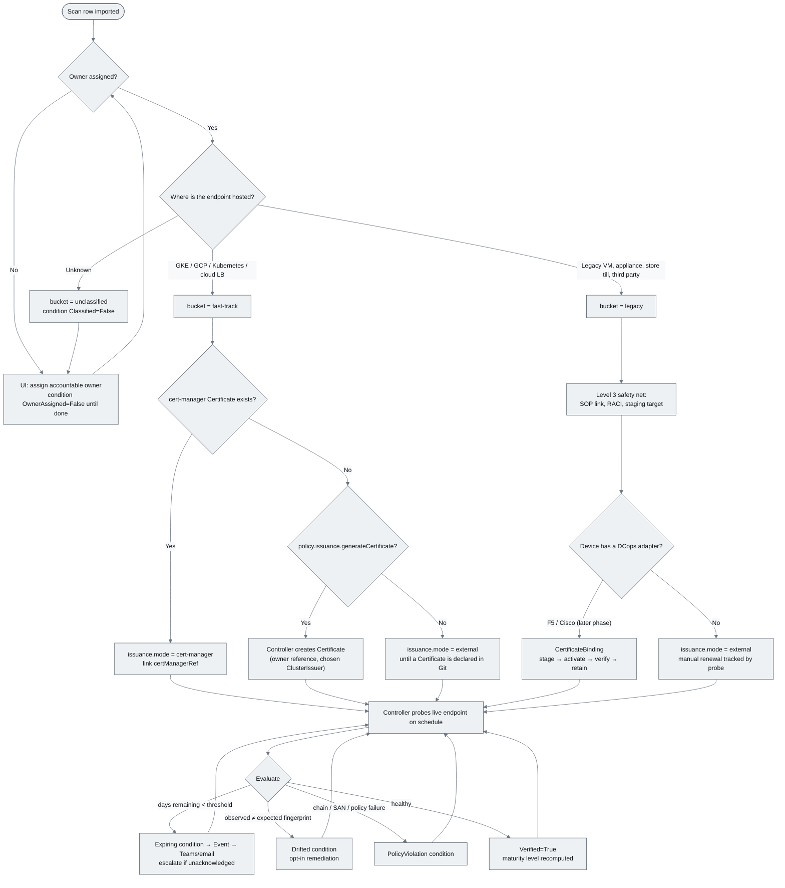
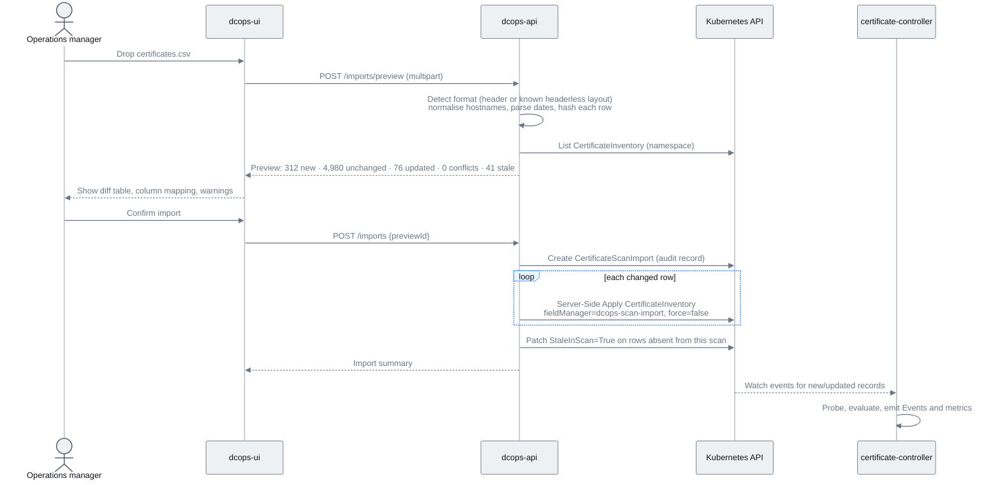

# DCops Certificate Management — Inventory, Maturity and Datadog Design

> **Type:** Architecture Design Document
> **Status:** Draft for discussion
> **Priority:** P1
> **Date:** 2026-09-08
> **Related:** `README.md` §"Certificate management beyond Kubernetes", `ADRs/ADR-001-Scope_and_Non-Goals.md` (requires amendment), `docs/01_dashboard_design.md`, `docs/CONTROLLER_RECONCILER_ARCHITECTURE.md`
> **Inputs:** *CMMI Certificate Management Maturity Scale* (T. Dziuk), *DCops Certificate Management* proposal deck, external certificate scan export (`certificates.csv`, 5,368 rows)

---

## 1. Problem statement

The organisation's certificate estate is at CMMI **Level 1–2**. The evidence is the scan export itself: a spreadsheet of 5,368 public hostnames, 1,172 of which are classified "Central management required" (manually issued Sectigo/DigiCert certificates), and 2,829 of which carry the action *"Assign accountable owner"* — meaning nobody is recorded as responsible for the majority of the estate. Renewal depends on individual heroics, alerting is undifferentiated, and there is no single source of truth.

cert-manager already solves **issuance and renewal** for anything that lives in Kubernetes. What is missing is the operational layer around it: a registry of every certificate the business depends on (whether or not cert-manager issues it), accountable ownership, policy-driven alerting and escalation, live verification that endpoints actually present the intended certificate, fleet-level metrics for Operations, and — for infrastructure that cannot consume a Kubernetes Secret — controlled delivery to F5 and Cisco devices.

This document designs that layer as a DCops controller, in a way that **extends cert-manager rather than duplicating it**, and that is operated by **non-technical Operations managers through the DCops UI**, not by engineers running `kubectl`.

## 2. Goals and non-goals

### Goals

- [ ] A **CMDB-grade certificate inventory** (`CertificateInventory` CRD) with one record per certificate-bearing endpoint, covering both cert-manager-issued and externally issued certificates, without storing anything cert-manager already stores.
- [ ] **Idempotent scan import**: an Operations manager can drop the scanner's CSV into the DCops UI repeatedly; the result converges to the same inventory, human-entered fields are never overwritten, and every import is auditable.
- [ ] **Ownership and escalation** enforced as data: every inventory record has an accountable owner or a visible `OwnerAssigned=False` condition.
- [ ] **Live verification** by the controller (TLS probe, chain validation, fingerprint comparison against cert-manager's Secret where applicable) so drift is detected rather than assumed away.
- [ ] **Datadog integration** built to `integrations-core` conventions (OpenMetrics check, curated metrics, overview dashboard, recommended monitors) so the fleet view on slide 8 of the proposal deck is real.
- [ ] A **per-record and estate-wide CMMI maturity level** computed from observed facts, so progress up the scale is measured, not asserted.
- [ ] A clear extension point (`CertificateBinding` + `CertificateAdapter` trait) for the F5/Cisco delivery pilot described in the deck, without blocking the inventory work on it.

### Non-goals

- DCops does **not** issue, sign or renew certificates. cert-manager (and the external CAs the business already uses) do that.
- DCops does **not** store private keys. Keys stay in cert-manager-managed Secrets; the controller reads them only in memory for key/cert match verification and never writes them to status, events or logs.
- The inventory does **not** replace NetBox. Where a device in the legacy bucket exists in NetBox, the record references it; it does not duplicate its DCIM fields.
- The first delivery is **observe-and-alert only**. Automatic remediation (rollout restart, device rollback) is opt-in per record and defaults to off.
- Device adapters (F5 iControl REST, Cisco RESTCONF/NETCONF/NX-API) are specified as an interface here and delivered in a later phase.

## 3. Relationship to cert-manager — where the line is

The single most important design rule: **cert-manager owns the certificate; DCops owns the operational facts about it.**

| Concern | Owner | Where it lives |
| :--- | :--- | :--- |
| Desired certificate (DNS names, issuer, duration, key algorithm) | cert-manager | `cert-manager.io/v1 Certificate` |
| Issuance, ACME challenges, renewal timing, private key | cert-manager | `Certificate` status, `Secret` |
| Ready / Issuing conditions, `notAfter`, `renewalTime` | cert-manager | `Certificate.status` |
| Which endpoints the business depends on (including ones cert-manager knows nothing about) | **DCops** | `CertificateInventory.spec` |
| Accountable owner, escalation chain, business unit, environment | **DCops** | `CertificateInventory.spec.ownership` |
| Maturity bucket (fast-track vs legacy), renewal policy, SLO thresholds | **DCops** | `CertificateInventory.spec.policy` |
| What the live endpoint *actually presents* (fingerprint, chain, SANs, expiry) | **DCops** | `CertificateInventory.status.observed` |
| Drift between cert-manager's Secret and the live endpoint | **DCops** | `CertificateInventory.status.conditions[Drifted]` |
| Delivery to non-Kubernetes targets, verification and rollback | **DCops** | `CertificateBinding` (later phase) |
| Fleet metrics, dashboards, Teams/email escalation | **DCops** + Datadog | `/metrics`, Datadog integration |

Three consequences follow.

**A `CertificateInventory` may reference a `Certificate`, but never restates it.** For a fast-track record, `spec.issuance.certManagerRef` points at the cert-manager `Certificate`. The controller *reads* that object's `status.conditions`, `status.notAfter`, `status.renewalTime` and the referenced Secret's leaf certificate, and surfaces them on the inventory record's status. It does not copy `dnsNames`, `issuerRef` or `duration` into its own spec.

**Automating a legacy certificate means creating a `Certificate`, not re-implementing one.** When an Operations manager moves a record from the legacy bucket to fast-track in the UI (the CMMI "Level 5 leap"), the controller may *generate* a cert-manager `Certificate` from the inventory record (hostnames, chosen `ClusterIssuer`, target Secret) and set an owner reference on it. This is the same relationship a Deployment has with a ReplicaSet: a derived resource, fully managed by the upstream project. Whether this generation is enabled is a per-record policy flag (`policy.issuance.generateCertificate`), defaulting to false so that GitOps-managed `Certificate` resources are never fought over.

**Externally issued certificates are first-class.** 1,172 rows in the scan are manually issued by Sectigo/DigiCert and will remain so for some time (store tills, appliances, third-party-hosted endpoints). For those, `spec.issuance.mode = external`, there is no cert-manager reference, and the *only* source of truth for observed state is the controller's own probe. This is what makes the inventory a CMDB rather than a cert-manager mirror.

## 4. The CMMI process as a flowchart

The maturity scale describes an organisational journey; the diagram below shows which DCops capability moves the estate across each boundary, and which risks (from the source document) each capability is there to close.

```mermaid
%%{init: {'theme':'base','themeVariables': {'fontFamily': 'Inter, Segoe UI, Helvetica, Arial, sans-serif', 'fontSize': '14px', 'primaryColor': '#EEF1F4', 'primaryTextColor': '#111318', 'primaryBorderColor': '#5E6672', 'secondaryColor': '#EAF3FF', 'secondaryTextColor': '#111318', 'secondaryBorderColor': '#2F80ED', 'tertiaryColor': '#EAF8F0', 'tertiaryTextColor': '#111318', 'tertiaryBorderColor': '#2FA36B', 'lineColor': '#6B7684', 'textColor': '#6B7684', 'nodeBorder': '#5E6672', 'nodeTextColor': '#111318', 'mainBkg': '#EEF1F4', 'clusterBkg': '#F7F9FB', 'clusterBorder': '#BAC1C9', 'titleColor': '#111318', 'edgeLabelBackground': '#F7F9FB', 'actorBkg': '#EEF1F4', 'actorBorder': '#5E6672', 'actorTextColor': '#111318', 'actorLineColor': '#BAC1C9', 'signalColor': '#6B7684', 'signalTextColor': '#6B7684', 'labelBoxBkgColor': '#EAF3FF', 'labelBoxBorderColor': '#2F80ED', 'labelTextColor': '#111318', 'loopTextColor': '#111318', 'noteBkgColor': '#FFF6E7', 'noteBorderColor': '#E6A23C', 'noteTextColor': '#111318', 'activationBkgColor': '#DCE6F7', 'activationBorderColor': '#2F80ED', 'sequenceNumberColor': '#FFFFFF', 'labelColor': '#111318', 'altBackground': '#F7F9FB', 'attributeBackgroundColorOdd': '#FFFFFF', 'attributeBackgroundColorEven': '#F7F9FB', 'classText': '#111318'}}}%%
flowchart TB
    L1["Level 1 — Initial<br/>Reactive & ad-hoc<br/><i>spreadsheets, heroics, shadow certs</i>"]
    L2["Level 2 — Managed<br/>Planned & tracked<br/><i>central inventory, manual alerts</i>"]
    L3["Level 3 — Defined<br/>Standardised & documented<br/><i>SOPs, RACI, staging-first rotation</i>"]
    L4["Level 4 — Quantitatively managed<br/>Measured & controlled<br/><i>SLOs, time-to-rotate, dashboard</i>"]
    L5["Level 5 — Optimising<br/>Continuous improvement<br/><i>self-renewing, self-healing, continuous audit</i>"]

    L1 -->|"Step 1"| L2 -->|"Step 2"| L3 -->|"Step 3"| L4 -->|"Step 4"| L5

    subgraph S1["Step 1 — DCops capability"]
        direction LR
        A1["Scan import<br/>(CSV → CertificateInventory, idempotent)"]
        A2["Owner assignment in UI<br/>OwnerAssigned condition"]
        A3["Expiry conditions<br/>90 / 60 / 30 / 14 / 7 days → Events"]
    end

    subgraph S2["Step 2 — DCops capability"]
        direction LR
        B1["Escalation policy<br/>unacknowledged alert → secondary owner"]
        B2["Bucket classification<br/>fast-track vs legacy"]
        B3["Staging target reference<br/>rotate in staging first"]
    end

    subgraph S3["Step 3 — DCops capability"]
        direction LR
        C1["Live TLS probe<br/>observed fingerprint, chain, SANs"]
        C2["Prometheus /metrics<br/>days_remaining, drift, probe_success"]
        C3["Datadog integration<br/>fleet dashboard, SLO monitors"]
    end

    subgraph S4["Step 4 — DCops capability"]
        direction LR
        D1["cert-manager Certificate generation<br/>for fast-track records"]
        D2["Drift detection<br/>Secret leaf ≠ live endpoint"]
        D3["Opt-in remediation<br/>rollout restart · CertificateBinding rollback"]
    end

    L1 -.-> S1 -.-> L2
    L2 -.-> S2 -.-> L3
    L3 -.-> S3 -.-> L4
    L4 -.-> S4 -.-> L5

    R1["Closes: unexpected expiry outage,<br/>key-person dependency, no visibility"]
    R2["Closes: alert fatigue,<br/>process silos"]
    R3["Closes: human error in CSR/install,<br/>slow hand-offs"]
    R4["Closes: metric overload,<br/>legacy debt (via adapters)"]
    R5["Closes: blind trust in automation,<br/>configuration drift"]

    S1 --- R1
    S2 --- R2
    S3 --- R3
    S4 --- R4
    L5 --- R5
    style S1 fill:transparent,stroke:#8A94A6,stroke-width:1.5px,stroke-dasharray:4 3
    style S2 fill:transparent,stroke:#8A94A6,stroke-width:1.5px,stroke-dasharray:4 3
    style S3 fill:transparent,stroke:#8A94A6,stroke-width:1.5px,stroke-dasharray:4 3
    style S4 fill:transparent,stroke:#8A94A6,stroke-width:1.5px,stroke-dasharray:4 3
```



The source document's *Phase-by-Phase Execution Playbook* cuts across those steps rather than following them in order. Mapped onto DCops it becomes a single decision flow that every inventory record goes through:



## 5. `CertificateInventory` CRD

Group `dcops.microscaler.io`, version `v1alpha1`, namespaced, defined in `crates/crds/src/certificates/certificate_inventory.rs`. Kubernetes `metadata.name` accepts DNS subdomain names up to 253 characters, so the **hostname itself is the record name** (`www-dev.metro-vto.es`). That is what makes import idempotent without a lookup table.

### 5.1 Spec

```yaml
apiVersion: dcops.microscaler.io/v1alpha1
kind: CertificateInventory
metadata:
  name: www-dev.metro-vto.es
  namespace: certificates
  labels:
    dcops.microscaler.io/bucket: legacy
    dcops.microscaler.io/owner-team: platform
    dcops.microscaler.io/severity: critical
  annotations:
    dcops.microscaler.io/scan-source: bitsight            # set by importer (SSA manager: dcops-scan-import)
    dcops.microscaler.io/scan-row-hash: "sha256:9f1c…"    # set by importer
    dcops.microscaler.io/scan-last-seen: "2026-09-08"     # set by importer
spec:
  endpoints:                      # what the controller probes
    - host: www-dev.metro-vto.es
      port: 443
      sni: www-dev.metro-vto.es
  ownership:                      # human-owned — importer never writes these
    team: platform
    contact: platform-oncall@example.com
    escalation:
      - after: 14d               # unacknowledged at 14 days → escalate
        to: platform-lead@example.com
      - after: 7d
        to: security@example.com
    businessUnits: ["METRO France", "METRO digital"]
    environment: production
  bucket: legacy                  # fast-track | legacy | unclassified
  issuance:
    mode: external                # cert-manager | external | unknown
    expectedIssuers: ["Sectigo Limited"]
    # certManagerRef:             # only when mode = cert-manager
    #   name: www-dev-metro-vto-es
    #   namespace: web-frontend
  policy:
    renewalReminders: [90d, 60d, 30d, 14d, 7d]
    sloMinimumRemaining: 30d      # from the CMMI document's Level 4 SLO
    probeInterval: 6h
    autoRemediate: false          # Level 5 opt-in
    issuance:
      generateCertificate: false  # Level 5 opt-in for fast-track records
      clusterIssuer: letsencrypt-prod
  acknowledgement:                # set from the UI when an alert is actioned
    by: charles
    at: "2026-09-08T09:12:00Z"
    note: "Renewal ticket INC-4411 raised"
  references:
    netboxDevice: null            # NetBoxDevice CR name for legacy bucket devices
    sop: "https://wiki.example.com/certs/legacy-renewal"
```

### 5.2 Status

```yaml
status:
  observed:                       # from the controller's own probe
    fingerprintSha256: "AB:CD:…"
    issuer: "CN=Sectigo RSA Domain Validation Secure Server CA"
    subjectAltNames: ["www-dev.metro-vto.es"]
    notBefore: "2026-04-14T00:00:00Z"
    notAfter:  "2026-12-20T23:59:59Z"
    daysRemaining: 103
    chainValid: true
    probedAt: "2026-09-08T08:40:12Z"
    probeError: null
  certManager:                    # only when issuance.mode = cert-manager (read-through, never copied into spec)
    ready: true
    renewalTime: "2026-11-20T00:00:00Z"
    secretFingerprintSha256: "AB:CD:…"
  maturityLevel: 2                # computed, see §7
  scan:
    lastSeen: "2026-09-08"
    classification: "Central management required"
    recommendedAction: "Onboard certificate and owner into central lifecycle management"
  conditions:
    - type: OwnerAssigned      # Level 2 gate
      status: "True"
    - type: Classified         # bucket != unclassified
      status: "True"
    - type: Probed             # controller has reached the endpoint
      status: "True"
    - type: Expiring           # daysRemaining below the nearest reminder threshold
      status: "False"
    - type: SloBreached        # daysRemaining < policy.sloMinimumRemaining
      status: "False"
    - type: Drifted            # observed fingerprint ≠ cert-manager Secret leaf (fast-track only)
      status: "False"
    - type: PolicyViolation    # issuer not in expectedIssuers, chain invalid, SAN mismatch
      status: "False"
    - type: IssuanceAutomated  # cert-manager Ready=True, or adapter-verified
      status: "False"
    - type: Verified           # everything above healthy at last probe
      status: "True"
    - type: StaleInScan        # not present in the most recent import
      status: "False"
```

### 5.3 Reconciler behaviour

Modelled on the netbox controller (`KubeApiTrait`, `EventRecorderTrait`, `SecretFetcher`, `BackoffCalculator`), not the `todo!()` stubs.

1. **Resolve** — if `issuance.mode = cert-manager`, fetch the referenced `Certificate` and its Secret (in memory only); extract the leaf fingerprint and cert-manager's Ready/renewal status.
2. **Probe** — open a TLS connection to each endpoint with SNI, capture the presented chain, validate against the system trust store (rustls + webpki, already workspace dependencies), compute SHA-256 fingerprint, SANs, notAfter.
3. **Evaluate** — set conditions in the order above; a condition transition emits a Kubernetes Event (`Normal` for recoveries, `Warning` for Expiring/Drifted/PolicyViolation/SloBreached).
4. **Escalate** — when `Expiring=True` and `acknowledgement.at` is older than the matching `ownership.escalation[].after`, emit an `Escalated` Event carrying the next contact. Teams/email fan-out is done by Datadog monitors on the resulting metric (see §8), which avoids building a notification subsystem into the controller.
5. **Remediate (opt-in)** — when `Drifted=True` and `policy.autoRemediate = true`: for fast-track records, annotate the workload referenced by the `Certificate`'s Secret consumers to trigger a rollout; for legacy records with a `CertificateBinding`, hand off to the binding reconciler. Anything else is alert-only.
6. **Export metrics** and requeue at `policy.probeInterval`, with bounded backoff on probe failure.

The reconciler never mutates `spec`. Server-Side Apply field ownership (§6.3) is what keeps importer, UI and Git from overwriting each other.

## 6. Idempotent scan import from the DCops UI

### 6.1 Why a backend is now required

The current `dcops-ui` is a read-only SolidJS SPA that talks straight to the Kubernetes API through a `ClusterRole` limited to `get`/`list` on `dcops.microscaler.io` (`config/dcops-ui/role.yaml`), and `docs/01_dashboard_design.md` lists "no custom backend" and "no write operations" as Phase 1 non-goals. An Operations manager uploading a CSV is a write, and it is a write that must be validated, previewed and audited — exactly the logic that should not live in a browser holding a cluster-admin token.

The design therefore adds **`dcops-api`**, a small `axum` service (axum and tower-http are already workspace dependencies) in `controllers/certificate/src/api/`, running in the same binary as the certificate controller so it shares the typed CRD models and the Kubernetes client. It exposes:

| Route | Purpose |
| :--- | :--- |
| `POST /api/v1/certificates/imports/preview` | Parse CSV, return a diff (create / update / unchanged / conflict / stale) without writing |
| `POST /api/v1/certificates/imports` | Apply a previewed import; returns the `CertificateScanImport` record |
| `GET /api/v1/certificates/imports/{id}` | Import status and per-row outcomes |
| `PATCH /api/v1/certificates/{name}/ownership` | Assign owner, bucket, acknowledgement — the Level 2 actions |
| `GET /api/v1/certificates?bucket=&owner=&state=` | Filtered list backing the table on deck slide 9 |

Authentication is out of scope for this document but the API is designed so a reverse-proxy OIDC layer (Envoy Gateway is already the dev edge) can inject the user identity that is recorded in `acknowledgement.by` and on each import.

### 6.2 The import flow



### 6.3 Idempotency guarantees

**Deterministic identity.** The record name is the normalised hostname (lower-cased, IDNA-encoded, trailing dot stripped). Re-importing the same scan resolves to the same objects; two scanners reporting the same host converge on one record.

**Field ownership, not last-writer-wins.** Every import writes with Server-Side Apply using the field manager `dcops-scan-import`. The importer only ever applies the fields it derives from the scan: `spec.endpoints`, `spec.issuance.expectedIssuers` (when `mode` is still `unknown`), `status.scan.*` via the status subresource, and the `scan-*` annotations. It never touches `spec.ownership`, `spec.bucket`, `spec.policy` or `spec.acknowledgement`. Those are owned by the UI (`dcops-ui`) or by Git (`kubectl`/Flux). Because SSA refuses to overwrite fields owned by another manager unless `force` is set, a human's owner assignment survives every subsequent import by construction, not by convention.

**Content hashing.** Each row's canonical form is hashed and stored in `dcops.microscaler.io/scan-row-hash`. Rows whose hash matches the stored annotation are skipped entirely, so re-importing an unchanged scan produces zero API writes and an audit record saying so.

**Never delete.** A hostname missing from the newest scan gets `StaleInScan=True` and `status.scan.lastSeen` left at the previous date. Records are removed only by an explicit UI action or a Git deletion, matching DCops's existing orphan-policy stance.

**Scanner-specific parsing lives in one place.** The current export is headerless; `dcops-api` ships a `ScanFormat` trait with an implementation for this layout (host, observed count, first seen, expiry, classification, business units, issuers, automation flag, severity, recommended action) and auto-detects it from column count and value shapes. A header row from a different tool maps through the same trait. Column mapping is shown in the preview so the Operations manager can correct it without engineering help.

**Auditability.** `CertificateScanImport` is itself a CRD: who imported, when, source hash, row counts by outcome, and per-row errors. It is what a Level 2 auditor asks for and what the UI's "import history" page lists.

### 6.4 What the Operations manager sees

The UI adds a *Certificates* section alongside the existing IPAM/DCIM/Tenancy/Boot categories, with three screens: the inventory table from deck slide 9 (target, vendor/bucket, certificate, expires, state, owner, with the state column driven directly by the conditions in §5.2); an import wizard (upload → mapping and preview → confirm → summary); and a record detail page showing observed vs expected fingerprint, event history, planned action and an *Assign owner / Acknowledge / Change bucket* panel. None of these screens expose YAML.

## 7. Computing the maturity level

The CMMI level is stored per record so it can be aggregated by owner, business unit, site or bucket. It is derived, never set by hand:

| Level | Condition on the record |
| :--- | :--- |
| 1 | Present in inventory but `OwnerAssigned=False` or `Classified=False` |
| 2 | Owner assigned and classified; alerting active (`Probed=True`) |
| 3 | Level 2 and (`references.sop` set or `bucket = fast-track`) and escalation chain defined |
| 4 | Level 3 and record has been continuously probed for ≥ 30 days with no `SloBreached` and metrics exported |
| 5 | Level 4 and `IssuanceAutomated=True` and no `Drifted` in the last 90 days |

The estate-wide level is the *minimum* level across production records weighted by severity — a single unowned Critical certificate keeps the estate at Level 1, which is what the source document intends. The distribution (how many records at each level) is the headline metric on the Operations dashboard.

## 8. Datadog integration (`integrations-core` conventions)

The deck's Operations dashboard is delivered as a proper Datadog integration rather than ad-hoc custom metrics. The reference implementation in `integrations-core` is `cert_manager/`, which is an `OpenMetricsBaseCheckV2` scraping a Prometheus endpoint — precisely the shape of a Rust controller exposing `/metrics`. The DCops integration mirrors it.

### 8.1 Controller side — Prometheus exposition

The certificate controller exposes `/metrics` on the same axum server as `dcops-api` (the `prometheus` crate is already a workspace dependency). Metric names follow Prometheus conventions and carry only low-cardinality labels; the hostname is a label because the fleet is ~5k, which is within Datadog's per-metric tag budget, but business units are *not* a label (multi-valued) and are instead aggregated via the `owner_team` and `environment` tags.

| Metric | Type | Labels | Meaning |
| :--- | :--- | :--- | :--- |
| `dcops_certificate_expiration_timestamp_seconds` | gauge | host, namespace, bucket, owner_team, environment, severity, issuance_mode | `notAfter` as epoch; matches cert-manager's metric so the two are comparable |
| `dcops_certificate_days_remaining` | gauge | same | Convenience for SLO monitors |
| `dcops_certificate_probe_success` | gauge (0/1) | same | Last probe reached endpoint and parsed chain |
| `dcops_certificate_chain_valid` | gauge (0/1) | same | Chain validates against trust store |
| `dcops_certificate_drift` | gauge (0/1) | same | Observed ≠ expected (cert-manager or adapter) |
| `dcops_certificate_condition` | gauge (0/1) | same + condition | One series per condition type in §5.2 |
| `dcops_certificate_maturity_level` | gauge (1–5) | same | Per-record CMMI level |
| `dcops_certificate_owner_assigned` | gauge (0/1) | same | Level 2 gate |
| `dcops_certificate_escalations_total` | counter | host, namespace, owner_team, level | Escalation events emitted |
| `dcops_scan_import_rows_total` | counter | outcome (created/updated/unchanged/conflict/stale/error) | Import audit |
| `dcops_scan_import_last_timestamp_seconds` | gauge | source | Freshness of the inventory |
| `dcops_controller_reconcile_total` | counter | kind, result | Shared with other DCops controllers |
| `dcops_controller_reconcile_duration_seconds` | histogram | kind | Shared |

### 8.2 Integration layout

Following `datadog_checks_dev/.../templates/integration/check` and the rules in `integrations-core/AGENTS.md` (new integrations: no `manifest.json`, metadata in `.ddev/config.toml`; no bespoke service checks — the inherited `dcops.openmetrics.health` is the only one; type-hinted modern Python):

```text
dcops/
├── README.md                              # overview, setup (Autodiscovery annotation on the controller pod), data collected
├── CHANGELOG.md
├── changelog.d/1.added
├── pyproject.toml / hatch.toml
├── metadata.csv                           # one row per metric above, prefix dcops.
├── assets/
│   ├── configuration/spec.yaml            # init_config/openmetrics + instances/openmetrics templates
│   ├── dataflows.yaml
│   ├── dashboards/dcops_certificates_overview.json   # the deck's slide 8
│   └── monitors/
│       ├── certificate_expiring.json      # days_remaining < 30 by owner_team (Level 4 SLO) — warn 30, critical 14
│       ├── certificate_drift.json         # drift == 1 for > 1 probe interval
│       ├── certificate_unowned.json       # owner_assigned == 0 on severity:critical
│       └── inventory_stale.json           # scan_import_last_timestamp older than 7 days
├── datadog_checks/dcops/
│   ├── __about__.py / __init__.py
│   ├── check.py                           # class DcopsCheck(OpenMetricsBaseCheckV2): __NAMESPACE__ = 'dcops'
│   ├── metrics.py                         # METRIC_MAP: dcops_certificate_days_remaining → certificate.days_remaining, …
│   ├── config_models/                     # generated by `ddev validate models -s dcops --sync`
│   └── data/conf.yaml.example
└── tests/
    ├── conftest.py, common.py
    ├── fixtures/dcops.txt                 # captured /metrics payload
    ├── test_dcops.py                      # unit: fixture → expected metrics
    └── test_e2e.py                        # kind cluster with the controller, as cert_manager/tests/kubernetes does
```

Since `integrations-core` is Datadog's repository for Datadog-authored checks, the realistic destination for a Microscaler-authored integration is `integrations-extras` (community) or a private Agent check deployed with the DCops Helm/kustomize bundle; the layout, validation (`ddev validate config|models|metadata`) and test conventions are identical, so building it in a fork of `integrations-core` first is the fastest path and keeps the option of upstreaming.

### 8.3 Notifications

Teams and email fan-out from deck slide 10 is delivered through Datadog monitor notification channels (`@teams-platform-certs`, `@platform-lead@example.com`) with the *renewal due / succeeded / failed* wording in the monitor message templates, using `owner_team` tag variables to route each alert to the right owner. This keeps the controller free of SMTP/webhook code and lets Operations edit escalation wording without a deploy. The "renewal succeeded" notification fires on the recovery of `certificate_expiring` *only when* `dcops_certificate_condition{condition="Verified"} == 1`, which enforces the deck's rule that success is announced after live verification.

## 9. Extension point for device delivery

`CertificateBinding` (fast-track Secret → legacy target) is deliberately out of this phase, but the inventory is designed to attach to it: `spec.references` will gain `bindings: [name]`, the `Drifted` condition will compare against the binding's last verified fingerprint, and `IssuanceAutomated` will become true when the binding reports `Verified`. The adapter contract from deck slide 7 is fixed now so the F5 pilot can start independently:

```rust
#[async_trait]
pub trait CertificateAdapter: Send + Sync {
    async fn discover_capabilities(&self, target: &Target) -> Result<Capabilities, AdapterError>;
    async fn inspect(&self, target: &Target) -> Result<ObservedBinding, AdapterError>;
    async fn stage(&self, target: &Target, bundle: &CertBundle) -> Result<StagedObjects, AdapterError>;
    async fn activate(&self, target: &Target, staged: &StagedObjects) -> Result<(), AdapterError>;
    async fn verify(&self, target: &Target, expected: &Fingerprint) -> Result<Verification, AdapterError>;
    async fn rollback(&self, target: &Target, last_known_good: &StagedObjects) -> Result<(), AdapterError>;
    async fn cleanup(&self, target: &Target, unreferenced: &[ObjectRef]) -> Result<(), AdapterError>;
}
```

`Capabilities` carries an explicit `Unsupported(reason)` variant; the reconciler surfaces it as a condition and never falls back to an ad-hoc SSH path.

## 10. Repository changes

| Path | Change |
| :--- | :--- |
| `ADRs/ADR-002-Certificate_Management_Scope.md` | Amend ADR-001's locked scope: add certificate inventory, verification and delivery as a phased capability; restate the cert-manager boundary from §3 |
| `crates/crds/src/certificates/{mod,certificate_inventory,certificate_scan_import,certificate_binding}.rs` | New CRDs; re-exported from `lib.rs`; regenerated into `config/crd/all-crds.yaml` |
| `controllers/certificate/` | New workspace member: `main.rs`, `controller.rs`, `reconciler/inventory.rs`, `probe/`, `api/` (axum routes, `ScanFormat` trait), `metrics.rs`, tests with mocked `KubeApiTrait` |
| `Cargo.toml` | Add member; add `x509-parser` / `rustls-pki-types`, `csv`, `sha2` |
| `config/certificate-controller/` | Deployment, Service (metrics + api), ClusterRole (read `cert-manager.io` Certificates and referenced Secrets; write `dcops.microscaler.io` certificate resources), HTTPRoute for `/api` |
| `config/dcops-ui/role.yaml` | Unchanged — the SPA stays read-only; writes go through `dcops-api` |
| `ui/src/api/k8s-client.ts` | Add `certificateinventories`, `certificatescanimports`, `certificatebindings` to `CRD_CATEGORY_MAP` under a new `certificates` category |
| `ui/src/components/certificates/` | Inventory table, import wizard, record detail |
| `dockerfiles/Dockerfile.certificate-controller{,.dev}`, `Tiltfile`, `justfile` | Build and dev wiring, `just cert-import <csv>` for engineers |
| `docs/implementationChecklists/CertificateInventory.md` | Per the house template |
| `<integrations fork>/dcops/` | Datadog integration per §8.2 |

## 11. Delivery phases

| Phase | Outcome | CMMI effect |
| :--- | :--- | :--- |
| **0 — Foundation** | ADR-002, CRDs, controller skeleton on netbox-controller traits, `/metrics` with reconcile counters | — |
| **1 — Inventory** | CSV import via `dcops-api` with preview and SSA idempotency, UI import wizard and owner assignment, `OwnerAssigned`/`Classified` conditions, Kubernetes Events | Estate measurably at Level 2 |
| **2 — Verification** | TLS probe, chain validation, all conditions in §5.2, cert-manager read-through, Datadog integration with dashboard and the four monitors, Teams/email routing | Level 3 → 4 for owned records |
| **3 — Automation** | Optional `Certificate` generation for fast-track records, drift detection against the Secret, opt-in rollout-restart remediation, maturity level computation | Fast-track bucket at Level 5 |
| **4 — Delivery** | `CertificateBinding`, mock adapter, F5 iControl REST pilot with verified rollback (deck slide 13) | Legacy bucket begins its Level 5 path |

## 12. Open questions

1. **Git as source of truth for ownership.** Owner and bucket are written by the UI, not by Git. Options: (a) accept that ownership is operational data like NetBox inventory and keep it cluster-resident with `CertificateScanImport` as the audit trail; (b) have `dcops-api` open a pull request against the GitOps repo for every UI change so Git remains authoritative. (b) is purer but adds a Git integration and a review delay that Operations managers may find obstructive. This document assumes (a) for Phase 1 with (b) as a Phase 3 option.
2. **Scan column semantics.** The headerless export's `Yes/No` column correlates strongly with ACME issuers and is assumed to mean "renewal appears automated"; the integer column is assumed to be an observation count. Both should be confirmed with the scan's producer before the `ScanFormat` implementation is finalised.
3. **Probe egress.** The controller must reach every inventoried endpoint from the management cluster. Endpoints only reachable from inside a store or DC network will need a probe agent or `Probed=False` handling; this is the same question the legacy-bucket adapters will face.
4. **Namespace model.** One `certificates` namespace with labels, or one namespace per business unit for RBAC? The UI filters either way; RBAC on `PATCH /ownership` is easier per namespace.
5. **Integration destination.** `integrations-extras` upstream versus a private check shipped with DCops. Affects nothing in the design, only the release process.
